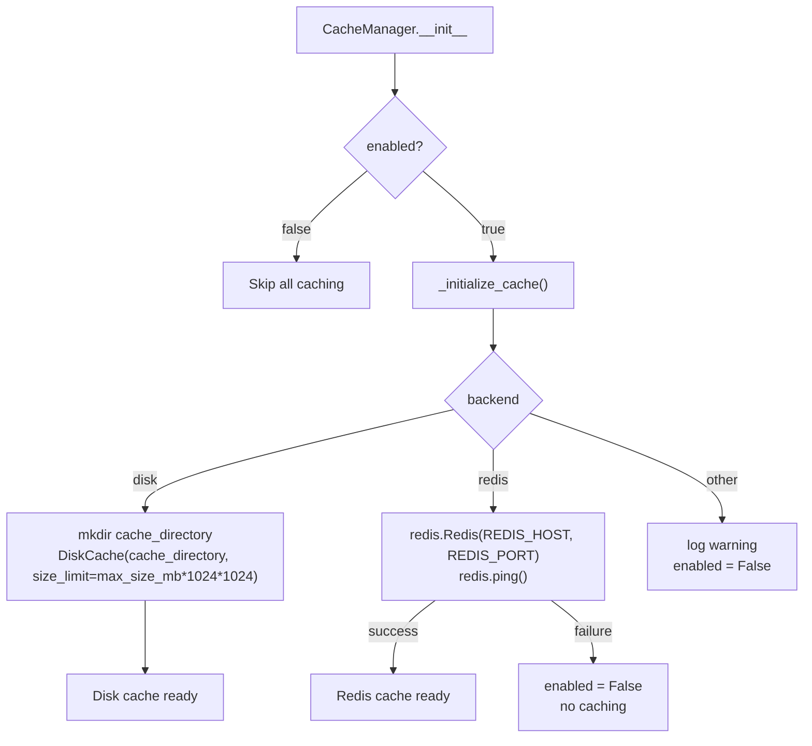
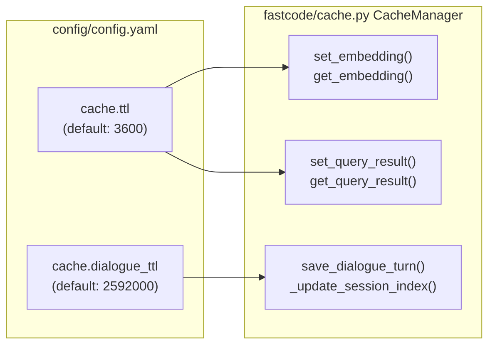
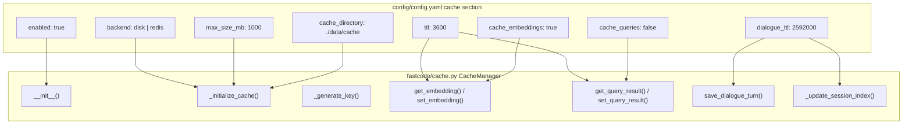

<!-- source: DeepWiki mcp.deepwiki.com · repo HKUDS/FastCode · page 8.10 Cache Configuration · fetched 2026-11-09 -->

# Cache Configuration

<details>
<summary>Relevant source files</summary>

The following files were used as context for generating this wiki page:

- [config/config.yaml](config/config.yaml)
- [fastcode/cache.py](fastcode/cache.py)
- [fastcode/embedder.py](fastcode/embedder.py)

</details>


This page documents the `cache` section of `config/config.yaml`, covering each key's type, default value, and behavioral effect on the `CacheManager` class in `fastcode/cache.py`. For a deeper look at how `CacheManager` operates at runtime — including session indexing, TTL management, and the dialogue turn key structure — see [Caching System](#9.1). For Redis and disk volume setup in production, see [Production Considerations](#7.4).

---

## Purpose

The cache layer in FastCode reduces redundant computation by storing:

- **Embeddings** — vector representations of code elements, avoiding re-encoding on repeated ingestion.
- **Query results** — previously computed retrieval results for identical queries against the same repository state.
- **Dialogue sessions** — per-session turn history for multi-turn conversation continuity.

All three categories are controlled through the `cache` block in `config/config.yaml` and consumed by `CacheManager.__init__` at startup.

---

## Configuration Keys

The full `cache` block with defaults as shipped:

[config/config.yaml:182-191]()

| Key | Type | Default | Description |
|---|---|---|---|
| `enabled` | `bool` | `true` | Master switch. When `false`, `CacheManager` skips all backend initialization and all `get`/`set` calls return `None`/`False`. |
| `backend` | `string` | `"disk"` | Storage backend. Accepts `"disk"` (via `diskcache`) or `"redis"`. |
| `ttl` | `int` | `3600` | Default time-to-live in seconds for embeddings and general cache entries. Applied via `DiskCache.set(expire=ttl)` or `redis.setex(ttl, ...)`. |
| `dialogue_ttl` | `int` | `2592000` | TTL in seconds for dialogue session entries. Kept long (30 days) so conversation history persists across server restarts. Applied to both turn keys and session index keys. |
| `max_size_mb` | `int` | `1000` | Maximum disk cache size in megabytes. Converted to bytes and passed as `size_limit` to `DiskCache`. Has no effect on Redis (Redis manages its own memory limits). |
| `cache_embeddings` | `bool` | `true` | When `true`, `get_embedding` and `set_embedding` are active. When `false`, those methods short-circuit to `None`/`False` immediately. |
| `cache_queries` | `bool` | `false` | When `true`, `get_query_result` and `set_query_result` are active. Disabled by default because query results can go stale after re-indexing. |
| `cache_directory` | `string` | `"./data/cache"` | Filesystem path for the disk backend. Created with `mkdir(parents=True, exist_ok=True)` on first startup. |

Sources: [config/config.yaml:182-191](), [fastcode/cache.py:19-35]()

---

## Backend Behavior

**How `CacheManager` reads the config:**

[fastcode/cache.py:19-69]()

The `_initialize_cache` method branches on `backend`:

- `"disk"` → instantiates `diskcache.Cache` pointed at `cache_directory`, with `size_limit = max_size_mb * 1024 * 1024`.
- `"redis"` → connects using `REDIS_HOST` and `REDIS_PORT` environment variables (defaults: `localhost:6379`). If `redis.ping()` fails, `enabled` is set to `False` and no further caching occurs.
- Any other value → logs a warning and sets `enabled = False`.

**Backend initialization flowchart:**



Sources: [fastcode/cache.py:41-69]()

---

## TTL Separation: General vs. Dialogue

Two distinct TTL values serve different use cases:

| Setting | Key | Default | Used By |
|---|---|---|---|
| `ttl` | `cache.ttl` | 3600 s (1 hr) | Embedding cache entries, query result cache entries |
| `dialogue_ttl` | `cache.dialogue_ttl` | 2592000 s (30 days) | Dialogue turn keys (`dialogue_{session_id}_turn_{n}`), session index keys (`dialogue_session_{session_id}_index`) |

The `set` method accepts an optional `ttl` argument. When omitted, it falls back to `self.ttl`. Dialogue methods explicitly pass `self.dialogue_ttl`:

[fastcode/cache.py:247-249]()
[fastcode/cache.py:373-374]()

**TTL application by cache type:**



Sources: [fastcode/cache.py:101-120](), [fastcode/cache.py:154-180](), [fastcode/cache.py:209-258](), [fastcode/cache.py:353-378]()

---

## Embedding Cache

Controlled by `cache_embeddings`. When enabled, the `CodeEmbedder` can avoid re-generating vectors for code text it has already processed.

- **Cache key**: MD5 hash of the raw text, prefixed with `"embedding_"`.
- **TTL**: uses the general `ttl` setting.
- **Guard**: `get_embedding` and `set_embedding` both check `cache_embeddings` before doing anything.

[fastcode/cache.py:154-166]()

To disable embedding caching (e.g., during development when the model changes frequently), set:

```yaml
cache:
  cache_embeddings: false
```

Sources: [fastcode/cache.py:154-166](), [fastcode/embedder.py:1-10]()

---

## Query Result Cache

Controlled by `cache_queries`. Disabled by default because indexed content changes between re-indexing runs, and stale results would return outdated code.

- **Cache key**: MD5 hash of `(query, repo_hash)`.
- **TTL**: uses the general `ttl` setting.

[fastcode/cache.py:168-180]()

Enable only if the repository content is stable and repeated identical queries are common:

```yaml
cache:
  cache_queries: true
  ttl: 7200  # increase if re-indexing is infrequent
```

Sources: [fastcode/cache.py:168-180]()

---

## Dialogue Session Cache

Session data uses a structured key naming convention independent of `_generate_key`:

| Key Pattern | Content | TTL |
|---|---|---|
| `dialogue_{session_id}_turn_{n}` | Full turn data: query, answer, summary, retrieved elements, metadata | `dialogue_ttl` |
| `dialogue_session_{session_id}_index` | Session metadata: `total_turns`, `created_at`, `last_updated`, `multi_turn` flag | `dialogue_ttl` |

The `list_sessions` method scans for keys matching `dialogue_session_*_index` — on disk via `cache.iterkeys()`, on Redis via `cache.scan_iter()`.

[fastcode/cache.py:423-463]()

To reduce storage use for sessions, lower `dialogue_ttl`:

```yaml
cache:
  dialogue_ttl: 604800  # 7 days instead of 30
```

Sources: [fastcode/cache.py:207-260](), [fastcode/cache.py:353-384](), [fastcode/cache.py:423-463]()

---

## Configuration Reference Summary



Sources: [fastcode/cache.py:19-69](), [config/config.yaml:182-191]()

---

## Redis-Specific Notes

When `backend: "redis"`, the `max_size_mb` and `cache_directory` settings are ignored. Redis connection parameters come from environment variables:

| Env Variable | Default | Used For |
|---|---|---|
| `REDIS_HOST` | `localhost` | Redis server hostname |
| `REDIS_PORT` | `6379` | Redis server port |

If the Redis connection fails at startup, `CacheManager` sets `self.enabled = False` rather than crashing. All subsequent cache calls silently return `None` or `False`, so FastCode continues operating without caching.

[fastcode/cache.py:52-65]()

For Docker Compose Redis setup, see [Docker Compose Setup](#7.2) and [Environment Configuration](#2.2).

Sources: [fastcode/cache.py:52-65]()

---

