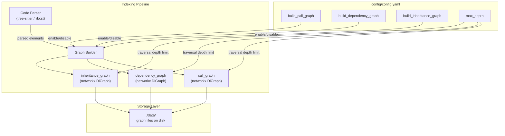
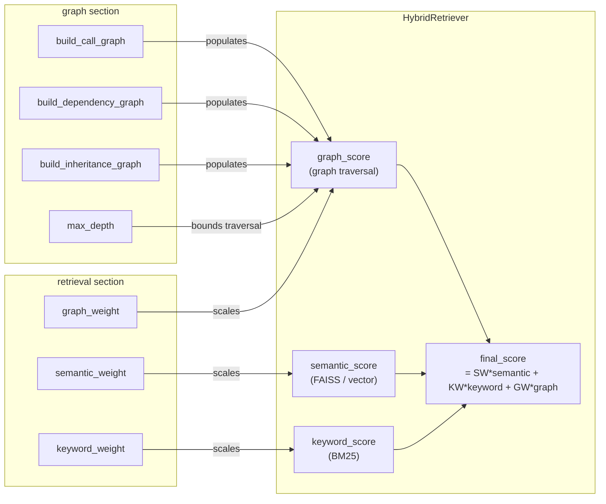

<!-- source: DeepWiki mcp.deepwiki.com · repo HKUDS/FastCode · page 8.11 Graph Configuration · fetched 2026-11-09 -->

# Graph Configuration

<details>
<summary>Relevant source files</summary>

The following files were used as context for generating this wiki page:

- [config/config.yaml](config/config.yaml)
- [fastcode/embedder.py](fastcode/embedder.py)

</details>


This page documents the `graph` section of `config/config.yaml`, which controls whether each of the three code relationship graphs is built during repository indexing and how deep graph traversal runs during retrieval. This is distinct from the hybrid retrieval weights that govern how much the graph score influences final ranking — those are covered in [Retrieval Configuration](#8.6). For a conceptual explanation of what the graphs contain and how they interact with the retrieval system, see [Multi-Layer Graph Modeling](#3.4).

---

## Configuration Block

The `graph` section appears at [config/config.yaml:162-167]():

```yaml
# Graph Building
graph:
  build_call_graph: true
  build_dependency_graph: true
  build_inheritance_graph: true
  max_depth: 5
```

All four keys are required when the section is present. Omitting a boolean flag causes the corresponding graph to fall back to its default behavior (described below).

---

## Settings Reference

| Key | Type | Default | Description |
|---|---|---|---|
| `build_call_graph` | boolean | `true` | Build a directed graph of function-to-function call relationships |
| `build_dependency_graph` | boolean | `true` | Build a directed graph of module/file import dependencies |
| `build_inheritance_graph` | boolean | `true` | Build a directed graph of class-to-class inheritance relationships |
| `max_depth` | integer | `5` | Maximum edge-hop depth used when traversing any graph during retrieval |

Sources: [config/config.yaml:162-167]()

---

## Graph Types

**Call graph** (`build_call_graph`)

Captures which functions invoke which other functions. A directed edge is added from caller to callee. This graph is the most dense of the three for most codebases because function calls are far more frequent than imports or inheritance.

**Dependency graph** (`build_dependency_graph`)

Captures file-level or module-level import relationships. A directed edge is added from the importing file to the imported module. This graph is useful for understanding which parts of the codebase depend on a given module.

**Inheritance graph** (`build_inheritance_graph`)

Captures class-to-class inheritance. A directed edge is added from the subclass to the base class. This graph is useful for answering questions about class hierarchies and polymorphism.

Sources: [config/config.yaml:162-167]()

---

## How Graphs Are Built

**Graph construction at index time**

The three graphs are constructed as part of the indexing pipeline after code elements have been parsed. Each graph is represented using `networkx` and persisted to disk alongside the vector store and BM25 index.

**Diagram: Graph Configuration → Index-Time Components**



Sources: [config/config.yaml:162-167]()

---

## How `max_depth` Affects Retrieval

When a code element is retrieved as a candidate during hybrid search, the graph component of the hybrid score is computed by traversing from that element through its graph neighbors. The `max_depth` setting limits how many hops are followed from any given seed node before traversal stops.

A higher `max_depth` produces larger neighborhoods, which increases recall for deeply connected codebases but also increases traversal time. A lower value keeps graph expansion focused and faster.

| `max_depth` | Effect |
|---|---|
| `1` | Only direct callers/callees/imports/subclasses are considered |
| `5` (default) | Up to 5 hops of relationships are considered for scoring |
| High values (e.g., `10+`) | May produce very large neighborhoods in densely connected codebases; slower traversal |

Sources: [config/config.yaml:162-167]()

---

## Interaction with the Hybrid Retriever

Graph scores from the built graphs contribute to the hybrid retrieval score alongside semantic and keyword scores. The relative influence of the graph score is controlled by `retrieval.graph_weight` (see [Retrieval Configuration](#8.6)), not by anything in the `graph` section.

If all three `build_*` flags are set to `false`, no graph data is available at retrieval time. In that case the graph component of the hybrid scorer produces no signal, and the effective retrieval strategy reduces to the semantic + BM25 combination.

**Diagram: Config Keys → Retrieval Score Components**



Sources: [config/config.yaml:98-119](), [config/config.yaml:162-167]()

---

## Disabling Individual Graphs

Each of the three graphs can be disabled independently. Common reasons:

- **Disable `build_call_graph`** if the codebase has minimal function-to-function calls (e.g., purely declarative configuration repositories) and build time is a concern.
- **Disable `build_dependency_graph`** if all files are standalone (no imports between modules).
- **Disable `build_inheritance_graph`** if the codebase has no object-oriented inheritance (e.g., functional-style code).

Disabling a graph that would otherwise be empty does not meaningfully reduce build time. The savings from disabling graphs are most noticeable in large codebases with many relationships.

> **Note:** Setting all three flags to `false` does not disable the `graph_weight` used in hybrid retrieval scoring. It simply means graph traversal will return empty neighbor sets, contributing a zero signal. To fully remove the graph component from scoring, set `retrieval.graph_weight` to `0` in addition.

Sources: [config/config.yaml:98-119](), [config/config.yaml:162-167]()

---

