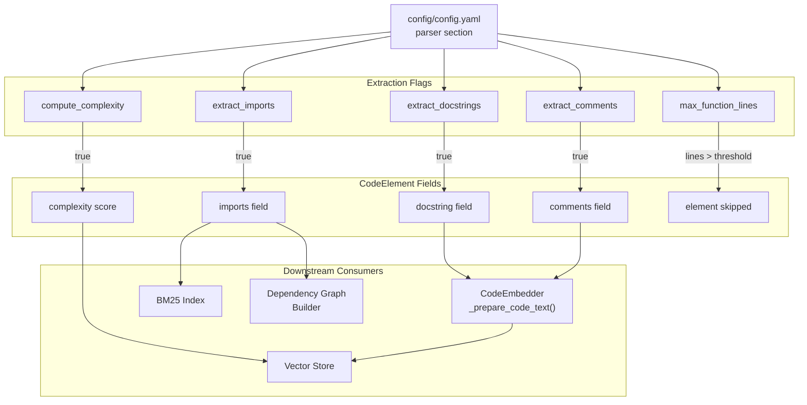
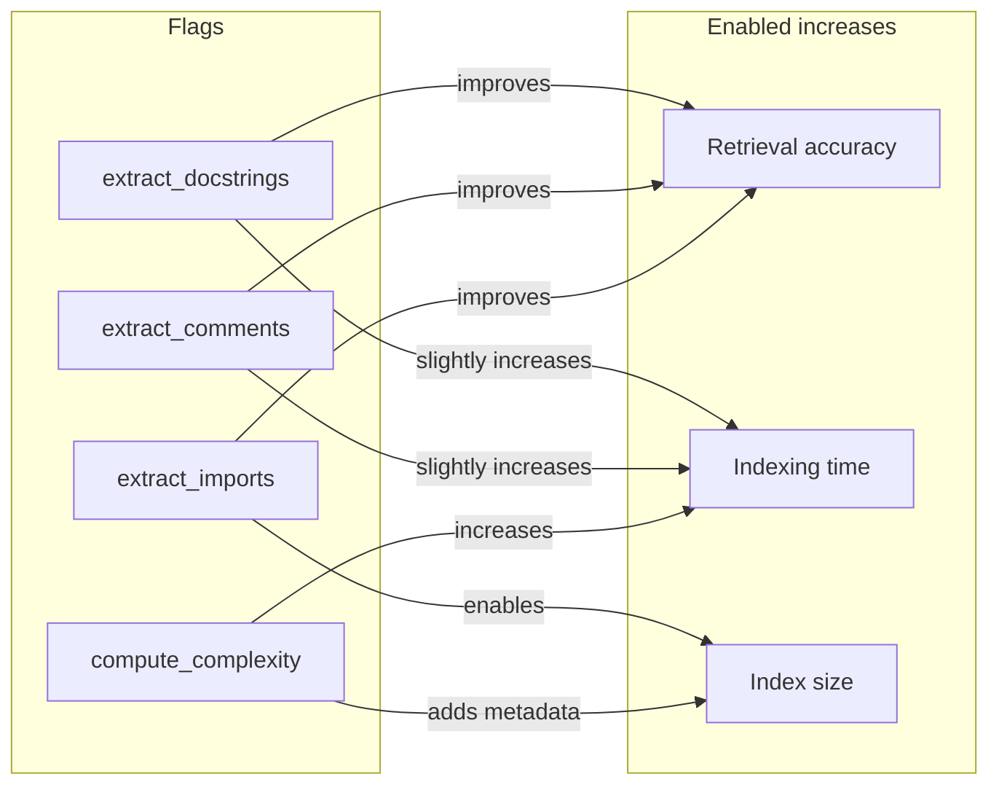

<!-- source: DeepWiki mcp.deepwiki.com · repo HKUDS/FastCode · page 8.2 Parser Configuration · fetched 2026-11-09 -->

# Parser Configuration

<details>
<summary>Relevant source files</summary>

The following files were used as context for generating this wiki page:

- [config/config.yaml](config/config.yaml)
- [fastcode/embedder.py](fastcode/embedder.py)

</details>


This page documents the `parser` section of `config/config.yaml`, which controls what data the code parsing subsystem extracts from source files during the indexing phase. These settings affect what metadata ends up in the vector store and BM25 index, and therefore influence retrieval quality.

For general information about the indexing pipeline that consumes parsed output, see [Indexing Configuration](#8.4). For the full Code Parser component documentation, see [Code Parser](#4.2). For the list of supported file extensions that the parser operates on, see [Repository Configuration](#8.1).

---

## Configuration Location

All parser settings live under the top-level `parser` key in `config/config.yaml`.

[config/config.yaml:50-56]()

```yaml
parser:
  extract_docstrings: true
  extract_comments: true
  extract_imports: true
  compute_complexity: true
  max_function_lines: 3000
```

---

## Settings Reference

| Key | Type | Default | Description |
|---|---|---|---|
| `extract_docstrings` | `bool` | `true` | Extract docstrings from functions and classes |
| `extract_comments` | `bool` | `true` | Extract inline and block comments |
| `extract_imports` | `bool` | `true` | Extract import statements |
| `compute_complexity` | `bool` | `true` | Compute cyclomatic complexity metrics |
| `max_function_lines` | `int` | `3000` | Line count ceiling; functions exceeding this are skipped |

Sources: [config/config.yaml:50-56]()

---

## What Each Setting Controls

### `extract_docstrings`

When `true`, the parser reads the docstring attached to each function and class definition. Docstrings become part of the text that gets embedded and indexed, which directly improves semantic search accuracy for natural-language queries. For Python, this uses `libcst`; for other languages, `tree-sitter` captures the equivalent documentation comment node.

Disabling this reduces index size and indexing time at the cost of weaker semantic matches for queries that describe behavior in natural language.

### `extract_comments`

When `true`, inline comments and block comments within function bodies are captured and stored as part of the code element's metadata. This is useful when code logic is explained through comments rather than docstrings, which is common in C/C++, Go, and JavaScript.

Disabling this shrinks the text passed to the embedder and can speed up indexing for large repositories with dense comment coverage.

### `extract_imports`

When `true`, import statements at the file level are extracted as a separate metadata field. This data is used by the indexer when `include_imports: true` is set in the `indexing` section (see [Indexing Configuration](#8.4)) to add import context to code element representations. It also feeds into the dependency graph builder (see [Graph Configuration](#8.11)).

### `compute_complexity`

When `true`, the parser computes a cyclomatic complexity score for each function. This metric counts decision points (branches, loops, etc.) and is stored as a numeric field on function-level code elements. The complexity value is not used in retrieval scoring by default but is available as metadata in query results and source citations.

Disabling this can noticeably reduce parse time for very large codebases with many long functions.

### `max_function_lines`

Functions whose source spans more than this many lines are skipped entirely by the parser. The default of `3000` is a safeguard against pathological files such as auto-generated code or minified scripts that tree-sitter would otherwise parse very slowly.

Setting this value lower (e.g., `500`) is useful when you want to avoid indexing generated or legacy mega-functions that would dilute search results.

Sources: [config/config.yaml:50-56]()

---

## Data Flow: Parser Settings to Index

The following diagram shows how each parser flag determines which fields are populated on a `CodeElement` before it enters the indexing and embedding pipeline.

**Diagram: Parser configuration flags and their downstream data fields**



Sources: [config/config.yaml:50-56](), [fastcode/embedder.py:111-147]()

---

## Interaction with the Embedder

When `CodeEmbedder._prepare_code_text()` builds the text string that gets embedded, it draws on the fields populated by the parser [fastcode/embedder.py:111-147](). Specifically:

- The `docstring` field maps to the `Documentation: ...` prefix in the embedding text [fastcode/embedder.py:131-134]().
- The `code` field (which includes comments when `extract_comments: true`) is appended as `Code:\n...` [fastcode/embedder.py:140-145]().

This means that disabling `extract_docstrings` or `extract_comments` produces shorter embedding texts and can reduce semantic recall.

Sources: [fastcode/embedder.py:111-147]()

---

## Effect on Index Quality vs. Speed

**Diagram: Parser flags and their trade-off direction**



| Flag | Retrieval Impact | Indexing Speed Impact | Recommended Setting |
|---|---|---|---|
| `extract_docstrings` | High — improves semantic search | Minor | `true` |
| `extract_comments` | Medium — helps undocumented code | Minor | `true` |
| `extract_imports` | Medium — powers dependency graph | Minor | `true` |
| `compute_complexity` | Low — metadata only | Minor to moderate | `true` for analysis; `false` to save time |
| `max_function_lines` | Filters noise | Significant for large repos | Tune based on repo characteristics |

Sources: [config/config.yaml:50-56](), [fastcode/embedder.py:111-147]()

---

## Tuning Recommendations

- **Auto-generated or minified files** — Lower `max_function_lines` to `500`–`1000` to avoid stalling the parser on single-file bundles.
- **Large repositories with slow indexing** — Set `compute_complexity: false` and `extract_comments: false` to speed up parsing with minimal accuracy loss.
- **Non-English codebases or sparse docstrings** — Keep `extract_comments: true` because comments often carry more semantic information than docstrings in these repositories.
- **Dependency analysis use cases** — Keep `extract_imports: true`; it is required for the dependency graph to be built correctly (see [Graph Configuration](#8.11)).

Sources: [config/config.yaml:50-56]()

---

