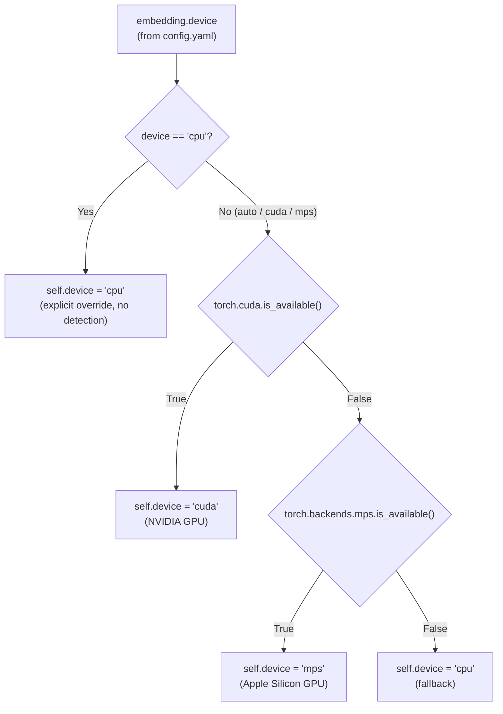
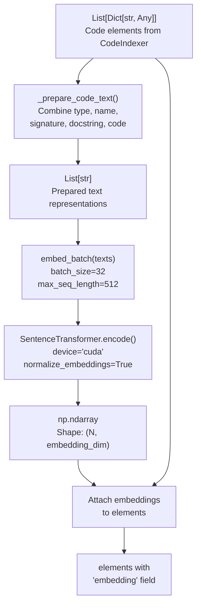
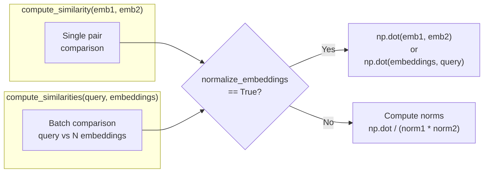

<!-- source: DeepWiki mcp.deepwiki.com · repo HKUDS/FastCode · page 8.3 Embedding Configuration · fetched 2026-11-09 -->

# Embedding Configuration

<details>
<summary>Relevant source files</summary>

The following files were used as context for generating this wiki page:

- [config/config.yaml](config/config.yaml)
- [fastcode/embedder.py](fastcode/embedder.py)

</details>


This document describes the embedding configuration options that control how FastCode generates semantic vector representations of code. The embedding system transforms code elements (files, classes, functions, documentation) into dense vector representations for similarity-based search.

For configuring the vector storage backend that stores these embeddings, see [Vector Store Configuration](#8.5). For configuring how embeddings are used during retrieval, see [Retrieval Configuration](#8.6).

## Overview

The embedding configuration section in `config.yaml` controls the `CodeEmbedder` class behavior, which uses sentence-transformers to generate embeddings. All configuration resides in the `embedding` section at [config/config.yaml:58-66]().

```yaml
embedding:
  model: "sentence-transformers/paraphrase-multilingual-MiniLM-L12-v2"
  device: "auto"
  batch_size: 32
  max_seq_length: 512
  normalize_embeddings: true
```

Sources: [config/config.yaml:58-66]()

## Configuration Parameters

The following table describes all available embedding configuration parameters:

| Parameter | Type | Default | Description |
|-----------|------|---------|-------------|
| `model` | string | `"sentence-transformers/paraphrase-multilingual-MiniLM-L12-v2"` | HuggingFace model identifier for the embedding model |
| `device` | string | `"auto"` | Computation device: `"auto"` (recommended), `"cuda"`, `"mps"`, or `"cpu"` |
| `batch_size` | integer | `32` | Number of texts to process simultaneously |
| `max_seq_length` | integer | `512` | Maximum token length for input sequences |
| `normalize_embeddings` | boolean | `true` | Whether to L2-normalize embedding vectors |

Sources: [config/config.yaml:58-66](), [fastcode/embedder.py:16-35]()

## Embedding Model Selection

The `model` parameter specifies which SentenceTransformer model to use. The `CodeEmbedder` class loads the model via the `_load_model()` method at [fastcode/embedder.py:37-41]().

### Supported Models

FastCode supports any model from the [sentence-transformers library](https://www.sbert.net/). The configuration file provides three alternatives with different tradeoffs:

| Model | Size | Languages | Use Case |
|-------|------|-----------|----------|
| `paraphrase-multilingual-MiniLM-L12-v2` | 470MB | 50+ languages | Default, multilingual repositories |
| `all-MiniLM-L6-v2` | 90MB | English only | Faster download, English codebases |
| `BAAI/bge-large-en-v1.5` | Larger | English | Higher quality, more accurate retrieval |

To change models, update the `model` field:

```yaml
embedding:
  model: "sentence-transformers/all-MiniLM-L6-v2"  # English-only, smaller download
```

The model is downloaded automatically on first use and cached locally by the sentence-transformers library.

Sources: [config/config.yaml:60-62](), [fastcode/embedder.py:21](), [fastcode/embedder.py:37-41]()

## Device Configuration

The `device` parameter controls which hardware accelerator is used to run the embedding model.

### Device Selection Logic

**Device detection in `CodeEmbedder.__init__`** [fastcode/embedder.py:27-30]():

When `device` is set to anything other than `"cpu"` (including `"auto"`, `"cuda"`, or `"mps"`), the constructor overrides the configured value with runtime detection. Only an explicit `"cpu"` setting bypasses detection entirely.

**Device selection diagram (`CodeEmbedder.__init__` device resolution)**



The resolved device is then passed to `SentenceTransformer` in `_load_model()` [fastcode/embedder.py:37-41]() and also forwarded to `model.encode()` per-call in `embed_batch()` [fastcode/embedder.py:67-80]().

Sources: [fastcode/embedder.py:22](), [fastcode/embedder.py:27-30](), [fastcode/embedder.py:37-41]()

### Performance Considerations

| Device value | Hardware targeted | Typical relative speed | Notes |
|---|---|---|---|
| `"auto"` | Best available | Varies | Recommended default |
| `"cuda"` | NVIDIA GPU | 10–50× baseline | Requires CUDA toolkit |
| `"mps"` | Apple Silicon (M1/M2/M3) | 3–10× baseline | macOS only |
| `"cpu"` | CPU | Baseline | Works everywhere |

Setting `device: "auto"` is recommended for most deployments. Only set an explicit device if you need to force a specific hardware target (e.g., benchmarking or multi-GPU environments). For CPU-only Docker images, set `device: "cpu"` to skip accelerator detection on startup.

Sources: [fastcode/embedder.py:22](), [fastcode/embedder.py:27-30](), [config/config.yaml:63]()

## Batch Processing Configuration

### batch_size

The `batch_size` parameter controls how many texts are encoded simultaneously. The `embed_batch()` method at [fastcode/embedder.py:55-82]() uses this value in the `encode_kwargs` dictionary:

```yaml
embedding:
  batch_size: 32  # Process 32 code elements at once
```

**Tradeoffs:**
- **Larger batch_size (64, 128)**: Faster processing on GPU, higher memory usage
- **Smaller batch_size (8, 16)**: Lower memory usage, suitable for CPU or limited VRAM

### max_seq_length

The `max_seq_length` parameter sets the maximum number of tokens the model processes. This is applied to the loaded model at [fastcode/embedder.py:40]():

```yaml
embedding:
  max_seq_length: 512  # Truncate inputs to 512 tokens
```

**Behavior:**
- Texts longer than `max_seq_length` are truncated
- Most code elements (function definitions, docstrings) fit within 512 tokens
- Longer sequences require more memory and processing time
- The embedding model's architecture determines the maximum possible value (typically 512 or 1024)

Sources: [config/config.yaml:64-65](), [fastcode/embedder.py:23-24](), [fastcode/embedder.py:40]()

## Platform-Specific Handling

The `embed_batch()` method includes macOS-specific handling at [fastcode/embedder.py:77-78]():

```python
if platform.system() == 'Darwin':
    encode_kwargs['pool'] = None
```

This disables multiprocessing on macOS to avoid compatibility issues with the `multiprocessing` library on that platform.

Sources: [fastcode/embedder.py:77-78]()

## Embedding Generation Process

The following diagram shows how the `CodeEmbedder` transforms code elements into embeddings:



Sources: [fastcode/embedder.py:84-110](), [fastcode/embedder.py:112-148]()

### Text Preparation

The `_prepare_code_text()` method at [fastcode/embedder.py:112-148]() prepares code elements for embedding by combining multiple fields:

1. **Type**: Element type (file, class, function, documentation)
2. **Name**: Identifier name
3. **Signature**: Function/method signature with parameters
4. **Documentation**: Docstrings and comments
5. **Summary**: High-level summary text
6. **Code**: Source code (truncated to 10,000 characters)

These components are joined with newlines to create a rich text representation that captures both structure and semantics.

Sources: [fastcode/embedder.py:112-148]()

## Normalization and Similarity Computation

### normalize_embeddings

The `normalize_embeddings` parameter controls L2 normalization:

```yaml
embedding:
  normalize_embeddings: true  # Normalize to unit length
```

**When true** (default):
- All embeddings are normalized to unit length
- Cosine similarity reduces to dot product
- Faster similarity computation at [fastcode/embedder.py:161-163]()

**When false**:
- Raw embeddings (unnormalized)
- Full cosine similarity computation required at [fastcode/embedder.py:165-170]()
- Slightly slower but preserves magnitude information

Sources: [config/config.yaml:66](), [fastcode/embedder.py:25](), [fastcode/embedder.py:150-170]()

### Similarity Methods

The `CodeEmbedder` provides two similarity computation methods:



Sources: [fastcode/embedder.py:150-195]()

## Configuration Examples

### High-Performance Setup (NVIDIA GPU)

For large codebases with CUDA available:

```yaml
embedding:
  model: "BAAI/bge-large-en-v1.5"
  device: "auto"   # will resolve to cuda if available
  batch_size: 64
  max_seq_length: 512
  normalize_embeddings: true
```

### Memory-Constrained Setup (CPU only)

For smaller environments or CPU-only deployments:

```yaml
embedding:
  model: "sentence-transformers/all-MiniLM-L6-v2"
  device: "cpu"
  batch_size: 8
  max_seq_length: 256
  normalize_embeddings: true
```

### Multilingual Setup (default)

For repositories with non-English identifiers or comments:

```yaml
embedding:
  model: "sentence-transformers/paraphrase-multilingual-MiniLM-L12-v2"
  device: "auto"
  batch_size: 32
  max_seq_length: 512
  normalize_embeddings: true
```

Sources: [config/config.yaml:58-66]()

## Implementation Reference

The embedding configuration is consumed by the `CodeEmbedder` class constructor at [fastcode/embedder.py:16-35]():

| Class Attribute | Config Source | Purpose |
|----------------|---------------|---------|
| `self.model_name` | `embedding.model` | Model identifier for SentenceTransformer |
| `self.device` | `embedding.device` | Computation device (with fallback) |
| `self.batch_size` | `embedding.batch_size` | Batch processing size |
| `self.max_seq_length` | `embedding.max_seq_length` | Maximum token length |
| `self.normalize` | `embedding.normalize_embeddings` | Normalization flag |
| `self.model` | - | Loaded SentenceTransformer instance |
| `self.embedding_dim` | - | Embedding dimension (from model) |

The class provides three main public methods:
- `embed_text()` at [fastcode/embedder.py:43-53](): Single text embedding
- `embed_batch()` at [fastcode/embedder.py:55-82](): Batch text embedding
- `embed_code_elements()` at [fastcode/embedder.py:84-110](): Code element embedding with text preparation

Sources: [fastcode/embedder.py:13-196]()

---

