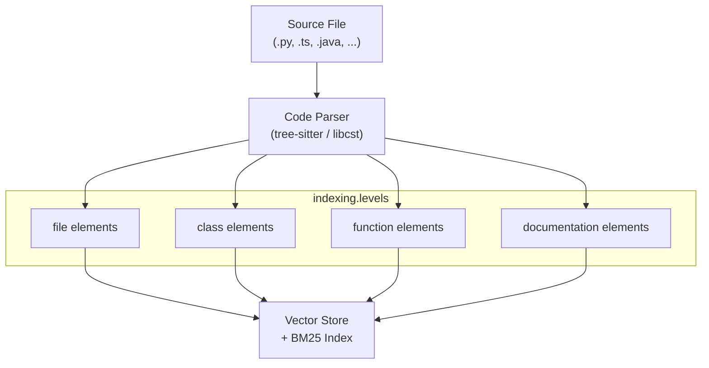
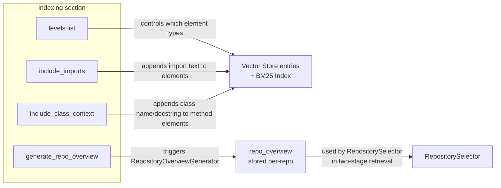

<!-- source: DeepWiki mcp.deepwiki.com · repo HKUDS/FastCode · page 8.4 Indexing Configuration · fetched 2026-11-09 -->

# Indexing Configuration

<details>
<summary>Relevant source files</summary>

The following files were used as context for generating this wiki page:

- [config/config.yaml](config/config.yaml)
- [fastcode/embedder.py](fastcode/embedder.py)

</details>


This page documents the `indexing` section of `config/config.yaml`. These settings control how parsed code elements are organized and stored during the indexing pipeline — specifically, which granularity levels are indexed, what contextual information is attached to each element, and whether repository-level overviews are generated.

For background on *why* multi-level indexing is useful, see [Hierarchical Code Indexing](#3.3). For the component that executes the indexing pipeline, see [Code Indexer](#4.3). For details on repository overview generation, see [Repository Overview Generator](#4.9). For embedding configuration (which operates on the elements produced by this stage), see [Embedding Configuration](#8.3).

---

## Configuration Block

The `indexing` section lives in `config/config.yaml` at [config/config.yaml:68-80]().

```yaml
indexing:
  levels:
    - file
    - class
    - function
    - documentation

  include_imports: true
  include_class_context: true
  generate_repo_overview: true
```

---

## Granularity Levels (`levels`)

The `levels` list defines which kinds of code elements are extracted from parsed source files and placed into the vector store and BM25 index. Each level represents a distinct unit of code that can be independently retrieved during a query.

| Level | What it represents | Primary content |
|---|---|---|
| `file` | Top-level file metadata | File path, language, imports summary, file-level docstring |
| `class` | Class or struct definitions | Class name, base classes, class-level docstring, method signatures |
| `function` | Individual function or method bodies | Signature, body code, docstring, complexity metrics |
| `documentation` | Standalone doc elements | Inline comments, module-level docstrings, documentation blocks |

All four levels are enabled by default. You can remove entries from the list to skip indexing those element types. For example, removing `documentation` will exclude standalone comment blocks from the index, reducing index size at the cost of documentation searchability.

**Diagram: Levels to Index Entry Mapping**



Sources: [config/config.yaml:68-80]()

---

## Context Flags

Beyond controlling *what* is indexed, two flags control *how much contextual information* is attached to each indexed element.

### `include_imports`

| Setting | Default | Type |
|---|---|---|
| `include_imports` | `true` | boolean |

When `true`, import statements from each file are attached to the indexed elements from that file. This gives the embedder and retriever additional signal about a function's or class's external dependencies — for example, knowing that a function imports `numpy` and `torch` helps match queries about numerical computation.

Disabling this flag reduces the size of each index entry's text representation but may reduce retrieval precision for queries that mention library names.

The `CodeEmbedder._prepare_code_text` method in [fastcode/embedder.py:111-147]() constructs the text that gets embedded for each element. Import information included at index time flows into this text preparation step.

### `include_class_context`

| Setting | Default | Type |
|---|---|---|
| `include_class_context` | `true` | boolean |

When `true`, methods indexed at the `function` level include the name and docstring of the enclosing class as additional context. Without this, a method like `train()` would be indexed with no indication that it belongs to, for example, a `ModelTrainer` class.

This flag is especially important for retrieval accuracy in object-oriented codebases, where method names are often ambiguous without their class context.

---

## Repository Overview Generation (`generate_repo_overview`)

| Setting | Default | Type |
|---|---|---|
| `generate_repo_overview: true` | `true` | boolean |

When `true`, the indexing pipeline generates a natural-language summary of each repository and stores it alongside the index. This overview is used during multi-repository retrieval to select the most relevant repositories before performing fine-grained element search.

The `RepositoryOverviewGenerator` component ([4.9](#4.9)) handles this step. Its process is:

1. Detect and read the repository's `README` file (or equivalent).
2. Send the README content to the configured LLM to produce a concise summary.
3. If no README is found, fall back to a structure-based summary derived from directory layout and detected languages.

Setting `generate_repo_overview: false` skips this step entirely. This reduces indexing time and removes the LLM call during ingestion, but disables overview-based repository pre-filtering (see [Two-Stage Retrieval](#9.5)).

**Diagram: generate_repo_overview in the Indexing Pipeline**



Sources: [config/config.yaml:68-80]()

---

## Interaction With Other Configuration Sections

The `indexing` settings do not operate in isolation. The following table shows which other configuration sections directly affect or are affected by indexing behavior.

| Related section | Interaction |
|---|---|
| `parser` | Determines what raw elements are available to index (docstrings, comments, imports, complexity). See [Parser Configuration](#8.2). |
| `embedding` | Controls how indexed element text is converted to vectors. See [Embedding Configuration](#8.3). |
| `vector_store` | Determines where index entries are persisted. See [Vector Store Configuration](#8.5). |
| `retrieval` | `select_repos_by_overview` depends on `generate_repo_overview` being enabled. See [Retrieval Configuration](#8.6). |
| `graph` | Graph structures (call/dependency/inheritance) are built in parallel with the index but are controlled separately. See [Graph Configuration](#8.11). |

---

## Effect of Disabling Levels

The table below summarizes the practical consequences of removing each level from the `levels` list.

| Removed level | Consequence |
|---|---|
| `file` | File-level metadata is not indexed; queries about "what files do X" degrade. |
| `class` | Class definitions are not independently retrievable; only their methods appear. |
| `function` | Function bodies are not indexed; most code-level queries will miss results. |
| `documentation` | Doc comments and module docstrings are excluded; documentation queries degrade. |

Removing all four levels would produce an empty index, so at minimum `function` should remain enabled for useful retrieval.

Sources: [config/config.yaml:68-80](), [fastcode/embedder.py:83-147]()

---

