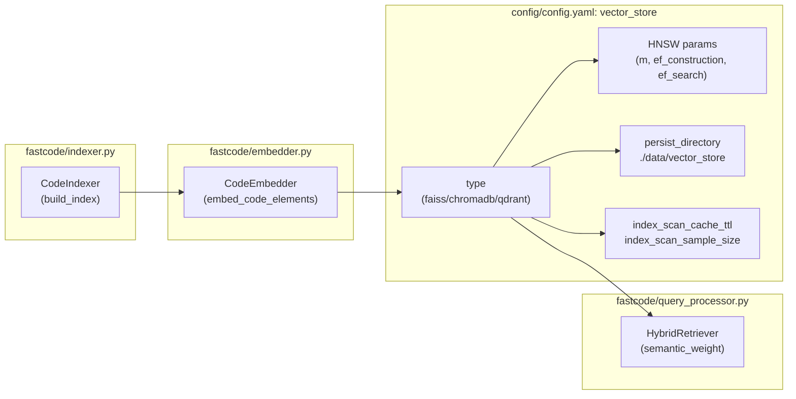
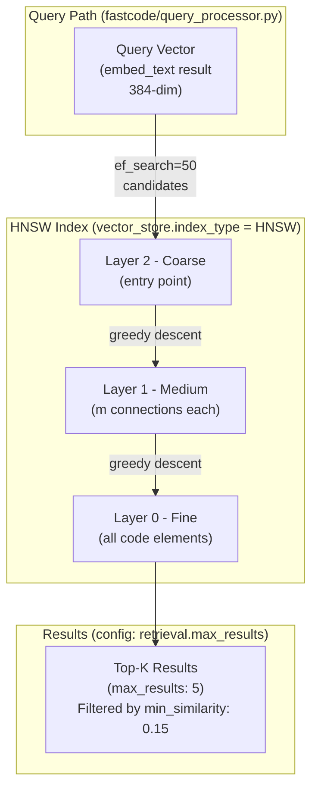
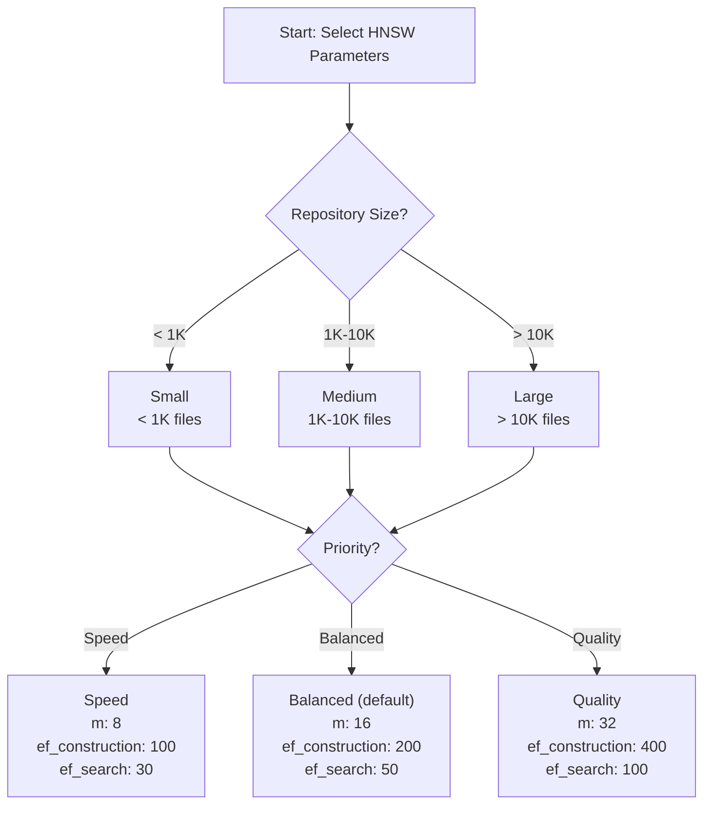
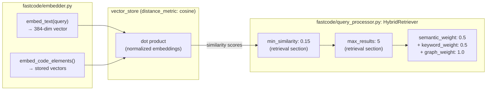
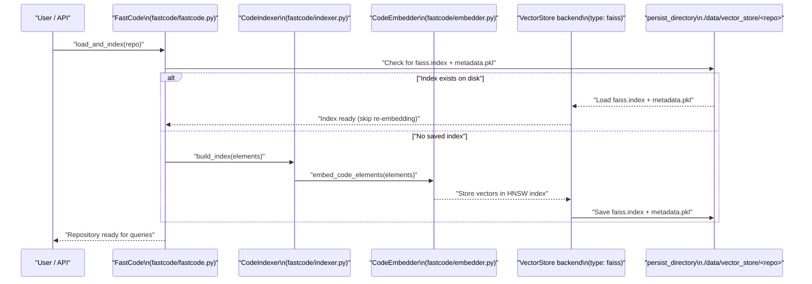
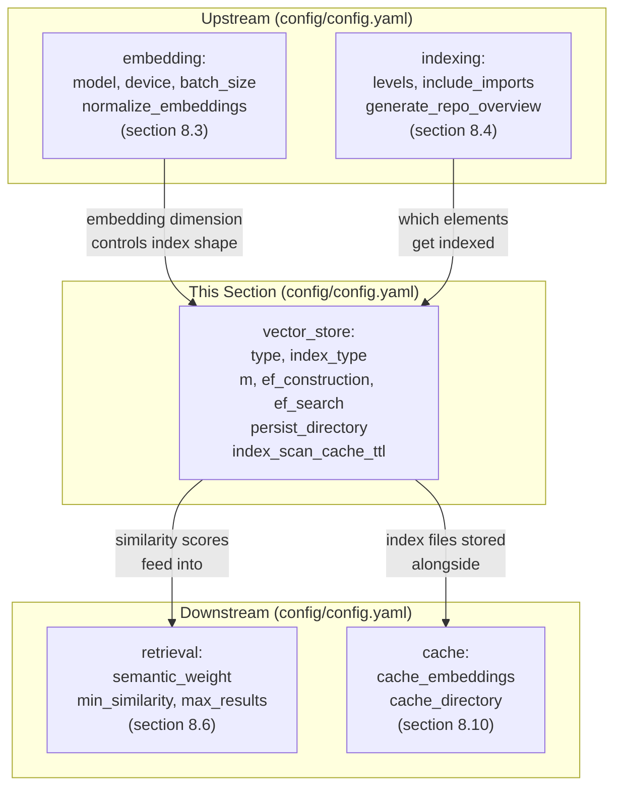

<!-- source: DeepWiki mcp.deepwiki.com · repo HKUDS/FastCode · page 8.5 Vector Store Configuration · fetched 2026-11-09 -->

# Vector Store Configuration

<details>
<summary>Relevant source files</summary>

The following files were used as context for generating this wiki page:

- [config/config.yaml](config/config.yaml)
- [fastcode/embedder.py](fastcode/embedder.py)

</details>


This page covers the `vector_store` section of `config/config.yaml`, which controls how FastCode stores and searches semantic embeddings for indexed code elements. The vector store sits between the embedding phase (`CodeEmbedder`) and the retrieval phase (`HybridRetriever`).

For information about generating embeddings, see page 8.3 (Embedding Configuration). For retrieval strategy weights, see page 8.6 (Retrieval Configuration). For implementation details, see page 4.5 (Vector Store) and page 4.4 (Code Embedder).

**Sources:** [config/config.yaml:82-96]()

---

## Overview

The vector store is the core component that enables semantic code search in FastCode. After code elements (files, classes, functions, documentation) are parsed and embedded into dense vectors by the `CodeEmbedder`, they are indexed in the vector store for efficient retrieval. FastCode supports three backend implementations with different tradeoffs in performance, memory usage, and deployment complexity.

### System Integration

**Diagram: Vector Store in the FastCode Pipeline (embedder.py → config.yaml → query_processor.py)**



The `CodeIndexer` parses code and calls `CodeEmbedder.embed_code_elements()` to produce dense vectors, which are stored using the backend specified in `vector_store.type`. The `HybridRetriever` queries this store at search time.

**Sources:** [config/config.yaml:82-96](), [fastcode/embedder.py:83-109]()

---

## Backend Selection

FastCode supports three vector store backends, configured via the `type` parameter. Each backend offers different characteristics for index construction, search performance, and deployment requirements.

### Configuration Syntax

```yaml
vector_store:
  type: "faiss"  # Options: "faiss", "chromadb", "qdrant"
```

### Backend Comparison

| Backend | Index Type | Performance | Memory Usage | Persistence | Best For |
|---------|-----------|-------------|--------------|-------------|----------|
| **FAISS** | HNSW | Fastest search | In-memory index | Manual save/load | Single-machine, high-performance search |
| **ChromaDB** | HNSW | Fast | Persistent storage | Automatic | Easy setup, moderate scale |
| **Qdrant** | HNSW | Fast | Persistent storage | Automatic | Distributed deployments, production |

### FAISS Backend (Default)

FAISS (Facebook AI Similarity Search) provides the fastest search performance with an in-memory HNSW index. This is the recommended backend for most deployments.

```yaml
vector_store:
  type: "faiss"
  index_type: "HNSW"
  persist_directory: "./data/vector_store"
```

**Characteristics:**
- **Speed:** Fastest approximate nearest neighbor search
- **Memory:** Index loaded entirely into RAM
- **Persistence:** Requires explicit save/load operations
- **Scale:** Handles millions of vectors efficiently

**Sources:** [config/config.yaml:84-86]()

### ChromaDB Backend

ChromaDB provides a persistent vector database with automatic storage management and an embedded deployment model.

```yaml
vector_store:
  type: "chromadb"
  persist_directory: "./data/vector_store"
```

**Characteristics:**
- **Speed:** Fast with automatic index management
- **Memory:** Hybrid disk-memory architecture
- **Persistence:** Automatic background persistence
- **Scale:** Good for small to medium repositories

**Sources:** [config/config.yaml:84]()

### Qdrant Backend

Qdrant is a vector search engine designed for production deployments with support for distributed configurations.

```yaml
vector_store:
  type: "qdrant"
  persist_directory: "./data/vector_store"
```

**Characteristics:**
- **Speed:** Fast with optimized storage layer
- **Memory:** Configurable memory vs disk tradeoffs
- **Persistence:** Production-grade durability
- **Scale:** Supports horizontal scaling and sharding

**Sources:** [config/config.yaml:84]()

### Backend Selection Summary

| Parameter | FAISS (`"faiss"`) | ChromaDB (`"chromadb"`) | Qdrant (`"qdrant"`) |
|-----------|-------------------|------------------------|---------------------|
| Index type | HNSW in-memory | HNSW on-disk | HNSW on-disk |
| Persistence | Manual save/load | Automatic | Automatic |
| Memory model | All in RAM | Hybrid disk/memory | Configurable |
| HNSW param tuning | Yes (`m`, `ef_*`) | Limited | Limited |
| Best for | Single-machine, high perf | Easy setup | Production / distributed |

**Sources:** [config/config.yaml:83-96]()

---

## HNSW Index Configuration

FastCode uses Hierarchical Navigable Small World (HNSW) graphs for approximate nearest neighbor search. HNSW provides excellent search performance with configurable accuracy-speed tradeoffs.

### HNSW Architecture

**Diagram: HNSW Index Search (config keys: index_type, ef_search, m → CodeEmbedder → HybridRetriever)**



HNSW navigates from coarse to fine layers using greedy search. `ef_search` controls how many candidates are tracked at each layer; a larger value improves recall at the cost of latency.

**Sources:** [config/config.yaml:86-89](), [config/config.yaml:106-107]()

### Core HNSW Parameters

The three HNSW parameters below are only applied when `type: "faiss"` is set. They correspond directly to FAISS HNSW index construction arguments.

#### `index_type`

```yaml
vector_store:
  index_type: "HNSW"
```

Specifies the index algorithm. `"HNSW"` is the only supported value and enables Hierarchical Navigable Small World approximate nearest-neighbor search.

**Sources:** [config/config.yaml:86]()

#### `m` (Connections per Layer)

```yaml
vector_store:
  m: 16
```

The number of bi-directional connections each node maintains in the graph. Higher values improve search quality at the cost of memory and construction time.

**Default:** `16`

**Tradeoffs:**
- **Low (4-8):** Faster construction, lower memory, reduced accuracy
- **Medium (16):** Balanced (recommended for most cases)
- **High (32-64):** Higher accuracy, slower construction, more memory

**Memory Impact:** Approximately `m * d * 4` bytes per vector, where `d` is dimensionality (384 for default embeddings).

**Sources:** [config/config.yaml:89]()

#### `ef_construction` (Construction Time Effort)

```yaml
vector_store:
  ef_construction: 200
```

The size of the dynamic candidate list during index construction. Higher values produce better quality indexes but increase build time.

**Default:** `200`

**Tradeoffs:**
- **Low (100):** Faster indexing, slightly lower quality
- **Medium (200):** Balanced construction time and quality (recommended)
- **High (400-800):** Best quality, significantly slower indexing

**Impact:** Only affects indexing time, not search time. For large repositories (>10K files), consider lower values for faster initial indexing.

**Sources:** [config/config.yaml:87]()

#### `ef_search` (Search Time Effort)

```yaml
vector_store:
  ef_search: 50
```

The size of the dynamic candidate list during search queries. Directly controls the accuracy-speed tradeoff at query time.

**Default:** `50`

**Tradeoffs:**
- **Low (10-30):** Fastest queries, lower recall
- **Medium (50):** Balanced (recommended)
- **High (100-200):** Better recall, slower queries

**Impact:** Larger values increase query latency linearly but improve result quality. Must be ≥ `max_results`.

**Sources:** [config/config.yaml:88]()

### HNSW Parameter Selection Guide

**Diagram: HNSW Parameter Decision (config/config.yaml: m, ef_construction, ef_search)**



> **Note:** Changing `m` or `ef_construction` requires re-indexing the repository. Changes to `ef_search` take effect on the next query without re-indexing.

**Sources:** [config/config.yaml:87-89]()

---

## Distance Metrics

The distance metric determines how vector similarity is computed during search operations. FastCode supports cosine distance, which is ideal for semantic similarity in high-dimensional embedding spaces.

```yaml
vector_store:
  distance_metric: "cosine"
```

### Cosine Distance (Default)

Cosine distance measures the angle between vectors, normalized to [0, 1] range. It is scale-invariant and well-suited for comparing semantic embeddings.

**Formula:** `distance = 1 - cosine_similarity`

where `cosine_similarity = (A · B) / (||A|| ||B||)`

**Characteristics:**
- **Range:** 0 (identical) to 1 (opposite)
- **Scale Invariant:** Vector magnitude does not affect results
- **Semantic Alignment:** Works well with sentence transformer embeddings

**When to Use:**
- Default choice for semantic code search
- When embeddings are L2-normalized (as in FastCode)
- Comparing code semantics regardless of text length

### Integration with Retrieval

**Diagram: Distance Metric through HybridRetriever (fastcode/query_processor.py)**



Because `normalize_embeddings: true` is set in the `embedding` section, cosine similarity reduces to a dot product between stored and query vectors.

**Sources:** [config/config.yaml:85](), [config/config.yaml:66](), [config/config.yaml:99-108](), [fastcode/embedder.py:149-168]()

---

## Persistence Configuration

The vector store can persist indexes to disk for reuse across sessions. Persistence eliminates the need to re-index repositories on every startup.

### Persist Directory

```yaml
vector_store:
  persist_directory: "./data/vector_store"
```

Specifies the directory where vector indexes are saved and loaded. Each repository gets a subdirectory based on its name.

**Directory Structure:**

```
./data/vector_store/
├── repo1/
│   ├── faiss.index          # FAISS index file
│   ├── metadata.pkl         # Code element metadata
│   └── config.json          # Index configuration
├── repo2/
│   ├── faiss.index
│   ├── metadata.pkl
│   └── config.json
└── repo3/
    └── ...
```

**Default:** `"./data/vector_store"`

**Considerations:**
- **Disk Space:** Each repository index requires ~50-200MB depending on code size
- **Loading Time:** Index loading is fast (~1-5 seconds per repository)
- **Persistence:** Indexes survive restarts and can be shared across machines

**Sources:** [config/config.yaml:92]()

### Persistence Workflow

**Diagram: Persist/Load Lifecycle (fastcode/indexer.py, persist_directory: ./data/vector_store)**



**Sources:** [config/config.yaml:91-92]()

---

## Performance Optimization

FastCode provides additional configuration options to optimize vector store performance, particularly for web interface responsiveness.

### Index Scan Caching

```yaml
vector_store:
  index_scan_cache_ttl: 30
  index_scan_sample_size: 100
```

These settings optimize the file count estimation and status checks that occur frequently in the web interface.

#### `index_scan_cache_ttl`

Time-to-live (in seconds) for caching index scan results. Reduces redundant disk operations when checking repository status.

**Default:** `30` seconds

**Options:**
- `0` — Disable caching (always scan filesystem)
- `30-60` — Balanced caching for development
- `300-600` — Aggressive caching for production

**Use Case:** Web interface repeatedly queries repository status. Caching prevents filesystem scans on every request.

**Sources:** [config/config.yaml:95]()

#### `index_scan_sample_size`

Number of files to sample when estimating total indexed elements. Larger samples provide more accurate estimates at the cost of slower scans.

**Default:** `100`

**Tradeoffs:**
- **Low (50):** Fast estimation, less accurate
- **Medium (100):** Balanced (recommended)
- **High (500+):** Accurate estimation, slower

**Sources:** [config/config.yaml:96]()

### Memory Management (FAISS backend)

The FAISS HNSW index memory footprint depends on the configured parameters:

| Component | Memory Formula | Configuration Key |
|-----------|---------------|-------------------|
| HNSW graph edges | `N × m × 8 bytes` | `m` |
| Raw vectors | `N × d × 4 bytes` | fixed by embedding model |
| Metadata store | varies per element | — |

Where:
- `N` = total indexed code elements
- `m` = connections per layer (default: `16`)
- `d` = embedding dimension (384 for the default `paraphrase-multilingual-MiniLM-L12-v2` model)

**Example:** 10,000 code elements with defaults (`m=16`, `d=384`):
- HNSW graph: ~1.3 MB
- Raw vectors: ~15 MB
- Total index: ~16 MB (excluding metadata pickle)

---

## Complete Configuration Example

### Default Configuration

This is the full `vector_store` block as shipped in `config/config.yaml`:

[config/config.yaml:82-96]()

| Setting | Default Value | Notes |
|---------|--------------|-------|
| `type` | `"faiss"` | Backend selection |
| `distance_metric` | `"cosine"` | Used for similarity scoring |
| `index_type` | `"HNSW"` | FAISS-only parameter |
| `ef_construction` | `200` | FAISS-only; affects index build quality |
| `ef_search` | `50` | FAISS-only; affects query recall |
| `m` | `16` | FAISS-only; connections per HNSW node |
| `persist_directory` | `"./data/vector_store"` | Root directory for saved indexes |
| `index_scan_cache_ttl` | `30` | Seconds to cache scan results (0 = off) |
| `index_scan_sample_size` | `100` | Files sampled for element count estimation |

### High-Performance Configuration

For speed-critical deployments prioritizing fast search over perfect recall:

```yaml
vector_store:
  type: "faiss"
  distance_metric: "cosine"
  index_type: "HNSW"
  ef_construction: 100
  ef_search: 30
  m: 8
  persist_directory: "./data/vector_store"
  index_scan_cache_ttl: 60
  index_scan_sample_size: 50
```

**Effect:** Faster index construction, lower memory usage, slightly reduced recall. Re-indexing required after changing `m` or `ef_construction`.

### High-Quality Configuration

For accuracy-critical deployments:

```yaml
vector_store:
  type: "faiss"
  distance_metric: "cosine"
  index_type: "HNSW"
  ef_construction: 400
  ef_search: 100
  m: 32
  persist_directory: "./data/vector_store"
  index_scan_cache_ttl: 30
  index_scan_sample_size: 200
```

**Effect:** Maximum recall, higher memory usage, slower index construction. Re-indexing required.

### Production Configuration (ChromaDB or Qdrant)

```yaml
vector_store:
  type: "chromadb"  # or "qdrant"
  distance_metric: "cosine"
  persist_directory: "/mnt/fast-storage/vector_store"
  index_scan_cache_ttl: 300
  index_scan_sample_size: 100
```

HNSW tuning parameters (`m`, `ef_construction`, `ef_search`) are ignored when `type` is `"chromadb"` or `"qdrant"`.

---

## Integration with Other Configuration

The vector store configuration works in conjunction with other FastCode settings to form the complete retrieval pipeline.

### Related Configuration Sections

**Diagram: Config Section Dependencies (config/config.yaml sections)**



**Sources:** [config/config.yaml:58-96](), [config/config.yaml:98-119](), [config/config.yaml:182-191]()

### Embedding Compatibility

The vector store index is built with the dimensionality of the configured embedding model. The `CodeEmbedder` reads `embedding_dim` from the loaded `SentenceTransformer` model and the vector store is sized accordingly:

[fastcode/embedder.py:33-34]()

```yaml
# embedding section (section 8.3)
embedding:
  model: "sentence-transformers/paraphrase-multilingual-MiniLM-L12-v2"
  # → 384-dimensional output vectors

# vector_store section: index is created with d=384 automatically
vector_store:
  type: "faiss"
  index_type: "HNSW"
```

If you change the `embedding.model`, delete the persisted index files under `persist_directory` and re-index all repositories, since dimension mismatch will cause a load error.

**Sources:** [config/config.yaml:59-66](), [config/config.yaml:82-96](), [fastcode/embedder.py:33-34]()

### Retrieval Integration

The similarity scores produced by the vector store feed into the `HybridRetriever` alongside BM25 keyword scores and graph traversal scores. The relative influence of vector store results is set in the `retrieval` section, not in `vector_store`:

```yaml
# vector_store section: controls similarity computation
vector_store:
  distance_metric: "cosine"

# retrieval section: controls how semantic scores are weighted
retrieval:
  min_similarity: 0.15    # Minimum score to include a result
  max_results: 5          # Top-K from vector search
  semantic_weight: 0.5    # Weight given to vector store scores
  keyword_weight: 0.5     # Weight given to BM25 scores
  graph_weight: 1.0       # Weight given to graph traversal scores
```

**Sources:** [config/config.yaml:98-108]()

---

## Configuration Reference

### Complete Parameter List

| Parameter | Type | Default | FAISS Only | Description |
|-----------|------|---------|------------|-------------|
| `type` | string | `"faiss"` | No | Backend: `"faiss"`, `"chromadb"`, or `"qdrant"` |
| `distance_metric` | string | `"cosine"` | No | Similarity metric |
| `index_type` | string | `"HNSW"` | Yes | Index algorithm; only `"HNSW"` is supported |
| `ef_construction` | int | `200` | Yes | Candidate list size during index build; higher = better quality, slower build |
| `ef_search` | int | `50` | Yes | Candidate list size during query; higher = better recall, slower queries |
| `m` | int | `16` | Yes | Bi-directional connections per HNSW node; higher = more memory, better quality |
| `persist_directory` | string | `"./data/vector_store"` | No | Root path for saved index files |
| `index_scan_cache_ttl` | int | `30` | No | Seconds to cache scan results; `0` disables caching |
| `index_scan_sample_size` | int | `100` | No | Files sampled for element-count estimation |

**Sources:** [config/config.yaml:82-96]()

### Environment Variables

Vector store configuration is entirely file-based. No environment variables affect vector store settings directly. The embedding model (which determines index dimensionality) may be influenced by environment variables — see page 12.3 for details.

---

## Troubleshooting

### High Memory Usage

**Symptom:** FastCode consumes excessive RAM during indexing or queries.

**Causes:**
- High `m` parameter (more connections = more memory)
- Large repository with many indexed elements
- Multiple repositories loaded simultaneously

**Solutions:**
```yaml
# Reduce HNSW connections
vector_store:
  m: 8  # Down from 16

# Or reduce index quality
  ef_construction: 100  # Down from 200
```

### Slow Index Construction

**Symptom:** Initial repository indexing takes too long.

**Causes:**
- High `ef_construction` parameter
- Large repository
- Slow disk I/O

**Solutions:**
```yaml
# Reduce construction effort
vector_store:
  ef_construction: 100  # Down from 200
  m: 8  # Fewer connections to build
```

### Poor Search Quality

**Symptom:** Queries return irrelevant results.

**Causes:**
- Low `ef_search` parameter
- Low `m` parameter
- Insufficient `ef_construction` during indexing

**Solutions:**
```yaml
# Increase search quality
vector_store:
  ef_search: 100  # Up from 50
  m: 32  # Up from 16
  ef_construction: 400  # Up from 200
```

Then re-index the repository to rebuild with new parameters.

### Index Load Failures

**Symptom:** Error loading existing index from disk.

**Causes:**
- Corrupted index files
- Version mismatch between indexed and current FastCode
- Insufficient disk space

**Solutions:**
1. Delete the persisted index directory: `rm -rf ./data/vector_store/<repo_name>`
2. Re-index the repository
3. Check disk space: `df -h ./data/vector_store`

---

## Best Practices

### Development Workflow

1. **Start with defaults** — The default configuration works well for most cases
2. **Profile first** — Only tune parameters if you observe specific issues
3. **Test incrementally** — Change one parameter at a time and measure impact
4. **Re-index after changes** — HNSW parameters require rebuilding the index

### Production Deployment

1. **Use persistent storage** — Mount `persist_directory` on fast SSD storage
2. **Enable caching** — Set `index_scan_cache_ttl` to 300+ seconds for reduced I/O
3. **Monitor memory** — Track memory usage and adjust `m` if needed
4. **Consider Qdrant** — For distributed deployments or high availability requirements

### Multi-Repository Scenarios

When working with multiple repositories:

```yaml
vector_store:
  persist_directory: "/mnt/shared-storage/vector_store"
  index_scan_cache_ttl: 60  # Longer cache for multiple repos
```

Each repository maintains its own index in a subdirectory, allowing efficient switching between codebases without re-indexing.

**Sources:** [config/config.yaml:82-96](), [config/config.yaml:110-116]()

---

**Sources:** [config/config.yaml:82-96](), [README.md:82-90]()

---

