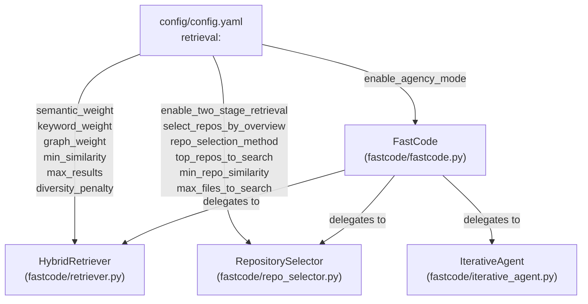
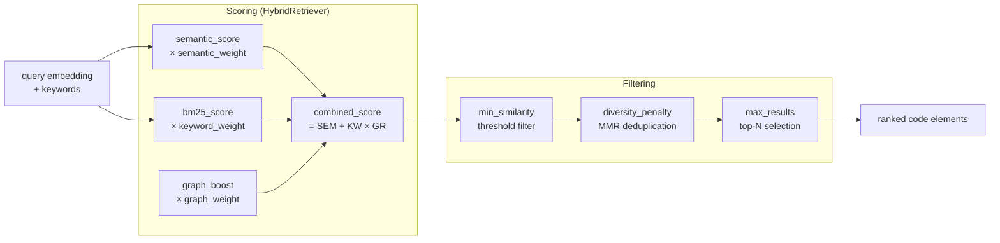
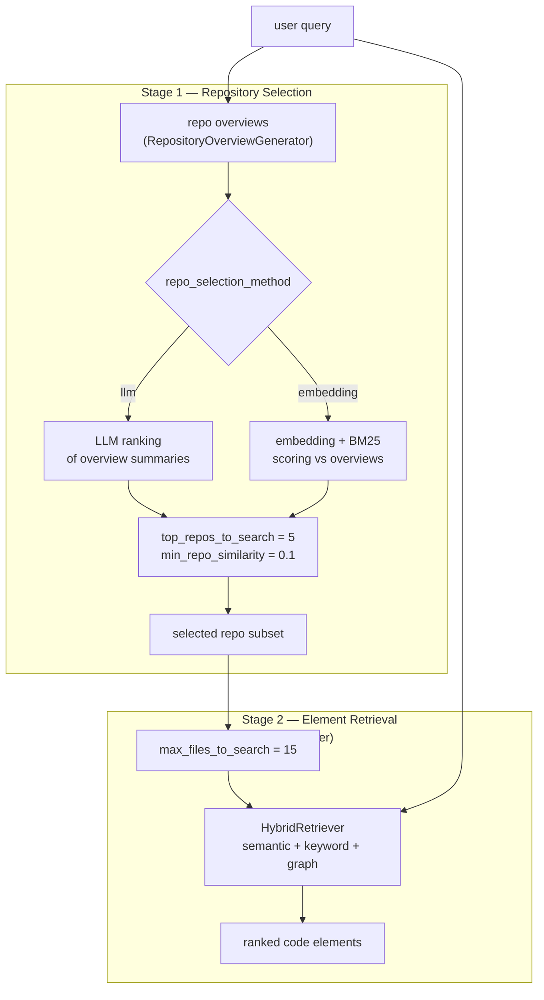
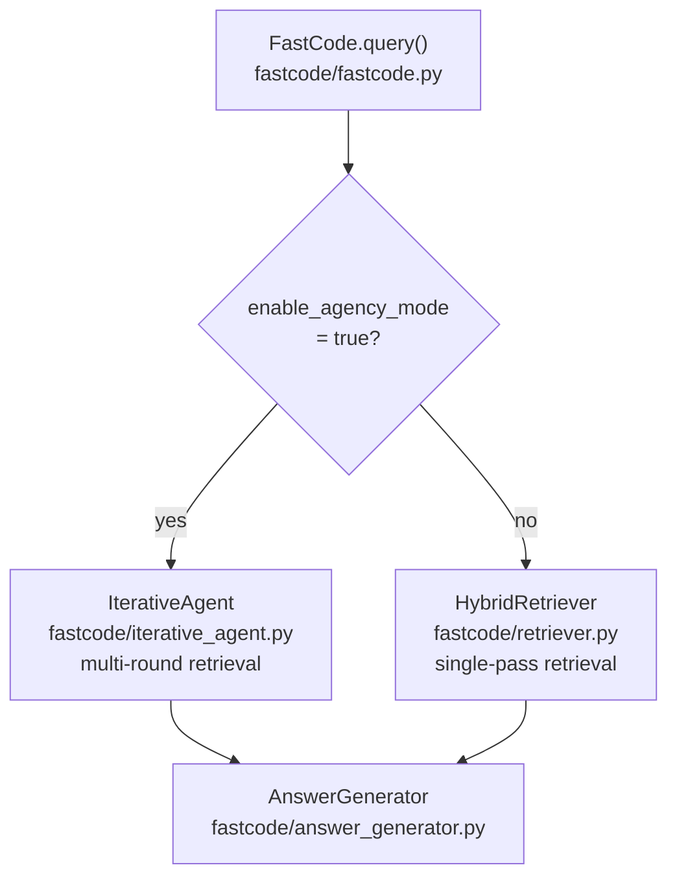

<!-- source: DeepWiki mcp.deepwiki.com · repo HKUDS/FastCode · page 8.6 Retrieval Configuration · fetched 2026-11-09 -->

# Retrieval Configuration

Relevant source files

The following files were used as context for generating this wiki page:

- [config/config.yaml](config/config.yaml)
- [fastcode/embedder.py](fastcode/embedder.py)

The `retrieval` section of `config/config.yaml` controls how FastCode searches indexed code when a query arrives. This covers hybrid search scoring weights, result filtering thresholds, multi-repository narrowing behavior, and whether agent-based retrieval is active.

For the vector store settings that determine what is indexed and how the underlying index is built, see [Vector Store Configuration](#8.5). For how queries are preprocessed before retrieval runs, see [Query Configuration](#8.7). For the agent's own iteration parameters (max rounds, confidence thresholds, line budgets), see [Agent Configuration](#8.9).

---

## Where These Settings Are Read

All keys under `retrieval:` in `config/config.yaml` are loaded and passed as a plain dictionary through the `FastCode` core orchestrator to the components that need them.

**Diagram: Retrieval config keys and the components that consume them**

Sources: [config/config.yaml:98-120]()

---

## Hybrid Search Weights

The `HybridRetriever` combines three search signals into a single ranked list. Each weight controls the relative contribution of one signal.

| Key | Default | Description |
|---|---|---|
| `semantic_weight` | `0.5` | Weight applied to cosine similarity scores from the vector store (FAISS/ChromaDB/Qdrant) |
| `keyword_weight` | `0.5` | Weight applied to BM25 term-frequency scores |
| `graph_weight` | `1` | Multiplicative boost applied using graph centrality (call graph, dependency graph, inheritance graph) |

The weights for `semantic_weight` and `keyword_weight` operate on an additive basis: the final score before graph application is `semantic_weight × semantic_score + keyword_weight × bm25_score`. The `graph_weight` acts as a multiplier on top of this combined score based on the element's graph connectivity.

> **Note:** `graph_weight` defaults to `1` (neutral multiplier). Setting it above `1` amplifies results that appear as highly connected nodes in the code graph; setting it to `0` disables graph-based boosting entirely. Setting `semantic_weight` and `keyword_weight` to equal values (both `0.5`) balances between embedding-based semantic search and exact keyword matching.

For documentation on how the graphs themselves are built, see [Multi-Layer Graph Modeling](#3.4). For graph build flags, see [Graph Configuration](#8.11).

Sources: [config/config.yaml:98-108]()

---

## Result Filtering

These settings gate which results survive after scoring and how many are returned.

| Key | Default | Description |
|---|---|---|
| `min_similarity` | `0.15` | Minimum combined score a candidate must reach to be included in results |
| `max_results` | `5` | Maximum number of code elements returned per retrieval call |
| `diversity_penalty` | `0.1` | Score deduction applied to candidates that are too similar to already-selected results (MMR-style deduplication) |

**How `diversity_penalty` works:** After ranking all candidates, results are selected greedily. Each time an element is selected, any remaining candidate whose similarity to the selected element exceeds a threshold has its score reduced by `diversity_penalty`. This prevents the top-`N` results from all being fragments of the same file.

**Diagram: Scoring and filtering pipeline within HybridRetriever**

Sources: [config/config.yaml:105-108]()

---

## Multi-Repository Retrieval Settings

When multiple repositories are indexed simultaneously, a naive full-search over all of them is expensive. The two-stage retrieval system narrows the search to only the most relevant repositories before running element-level retrieval. These keys control that narrowing step.

For a conceptual explanation of the two-stage process, see [Two-Stage Retrieval](#9.5). For the `RepositorySelector` class itself, see [Repository Selector](#5.4).

| Key | Default | Description |
|---|---|---|
| `enable_two_stage_retrieval` | `true` | Activates the repo-narrowing stage before fine-grained element retrieval |
| `select_repos_by_overview` | `true` | When `true`, compares the query against per-repo overview summaries to rank repos before searching their elements |
| `repo_selection_method` | `"llm"` | How repos are ranked: `"llm"` sends overviews to the configured LLM; `"embedding"` uses semantic + BM25 scoring against overview text |
| `top_repos_to_search` | `5` | Maximum number of repositories passed to the element-level retrieval stage |
| `min_repo_similarity` | `0.1` | Minimum similarity score a repository overview must reach to be included in the search pool |
| `max_files_to_search` | `15` | Maximum number of files searched within the selected repositories |

**`repo_selection_method` tradeoffs:**

| Method | Speed | Accuracy | Notes |
|---|---|---|---|
| `"llm"` | Slower | Higher | LLM reads full overview summaries and selects relevant repos with reasoning |
| `"embedding"` | Faster | Lower | Cosine similarity + BM25 scored against overview text, no LLM call |

**Diagram: Two-stage retrieval flow and configuration keys**

Sources: [config/config.yaml:110-116]()

---

## Agency Mode Flag

| Key | Default | Description |
|---|---|---|
| `enable_agency_mode` | `true` | When `true`, the `IterativeAgent` is used for retrieval instead of a single-pass `HybridRetriever` call |

When `enable_agency_mode` is `true`, `FastCode` delegates complex queries to `IterativeAgent` (`fastcode/iterative_agent.py`), which runs multiple retrieval rounds, evaluating confidence after each round and refining search parameters until a threshold is met or the maximum iteration count is reached.

When `false`, `FastCode` performs a single retrieval pass directly through `HybridRetriever`.

The agent's own stopping criteria (`max_iterations`, `confidence_threshold`, `min_confidence_gain`, line budgets) are configured separately under the `agent.iterative` block. See [Agent Configuration](#8.9) and [Iterative Agent](#5.1).

**Diagram: enable_agency_mode dispatch in FastCode**

Sources: [config/config.yaml:118-119]()

---

## Complete Retrieval Settings Reference

All keys listed under `retrieval:` in [config/config.yaml:98-120]():

| Key | Type | Default | Component |
|---|---|---|---|
| `semantic_weight` | float | `0.5` | `HybridRetriever` |
| `keyword_weight` | float | `0.5` | `HybridRetriever` |
| `graph_weight` | float | `1` | `HybridRetriever` |
| `min_similarity` | float | `0.15` | `HybridRetriever` |
| `max_results` | int | `5` | `HybridRetriever` |
| `diversity_penalty` | float | `0.1` | `HybridRetriever` |
| `enable_two_stage_retrieval` | bool | `true` | `FastCode` / `RepositorySelector` |
| `select_repos_by_overview` | bool | `true` | `RepositorySelector` |
| `repo_selection_method` | string | `"llm"` | `RepositorySelector` |
| `top_repos_to_search` | int | `5` | `RepositorySelector` |
| `min_repo_similarity` | float | `0.1` | `RepositorySelector` |
| `max_files_to_search` | int | `15` | `RepositorySelector` |
| `enable_agency_mode` | bool | `true` | `FastCode` → `IterativeAgent` |

For the full flat reference across all configuration sections, see [Configuration Reference](#12.1).

---

