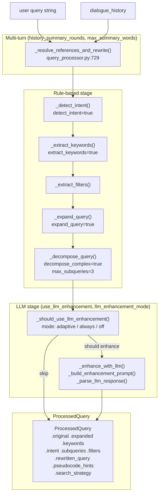
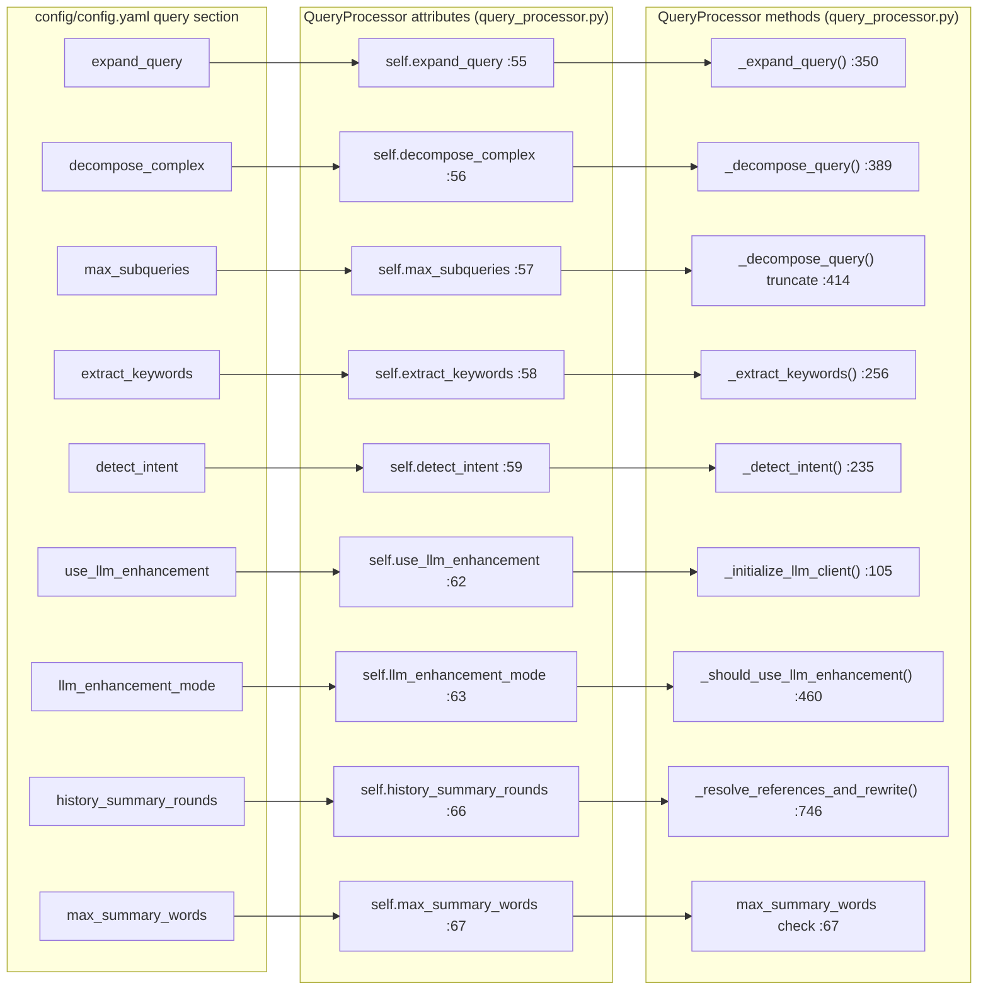

<!-- source: DeepWiki mcp.deepwiki.com · repo HKUDS/FastCode · page 8.7 Query Configuration · fetched 2026-11-09 -->

# Query Configuration

<details>
<summary>Relevant source files</summary>

The following files were used as context for generating this wiki page:

- [config/config.yaml](config/config.yaml)
- [fastcode/embedder.py](fastcode/embedder.py)
- [fastcode/query_processor.py](fastcode/query_processor.py)

</details>


This page documents the `query` section of `config/config.yaml`, which controls how the `QueryProcessor` class transforms raw user input before retrieval. It covers basic rule-based processing flags, LLM enhancement mode settings, and multi-turn dialogue parameters.

For information about how these settings interact at runtime, see the `QueryProcessor` documentation at page [4.7](#4.7). For settings that govern the LLM model used during enhancement (provider, temperature, model name), see Generation Configuration at page [8.8](#8.8). For settings that affect what happens after a processed query reaches the retrieval stage, see Retrieval Configuration at page [8.6](#8.6).

---

## Location in Configuration File

The `query` block occupies [config/config.yaml:122-140]() and is consumed by `QueryProcessor.__init__()` at [fastcode/query_processor.py:55-67]().

```yaml
query:
  expand_query: true
  decompose_complex: true
  max_subqueries: 3
  extract_keywords: true
  detect_intent: true

  use_llm_enhancement: true
  llm_enhancement_mode: "always"

  history_summary_rounds: 10
  max_summary_words: 500
```

Sources: [config/config.yaml:122-140]()

---

## Configuration Key Reference

| Key | Type | Default | Description |
|---|---|---|---|
| `expand_query` | bool | `true` | Expand query terms with synonyms via `_expand_query()` |
| `decompose_complex` | bool | `true` | Split multi-clause queries into subqueries via `_decompose_query()` |
| `max_subqueries` | int | `3` | Maximum number of subqueries produced by decomposition |
| `extract_keywords` | bool | `true` | Extract keyword tokens for BM25 search via `_extract_keywords()` |
| `detect_intent` | bool | `true` | Classify query intent (how/what/where/debug/explain/find/implement) |
| `use_llm_enhancement` | bool | `true` | Master switch for all LLM-based query enhancement |
| `llm_enhancement_mode` | string | `"always"` | Controls when the LLM enhancement runs: `"adaptive"`, `"always"`, or `"off"` |
| `history_summary_rounds` | int | `10` | Number of past turn summaries passed to the reference-resolution LLM call |
| `max_summary_words` | int | `500` | Maximum words allowed per turn summary stored in dialogue history |

Sources: [config/config.yaml:122-140](), [fastcode/query_processor.py:55-67]()

---

## Basic Processing Flags

These five flags control the rule-based processing stage that runs on every query, regardless of LLM availability.

### `expand_query`

When `true`, `_expand_query()` replaces common words with synonym lists. For example, the word `"function"` is expanded to `"function method procedure routine"`. This broadens BM25 keyword matches against the index.

[fastcode/query_processor.py:350-387]()

### `decompose_complex`

When `true`, `_decompose_query()` splits a query on connectors (`" and "`, `" or "`, `", "`, `"; "`) to produce a list of independent subqueries. Only parts with more than 15 characters are kept. The result is stored in `ProcessedQuery.subqueries`.

[fastcode/query_processor.py:389-418]()

### `max_subqueries`

Upper bound on the length of `ProcessedQuery.subqueries`. Truncation is applied at [fastcode/query_processor.py:414]().

### `extract_keywords`

When `true`, `_extract_keywords()` tokenizes the query, strips stopwords, and returns a list prioritizing known code-domain terms (`function`, `class`, `api`, `endpoint`, `auth`, etc.). These keywords feed into BM25 scoring.

[fastcode/query_processor.py:256-275]()

### `detect_intent`

When `true`, `_detect_intent()` pattern-matches the query against seven intent categories and stores the result in `ProcessedQuery.intent`. When `false`, the intent is set to `"general"`.

**Intent categories and their trigger terms:**

| Intent | Trigger words |
|---|---|
| `how` | how, implement, create, build, make |
| `what` | what, is, are, does, define, purpose |
| `where` | where, locate, find, which file |
| `debug` | error, bug, issue, problem, fix, why not, doesn't work |
| `explain` | explain, describe, tell me about, understand |
| `find` | find, search, locate, show me, list |
| `implement` | implement, write, code, develop, algorithm |

[fastcode/query_processor.py:235-254](), [fastcode/query_processor.py:86-94]()

Sources: [fastcode/query_processor.py:235-418](), [config/config.yaml:124-129]()

---

## LLM Enhancement Settings

### `use_llm_enhancement`

Master switch. When `false`, `self.llm_client` is set to `None` and all LLM calls are skipped. The `process()` method receives an optional `use_llm_enhancement` argument that can override this on a per-call basis ([fastcode/query_processor.py:132-153]()).

> **Note:** When the iterative agent is active, `QueryProcessor.process()` is called with `use_llm_enhancement=False` because the agent handles its own dialogue history integration. See page [5.1](#5.1) for details.

### `llm_enhancement_mode`

Controls the activation logic inside `_should_use_llm_enhancement()` at [fastcode/query_processor.py:460-510]().

| Mode | Behavior |
|---|---|
| `"always"` | LLM enhancement runs on every query |
| `"off"` | LLM enhancement is completely disabled even if `use_llm_enhancement: true` |
| `"adaptive"` | LLM runs only for queries classified as implementation-oriented, complex (≥3 tech terms or ≥15 words), or ambiguous (≤5 words and ≤1 tech term) |

**Adaptive mode decision logic:**

```
is_implementation = any trigger word in ["implement","how to","write","create","build","develop","algorithm","logic","code for","function that","method that"]
is_complex       = tech_term_count >= 3 OR word_count >= 15
is_ambiguous     = word_count <= 5 AND tech_term_count <= 1
should_enhance   = is_implementation OR is_complex OR is_ambiguous
```

[fastcode/query_processor.py:488-510]()

**Tradeoff summary:**

| Mode | Speed | Accuracy | LLM API calls |
|---|---|---|---|
| `"off"` | Fastest | Rule-based only | 0 per query |
| `"adaptive"` | Moderate | Selective improvement | 0–1 per query |
| `"always"` | Slowest | Highest | 1 per query |

Sources: [fastcode/query_processor.py:460-510](), [config/config.yaml:132-136]()

---

## LLM Enhancement Pipeline

When LLM enhancement runs, `_enhance_with_llm()` calls the configured LLM provider ([fastcode/query_processor.py:512-544]()) and the response is parsed by `_parse_llm_response()` ([fastcode/query_processor.py:613-727]()) to populate these fields of `ProcessedQuery`:

| `ProcessedQuery` field | Source |
|---|---|
| `rewritten_query` | `REWRITTEN_QUERY` tag in LLM response |
| `pseudocode_hints` | `PSEUDOCODE_HINTS` tag in LLM response |
| `search_strategy` | `SEARCH_STRATEGY` tag in LLM response |
| `intent` (refined) | `REFINED_INTENT` tag in LLM response, overrides rule-based intent |
| `keywords` (extended) | `SELECTED_KEYWORDS` tag in LLM response, merged with rule-based keywords |

The LLM enhancement prompt instructs the model to output responses in English regardless of the input language ([fastcode/query_processor.py:557]()).

Sources: [fastcode/query_processor.py:512-727]()

---

## Multi-Turn Dialogue Settings

These settings affect the reference resolution step that runs before main query processing when a `dialogue_history` is provided.

### `history_summary_rounds`

Limits how many past turn summaries are passed to `_resolve_references_and_rewrite()`. Only the most recent `history_summary_rounds` summaries are included.

[fastcode/query_processor.py:746]()

### `max_summary_words`

Controls the word budget per turn summary. This applies during answer generation (see [8.8](#8.8)) when summaries are extracted and stored. The query processor reads this to understand the expected summary size.

[fastcode/query_processor.py:67]()

### Reference resolution flow

When a `dialogue_history` is provided and LLM enhancement is not disabled, `_resolve_references_and_rewrite()` ([fastcode/query_processor.py:729-766]()) sends the current query and the windowed history to the LLM. The LLM is instructed to produce a self-contained rewritten query that resolves any pronouns or implicit references (e.g., "that function", "the class above").

Sources: [fastcode/query_processor.py:729-827](), [config/config.yaml:138-140]()

---

## Processing Flow Diagram

This diagram maps the `query` config keys to the exact code paths they activate.

**QueryProcessor.process() — config-driven branching**



Sources: [fastcode/query_processor.py:129-233](), [config/config.yaml:122-140]()

---

## Config Keys to Code Entities

This diagram maps each configuration key directly to the `QueryProcessor` attribute and method that reads or uses it.

**config/config.yaml `query.*` → QueryProcessor code entities**



Sources: [fastcode/query_processor.py:46-103](), [config/config.yaml:122-140]()

---

## Interaction with Other Config Sections

The `query` section does not operate in isolation. Several cross-section dependencies exist:

| Dependency | Description |
|---|---|
| `generation.provider` | `QueryProcessor` reads this to decide whether to instantiate `OpenAI` or `Anthropic` client for LLM calls ([fastcode/query_processor.py:71]()) |
| `generation.enable_multi_turn` | Determines whether `dialogue_history` is passed to `process()` at all; see [8.8](#8.8) |
| `generation.context_rounds` | Controls how many full dialogue rounds are sent to the answer generator; complements `history_summary_rounds` |
| `retrieval.enable_agency_mode` | When `true`, `process()` is called with `use_llm_enhancement=False`; the agent owns LLM-based history handling; see [8.6](#8.6) |

Sources: [fastcode/query_processor.py:62-83](), [config/config.yaml:131-160]()

---

