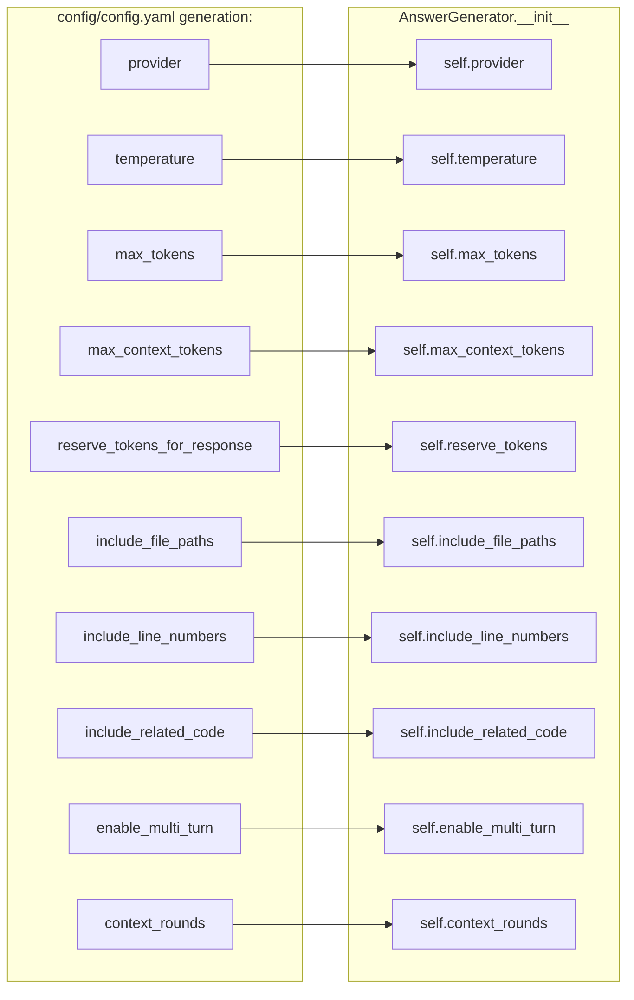
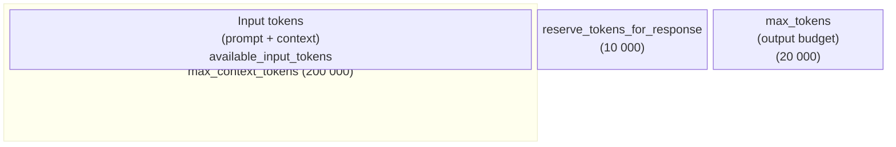
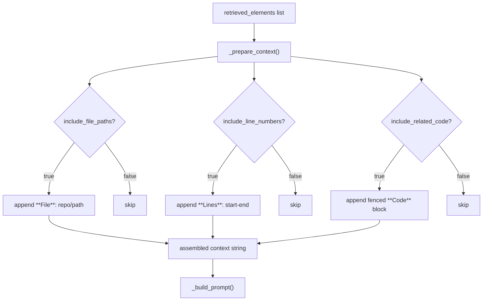
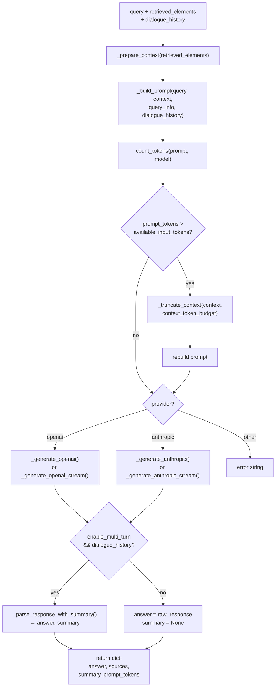

<!-- source: DeepWiki mcp.deepwiki.com · repo HKUDS/FastCode · page 8.8 Generation Configuration · fetched 2026-11-09 -->

# Generation Configuration

<details>
<summary>Relevant source files</summary>

The following files were used as context for generating this wiki page:

- [config/config.yaml](config/config.yaml)
- [fastcode/answer_generator.py](fastcode/answer_generator.py)
- [fastcode/embedder.py](fastcode/embedder.py)

</details>


This page documents the `generation` section of `config/config.yaml`, which controls how the `AnswerGenerator` class constructs prompts, manages the LLM context window, and formats the final response. It covers LLM provider selection, token budgeting, prompt inclusion flags, and multi-turn dialogue settings.

> **Note**: The LLM model name and API base URL are **not** read from `config.yaml`. They are sourced from the `MODEL` and `BASE_URL` environment variables respectively. For a full listing of environment variables, see [Environment Configuration](#2.2). For query-side configuration that happens before generation, see [Query Configuration](#8.7). For agent-specific generation settings, see [Agent Configuration](#8.9).

---

## Configuration Block

The full `generation` section in `config/config.yaml`:

[config/config.yaml:142-160]()

```yaml
# Answer Generation
# NOTE: model and base_url are read from environment variables (MODEL, BASE_URL)
generation:
  provider: "openai"          # openai, anthropic, or local
  temperature: 0.4
  max_tokens: 20000

  # Context window management
  max_context_tokens: 200000
  reserve_tokens_for_response: 10000

  # Prompt settings
  include_file_paths: true
  include_line_numbers: true
  include_related_code: true

  # Multi-turn dialogue settings
  enable_multi_turn: true
  context_rounds: 10
```

Sources: [config/config.yaml:142-160]()

---

## Settings Reference

| Key | Type | Default | Description |
|---|---|---|---|
| `provider` | string | `"openai"` | LLM backend: `openai`, `anthropic`, or `local` |
| `temperature` | float | `0.4` | Sampling temperature for generation |
| `max_tokens` | int | `20000` | Maximum tokens the LLM is allowed to produce |
| `max_context_tokens` | int | `200000` | Total context window size of the model |
| `reserve_tokens_for_response` | int | `10000` | Token headroom reserved beyond `max_tokens` |
| `include_file_paths` | bool | `true` | Prepend file path to each code snippet in the prompt |
| `include_line_numbers` | bool | `true` | Include line range for each retrieved element |
| `include_related_code` | bool | `true` | Include code body from retrieved elements |
| `enable_multi_turn` | bool | `true` | Activate multi-turn dialogue mode with summary extraction |
| `context_rounds` | int | `10` | Number of past turns to include in the prompt |

Sources: [config/config.yaml:142-160](), [fastcode/answer_generator.py:26-41]()

---

## How Settings Map to `AnswerGenerator`

**Configuration-to-Code Mapping**



Sources: [fastcode/answer_generator.py:22-41]()

---

## Provider Selection

`provider` determines which LLM backend `AnswerGenerator._initialize_client()` instantiates:

| `provider` value | Client created | API key env var |
|---|---|---|
| `"openai"` | `OpenAI(api_key=..., base_url=...)` | `OPENAI_API_KEY` |
| `"anthropic"` | `Anthropic(api_key=..., base_url=...)` | `ANTHROPIC_API_KEY` |
| anything else | `None` (warning logged) | — |

Both clients accept an optional `BASE_URL` override from the environment, enabling proxies and compatible third-party endpoints.

The model name is read from `os.getenv("MODEL")` at runtime, not from `config.yaml`.

Sources: [fastcode/answer_generator.py:53-69]()

---

## Token Budget and Context Window Management

### The Token Budget Formula

`AnswerGenerator.generate()` and `generate_stream()` compute the maximum allowable input token count using:

```
available_input_tokens = max_context_tokens - max_tokens - reserve_tokens_for_response
```

**Token Budget Diagram**



Sources: [fastcode/answer_generator.py:106](), [fastcode/answer_generator.py:231]()

### Truncation Behavior

If the assembled prompt exceeds `available_input_tokens`, `AnswerGenerator` applies context truncation before sending to the LLM:

1. Rebuild the prompt with an empty context string to measure its base token count (`base_tokens`).
2. Compute `context_token_budget = available_input_tokens - base_tokens - 100`.
3. Call `_truncate_context(context, context_token_budget)`, which delegates to `truncate_to_tokens()` in `fastcode/utils.py`.
4. Rebuild the final prompt with the truncated context.

If `context_token_budget` is zero or negative, the context is dropped entirely.

Sources: [fastcode/answer_generator.py:107-141]()

---

## Prompt Inclusion Flags

Three flags in the `generation` section control what metadata appears alongside each retrieved code element in the prompt:

| Flag | Corresponding `_prepare_context()` behavior |
|---|---|
| `include_file_paths` | Appends a `**File**: \`repo/path\`` line per element |
| `include_line_numbers` | Appends `**Lines**: start-end` when `start_line > 0` |
| `include_related_code` | Appends the full `**Code**: ...` fenced block |

All three default to `true`. Disabling them reduces token usage at the cost of fewer code references in the answer.

**Prompt Inclusion Flag Flow**



Sources: [fastcode/answer_generator.py:447-515]()

---

## Multi-Turn Dialogue Settings

### `enable_multi_turn`

When `true`, `AnswerGenerator` operates in multi-turn mode:

- The system prompt is extended with `<SUMMARY>` tag instructions, asking the LLM to append a structured summary to its response.
- `_parse_response_with_summary()` strips the `<SUMMARY>...</SUMMARY>` block from the visible answer and returns it separately.
- `generate_stream()` uses `_stream_with_summary_filter()` to remove summary tokens from the streamed display in real time.
- If the LLM omits the summary, `_generate_fallback_summary()` constructs one from the retrieved elements.

When `false`, the summary machinery is bypassed entirely and `raw_response` is returned as-is.

Sources: [fastcode/answer_generator.py:159-169](), [fastcode/answer_generator.py:267-311](), [fastcode/answer_generator.py:737-768]()

### `context_rounds`

Controls how many turns from `dialogue_history` are prepended to the user prompt in `_build_prompt()`:

```python
recent_history = dialogue_history[-self.context_rounds:]
```

Each included turn contributes its `query` and `summary` fields. Reducing `context_rounds` lowers token consumption for long conversations at the cost of shorter contextual memory.

Sources: [fastcode/answer_generator.py:585-596]()

---

## End-to-End Generation Flow

**`AnswerGenerator.generate()` / `generate_stream()` — Decision Flow**



Sources: [fastcode/answer_generator.py:71-194](), [fastcode/answer_generator.py:196-319]()

---

## Interaction with Other Configuration Sections

| Related config section | Interaction |
|---|---|
| `query.history_summary_rounds` | Controls how many summaries the `QueryProcessor` feeds back into the query; `generation.context_rounds` controls how many turns `AnswerGenerator` includes in the prompt |
| `agent.iterative.temperature_agent` | A separate temperature used by the iterative agent's planning steps, independent of `generation.temperature` |
| `agent.iterative.max_tokens_agent` | A separate token limit for agent reasoning calls, independent of `generation.max_tokens` |

For the query-side history settings, see [Query Configuration](#8.7). For agent-specific generation parameters, see [Agent Configuration](#8.9).

Sources: [config/config.yaml:122-160](), [config/config.yaml:169-180]()

---

