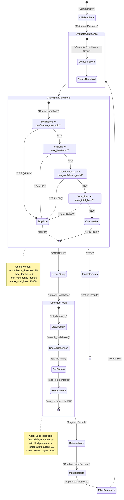
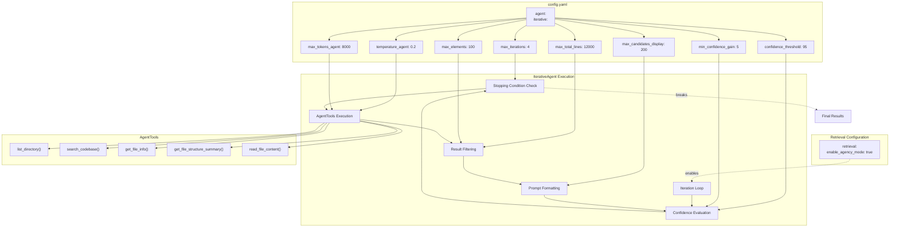

<!-- source: DeepWiki mcp.deepwiki.com · repo HKUDS/FastCode · page 8.9 Agent Configuration · fetched 2026-11-09 -->

# Agent Configuration

<details>
<summary>Relevant source files</summary>

The following files were used as context for generating this wiki page:

- [config/config.yaml](config/config.yaml)
- [fastcode/embedder.py](fastcode/embedder.py)
- [fastcode/iterative_agent.py](fastcode/iterative_agent.py)

</details>


This page documents the configuration options for FastCode's iterative agent system, which enables multi-round code exploration with confidence-based stopping conditions. The agent iteratively refines retrieval results until it reaches sufficient confidence or hits resource limits.

**Related Pages:**
- For understanding how the iterative agent works, see [Iterative Agent](#5.1)
- For details on agent exploration tools, see [Agent Tools](#5.2)
- For enabling/disabling agency mode, see [Agency Mode](#5.3)
- For retrieval-level agency settings, see [Retrieval Configuration](#8.6)

---

## Configuration Location

All agent-related settings are defined in the `agent:` section of [config/config.yaml:169-181]().

```yaml
agent:
  iterative:
    max_iterations: 4
    confidence_threshold: 95
    min_confidence_gain: 5
    max_total_lines: 12000
    temperature_agent: 0.2
    max_tokens_agent: 8000
    max_elements: 100
    max_candidates_display: 200
```

**Sources:** [config/config.yaml:169-181]()

---

## Configuration Parameters

### Iteration Control Parameters

| Parameter | Type | Default | Description |
|-----------|------|---------|-------------|
| `max_iterations` | int | 4 | Maximum number of refinement rounds the agent will perform |
| `confidence_threshold` | int | 95 | Stop iterating when confidence reaches this percentage (0-100) |
| `min_confidence_gain` | int | 5 | Minimum confidence improvement required per iteration to continue (percentage points) |
| `max_total_lines` | int | 12000 | Maximum total lines of code to retrieve across all iterations |

### LLM Parameters for Agent Reasoning

| Parameter | Type | Default | Description |
|-----------|------|---------|-------------|
| `temperature_agent` | float | 0.2 | Temperature for agent reasoning LLM calls (lower = more deterministic) |
| `max_tokens_agent` | int | 8000 | Maximum tokens for agent response generation |

### Result Management Parameters

| Parameter | Type | Default | Description |
|-----------|------|---------|-------------|
| `max_elements` | int | 100 | Maximum code elements to keep after relevance filtering |
| `max_candidates_display` | int | 200 | Maximum candidate elements to display when formatting agent prompts |

**Sources:** [config/config.yaml:169-181]()

---

## Stopping Conditions Logic

The iterative agent uses multiple stopping conditions to balance accuracy with resource efficiency. The following diagram illustrates how configuration parameters control the iteration loop:

**Agent Iteration Control Flow**



**Sources:** [config/config.yaml:173-176](), [fastcode/agent_tools.py:1-543]()

---

## Configuration Parameter Details

### max_iterations

Controls the maximum number of refinement rounds the agent will perform. Each iteration consists of:
1. Evaluating current results
2. Deciding if more information is needed
3. Using AgentTools to explore the codebase
4. Retrieving additional code elements

**Default:** `4`

**Typical Range:** 2-6

**Impact:**
- **Lower values (2-3):** Faster execution, may miss relevant code
- **Higher values (5-6):** More thorough exploration, higher token cost

**Example Configuration:**
```yaml
agent:
  iterative:
    max_iterations: 3  # Faster, less thorough
```

**Sources:** [config/config.yaml:173]()

---

### confidence_threshold

The confidence percentage (0-100) at which the agent considers its results sufficient and stops iterating. The agent computes confidence based on result completeness and relevance.

**Default:** `95`

**Typical Range:** 85-98

**Impact:**
- **Lower values (85-90):** Agent stops earlier, faster but potentially incomplete
- **Higher values (95-98):** Agent pursues higher quality, more iterations

**Example Configuration:**
```yaml
agent:
  iterative:
    confidence_threshold: 90  # Stop earlier when "good enough"
```

**Sources:** [config/config.yaml:174]()

---

### min_confidence_gain

Minimum improvement in confidence percentage points required between iterations to justify continuing. If the confidence improvement falls below this threshold, the agent stops.

**Default:** `5`

**Typical Range:** 3-10

**Impact:**
- **Lower values (3-5):** Agent continues with marginal improvements
- **Higher values (8-10):** Agent stops if not making significant progress

**Example Configuration:**
```yaml
agent:
  iterative:
    min_confidence_gain: 8  # Require substantial improvement
```

**Sources:** [config/config.yaml:175]()

---

### max_total_lines

Maximum total lines of code the agent will retrieve across all iterations. This prevents excessive context window usage.

**Default:** `12000`

**Typical Range:** 8000-20000

**Impact:**
- **Lower values (8000-10000):** Reduced token cost, may truncate important context
- **Higher values (15000-20000):** More comprehensive context, higher cost

**Example Configuration:**
```yaml
agent:
  iterative:
    max_total_lines: 15000  # Allow more context
```

**Sources:** [config/config.yaml:176]()

---

### temperature_agent

Temperature parameter for LLM calls during agent reasoning. Controls randomness in agent decision-making.

**Default:** `0.2`

**Typical Range:** 0.0-0.5

**Impact:**
- **Lower values (0.0-0.1):** More deterministic, consistent decisions
- **Higher values (0.3-0.5):** More creative exploration paths

**Note:** Agent reasoning typically benefits from low temperature for consistent, logical decisions.

**Example Configuration:**
```yaml
agent:
  iterative:
    temperature_agent: 0.1  # Very deterministic
```

**Sources:** [config/config.yaml:177]()

---

### max_tokens_agent

Maximum tokens for agent response generation during each iteration step.

**Default:** `8000`

**Typical Range:** 4000-16000

**Impact:**
- **Lower values (4000-6000):** Shorter agent responses, may truncate reasoning
- **Higher values (10000-16000):** More detailed agent reasoning, higher cost

**Example Configuration:**
```yaml
agent:
  iterative:
    max_tokens_agent: 12000  # Allow longer reasoning
```

**Sources:** [config/config.yaml:178]()

---

### max_elements

Maximum number of code elements (functions, classes, etc.) to keep after relevance filtering in each iteration.

**Default:** `100`

**Typical Range:** 50-200

**Impact:**
- **Lower values (50-80):** Stricter filtering, less context
- **Higher values (150-200):** More permissive filtering, more context

**Example Configuration:**
```yaml
agent:
  iterative:
    max_elements: 150  # Keep more candidates
```

**Sources:** [config/config.yaml:179]()

---

### max_candidates_display

Maximum number of candidate elements to display in formatted prompts to the agent during iteration.

**Default:** `200`

**Typical Range:** 100-300

**Impact:**
- **Lower values (100-150):** Shorter prompts, may miss context
- **Higher values (250-300):** Longer prompts with more options

**Example Configuration:**
```yaml
agent:
  iterative:
    max_candidates_display: 250  # Show more candidates
```

**Sources:** [config/config.yaml:180]()

---

## Configuration Mapping to Agent Behavior

The following diagram shows how configuration parameters flow through the agent system:

**Configuration to Execution Flow**



**Sources:** [config/config.yaml:169-181](), [config/config.yaml:119](), [fastcode/agent_tools.py:15-543]()

---

## Interaction with Other Configuration

### Enabling Agency Mode

The agent configuration only takes effect when agency mode is enabled in retrieval settings:

```yaml
retrieval:
  enable_agency_mode: true  # Must be true to use agent
```

See [Retrieval Configuration](#8.6) for more details.

**Sources:** [config/config.yaml:119]()

---

### Agent Model Selection

The agent uses LLM models configured through environment variables, not config.yaml:

```bash
# In .env file
OPENAI_API_KEY=your_key
MODEL=gpt-4-turbo  # Used for agent reasoning
BASE_URL=https://api.openai.com/v1
```

The agent uses the same model as answer generation, but with `temperature_agent` instead of the generation temperature.

**Sources:** [README.md:209-213]()

---

## Configuration Examples

### Example 1: High-Accuracy Configuration

For maximum accuracy, willing to trade speed:

```yaml
agent:
  iterative:
    max_iterations: 6           # Allow more rounds
    confidence_threshold: 98    # Very high confidence required
    min_confidence_gain: 3      # Continue even with small gains
    max_total_lines: 20000      # Large context window
    temperature_agent: 0.1      # Very deterministic
    max_tokens_agent: 12000     # Allow detailed reasoning
    max_elements: 150           # Keep more candidates
    max_candidates_display: 300 # Show many options
```

**Use Case:** Critical code analysis, security audits, complex refactoring

---

### Example 2: Fast Exploration Configuration

For quick exploration, prioritizing speed:

```yaml
agent:
  iterative:
    max_iterations: 2           # Quick iterations
    confidence_threshold: 85    # Lower threshold
    min_confidence_gain: 10     # Require clear improvements
    max_total_lines: 8000       # Smaller context
    temperature_agent: 0.2      # Default determinism
    max_tokens_agent: 6000      # Shorter responses
    max_elements: 80            # Fewer candidates
    max_candidates_display: 150 # Fewer options shown
```

**Use Case:** Quick code exploration, understanding high-level architecture

---

### Example 3: Balanced Default Configuration

The default balanced configuration (as shipped):

```yaml
agent:
  iterative:
    max_iterations: 4           # Moderate iterations
    confidence_threshold: 95    # High but achievable
    min_confidence_gain: 5      # Reasonable progress
    max_total_lines: 12000      # Good context size
    temperature_agent: 0.2      # Low temperature
    max_tokens_agent: 8000      # Standard tokens
    max_elements: 100           # Standard elements
    max_candidates_display: 200 # Standard display
```

**Use Case:** General-purpose code understanding

**Sources:** [config/config.yaml:169-181]()

---

## Performance Tuning Guidelines

### Reducing Token Cost

To minimize LLM API costs:

1. **Decrease iterations:** `max_iterations: 2-3`
2. **Lower confidence threshold:** `confidence_threshold: 85-90`
3. **Reduce context:** `max_total_lines: 8000-10000`
4. **Limit agent tokens:** `max_tokens_agent: 4000-6000`

---

### Improving Accuracy

To maximize result quality:

1. **Increase iterations:** `max_iterations: 5-6`
2. **Raise confidence threshold:** `confidence_threshold: 95-98`
3. **Allow more context:** `max_total_lines: 15000-20000`
4. **Keep more candidates:** `max_elements: 150-200`

---

### Balancing Speed vs. Quality

The stopping conditions create natural trade-offs:

| Scenario | Iterations | Confidence | Lines | Speed | Accuracy |
|----------|-----------|------------|-------|-------|----------|
| Fast | 2 | 85 | 8000 | ⚡⚡⚡ | ⭐⭐ |
| Balanced | 4 | 95 | 12000 | ⚡⚡ | ⭐⭐⭐ |
| Thorough | 6 | 98 | 20000 | ⚡ | ⭐⭐⭐⭐ |

---

## Monitoring Agent Behavior

### Log Messages

The agent logs its decision-making process. Enable debug logging to observe:

```yaml
logging:
  level: "DEBUG"  # In config.yaml
```

Look for log patterns indicating:
- Iteration count
- Current confidence scores
- Stopping condition that triggered
- Tools used in each iteration

---

### Result Metadata

Query responses include agent metadata when agency mode is used:

```json
{
  "answer": "...",
  "sources": [...],
  "total_tokens": 45000,
  "agent_iterations": 3,
  "final_confidence": 96,
  "stopped_reason": "confidence_threshold_reached"
}
```

**Sources:** [config/config.yaml:202-206]()

---

## Common Configuration Issues

### Issue: Agent Stops Too Early

**Symptoms:** Results seem incomplete, low iteration count

**Solutions:**
- Increase `max_iterations`
- Increase `confidence_threshold`
- Decrease `min_confidence_gain`

---

### Issue: Agent Runs Too Many Iterations

**Symptoms:** High token costs, slow responses

**Solutions:**
- Decrease `max_iterations`
- Decrease `confidence_threshold`
- Increase `min_confidence_gain`

---

### Issue: Context Window Exceeded

**Symptoms:** Errors about token limits

**Solutions:**
- Decrease `max_total_lines`
- Decrease `max_elements`
- Check `generation.max_context_tokens` in [Generation Configuration](#8.8)

---

## Related Configuration Sections

- **Retrieval Configuration** ([#8.6](#8.6)): Controls `enable_agency_mode`
- **Generation Configuration** ([#8.8](#8.8)): Controls LLM provider and context window
- **Query Configuration** ([#8.7](#8.7)): Controls query enhancement that feeds the agent

---

**Sources:** [config/config.yaml:169-181](), [fastcode/agent_tools.py:1-543](), [README.md:92-113]()

---

