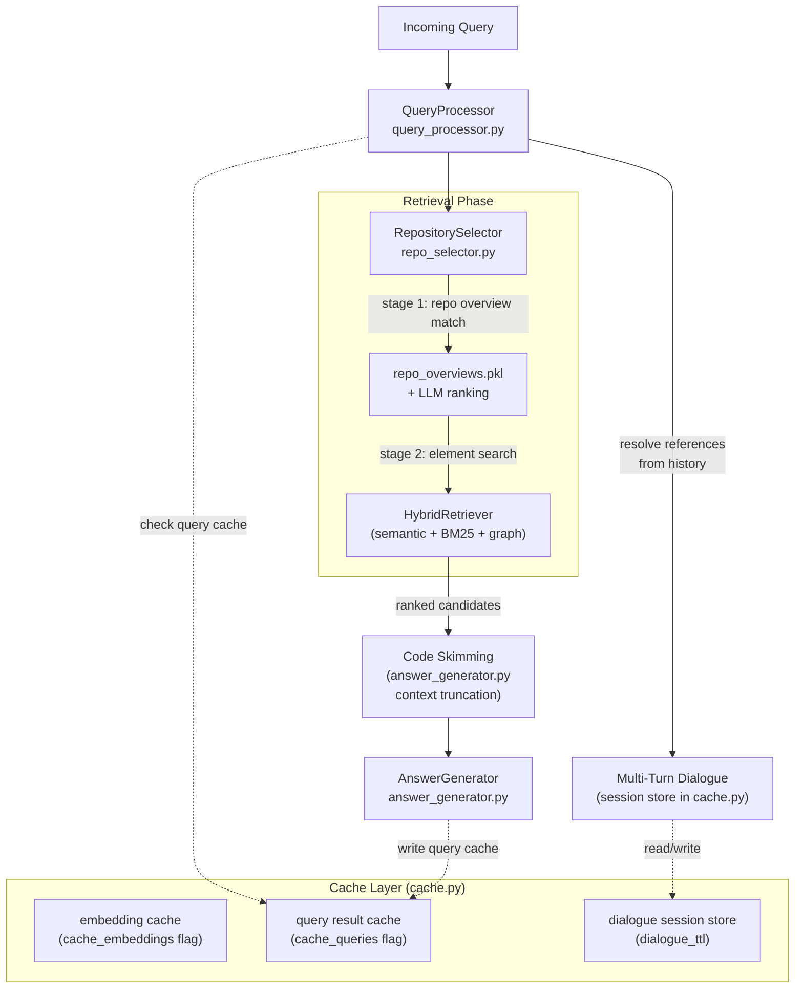
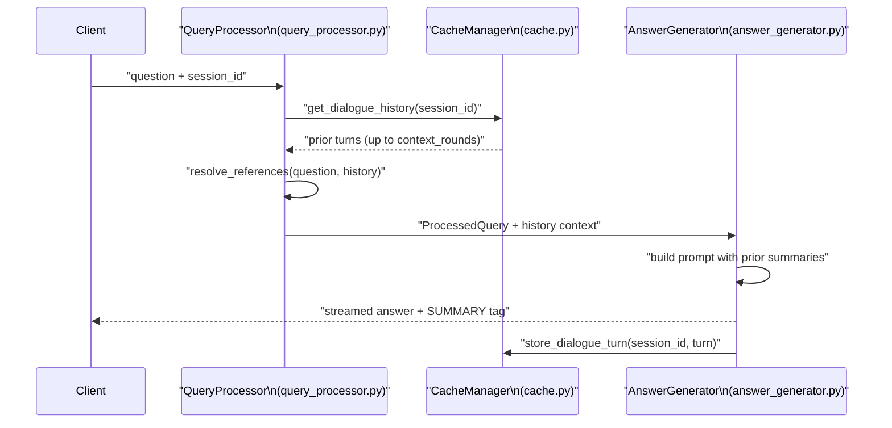
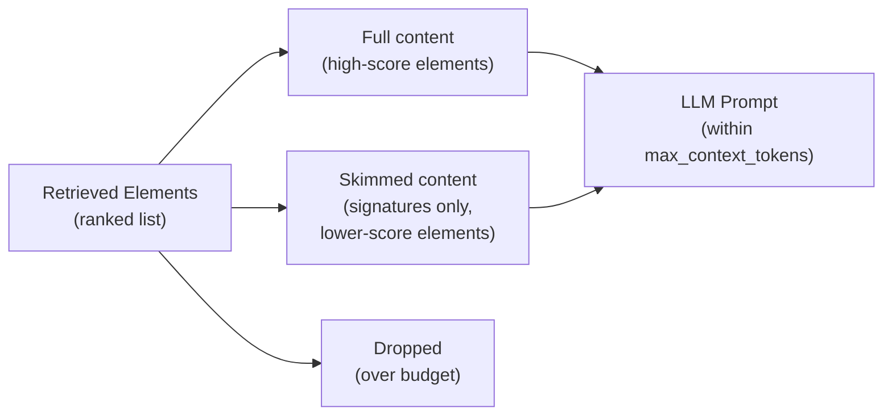
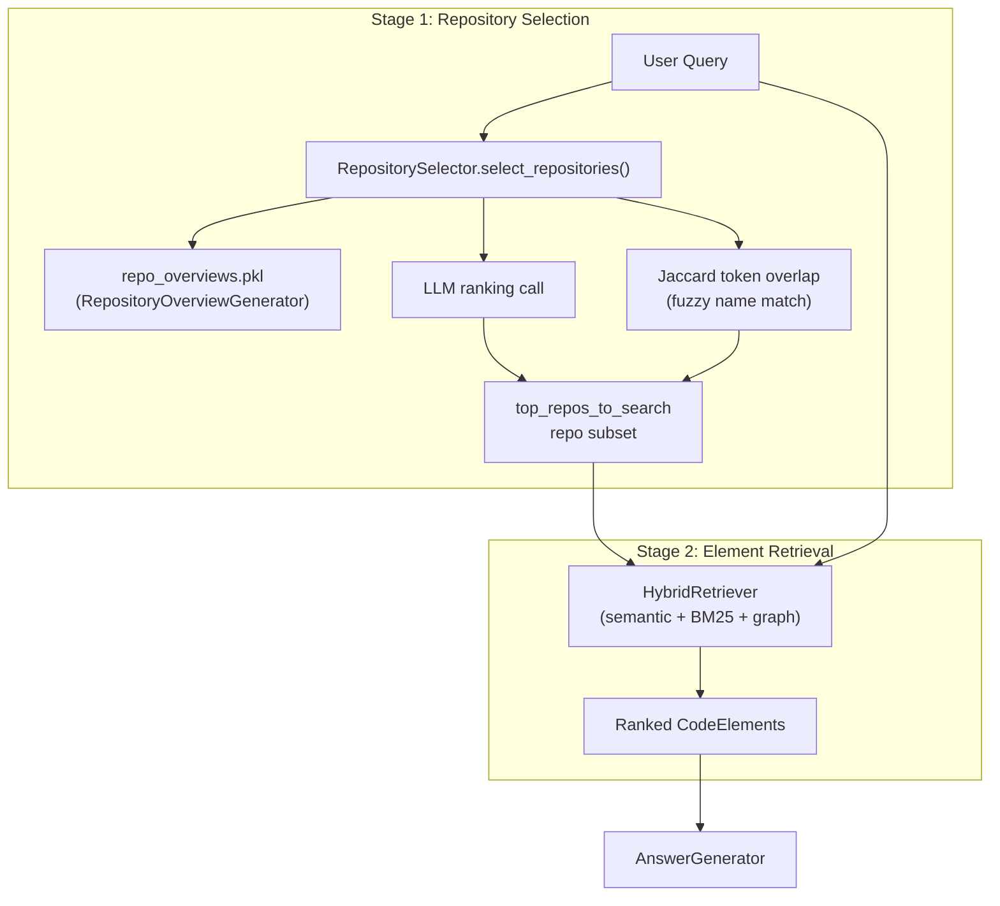
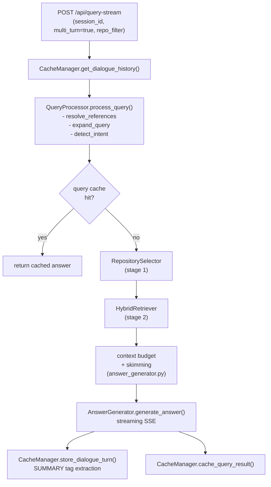

<!-- source: DeepWiki mcp.deepwiki.com · repo HKUDS/FastCode · page 9 Advanced Features · fetched 2026-11-09 -->

# Advanced Features

Relevant source files

The following files were used as context for generating this wiki page:

- [README.md](README.md)

This page is an index for FastCode capabilities that extend beyond basic single-repository indexing and querying. Each section introduces a feature area and directs you to the detailed sub-page.

The features covered here operate across the pipeline: from how retrieval candidates are selected ([Two-Stage Retrieval](#9.5)), to how context is pruned before reaching the LLM ([Code Skimming](#9.4)), to how results and sessions are persisted across requests ([Caching System](#9.1), [Multi-Turn Dialogue](#9.2)), and how the system can be tuned for throughput ([Performance Optimization](#9.3)).

For configuration knobs that control these features, see the [Configuration](#8) reference pages. For the agent-mode iterative loop, see [Agent System](#5).

---

## Feature Map

The diagram below shows which code module implements each advanced feature and where it sits in the request lifecycle.

**Advanced Features: Module Mapping**

Sources: [README.md:85-116]()

---

## Summary of Advanced Features

| Feature | Primary Module(s) | Config Section | Page |
|---|---|---|---|
| Caching System | `cache.py` (`CacheManager`) | `cache:` | [9.1](#9.1) |
| Multi-Turn Dialogue | `cache.py`, `query_processor.py`, `answer_generator.py` | `query:`, `generation:` | [9.2](#9.2) |
| Performance Optimization | `embedder.py`, `cache.py`, `loader.py` | `embedding:`, `cache:`, `repository:` | [9.3](#9.3) |
| Code Skimming | `answer_generator.py` | `generation:` | [9.4](#9.4) |
| Two-Stage Retrieval | `repo_selector.py`, `query_processor.py` | `retrieval:` | [9.5](#9.5) |

---

## 9.1 — Caching System

`CacheManager` in `cache.py` provides three independent caches backed by either disk or Redis:

- **Embedding cache** — stores computed embedding vectors keyed by content hash; avoids re-running `SentenceTransformer` on unchanged code.
- **Query result cache** — stores full `(question, repo_filter)` → `answer` mappings with a configurable TTL.
- **Dialogue session store** — persists ordered turn lists keyed by `session_id`, enabling multi-turn conversations to survive server restarts.

See [Caching System](#9.1) for the full implementation details including backend initialization, TTL management, and failure handling.

---

## 9.2 — Multi-Turn Dialogue

Multi-turn mode links sequential queries through a shared `session_id`. The key interactions are:

1. `QueryProcessor` resolves pronouns and implicit references against stored history.
2. `AnswerGenerator` prepends a windowed context of prior turns (governed by `context_rounds` in `config.yaml`).
3. Each completed turn is written back to the session store via `CacheManager`.
4. `AnswerGenerator` emits a `
` tag in its output; this tag is extracted and stored as the compressed history entry, keeping token costs bounded.

**Multi-Turn Dialogue Flow**

See [Multi-Turn Dialogue](#9.2) for the full session lifecycle and SUMMARY tag extraction.

---

## 9.3 — Performance Optimization

Performance-critical paths and their tuning handles:

| Bottleneck | Tuning Handle | Location |
|---|---|---|
| Embedding latency | `device: auto/cuda/mps/cpu`, `batch_size` | `embedding:` in `config.yaml` |
| Re-indexing on restart | `index scan cache` TTL + `sample_size` | `vector_store:` in `config.yaml` |
| Clone time | `clone_depth: 1` (shallow clone) | `repository:` in `config.yaml` |
| Repeated query cost | `cache_queries: true` | `cache:` in `config.yaml` |
| Retrieval precision vs. recall | `semantic_weight`, `keyword_weight`, `graph_weight` | `retrieval:` in `config.yaml` |

`CodeEmbedder` in `embedder.py` auto-detects the best available device (CUDA → MPS → CPU) at startup. Batch size directly controls throughput during initial indexing.

See [Performance Optimization](#9.3) for guidance on each tuning lever.

---

## 9.4 — Code Skimming

Code skimming is the mechanism by which `AnswerGenerator` in `answer_generator.py` reduces token consumption when the retrieved context exceeds the configured `max_context_tokens` budget.

Instead of truncating full file contents arbitrarily, skimming retains only the structural skeleton of lower-priority elements — function signatures, class definitions, and type annotations — discarding bodies. This preserves navigability of the context while reducing token count substantially.

**Context Budget Management**

The `reserve_tokens_for_response` setting in `config.yaml` under `generation:` carves out a guaranteed portion of the context window for the model's output before the skimming budget is calculated.

See [Code Skimming](#9.4) for implementation details.

---

## 9.5 — Two-Stage Retrieval

When multiple repositories are indexed, FastCode uses a two-stage selection strategy to avoid searching every repository for every query:

**Stage 1 — Repository Selection (`RepositorySelector` in `repo_selector.py`):**  
`RepositorySelector` uses pre-computed repository overviews (stored in `repo_overviews.pkl`) and LLM-assisted ranking to identify the `top_repos_to_search` most relevant repositories. Fuzzy name matching via Jaccard token overlap supplements the LLM ranking when repository names appear in the query.

**Stage 2 — Element Retrieval (`HybridRetriever`):**  
Fine-grained retrieval (semantic + BM25 + graph) runs only against the repositories selected in Stage 1.

**Two-Stage Retrieval Flow**

This is controlled by the `select_repos_by_overview`, `top_repos_to_search`, and `min_repo_similarity` knobs in the `retrieval:` section of `config.yaml`.

See [Two-Stage Retrieval](#9.5) and [Repository Selector](#5.4) for full details.

---

## How the Advanced Features Interact

All advanced features operate concurrently within a single query lifecycle. The diagram below shows their combined contribution to a multi-turn, multi-repo query.

**Full Advanced Feature Interaction (Multi-Turn, Multi-Repo Query)**

Sources: [README.md:99-116](), [README.md:638-643]()

---

