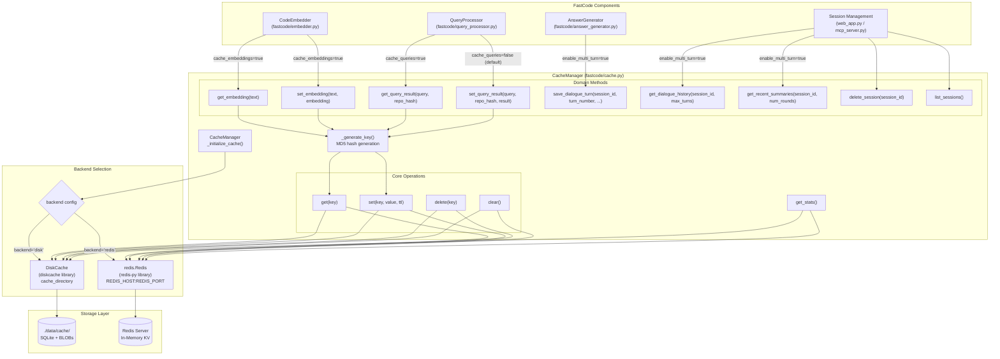
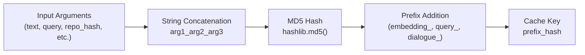
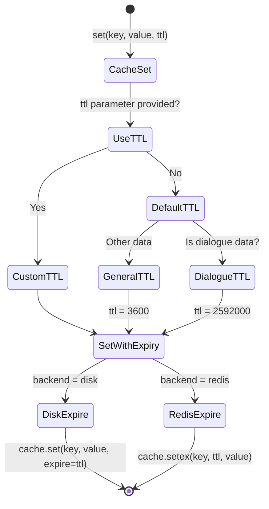
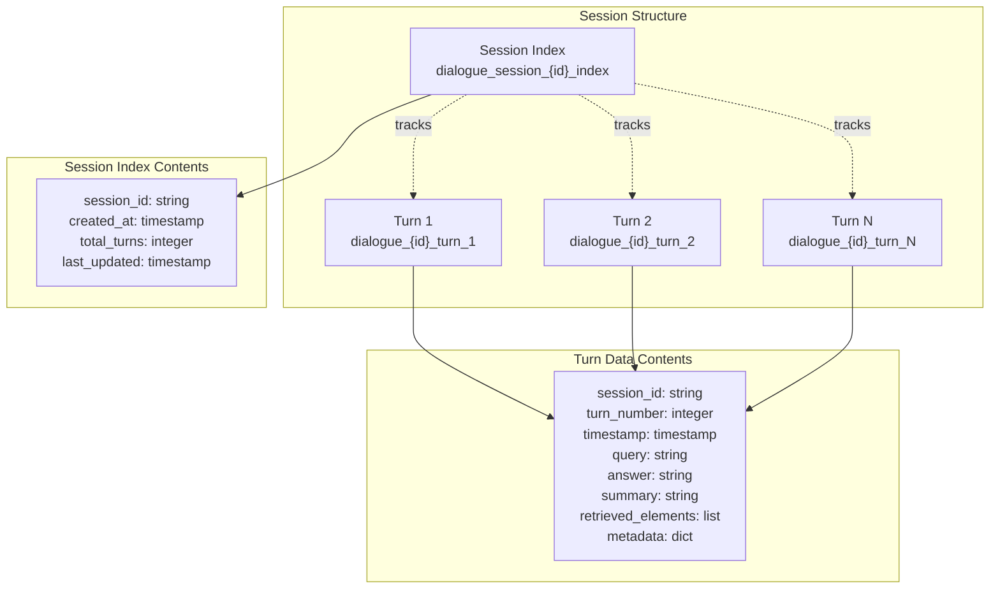
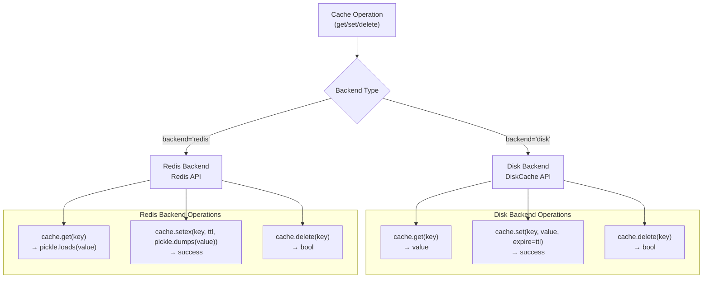

<!-- source: DeepWiki mcp.deepwiki.com · repo HKUDS/FastCode · page 9.1 Caching System · fetched 2026-11-09 -->

# Caching System

<details>
<summary>Relevant source files</summary>

The following files were used as context for generating this wiki page:

- [config/config.yaml](config/config.yaml)
- [fastcode/cache.py](fastcode/cache.py)
- [fastcode/embedder.py](fastcode/embedder.py)

</details>


The caching system in FastCode provides high-performance persistent storage for embeddings, query results, and multi-turn dialogue sessions. It supports two backend implementations (disk-based and Redis) with configurable TTL policies to balance performance and storage utilization.

**Purpose and Scope**: This document covers the cache architecture, backend implementations, cache key management, TTL policies, and integration patterns. For configuration options, see [Cache Configuration](#8.10). For dialogue session usage patterns, see [Multi-Turn Dialogue](#9.2).

---

## Cache Architecture

The caching system is implemented by the `CacheManager` class and supports two pluggable backends with different characteristics:



**Sources**: [fastcode/cache.py:1-458](), [config/config.yaml:182-191]()

---

## Backend Implementations

### Disk Cache Backend

The disk backend uses the `diskcache` library, which implements a persistent cache on the file system using SQLite for indexing and file storage for large values.

**Initialization**: [fastcode/cache.py:41-50]()

```
Backend: "disk"
Storage: ./data/cache (configurable via cache.cache_directory)
Technology: DiskCache with SQLite index
Size Limit: 1000 MB (configurable via cache.max_size_mb)
Eviction: LRU when size_limit is reached
```

**Key Characteristics**:
- No external dependencies (self-contained)
- Survives process restarts
- Thread-safe and process-safe
- Lower memory footprint
- Suitable for single-server deployments

**Configuration Example**:
```yaml
cache:
  enabled: true
  backend: "disk"
  cache_directory: "./data/cache"
  max_size_mb: 1000
```

### Redis Backend

The Redis backend uses the `redis-py` library to connect to an external Redis server, providing distributed caching capabilities.

**Initialization**: [fastcode/cache.py:52-65]()

```
Backend: "redis"
Connection: REDIS_HOST:REDIS_PORT (environment variables)
Technology: Redis key-value store
Size Limit: Redis maxmemory configuration
Eviction: Redis eviction policy (e.g., allkeys-lru)
```

**Key Characteristics**:
- Requires external Redis server
- Supports distributed deployments
- Higher throughput for concurrent access
- In-memory performance
- Network latency overhead

**Configuration Example**:
```yaml
cache:
  enabled: true
  backend: "redis"
  # Connection via environment variables:
  # REDIS_HOST=localhost
  # REDIS_PORT=6379
```

**Sources**: [fastcode/cache.py:41-69](), [config/config.yaml:182-191]()

---

## Cache Key Generation

The `CacheManager` generates deterministic cache keys using MD5 hashing to ensure consistent key generation across multiple invocations.



**Key Generation Method**: [fastcode/cache.py:71-76]()

```python
def _generate_key(self, prefix: str, *args) -> str:
    content = "_".join(str(arg) for arg in args)
    hash_val = hashlib.md5(content.encode()).hexdigest()
    return f"{prefix}_{hash_val}"
```

**Key Patterns**:

| Cache Type | Key Pattern | Example |
|------------|-------------|---------|
| Embeddings | `embedding_{hash}` | `embedding_a3f2c9d1...` |
| Query Results | `query_{hash}` | `query_b7e4d8c2...` |
| Dialogue Turn | `dialogue_{session_id}_turn_{turn_number}` | `dialogue_abc123_turn_5` |
| Session Index | `dialogue_session_{session_id}_index` | `dialogue_session_abc123_index` |

**Sources**: [fastcode/cache.py:71-76](), [fastcode/cache.py:154-180](), [fastcode/cache.py:209-277]()

---

## TTL Management

FastCode implements differentiated TTL policies based on cache content type to balance performance and storage efficiency.

### TTL Configuration

| Cache Type | Config Key | Default Value | Purpose |
|------------|-----------|---------------|---------|
| General Cache | `cache.ttl` | 3600 seconds (1 hour) | Embeddings and short-term data |
| Dialogue Sessions | `cache.dialogue_ttl` | 2592000 seconds (30 days) | Long-term conversation history |

**TTL Implementation**: [fastcode/cache.py:26-34]()



**TTL Application Points**:
- **Embeddings**: [fastcode/cache.py:161-166]() - Uses default `ttl` (1 hour)
- **Query Results**: [fastcode/cache.py:175-180]() - Uses default `ttl` (1 hour)
- **Dialogue Turns**: [fastcode/cache.py:249]() - Uses `dialogue_ttl` (30 days)
- **Session Index**: [fastcode/cache.py:367]() - Uses `dialogue_ttl` (30 days)

**Sources**: [fastcode/cache.py:19-34](), [fastcode/cache.py:101-120](), [fastcode/cache.py:209-277](), [config/config.yaml:186-187]()

---

## Cached Data Types

### Embedding Cache

Embeddings are the most frequently cached data type, representing vector representations of code elements.

**Cache Control**: [config/config.yaml:189]()
```yaml
cache:
  cache_embeddings: true  # Enable/disable embedding cache
```

**Methods**:
- `get_embedding(text: str) -> Optional[Any]` - [fastcode/cache.py:154-159]()
- `set_embedding(text: str, embedding: Any) -> bool` - [fastcode/cache.py:161-166]()

**Usage Pattern**:
```
1. CodeEmbedder generates embedding for text
2. Check cache: cached_embedding = cache_manager.get_embedding(text)
3. If hit: return cached_embedding
4. If miss: compute embedding, cache_manager.set_embedding(text, embedding)
```

**Performance Impact**: Embedding generation is computationally expensive (requires SentenceTransformer model inference). Caching provides significant performance improvements for repeated code elements.

### Query Result Cache

Query results cache stores complete retrieval results for query-repository pairs.

**Cache Control**: [config/config.yaml:190]()
```yaml
cache:
  cache_queries: false  # Disabled by default (results change as code evolves)
```

**Methods**:
- `get_query_result(query: str, repo_hash: str) -> Optional[Any]` - [fastcode/cache.py:168-173]()
- `set_query_result(query: str, repo_hash: str, result: Any) -> bool` - [fastcode/cache.py:175-180]()

**Key Generation**: Uses both query string and repository hash to ensure cache invalidation when repository content changes.

**Default Behavior**: Disabled by default because code changes frequently and cached results may become stale.

### Dialogue Session Cache

Multi-turn dialogue sessions require long-term persistence to maintain conversation context across interactions.



**Core Methods**:

| Method | Purpose | Reference |
|--------|---------|-----------|
| `save_dialogue_turn()` | Save single dialogue turn | [fastcode/cache.py:209-259]() |
| `get_dialogue_turn()` | Retrieve specific turn | [fastcode/cache.py:261-276]() |
| `get_dialogue_history()` | Retrieve multiple turns | [fastcode/cache.py:278-319]() |
| `get_recent_summaries()` | Get turn summaries for context | [fastcode/cache.py:321-350]() |
| `delete_session()` | Delete entire session | [fastcode/cache.py:379-414]() |
| `list_sessions()` | List all sessions | [fastcode/cache.py:416-456]() |

**Session Management Pattern**:
```
1. AnswerGenerator completes a query
2. Extract summary from answer (parsing <SUMMARY> tags)
3. cache_manager.save_dialogue_turn(session_id, turn_number, query, answer, summary)
4. Session index automatically updated via _update_session_index()
```

**Sources**: [fastcode/cache.py:207-456](), [config/config.yaml:187]()

---

## Cache Operations API

### Basic Operations

The `CacheManager` provides four fundamental operations that work across both backends:

**get(key: str) -> Optional[Any]** - [fastcode/cache.py:78-99]()
```
Retrieves value from cache by key.
Returns None if key not found or cache disabled.
Logs cache hits at DEBUG level.
```

**set(key: str, value: Any, ttl: Optional[int] = None) -> bool** - [fastcode/cache.py:101-120]()
```
Stores value in cache with optional TTL override.
Uses default TTL if not specified.
Returns True on success, False on failure.
```

**delete(key: str) -> bool** - [fastcode/cache.py:122-134]()
```
Removes key from cache.
Returns True if key was deleted, False otherwise.
```

**clear() -> bool** - [fastcode/cache.py:136-152]()
```
Removes all keys from cache.
Disk: cache.clear()
Redis: cache.flushdb()
```

### Backend-Specific Behavior



**Key Differences**:
- **Serialization**: Disk backend uses native pickle via DiskCache; Redis backend explicitly pickles/unpickles values
- **TTL Syntax**: Disk uses `expire` parameter; Redis uses `setex()` with TTL as first-class parameter
- **Return Types**: Both backends normalize to Python types

**Sources**: [fastcode/cache.py:78-152]()

---

## Cache Statistics

The `get_stats()` method provides runtime cache metrics for monitoring and debugging.

**Statistics Method**: [fastcode/cache.py:182-205]()

### Disk Backend Statistics

```python
{
    "enabled": True,
    "backend": "disk",
    "size": 52428800,        # Bytes currently used
    "items": 1247            # Number of cached items
}
```

**Metrics Source**:
- `size`: `cache.volume()` - total bytes used by cache
- `items`: `len(cache)` - number of keys in cache

### Redis Backend Statistics

```python
{
    "enabled": True,
    "backend": "redis",
    "size": 104857600,       # used_memory from INFO
    "items": 3521            # dbsize() count
}
```

**Metrics Source**:
- `size`: `cache.info()['used_memory']` - Redis memory usage
- `items`: `cache.dbsize()` - number of keys in current database

**Sources**: [fastcode/cache.py:182-205]()

---

## Integration with FastCode Components

### CodeEmbedder Integration

The `CodeEmbedder` class in [fastcode/embedder.py]() checks the embedding cache before running model inference to avoid redundant computation.

**Integration Point**: Referenced in architecture diagram above

**Flow**:
```
1. CodeEmbedder.embed_batch(texts: List[str]) or embed_text(text: str) called
2. For each text:
   a. cached = cache_manager.get_embedding(text)
   b. If hit: return cached embedding
   c. If miss: generate via SentenceTransformer, cache_manager.set_embedding(text, embedding)
3. Return combined results (cached + newly generated)
```

**Configuration**: [config/config.yaml:189]()

### Query Processing Integration

Query results can be cached to avoid repeated retrieval for identical queries.

**Flow**:
```
1. User submits query for specific repository
2. Generate repo_hash from repository state
3. cached_result = cache_manager.get_query_result(query, repo_hash)
4. If cached: return cached_result
5. If not cached: perform retrieval, cache_manager.set_query_result(query, repo_hash, result)
```

**Configuration**: [config/config.yaml:190]() - Disabled by default

### Multi-Turn Dialogue Integration

The `AnswerGenerator` and session management components rely heavily on dialogue cache for conversation continuity.

**Integration Points**:
- **Saving Turns**: After generating each answer - [fastcode/cache.py:209-259]()
- **Loading Context**: Before processing new query - [fastcode/cache.py:321-350]()
- **Session Management**: API endpoints for session CRUD operations - [fastcode/cache.py:379-456]()

**Context Flow**:
```
1. User sends query in session
2. get_recent_summaries(session_id, num_rounds=10) retrieves last 10 turn summaries
3. Summaries used for query rewriting (understanding context)
4. get_dialogue_history(session_id, max_turns=10) retrieves full turns
5. Full history included in prompt context (generation.context_rounds)
6. After generation: save_dialogue_turn() persists new turn with 30-day TTL
```

**Configuration**: [config/config.yaml:139-140]() (query), [config/config.yaml:159-160]() (generation)

**Sources**: [fastcode/cache.py:1-458](), [config/config.yaml:182-191]()

---

## Cache Lifecycle and Management

### Initialization

The cache is initialized when the `CacheManager` is instantiated, typically during FastCode system startup.

**Initialization Flow**: [fastcode/cache.py:19-39]()
```
1. Load cache configuration from config.yaml
2. Check if cache is enabled (cache.enabled)
3. Determine backend (cache.backend)
4. Call _initialize_cache():
   - Disk: Create cache directory, initialize DiskCache with size_limit
   - Redis: Connect to Redis server, test with ping()
5. Set cache_embeddings and cache_queries flags
```

### Error Handling

The cache system implements defensive error handling to prevent cache failures from disrupting core functionality.

**Error Handling Pattern**:
```python
try:
    # Cache operation
    result = self.cache.get(key)
    return result
except Exception as e:
    self.logger.warning(f"Cache operation failed: {e}")
    return None  # Degrade gracefully
```

**Degradation Behavior**:
- Cache read failure: Returns `None`, system proceeds without cached data
- Cache write failure: Logs warning, continues operation
- Initialization failure: Sets `enabled = False`, disables all caching

**Implementation**: Error handling present in all cache methods - [fastcode/cache.py:78-152]()

### Cleanup and Maintenance

**Automatic Cleanup**:
- **Disk Backend**: DiskCache automatically evicts entries using LRU policy when `size_limit` is reached
- **Redis Backend**: Follows Redis eviction policy (configured externally)

**Manual Cleanup**:
- `clear()` method: [fastcode/cache.py:136-152]() - Removes all cache entries
- `delete_session()` method: [fastcode/cache.py:379-414]() - Removes specific dialogue session

**TTL-Based Expiration**:
- Embeddings and query results: 1 hour (default `ttl`)
- Dialogue sessions: 30 days (`dialogue_ttl`)
- Both backends handle TTL expiration automatically

**Sources**: [fastcode/cache.py:19-69](), [fastcode/cache.py:136-152](), [fastcode/cache.py:379-414]()

---

## Configuration Reference

Complete cache configuration block from [config/config.yaml:182-191]():

```yaml
cache:
  enabled: true                    # Enable/disable entire cache system
  backend: "disk"                  # "disk" or "redis"
  ttl: 3600                       # Default TTL in seconds (1 hour)
  dialogue_ttl: 2592000           # Dialogue session TTL (30 days)
  max_size_mb: 1000               # Disk cache size limit
  cache_embeddings: true          # Cache embedding vectors
  cache_queries: false            # Cache query results (default: disabled)
  cache_directory: "./data/cache" # Disk cache location
```

**Environment Variables for Redis**:
- `REDIS_HOST`: Redis server hostname (default: "localhost")
- `REDIS_PORT`: Redis server port (default: 6379)

For detailed configuration options, see [Cache Configuration](#8.10).

**Sources**: [config/config.yaml:182-191](), [fastcode/cache.py:52-60]()

---

