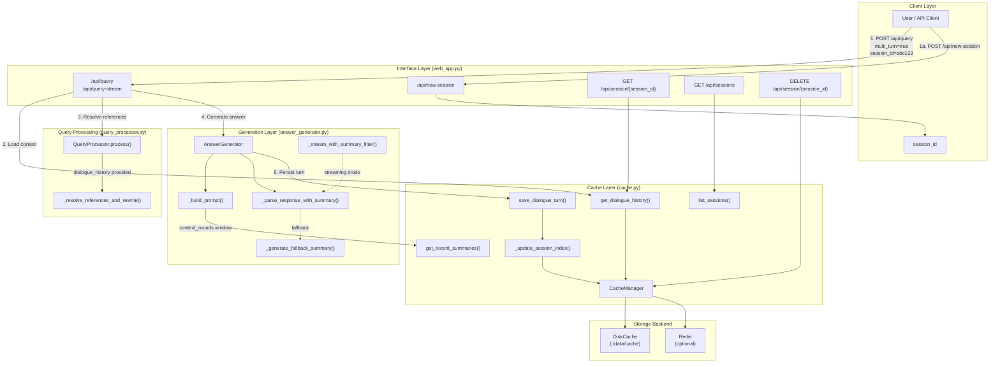
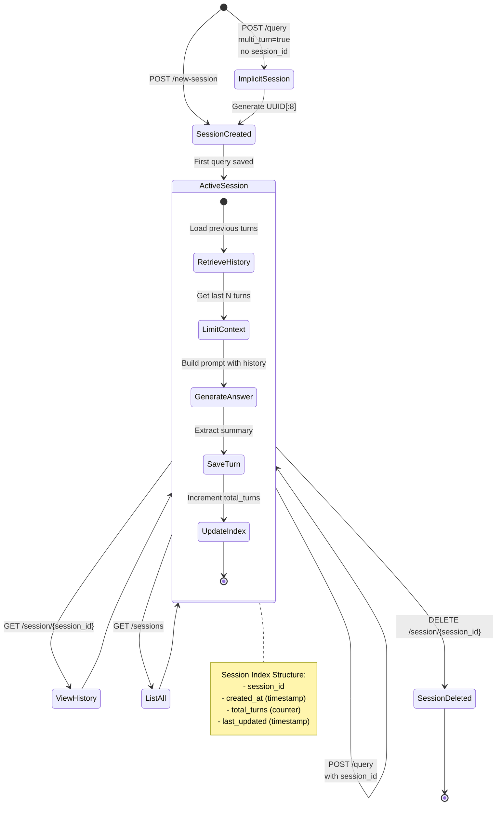
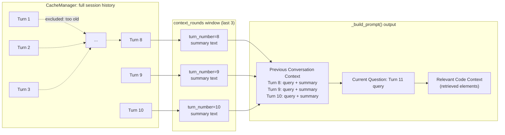
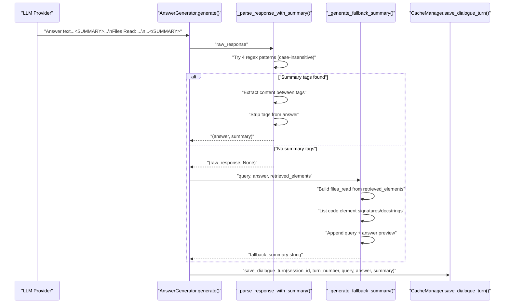
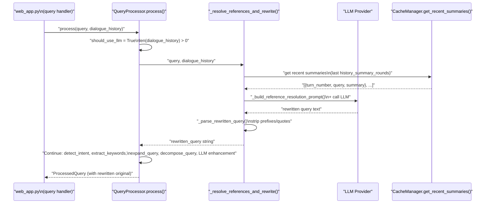
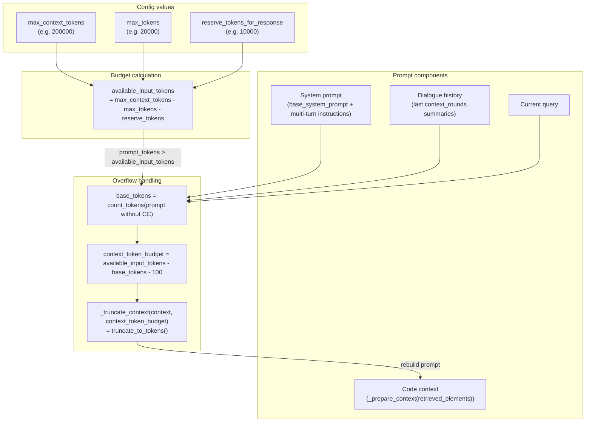

<!-- source: DeepWiki mcp.deepwiki.com · repo HKUDS/FastCode · page 9.2 Multi-Turn Dialogue · fetched 2026-11-09 -->

# Multi-Turn Dialogue

<details>
<summary>Relevant source files</summary>

The following files were used as context for generating this wiki page:

- [fastcode/answer_generator.py](fastcode/answer_generator.py)
- [fastcode/cache.py](fastcode/cache.py)
- [fastcode/query_processor.py](fastcode/query_processor.py)

</details>


## Purpose and Scope

Multi-turn dialogue enables conversational code understanding where FastCode maintains context across multiple queries within a session. Instead of treating each query independently, the system remembers previous questions, answers, and code elements to provide more coherent and context-aware responses.

This feature is particularly useful for:
- **Iterative exploration**: "Show me the auth module" → "How does it handle tokens?" → "What happens when a token expires?"
- **Complex investigations**: Breaking down large questions into manageable conversation turns
- **Follow-up clarifications**: Asking for more details about previous answers without repeating context

For single-query operations without conversation history, see page 6.1.2. For general answer generation without session management, see page 4.8. For the caching subsystem that stores sessions, see page 9.1.

Sources: [fastcode/answer_generator.py:1-889](), [fastcode/query_processor.py:1-828](), [fastcode/cache.py:1-465]()

---

## Architecture Overview

Multi-turn dialogue involves four main subsystems working together:

**Multi-turn dialogue component flow**



Sources: [fastcode/answer_generator.py:17-193](), [fastcode/query_processor.py:129-233](), [fastcode/cache.py:16-465]()

The system follows this flow:
1. **Session Creation**: Client calls `/api/new-session` to get a `session_id`, or passes one directly on the first query.
2. **Context Retrieval**: `CacheManager.get_dialogue_history()` loads previous turns from the cache backend.
3. **Reference Resolution**: `QueryProcessor._resolve_references_and_rewrite()` rewrites the current query to resolve pronouns and references using the dialogue history.
4. **Prompt Building**: `AnswerGenerator._build_prompt()` includes the last `context_rounds` summaries in the user prompt.
5. **Answer Generation**: The LLM produces an answer containing an embedded `<SUMMARY>` section.
6. **Summary Extraction**: `_parse_response_with_summary()` strips the summary from the visible answer and stores it separately.
7. **Turn Persistence**: `CacheManager.save_dialogue_turn()` stores the full turn with a long TTL (default: 30 days).

Sources: [fastcode/answer_generator.py:71-193](), [fastcode/query_processor.py:129-233](), [fastcode/cache.py:209-260]()

---

## Session Management

### Session Lifecycle

Sessions are identified by unique 8-character IDs (e.g., `"abc12345"`) and persist in the cache backend:



**Diagram**: Session lifecycle state machine

Sources: [fastcode/cache.py:352-456]()

### Session Index Structure

Each session maintains an index entry stored at cache key `dialogue_session_{session_id}_index`:

| Field | Type | Description |
|-------|------|-------------|
| `session_id` | string | Unique session identifier |
| `created_at` | float | Unix timestamp of session creation |
| `total_turns` | int | Total number of dialogue turns recorded |
| `last_updated` | float | Unix timestamp of most recent turn |
| `multi_turn` | bool | Whether any turn was made with `multi_turn=True`; once `True`, stays `True` |

Individual turns are stored at cache key `dialogue_{session_id}_turn_{turn_number}`:

| Field | Type | Description |
|-------|------|-------------|
| `session_id` | string | Session identifier |
| `turn_number` | int | Turn sequence number (1-indexed) |
| `timestamp` | float | Turn creation timestamp |
| `query` | string | User query for this turn |
| `answer` | string | Generated answer (full text) |
| `summary` | string | Extracted `<SUMMARY>` content for context propagation |
| `retrieved_elements` | `List[Dict]` | Code elements retrieved for this turn (optional) |
| `metadata` | `Dict` | Additional metadata, e.g. token counts (optional) |

Sources: [fastcode/cache.py:209-259](), [fastcode/cache.py:352-379]()

### API Endpoints

These endpoints are served by `web_app.py` (default port 5777). See page 6.1.3 for the full session management API reference.

#### Creating a Session

```
POST /api/new-session
```

Returns `{"session_id": "<uuid>"}`. Pass an optional `?clear_session_id=<old_id>` query parameter to delete a previous session at the same time.

#### Listing Sessions

```
GET /api/sessions
```

Returns all sessions sorted by `last_updated` descending. Delegates to `CacheManager.list_sessions()`.

Sources: [fastcode/cache.py:416-456]()

#### Retrieving Session History

```
GET /api/session/{session_id}
```

Returns the ordered list of turn objects from `CacheManager.get_dialogue_history()`. Each turn includes `turn_number`, `query`, `answer`, `summary`, and `retrieved_elements`.

Sources: [fastcode/cache.py:278-319]()

#### Deleting a Session

```
DELETE /api/session/{session_id}
```

Calls `CacheManager.delete_session()` which removes all `dialogue_{session_id}_turn_*` keys and the index key.

Sources: [fastcode/cache.py:379-414]()

---

## Dialogue History and Context Management

### Context Window Limiting

To prevent prompt overflow, `AnswerGenerator._build_prompt()` limits how many previous turns appear in the prompt.

**`context_rounds` sliding window (example with context_rounds=3)**



The `context_rounds` configuration key (default: `10`, under `generation:`) controls this window. The relevant slice is computed at [fastcode/answer_generator.py:584-585]() as:

```
recent_history = dialogue_history[-self.context_rounds:]
```

Only each turn's `query` and `summary` fields are injected — not the full answer — keeping per-turn overhead small.

Sources: [fastcode/answer_generator.py:517-629]()

### Summary-Based Compression

Rather than including full answers in the prompt, FastCode uses **summaries** extracted from previous turns. This reduces token consumption while preserving key information:

| Information Preserved | Example |
|----------------------|---------|
| **Files Read** | `- auth/handler.py - JWT validation logic` |
| **Missing Information** | `- Need to check token storage mechanism` |
| **Key Facts** | `- Tokens expire after 3600 seconds` |
| **Symbol Mappings** | `- "the handler" → auth.JWTHandler` |
| **Intent** | `User wants to understand token lifecycle` |

This structured summary format is specifically designed for multi-turn reasoning and enables the LLM to:
1. Avoid re-analyzing files already examined
2. Identify missing information for targeted retrieval
3. Maintain stable facts across turns
4. Resolve ambiguous references to code symbols

Sources: [fastcode/answer_generator.py:540-572](), [fastcode/answer_generator.py:770-843]()

---

## Summary Generation and Parsing

### LLM Prompt Instructions

When `enable_multi_turn` is true, AnswerGenerator adds specific instructions to the system prompt:

```
**Multi-turn Dialogue Instructions:**
At the end of your answer, you MUST provide a structured summary for internal use.
The summary should be enclosed in <SUMMARY> tags and include:
1. Intent: A sentence describing the user's intent in this turn
2. Files Read: List all the files you have analyzed
3. Missing Information: What additional context would help
4. Key Facts: Stable conclusions for subsequent turns
5. Symbol Mappings: Map user terms to actual symbols

Format:
<SUMMARY>
Files Read:
- [repo_name/file_path] - [brief description]

Missing Information:
- [what files or context are still needed]

Key Facts:
- [fact 1]
- [fact 2]

Symbol Mappings:
- [user term] → [actual symbol in codebase]
</SUMMARY>
```

Sources: [fastcode/answer_generator.py:540-572]()

### Summary Extraction Process

**Summary extraction and fallback flow**



The system uses multiple extraction strategies to handle variations in LLM output format:

**Pattern Matching (Primary)**:
- Regex-based extraction with case-insensitive flags
- Handles variations: `<SUMMARY>`, `<Summary>`, `<summary>`, `**<SUMMARY>**`, etc.
- Supports both XML-style tags and Markdown-style headers

**Fallback Generation (Secondary)**:
- Triggered when no summary tags found in response
- Automatically generates summary from retrieved code elements
- Includes: files analyzed, code elements with signatures, query preview, answer preview
- Ensures subsequent turns have context even if LLM doesn't follow format

Sources: [fastcode/answer_generator.py:737-768](), [fastcode/answer_generator.py:770-843]()

### Streaming Mode Summary Filtering

When using streaming responses (`/query-stream`), the system must filter out the `<SUMMARY>` section from what users see while capturing it for storage:

**`_stream_with_summary_filter()` state machine**

```mermaid
stateDiagram-v2
    [*] --> "not in_summary"

    "not in_summary" --> "not in_summary" : "chunk has no SUMMARY start\nyield (original, chunk)"
    "not in_summary" --> "buffering" : "chunk might be partial tag\nyield (original, prior_buffer)"
    "not in_summary" --> "in_summary" : "SUMMARY start detected\nyield (original, text_before_tag)"

    "buffering" --> "not in_summary" : "no tag confirmed"
    "buffering" --> "in_summary" : "tag confirmed"

    "in_summary" --> "in_summary" : "no SUMMARY end\nyield (original, None)"
    "in_summary" --> "not in_summary" : "SUMMARY end detected\nyield (original, text_after_tag)"
```

`_stream_with_summary_filter()` in [fastcode/answer_generator.py:321-445]() yields tuples of `(original_chunk, filtered_chunk)`. The caller accumulates `original_chunk` into the full response (for later summary parsing) while forwarding `filtered_chunk` to the user. When `filtered_chunk` is `None`, the chunk is silently dropped because it is inside the `<SUMMARY>` block.

Key implementation details:
- `buffer` holds up to 20 characters to detect tags that span chunk boundaries.
- Both regex patterns (case-insensitive) and exact string patterns are tried; regex is tried first for robustness.
- After the loop, any remaining buffer content outside a summary is flushed to the user.

Sources: [fastcode/answer_generator.py:321-445]()

---

## Configuration

Multi-turn dialogue is controlled by configuration keys in `config/config.yaml` and by per-request API parameters.

### Generation Configuration (`generation:`)

| Key | Default | Description |
|-----|---------|-------------|
| `enable_multi_turn` | `false` | Master switch. Enables `<SUMMARY>` injection in prompts and summary parsing. |
| `context_rounds` | `10` | Number of recent turns included in `_build_prompt()`. |
| `max_context_tokens` | `200000` | Total token budget (system + history + code context + response). |
| `reserve_tokens_for_response` | `10000` | Tokens withheld from the input budget for the LLM response. |
| `max_tokens` | `20000` | Maximum tokens for the LLM response itself. |
| `temperature` | `0.4` | LLM sampling temperature. |

Sources: [fastcode/answer_generator.py:34-51]()

### Query Configuration (`query:`)

| Key | Default | Description |
|-----|---------|-------------|
| `history_summary_rounds` | `10` | How many recent summaries `_resolve_references_and_rewrite()` receives. |
| `max_summary_words` | `250` | Word limit hint for summary content (passed to reference resolution prompt). |

Sources: [fastcode/query_processor.py:65-67]()

### Cache Configuration (`cache:`)

| Key | Default | Description |
|-----|---------|-------------|
| `enabled` | `true` | Must be `true` for session storage to work. |
| `backend` | `disk` | `disk` (DiskCache) or `redis`. |
| `dialogue_ttl` | `2592000` | TTL in seconds for session data (default: 30 days). |
| `cache_directory` | `./data/cache` | Root directory for disk cache. |

The `dialogue_ttl` is stored separately from the general `ttl` to allow long-lived conversations while keeping short TTLs for embeddings and query results.

Sources: [fastcode/cache.py:19-34](), [fastcode/cache.py:249](), [fastcode/cache.py:367-374]()

### Runtime (per-request)

Multi-turn can be toggled per request via the `multi_turn` boolean and `session_id` string in the query request body posted to `/api/query` or `/api/query-stream`. When `multi_turn=true` and a `session_id` is provided, the handler retrieves history and passes it to both `QueryProcessor.process()` and `AnswerGenerator.generate()`.

---

## Reference Resolution via QueryProcessor

When `multi_turn=True` and a `session_id` with prior turns is provided, `QueryProcessor.process()` performs **reference resolution** before retrieval, so ambiguous pronouns and phrases in the new query are expanded into fully specified terms.

**Reference resolution flow in `QueryProcessor`**



Key points:
- Reference resolution is skipped when `use_llm_enhancement=False` (e.g., when iterative agent mode is active, because the agent handles history integration itself).
- The number of summaries fed into the reference resolution prompt is capped at `history_summary_rounds` (default: `10`).
- The resolved query replaces `query` before all downstream steps (intent detection, keyword extraction, BM25/semantic search).

Sources: [fastcode/query_processor.py:129-233](), [fastcode/query_processor.py:729-827]()

## API Usage

The default REST API server runs on port **5777**. All multi-turn endpoints are under `/api/`.

**Typical multi-turn workflow:**

1. `POST /api/new-session` → receive `session_id`
2. `POST /api/query` with `{"question": "...", "multi_turn": true, "session_id": "<id>"}` — repeat for each turn
3. `GET /api/session/<id>` — inspect full history
4. `DELETE /api/session/<id>` — clean up when done

For streaming responses, use `POST /api/query-stream` instead of `/api/query`. The SSE stream yields `chunk` events with filtered answer text (the `<SUMMARY>` section is suppressed client-side via `_stream_with_summary_filter()`).

See page 6.1.2 for the full `QueryRequest` model and page 6.1.3 for the session management endpoints.

---

## Implementation Details

### Token Budget Management

Multi-turn dialogue introduces additional context that consumes tokens. `AnswerGenerator.generate()` and `generate_stream()` apply the same budgeting logic.

**Token budget allocation in `AnswerGenerator.generate()`**



The truncation always targets `CC` (code context) first, preserving system prompt, dialogue history, and the current query. The trimming is applied by `_truncate_context()` which delegates to `truncate_to_tokens()` in `fastcode/utils.py`.

Sources: [fastcode/answer_generator.py:99-140](), [fastcode/answer_generator.py:226-255]()

### Cache Storage Layout

Cache keys follow a predictable naming scheme, enabling `list_sessions()` to enumerate all sessions by scanning for the `_index` suffix pattern.

```
data/cache/                                    ← cache_directory
├── dialogue_abc12345_turn_1                   ← turn data (dict)
├── dialogue_abc12345_turn_2
├── dialogue_abc12345_turn_3
├── dialogue_session_abc12345_index            ← session index (dict)
├── dialogue_xyz67890_turn_1
├── dialogue_session_xyz67890_index
└── ...
```

**Session index key**: `dialogue_session_{session_id}_index`
**Turn data key**: `dialogue_{session_id}_turn_{turn_number}`

`list_sessions()` scans for keys matching `dialogue_session_*_index` (disk: `iterkeys()`; Redis: `scan_iter()`), so listing is O(total sessions), not O(total turns).

Sources: [fastcode/cache.py:209-260](), [fastcode/cache.py:352-379](), [fastcode/cache.py:416-462]()

### Summary Format Variations

The LLM may produce summaries in various formats. The parser handles these variations:

**Standard XML-style** (preferred):
```xml
<SUMMARY>
Files Read:
- auth/handler.py - JWT validation logic
- auth/token.py - Token generation

Missing Information:
- Need to check token storage mechanism

Key Facts:
- Tokens expire after 3600 seconds
- Refresh tokens have 7-day lifetime

Symbol Mappings:
- "the handler" → auth.JWTHandler
</SUMMARY>
```

**Markdown-style header**:
```markdown
**SUMMARY**:

Files Read:
- auth/handler.py - JWT validation logic

Missing Information:
- Need to check token storage mechanism
```

**Plain header**:
```
SUMMARY:

Files Read:
- auth/handler.py - JWT validation logic
```

All variations are captured by the regex patterns in `_parse_response_with_summary()`. If no summary is found, the fallback generator creates a minimal summary from retrieved elements.

**Sources**: [fastcode/answer_generator.py:734-765](), [fastcode/answer_generator.py:767-840]()

### Error Handling

| Scenario | Handling Strategy |
|----------|------------------|
| **Session Not Found** | `web_app.py` returns HTTP 404 |
| **Cache Backend Failure** | `CacheManager` disables itself (`self.enabled = False`); query proceeds without history |
| **Summary Parsing Failure** | `_parse_response_with_summary()` logs a warning; `_generate_fallback_summary()` produces a minimal summary from retrieved elements |
| **Token Budget Exceeded** | Code context is truncated by `_truncate_context()`; dialogue history and current query are preserved |
| **Streaming Interruption** | `generate_stream()` catches exceptions and yields an error string plus `{"error": ..., "complete": True}` metadata |
| **Reference Resolution Failure** | `_resolve_references_and_rewrite()` returns the original query unchanged and logs the error |

Sources: [fastcode/answer_generator.py:159-168](), [fastcode/answer_generator.py:312-319](), [fastcode/cache.py:41-69](), [fastcode/cache.py:317-319](), [fastcode/query_processor.py:761-766]()

---

## Best Practices

### When to Use Multi-Turn Dialogue

**Use multi-turn dialogue for**:
- Complex code exploration requiring multiple follow-up questions
- Debugging workflows where context builds across queries
- Architectural understanding that unfolds over conversation
- Mentoring scenarios where user needs guided exploration

**Use single-turn queries for**:
- Simple lookups ("Where is function X?")
- Independent questions without context dependency
- Batch processing or automated queries
- High-throughput scenarios where session overhead matters

### Session Management Tips

1. **Create Explicit Sessions**: Use `POST /new-session` to get a session_id before starting conversation
2. **Reuse Sessions**: Pass the same `session_id` across related queries
3. **Clean Up**: Delete old sessions with `DELETE /session/{session_id}` to free cache space
4. **Monitor Session List**: Use `GET /sessions` to track active conversations
5. **Set Appropriate TTL**: Adjust `dialogue_ttl` based on your use case (longer for persistent exploration, shorter for temporary sessions)

### Context Window Tuning

Balance `context_rounds` based on your needs:

| `context_rounds` | Token Usage | Use Case |
|------------------|-------------|----------|
| 3-5 | Low (~600-1000 tokens) | Short-term clarifications, focused exploration |
| 10 (default) | Medium (~2000 tokens) | General multi-turn conversations |
| 20-30 | High (~4000-6000 tokens) | Long-running investigations, complex debugging |

Note: Higher `context_rounds` consumes more tokens per query but provides richer context.

**Sources**: [fastcode/answer_generator.py:34-37](), [config/config.yaml (referenced)]()

---

This documentation covers the complete multi-turn dialogue system in FastCode, from API usage to internal implementation details. For related topics, see [Caching System](#9.1) for cache backend configuration and [Answer Generator](#4.7) for general LLM integration details.

---

