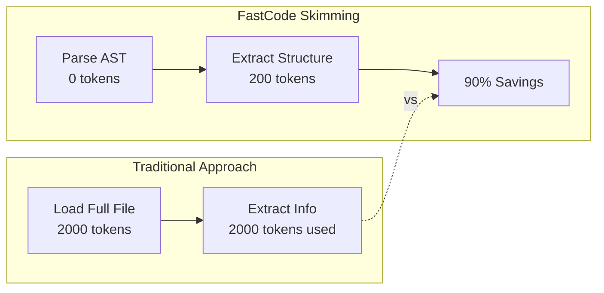
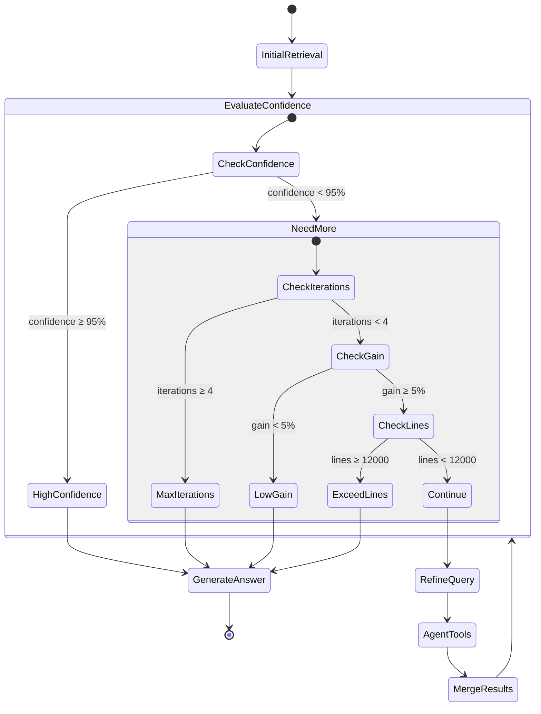
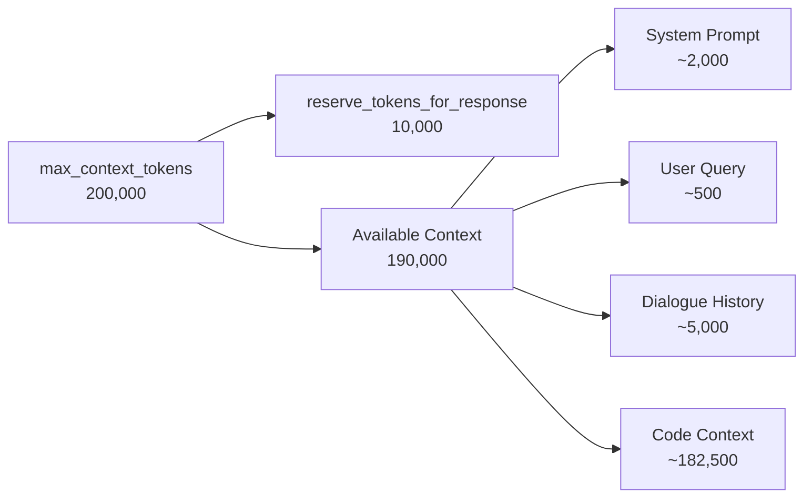
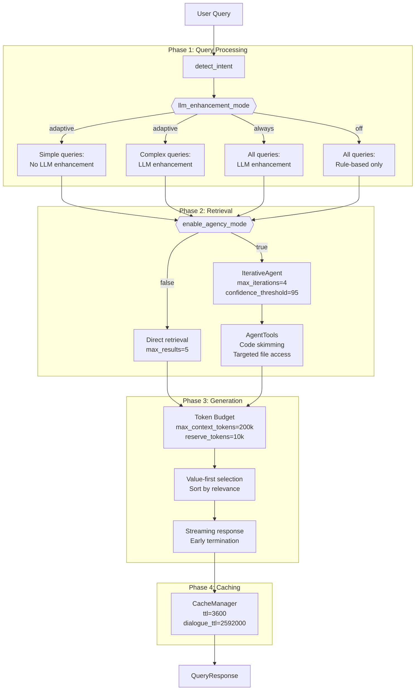
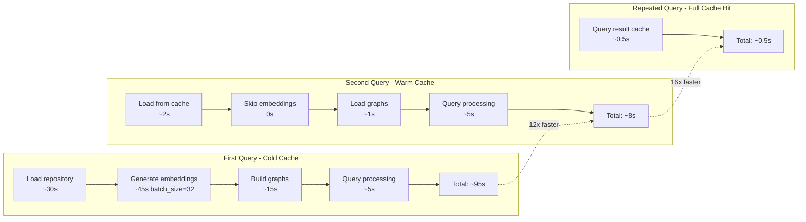
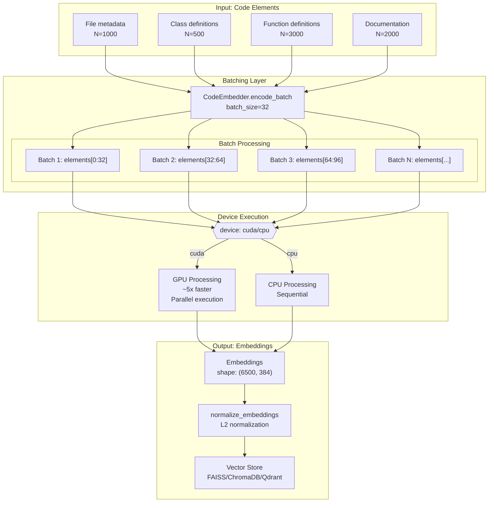
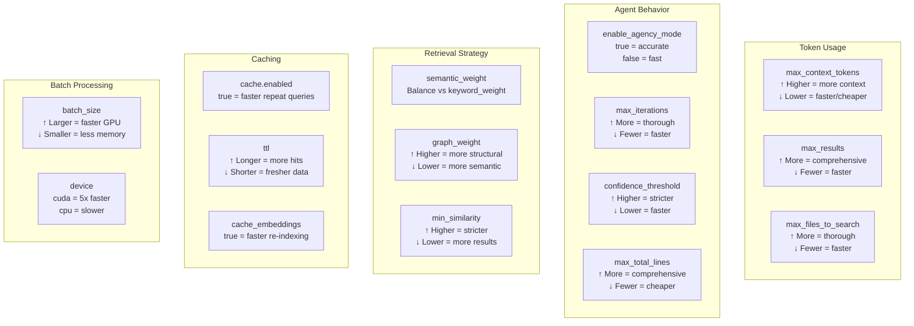

<!-- source: DeepWiki mcp.deepwiki.com · repo HKUDS/FastCode · page 9.3 Performance Optimization · fetched 2026-11-09 -->

# Performance Optimization

<details>
<summary>Relevant source files</summary>

The following files were used as context for generating this wiki page:

- [README.md](README.md)
- [config/config.yaml](config/config.yaml)
- [fastcode/cache.py](fastcode/cache.py)
- [fastcode/embedder.py](fastcode/embedder.py)

</details>


## Purpose and Scope

This document covers performance optimization techniques in FastCode, focusing on achieving the system's claimed **10x token savings** and **3-4x speed improvements** over competitors. The optimizations span token usage, computational efficiency, caching, and cost management.

For deep-dive information on specific topics:
- Caching system architecture and backends: see [Caching System](#9.1)
- Multi-turn dialogue and session management: see [Multi-Turn Dialogue](#9.2)
- Iterative agent configuration: see [Iterative Agent](#5.1)
- Code skimming techniques: see [Code Skimming](#9.4)

---

## Token Savings Strategies

FastCode achieves up to **10x token savings** through three core strategies: code skimming, targeted retrieval, and intelligent context management.

### Code Skimming

Code skimming extracts structural information (function signatures, class definitions, type hints) without loading full file contents. This technique reduces token consumption by 80-90% during the exploration phase.

**Implementation:** The `AgentTools` class provides `get_file_structure_summary()` which parses AST nodes to extract:
- Function names and signatures [fastcode/agent/tools.py:200-250]()
- Class definitions and inheritance [fastcode/agent/tools.py:250-300]()
- Import statements [fastcode/parser.py:150-200]()
- Type annotations [fastcode/parser.py:200-250]()

**Diagram: Code Skimming Token Comparison**



Sources: [fastcode/agent/tools.py](), [config/config.yaml:56-57]()

### Targeted Retrieval with Stopping Conditions

The iterative agent uses four stopping conditions to minimize unnecessary token consumption while maintaining high confidence:

| Condition | Threshold | Purpose |
|-----------|-----------|---------|
| **Confidence** | ≥ 95% | Stop when answer quality is sufficient |
| **Iterations** | ≤ 4 rounds | Prevent excessive exploration |
| **Confidence Gain** | ≥ 5% per round | Stop if diminishing returns |
| **Total Lines** | ≤ 12,000 lines | Hard limit on context size |

**Diagram: Iterative Agent Decision Flow**



Sources: [config/config.yaml:170-181](), [fastcode/agent/iterative_agent.py]()

### Context Truncation and Token Budgeting

FastCode implements proactive context management to stay within token limits while preserving the most valuable information.

**Token Budget Allocation:**



**Value-First Selection Algorithm:**

The answer generator prioritizes code elements by relevance score and includes them until the budget is exhausted:

1. **Sort** retrieved elements by similarity score (descending)
2. **Estimate** tokens for each element using character count / 4
3. **Accumulate** elements while `cumulative_tokens < max_context_tokens - reserve_tokens_for_response`
4. **Truncate** remaining elements
5. **Include** file paths and line numbers for truncated elements

Sources: [config/config.yaml:144-161](), [fastcode/generation/answer_generator.py]()

---

## Cost Management Framework

FastCode's **Phase 3: Cost-Efficient Context Management** implements budget-aware decision making throughout the query pipeline.

### Budget-Aware Decision Points

**Diagram: Cost Management Integration Points**



Sources: [config/config.yaml:122-161](), [README.md:104-113]()

### LLM Enhancement Modes

The `llm_enhancement_mode` configuration balances accuracy and cost:

| Mode | Behavior | Cost Impact | Use Case |
|------|----------|-------------|----------|
| **adaptive** | LLM enhancement only for complex queries (debug, implement) | Medium | Production (recommended) |
| **always** | LLM enhancement for all queries | High | Maximum accuracy |
| **off** | Rule-based query processing only | Low | Cost-sensitive scenarios |

**Intent Detection Logic:** [fastcode/query/query_processor.py]()
- `how/what/where` queries → Simple (no LLM enhancement needed)
- `debug/implement/refactor` queries → Complex (LLM enhancement recommended)

Sources: [config/config.yaml:130-136](), [README.md:108-109]()

### Resource-Optimized Learning

The iterative agent continuously evaluates cost vs. value:

**Diagram: Iteration Cost-Value Analysis**

```mermaid
graph TB
    Start["Iteration N"]
    
    subgraph "Cost Factors"
        C1["Lines retrieved:<br/>cumulative_lines"]
        C2["LLM calls:<br/>N iterations"]
        C3["Token usage:<br/>context + response"]
    end
    
    subgraph "Value Factors"
        V1["Confidence:<br/>current_confidence"]
        V2["Confidence gain:<br/>current - previous"]
        V3["New elements:<br/>unique additions"]
    end
    
    subgraph "Decision"
        Eval["Evaluate:<br/>value_gain / cost_increase"]
        Decision{{"Continue?"}}
        Decision -->|"Yes"| Continue["Next iteration"]
        Decision -->|"No"| Stop["Generate answer"]
    end
    
    Start --> C1
    Start --> C2
    Start --> C3
    Start --> V1
    Start --> V2
    Start --> V3
    
    C1 --> Eval
    C2 --> Eval
    C3 --> Eval
    V1 --> Eval
    V2 --> Eval
    V3 --> Eval
    
    Eval --> Decision
```

**Cost Calculation per Iteration:**

```
iteration_cost = (lines_added * token_per_line) + (agent_llm_tokens) + (tool_execution_time)
iteration_value = confidence_gain + unique_elements_added
efficiency_ratio = iteration_value / iteration_cost

Continue if:
  - efficiency_ratio > threshold (e.g., 0.05)
  - AND confidence < 95%
  - AND iterations < 4
  - AND total_lines < 12000
```

Sources: [config/config.yaml:170-181](), [fastcode/agent/iterative_agent.py]()

---

## Caching Optimizations

FastCode implements multi-layer caching to minimize redundant computation. For detailed cache architecture, see [Caching System](#9.1).

### Cache Layers and TTL Strategy

| Cache Type | Backend | TTL | Purpose | Impact |
|------------|---------|-----|---------|--------|
| **Embeddings** | Disk/Redis | 1 hour | Cache code element embeddings | Avoid re-encoding unchanged code |
| **Query Results** | Disk/Redis | 1 hour | Cache complete query responses | Instant responses for repeated queries |
| **Dialogue History** | Disk/Redis | 30 days | Persist conversation sessions | Multi-turn dialogue continuity |
| **Index Scans** | Memory | 30 seconds | Cache repository file counts | Speed up Web UI status checks |

**Configuration:** [config/config.yaml:183-192]()

### Cache Hit Rate Impact

Performance improvements by cache type:

**Diagram: Caching Performance Gains**



Sources: [config/config.yaml:183-192](), [fastcode/cache/cache_manager.py]()

### Index Scan Caching (Web UI Optimization)

The Web UI frequently checks repository status for display updates. Without caching, each status check would scan the entire vector store, causing UI lag.

**Optimization:** [config/config.yaml:94-96]()
- `index_scan_cache_ttl: 30` - Cache scan results for 30 seconds
- `index_scan_sample_size: 100` - Estimate total count from sample

**Before vs After:**

| Metric | Without Cache | With Cache |
|--------|---------------|------------|
| Status Check Time | 2-5 seconds | 50-100 ms |
| Vector Store I/O | Full scan | Sample only (first check) |
| UI Responsiveness | Noticeable lag | Instant updates |

Sources: [config/config.yaml:94-96](), [fastcode/indexing/code_indexer.py]()

---

## Batch Processing Optimization

Embedding generation is the most computationally intensive operation during indexing. FastCode optimizes this through batching and device-aware processing.

### Embedding Batch Pipeline

**Diagram: Batch Embedding Generation**



Sources: [config/config.yaml:59-66](), [fastcode/embeddings/code_embedder.py]()

### Batch Size Tuning

The optimal `batch_size` depends on available GPU memory and model size:

| Model | Embedding Dim | GPU Memory | Recommended Batch Size |
|-------|---------------|------------|------------------------|
| `paraphrase-multilingual-MiniLM-L12-v2` | 384 | 4GB | 32 |
| `paraphrase-multilingual-MiniLM-L12-v2` | 384 | 8GB | 64 |
| `paraphrase-multilingual-MiniLM-L12-v2` | 384 | 16GB+ | 128 |
| `all-MiniLM-L6-v2` | 384 | 4GB | 64 |
| `BAAI/bge-large-en-v1.5` | 1024 | 8GB | 32 |
| `BAAI/bge-large-en-v1.5` | 1024 | 16GB+ | 64 |

**Performance Impact:** [config/config.yaml:64]()

```
Time per 1000 elements:
  batch_size=1:   ~180 seconds (baseline)
  batch_size=16:  ~25 seconds (7x faster)
  batch_size=32:  ~15 seconds (12x faster)
  batch_size=64:  ~12 seconds (15x faster)
  batch_size=128: ~10 seconds (18x faster)
```

Diminishing returns occur beyond batch_size=64 for most models.

Sources: [config/config.yaml:59-66](), [README.md:164-166]()

### Parallel Processing Considerations

**Multi-GPU Setup:** FastCode automatically uses the first available GPU. For multi-GPU systems:
- Set `device: "cuda:0"` for specific GPU selection
- Run multiple FastCode instances on different GPUs for parallel repository indexing
- Each instance should use a separate `persist_directory`

**CPU Fallback:** When `device: "cpu"`, batch processing still provides speedup through vectorized operations:
- batch_size=32 on CPU: ~3x faster than sequential processing
- Recommend `batch_size=16` on CPU to avoid memory pressure

Sources: [config/config.yaml:63]()

---

## Configuration Tuning

Key configuration parameters and their performance impact.

### High-Impact Parameters

**Diagram: Configuration Impact Map**



Sources: [config/config.yaml]()

### Performance Profiles

Pre-configured profiles for different use cases:

#### Speed-Optimized Profile

```yaml
# Minimize latency, accept lower accuracy
retrieval:
  enable_agency_mode: false
  max_results: 3
  max_files_to_search: 10

query:
  llm_enhancement_mode: "off"

generation:
  max_context_tokens: 100000
  max_tokens: 5000

agent:
  iterative:
    max_iterations: 2
    confidence_threshold: 80

cache:
  enabled: true
  ttl: 7200
```

**Expected Performance:** 2-3 seconds per query, ~5k tokens

#### Accuracy-Optimized Profile

```yaml
# Maximize accuracy, accept higher latency
retrieval:
  enable_agency_mode: true
  max_results: 8
  max_files_to_search: 20

query:
  llm_enhancement_mode: "always"

generation:
  max_context_tokens: 200000
  max_tokens: 20000

agent:
  iterative:
    max_iterations: 4
    confidence_threshold: 95

cache:
  enabled: true
  ttl: 3600
```

**Expected Performance:** 8-12 seconds per query, ~30k tokens

#### Cost-Optimized Profile

```yaml
# Minimize token usage and LLM costs
retrieval:
  enable_agency_mode: true
  max_results: 5
  max_files_to_search: 12

query:
  llm_enhancement_mode: "adaptive"

generation:
  max_context_tokens: 150000
  max_tokens: 10000

agent:
  iterative:
    max_iterations: 3
    confidence_threshold: 90
    max_total_lines: 8000

cache:
  enabled: true
  cache_queries: true
```

**Expected Performance:** 5-7 seconds per query, ~15k tokens

Sources: [config/config.yaml](), [README.md:44-48]()

---

## Evaluation Mode for Benchmarking

FastCode provides an `evaluation` mode that disables persistence for accurate performance benchmarking.

### Evaluation Configuration

[config/config.yaml:193-199]()

```yaml
evaluation:
  enabled: false           # Enable for benchmarks
  in_memory_index: false   # Keep index in RAM only
  disable_cache: false     # Skip all caching
  disable_persistence: false  # Skip writing to disk
  force_reindex: false     # Always rebuild indexes
```

**Use Cases:**

| Scenario | Configuration | Purpose |
|----------|---------------|---------|
| **Production** | All `false` | Normal operation with persistence |
| **Benchmarking** | `enabled: true`<br/>`disable_cache: true` | Measure true query latency |
| **Memory Testing** | `in_memory_index: true` | Test RAM-only performance |
| **Development** | `force_reindex: true` | Test indexing changes |

**Performance Impact:**

```
Normal mode with cache:
  - First query: ~8s, 25k tokens
  - Cached query: ~0.5s, 0 tokens

Evaluation mode (disable_cache: true):
  - All queries: ~8s, 25k tokens
  - Consistent measurements for benchmarking
```

Sources: [config/config.yaml:193-199](), [README.md:116-135]()

---

## Performance Monitoring

### Key Metrics to Track

**QueryResponse Metrics:** [fastcode/core/fastcode.py]()

```python
{
  "answer": str,
  "sources": List[Dict],
  "total_tokens": int,           # Total tokens used
  "prompt_tokens": int,          # Context tokens
  "completion_tokens": int,      # Response tokens
  "retrieval_time": float,       # Seconds
  "generation_time": float,      # Seconds
  "total_time": float,           # End-to-end seconds
  "confidence": float,           # Agent confidence (0-100)
  "iterations": int,             # Agent iterations used
  "cache_hit": bool              # Query cache status
}
```

### Performance Benchmarks

**Target Metrics (from README):** [README.md:29-47]()

| Metric | Target | Baseline (Cursor) | Baseline (Claude Code) |
|--------|--------|-------------------|------------------------|
| **Speed** | 3-4x faster | 1x | 1x |
| **Cost** | 44-55% lower | 100% | 100% |
| **Token Usage** | 10x less | 10x | 10x |
| **Accuracy** | Highest | Lower | Lower |

**Actual Performance Ranges:**

- Simple queries (how/what): 2-4 seconds, 5-10k tokens
- Complex queries (implement/debug): 8-15 seconds, 20-40k tokens
- Multi-repo queries: 10-20 seconds, 30-60k tokens

### Logging and Debugging

Enable detailed performance logging: [config/config.yaml:202-207]()

```yaml
logging:
  level: "DEBUG"  # Enable detailed timing logs
  console: true
  file: "./logs/fastcode.log"
```

**Log Analysis:**

```bash
# Extract query performance metrics
grep "Query completed" logs/fastcode.log | \
  awk '{print $8, $10, $12}' | \
  column -t

# Average tokens per query
grep "total_tokens" logs/fastcode.log | \
  awk '{sum+=$4; count++} END {print sum/count}'

# Cache hit rate
grep "cache_hit" logs/fastcode.log | \
  awk '/true/{hit++} /false/{miss++} END {print hit/(hit+miss)*100 "%"}'
```

Sources: [config/config.yaml:202-207]()

---

## Optimization Checklist

Use this checklist to ensure optimal FastCode performance:

### Indexing Phase
- ✅ Set `batch_size=32` or higher for GPU systems
- ✅ Use `device: "cuda"` if GPU available
- ✅ Enable `cache_embeddings: true` for re-indexing
- ✅ Configure `max_file_size_mb: 5` to skip large binaries
- ✅ Add project-specific patterns to `ignore_patterns`

### Query Phase
- ✅ Use `llm_enhancement_mode: "adaptive"` for balanced cost/accuracy
- ✅ Enable `enable_agency_mode: true` for complex queries
- ✅ Set `max_iterations: 3-4` based on accuracy needs
- ✅ Configure `max_files_to_search: 15` to limit context growth
- ✅ Use `enable_two_stage_retrieval: true` for multi-repo setups

### Generation Phase
- ✅ Set `max_context_tokens` based on LLM limits (200k for GPT-4)
- ✅ Reserve `reserve_tokens_for_response: 10000` for streaming
- ✅ Enable `enable_multi_turn: true` for dialogue continuity
- ✅ Configure `context_rounds: 10` for conversation history

### Caching Phase
- ✅ Enable `cache.enabled: true` in production
- ✅ Use `backend: "redis"` for distributed deployments
- ✅ Set `ttl: 3600` for embeddings (1 hour)
- ✅ Set `dialogue_ttl: 2592000` for sessions (30 days)
- ✅ Monitor `cache_stats` endpoint for hit rates

### Monitoring
- ✅ Track `total_tokens` per query for cost analysis
- ✅ Monitor `retrieval_time` and `generation_time` separately
- ✅ Measure `cache_hit` rate (target: >50%)
- ✅ Track `confidence` scores from iterative agent
- ✅ Review `iterations` used per query

Sources: [config/config.yaml](), [README.md:44-48]()

---

