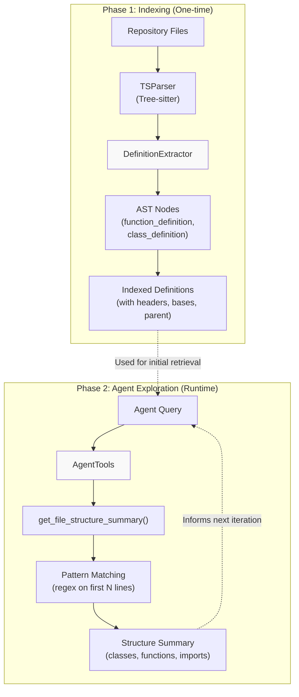
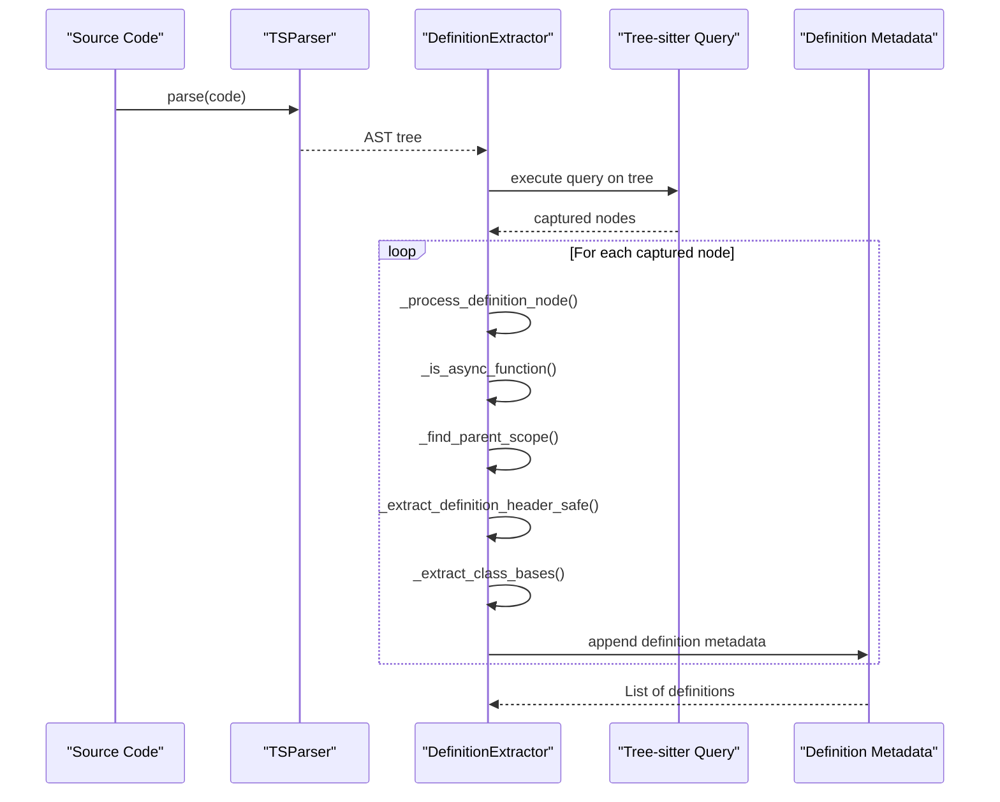
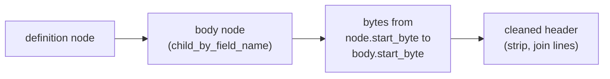
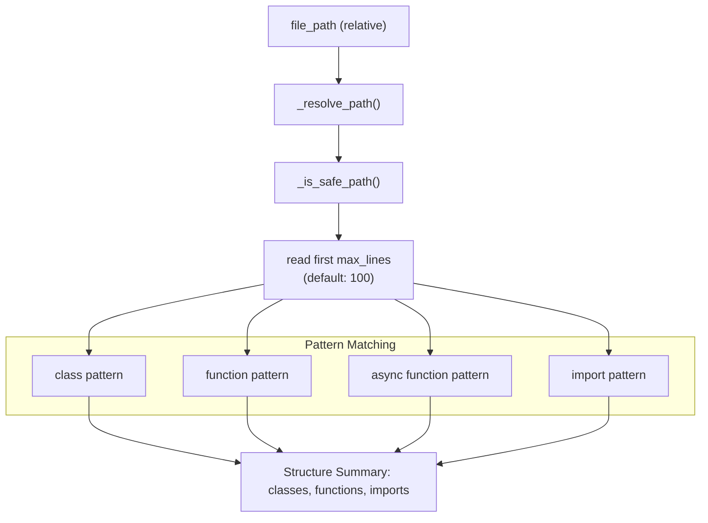
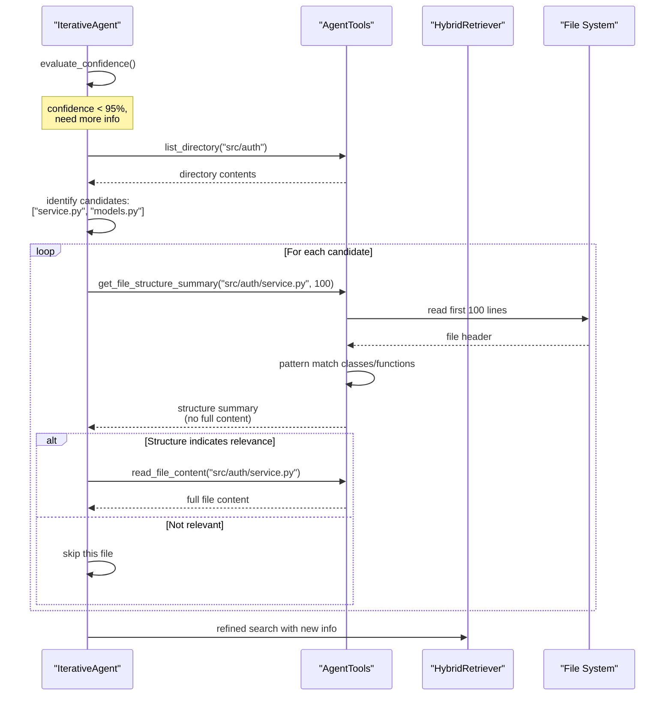
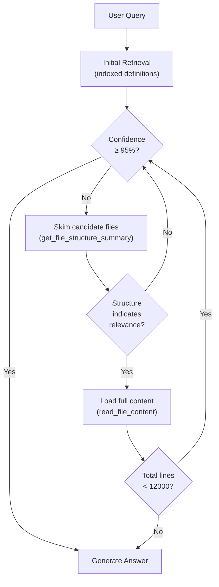
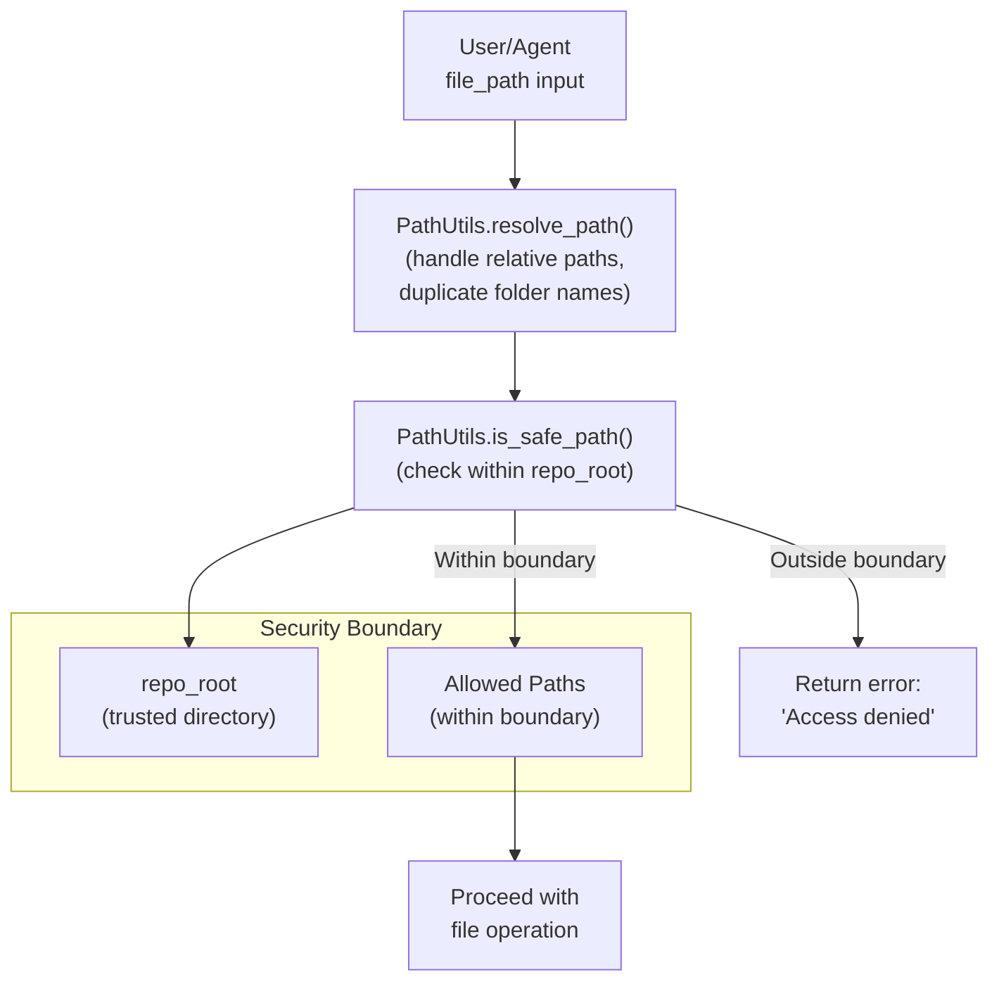
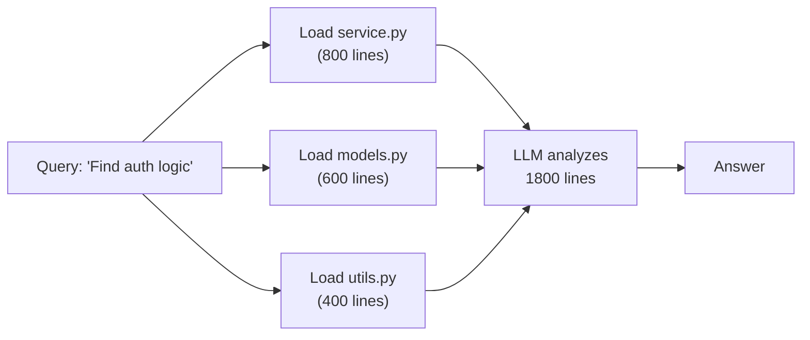
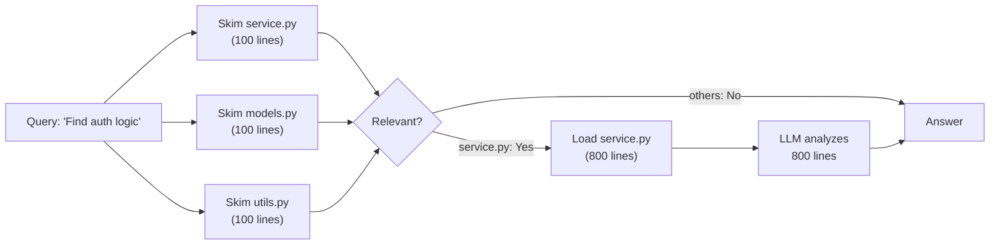
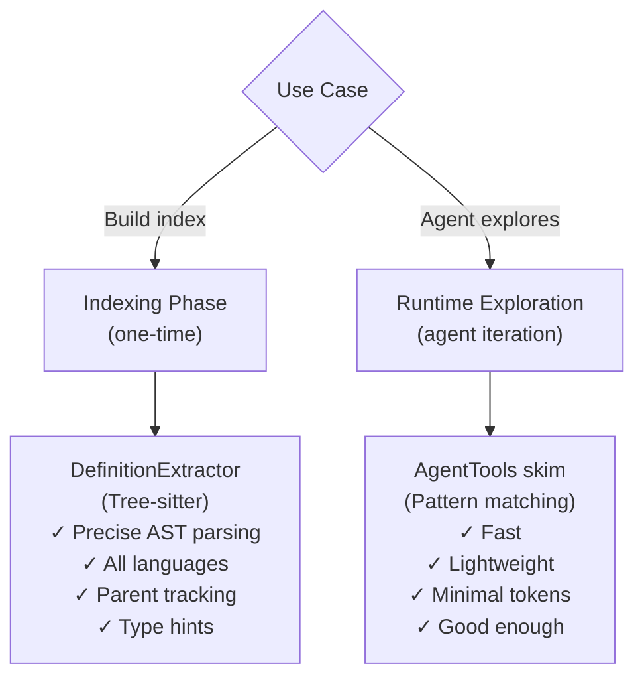

<!-- source: DeepWiki mcp.deepwiki.com · repo HKUDS/FastCode · page 9.4 Code Skimming · fetched 2026-11-09 -->

# Code Skimming

<details>
<summary>Relevant source files</summary>

The following files were used as context for generating this wiki page:

- [README.md](README.md)
- [config/config.yaml](config/config.yaml)
- [fastcode/embedder.py](fastcode/embedder.py)

</details>


**Purpose:** This document describes FastCode's code skimming capability, which enables efficient code exploration by extracting structural information (function names, class definitions, type hints) without loading full file content. This feature is a key component of the Lightning-Fast Navigation phase and contributes to FastCode's 10x token savings.

**Scope:** This page covers the implementation of code skimming in both the indexing phase (using Tree-sitter AST parsing) and the agent exploration phase (using pattern matching). For information about how agents use these tools iteratively, see [Iterative Agent](#5.1). For details on the complete agent toolset, see [Agent Tools](#5.2).

---

## Overview

Code skimming allows FastCode to understand a file's structure without reading its entire content. Instead of loading thousands of lines of code into the LLM context, the system extracts only the "headlines" - function signatures, class definitions, imports, and their locations. This approach is analogous to reading a book's table of contents instead of every page.

### Key Benefits

| Benefit | Description | Impact |
|---------|-------------|--------|
| **Token Efficiency** | Extracts structure in ~100 lines vs. full file content | Up to 10x reduction in token usage |
| **Rapid Exploration** | Agents can survey file structure in milliseconds | 3-4x faster query processing |
| **Targeted Loading** | Enables loading only relevant functions/classes | Minimizes LLM context pollution |
| **Budget-Aware Navigation** | Supports cost-efficient decision making | Enables iteration within token budgets |

**Sources:** [README.md:102]()

---

## Two-Phase Implementation

FastCode implements code skimming in two distinct phases, each optimized for its specific use case:

### Diagram: Code Skimming Architecture



**Sources:** [fastcode/definition_extractor.py:1-252](), [fastcode/agent_tools.py:400-491]()

---

## DefinitionExtractor: AST-Based Skimming

The `DefinitionExtractor` class uses Tree-sitter to extract precise structural information during the indexing phase. This provides high-quality metadata that forms the basis of FastCode's hierarchical index.

### Implementation Details

The extractor defines a Tree-sitter query constant `DEFINITION_QUERY_SCM` that captures `function_definition` and `class_definition` AST nodes using the capture names `@function.def` and `@class.def`, respectively. These captures drive the main extraction loop.

**Sources:** [fastcode/definition_extractor.py:20-24]()

### Extracted Information

For each definition, the extractor captures:

| Field | Description | Example |
|-------|-------------|---------|
| `name` | Function or class name | `"authenticate_user"` |
| `type` | Definition type | `"async_function"`, `"function"`, `"class"` |
| `header` | Signature without body | `"def authenticate_user(username: str, password: str) -> User:"` |
| `parent` | Containing class (if method) | `"AuthService"` |
| `bases` | Base classes (if class) | `["BaseModel", "Serializable"]` |
| `range` | Position information | `{start_byte, end_byte, start_point, end_point}` |
| `id` | Unique identifier | `"src/auth.py::AuthService::authenticate_user"` |

**Sources:** [fastcode/definition_extractor.py:81-133]()

### Diagram: Definition Extraction Flow



**Sources:** [fastcode/definition_extractor.py:35-79]()

### Header Extraction

The `_extract_definition_header_safe` method uses AST-aware extraction to safely handle type hints and strings:



This approach avoids naive string splitting on `:` which would break on type hints like `def foo(x: Dict[str, int]):`.

**Sources:** [fastcode/definition_extractor.py:178-217]()

### Async Function Detection

`_is_async_function()` uses two strategies to detect async functions. First, it inspects the first 50 bytes of the node for an `async` prefix via `re.match`. Second, it checks the 100 bytes preceding the node start for a trailing `async` keyword, covering unusual formatting where the keyword and `def` appear on separate tokens.

**Sources:** [fastcode/definition_extractor.py:135-153]()

---

## AgentTools: Runtime Skimming

The `AgentTools.get_file_structure_summary` method provides lightweight file skimming during agent exploration, enabling agents to survey files without loading full content.

### Method Signature

`AgentTools.get_file_structure_summary(file_path: str, max_lines: int = 100) -> Dict[str, Any]`

Accepts a relative `file_path` within the repository and an optional `max_lines` parameter (default `100`) that controls how many lines are scanned. See [fastcode/agent_tools.py:400]().

### Extraction Strategy

The method uses pattern matching on the first `max_lines` of a file:



**Sources:** [fastcode/agent_tools.py:427-485]()

### Pattern Matching Logic

The method extracts structure using simple regex patterns:

| Pattern Type | Regex | Captures |
|-------------|-------|----------|
| **Classes** | `r'class\s+(\w+)'` | Class name and line number |
| **Functions** | `r'(?:def\|function)\s+(\w+)'` | Function name and line number |
| **Async Functions** | `'async' in line and ('def ' or 'function ')` | Function name, line number, `is_async: true` |
| **Imports** | `startswith('import ') or startswith('from ')` | Import statement (truncated to 100 chars) |

**Sources:** [fastcode/agent_tools.py:445-483]()

### Return Format

The method returns a dictionary containing structural metadata only — no full file content.

| Key | Type | Description |
|-----|------|-------------|
| `success` | `bool` | `True` if the file was read successfully |
| `path` | `str` | Resolved file path |
| `total_lines_scanned` | `int` | Number of lines actually read (up to `max_lines`) |
| `classes` | `list` | List of `{"name": str, "line": int}` entries |
| `functions` | `list` | List of `{"name": str, "line": int}` entries, with optional `"is_async": True` |
| `imports` | `list` | List of `{"line": int, "statement": str}` entries (statement truncated to 100 chars) |

**Sources:** [fastcode/agent_tools.py:436-443]()

---

## Integration with Retrieval Pipeline

Code skimming is integrated into FastCode's agent-based exploration workflow:

### Diagram: Skimming in Agent Iteration



**Sources:** [fastcode/agent_tools.py:400-491]()

---

## Performance Optimization

Code skimming enables several performance optimizations:

### Token Savings

| Scenario | Without Skimming | With Skimming | Savings |
|----------|------------------|---------------|---------|
| **Survey 10 files** | 10,000 lines × 10 = 100,000 tokens | 100 lines × 10 = 1,000 tokens | **99% reduction** |
| **Identify relevant files** | Load all, then filter | Skim first, load selectively | **90% reduction** |
| **Iterative refinement** | Re-load files each iteration | Skim cached structures | **95% reduction** |

### Diagram: Budget-Aware Decision Making



**Sources:** [README.md:104-113]()

---

## Configuration

Code skimming behavior can be configured through various parameters:

### DefinitionExtractor Configuration

Controlled via `config.yaml` parser settings:

```yaml
parser:
  extract_docstrings: true    # Include docstrings in headers
  extract_comments: true       # Include inline comments
  extract_imports: true        # Track import statements
  compute_complexity: false    # Skip complexity metrics for speed
```

**Sources:** [README.md:550-608]()

### AgentTools Configuration

The `max_lines` parameter controls how many lines are scanned per call:

| `max_lines` | Use Case |
|-------------|----------|
| `50` | Minimal skim for rapid file triage |
| `100` | Default — balances speed and coverage |
| `500` | Deeper skim for files with many definitions |

Configured via `config.yaml` agent settings:

```yaml
agent:
  iterative:
    max_total_lines: 12000  # Budget limit across all iterations
    max_iterations: 4       # Stop after 4 exploration rounds
```

**Sources:** [fastcode/agent_tools.py:400-407]()

---

## Security Considerations

Both skimming implementations enforce strict path security:

### Security Boundaries



All file access operations call `_is_safe_path()` before reading. If the resolved path is outside `repo_root`, the method returns a failure dictionary with an `"Access denied"` error message rather than raising an exception.

**Sources:** [fastcode/agent_tools.py:40-46](), [fastcode/agent_tools.py:411-416]()

---

## Usage Examples

### Example 1: Agent Exploring Auth Module

**Agent goal:** Understand authentication implementation

1. Call `list_directory("src/auth")` → returns `["service.py", "models.py", "utils.py"]`
2. Call `get_file_structure_summary("src/auth/service.py", 100)` → returns a structure dict with `classes: [AuthService]` and `functions: [authenticate_user, validate_token]`
3. Agent identifies `service.py` as relevant from the class/function names alone
4. Call `read_file_content("src/auth/service.py")` → loads only this file's full content

**Token usage:**
- Without skimming: 3 files × 500 lines = 1,500 lines loaded
- With skimming: 3 files × 100 lines + 1 file × 500 lines = 800 lines loaded
- **Savings: 47%**

### Example 2: Finding Model Definitions

**Agent goal:** Locate `User` model definition

1. For each file in `models/` — `user.py`, `auth.py`, `session.py` — call `get_file_structure_summary(path, max_lines=50)`
2. Inspect the `classes` list in each result; stop when a class named `User` is found
3. Call `read_file_content` on only the matching file

**Token usage:**
- Without skimming: 3 files × 300 lines = 900 lines
- With skimming: 3 files × 50 lines + 1 file × 300 lines = 450 lines
- **Savings: 50%**

**Sources:** [fastcode/agent_tools.py:48-106](), [fastcode/agent_tools.py:400-491]()

---

## Comparison with Full Content Loading

### Traditional Approach



**Cost:** 1,800 lines = ~2,700 tokens

### FastCode Skimming Approach



**Cost:** 300 skimmed + 800 loaded = 1,100 lines = ~1,650 tokens

**Savings: 39%** in this example, often much higher with larger codebases.

**Sources:** [README.md:102]()

---

## Limitations and Trade-offs

### Pattern Matching Limitations

The `get_file_structure_summary` method uses simple regex patterns which have limitations:

| Limitation | Impact | Mitigation |
|------------|--------|------------|
| **No nested classes** | May miss inner class definitions | Use Tree-sitter `DefinitionExtractor` for precise extraction |
| **No decorators** | Decorator information not captured | Indexed definitions include decorators |
| **Limited to first N lines** | May miss definitions below `max_lines` | Increase `max_lines` for deeper files |
| **Language-agnostic patterns** | Less accurate for non-Python files | Primary tool for quick exploration only |

### When to Use Each Approach



**Sources:** [fastcode/definition_extractor.py:1-252](), [fastcode/agent_tools.py:400-491]()

---

## Related Features

- **[Iterative Agent](#5.1)**: Uses code skimming for multi-round exploration
- **[Agent Tools](#5.2)**: Complete toolset including skimming capabilities
- **[Code Parser](#4.2)**: AST-based parsing for precise definition extraction
- **[Performance Optimization](#9.3)**: Token savings strategies including skimming
- **[Two-Stage Retrieval](#9.5)**: Combines indexed definitions with runtime skimming

---

