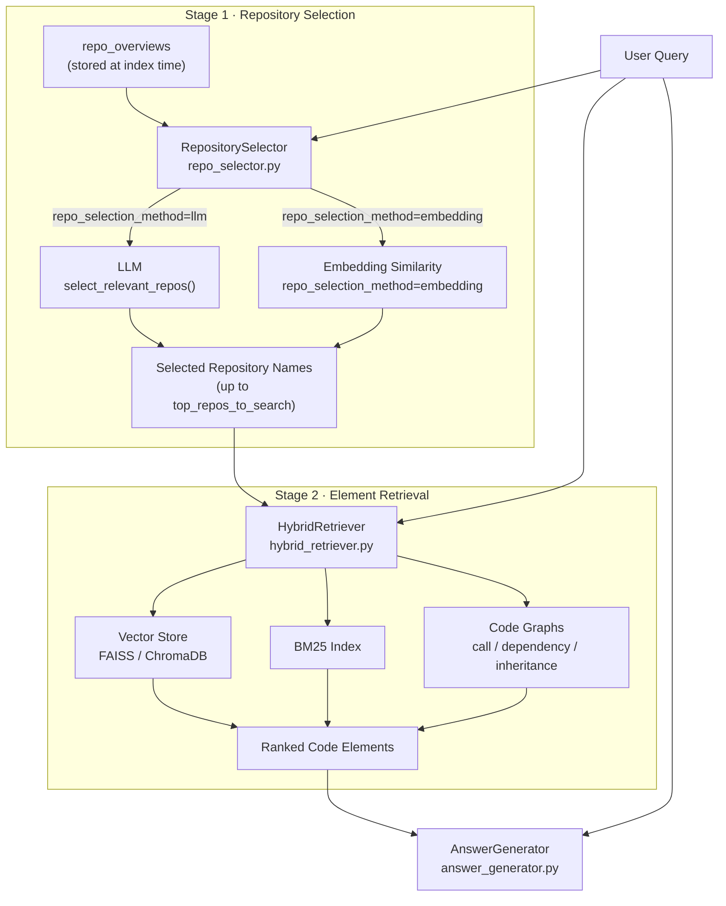
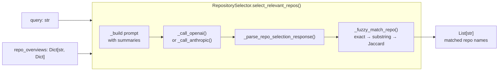

<!-- source: DeepWiki mcp.deepwiki.com · repo HKUDS/FastCode · page 9.5 Two-Stage Retrieval · fetched 2026-11-09 -->

# Two-Stage Retrieval

<details>
<summary>Relevant source files</summary>

The following files were used as context for generating this wiki page:

- [README.md](README.md)
- [config/config.yaml](config/config.yaml)
- [fastcode/embedder.py](fastcode/embedder.py)
- [fastcode/repo_overview.py](fastcode/repo_overview.py)
- [fastcode/repo_selector.py](fastcode/repo_selector.py)

</details>


This page explains how FastCode narrows a multi-repository query down to the right code elements in two sequential passes: a coarse repository-selection pass and a fine-grained element-retrieval pass. It covers the configuration keys that control each stage, the classes involved, and the decision logic applied at each step.

For background on the hybrid retrieval mechanism used in stage 2, see page [4.6](#4.6). For the agent system that uses two-stage retrieval as its initial search step, see page [5.1](#5.1). For the overview generation process that powers stage 1, see page [4.9](#4.9).

---

## Motivation

When multiple repositories are indexed simultaneously, searching all of them with equal weight is wasteful and noisy. A query about authentication logic should not incur the cost of scanning repositories unrelated to that topic. Two-stage retrieval avoids this by running a cheap, high-level filter before the expensive vector search.

```
Stage 1 (coarse): Which repos are relevant?
  → repo_overviews → LLM or embedding scoring → select top_repos_to_search repos

Stage 2 (fine):   Which code elements answer the query?
  → hybrid vector + BM25 + graph search inside selected repos only
```

This approach is activated by `enable_two_stage_retrieval: true` in `config/config.yaml`.

---

## Architecture Overview

**Diagram: Two-Stage Retrieval Data Flow**



Sources: [config/config.yaml:99-120](), [fastcode/repo_selector.py:280-353]()

---

## Stage 1: Repository-Level Selection

### Overview Data

Repository overviews are produced by `RepositoryOverviewGenerator` ([fastcode/repo_overview.py:62-99]()) during indexing and stored in a persistent file (`repo_overviews.pkl` in the vector store directory). Each stored entry contains:

| Field | Content |
|---|---|
| `repo_name` | Name of the repository |
| `summary` | 3–5 sentence LLM summary, or structure-based fallback |
| `readme_content` | First 10,000 characters of README (if present) |
| `structure_text` | Formatted file listing with language counts |
| `has_readme` | Boolean indicating README availability |

The `summary` field is the primary signal used during repository selection. It is generated by `_summarize_readme_with_llm()` ([fastcode/repo_overview.py:228-281]()) when a README is available, or by `_generate_structure_based_overview()` ([fastcode/repo_overview.py:283-308]()) as a fallback.

Sources: [fastcode/repo_overview.py:62-99](), [fastcode/repo_overview.py:228-281]()

---

### RepositorySelector

The `RepositorySelector` class ([fastcode/repo_selector.py:16-478]()) owns the selection logic. Its primary method for stage 1 is `select_relevant_repos()`.

**Diagram: RepositorySelector Internal Flow**



Sources: [fastcode/repo_selector.py:280-353](), [fastcode/repo_selector.py:420-455](), [fastcode/repo_selector.py:365-418]()

The method builds a prompt listing each repository's summary, calls the configured LLM, then parses lines matching `REPO: <repository_name>`. Because LLMs sometimes return imprecise names (partial matches, different casing, surrounding markdown), `_fuzzy_match_repo()` ([fastcode/repo_selector.py:365-418]()) applies three matching tiers in order:

1. **Exact match** – case-insensitive equality
2. **Substring containment** – LLM output is contained in a real name, or vice versa
3. **Jaccard token overlap** – score must be ≥ 0.5 on alphanumeric token sets

If the LLM cannot determine which repositories are relevant (e.g., a very general query), the prompt instructs it to return all repository names, avoiding incorrect filtering.

Sources: [fastcode/repo_selector.py:365-418](), [fastcode/repo_selector.py:420-455]()

---

### repo_selection_method: "embedding" Alternative

When `repo_selection_method` is set to `"embedding"` in `config.yaml`, stage 1 uses semantic similarity plus BM25 scoring against overview text rather than calling an LLM. This trades selection accuracy for lower latency and zero LLM cost during the filtering step. The `min_repo_similarity` threshold ([config/config.yaml:115]()) controls the cutoff for this path.

---

## Stage 2: Fine-Grained Element Retrieval

Once the set of relevant repositories is narrowed to at most `top_repos_to_search` candidates, the normal hybrid retrieval pipeline runs, but scoped to those repositories.

The hybrid retriever combines three signals with configurable weights:

| Signal | Config Key | Default |
|---|---|---|
| Semantic vector similarity | `semantic_weight` | `0.5` |
| BM25 keyword score | `keyword_weight` | `0.5` |
| Graph traversal score | `graph_weight` | `1.0` |

Results are filtered by `min_similarity` and deduplicated with a `diversity_penalty` before being passed to `AnswerGenerator`. The maximum number of results is `max_results`.

Sources: [config/config.yaml:99-119]()

---

## Optional File-Level Pre-Selection

Beyond repo-level selection, `RepositorySelector` also exposes `select_relevant_files()` ([fastcode/repo_selector.py:62-112]()). This method asks the LLM to identify specific files within the selected repositories before the vector search runs.

When used, the returned file paths are passed to `enhance_query_with_file_hints()` ([fastcode/repo_selector.py:457-478]()), which appends a `[Relevant files: ...]` suffix to the query. This biases the subsequent vector and BM25 searches toward those paths.

**Diagram: File Selection and Query Enhancement**

```mermaid
flowchart LR
    Q["original query"]
    SR["select_relevant_files()\nrepo_selector.py"]
    FILES["List[Dict]\nrepo_name, file_path, reason"]
    EQ["enhance_query_with_file_hints()\nrepo_selector.py"]
    QE["enhanced query\n\"...query... [Relevant files: repo/path, ...]\"\n(top 5 files appended)"]

    subgraph LLM_Response["LLM Output Format"]
        FMT["FILE: repo_name::file_path\nREASON: brief reason"]
    end

    Q --> SR
    SR --> LLM_Response
    LLM_Response --> FILES
    FILES --> EQ
    Q --> EQ
    EQ --> QE
```

The `scenario_mode` parameter (`"single"` or `"multi"`) adjusts the prompt: in single-repo mode, the instruction focuses on one repository; in multi-repo mode, the LLM is told to first identify relevant repositories and then select files only from those.

Sources: [fastcode/repo_selector.py:62-112](), [fastcode/repo_selector.py:114-187](), [fastcode/repo_selector.py:457-478]()

---

## select_repos_by_overview Flag

`select_repos_by_overview: true` ([config/config.yaml:112]()) enables stage 1 repo filtering in both agency mode and standard (non-agent) query mode. When `false`, all indexed repositories are searched in stage 2 regardless of relevance, which is appropriate when only a small number of repositories are loaded.

---

## Configuration Reference

All two-stage retrieval settings live under the `retrieval:` section of `config/config.yaml`.

| Key | Type | Default | Effect |
|---|---|---|---|
| `enable_two_stage_retrieval` | bool | `true` | Master switch for the two-stage pipeline |
| `select_repos_by_overview` | bool | `true` | Enable LLM/embedding repo pre-filtering |
| `repo_selection_method` | string | `"llm"` | `"llm"` calls the LLM; `"embedding"` uses semantic scoring |
| `top_repos_to_search` | int | `5` | Maximum repos to pass to stage 2 |
| `min_repo_similarity` | float | `0.1` | Minimum similarity score for embedding-based selection |
| `max_files_to_search` | int | `15` | Maximum files for `select_relevant_files()` |
| `semantic_weight` | float | `0.5` | Weight of vector similarity in stage 2 |
| `keyword_weight` | float | `0.5` | Weight of BM25 in stage 2 |
| `graph_weight` | float | `1.0` | Weight of graph traversal in stage 2 |
| `min_similarity` | float | `0.15` | Minimum score threshold for returned elements |
| `max_results` | int | `5` | Maximum elements returned from stage 2 |
| `diversity_penalty` | float | `0.1` | Penalty for near-duplicate results |

Sources: [config/config.yaml:98-120]()

---

## Single-Repository Behavior

When only one repository is indexed, stage 1 selection is a no-op: there is only one candidate, so no filtering is needed. The `RepositorySelector` skips LLM calls in this case and passes the single repository directly to stage 2. The `scenario_mode: "single"` path in `select_relevant_files()` also adjusts the prompt accordingly to avoid instructing the LLM to "identify relevant repositories" when there is no choice.

Sources: [fastcode/repo_selector.py:62-68](), [fastcode/repo_selector.py:114-130]()

---

