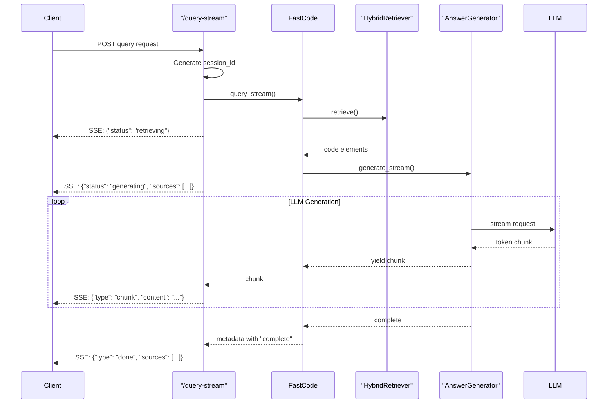
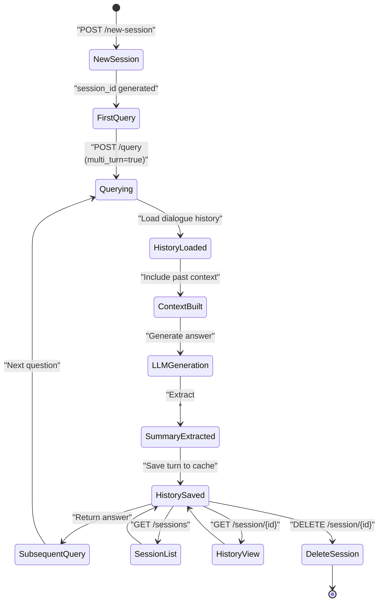
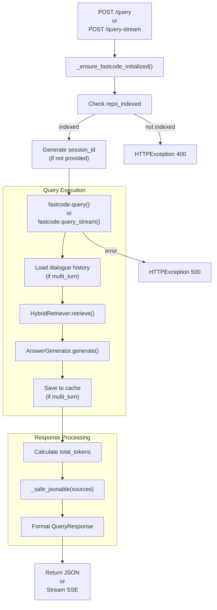

<!-- source: DeepWiki mcp.deepwiki.com · repo HKUDS/FastCode · extra page Query Endpoints · fetched 2026-11-09 -->

# Query Endpoints

<details>
<summary>Relevant source files</summary>

The following files were used as context for generating this wiki page:

- [fastcode/answer_generator.py](fastcode/answer_generator.py)
- [web_app.py](web_app.py)

</details>


This page documents the REST API endpoints for querying code repositories and managing multi-turn conversations. These endpoints enable natural language queries against indexed codebases, with support for both single-shot responses and streaming interactions.

For repository management operations (loading, indexing, uploading), see [Repository Endpoints](#6.1.1). For system status and cache operations, see [System Endpoints](#6.1.4).

## Overview

The query endpoints provide the core question-answering functionality of FastCode. They accept natural language questions about code and return answers with source citations, token usage statistics, and optional streaming responses. All query operations require that at least one repository has been indexed.

**Sources:** [api.py:1-796]()

## Request and Response Models

### QueryRequest

The `QueryRequest` Pydantic model defines the structure for all query operations:

| Field | Type | Required | Description |
|-------|------|----------|-------------|
| `question` | `str` | Yes | Natural language question about the repository |
| `filters` | `Dict[str, Any]` | No | Optional retrieval filters (min_similarity, max_results, etc.) |
| `repo_filter` | `List[str]` | No | Repository names to search (for multi-repo mode) |
| `multi_turn` | `bool` | No | Enable multi-turn conversation mode (default: False) |
| `session_id` | `str` | No | Session ID for multi-turn dialogue continuation |

**Sources:** [api.py:40-46]()

### QueryResponse

The `QueryResponse` model returns comprehensive query results:

| Field | Type | Description |
|-------|------|-------------|
| `answer` | `str` | Generated answer to the question |
| `query` | `str` | The original or processed query |
| `context_elements` | `int` | Number of code elements used in context |
| `sources` | `List[Dict]` | Retrieved code elements with metadata |
| `prompt_tokens` | `int` | Tokens used in the prompt |
| `completion_tokens` | `int` | Tokens generated in the response |
| `total_tokens` | `int` | Total token usage |
| `session_id` | `str` | Session identifier (for multi-turn mode) |

**Sources:** [api.py:48-57]()

## Single Query Endpoint

### POST /query

Executes a query and returns a complete response in a single HTTP transaction. This endpoint is suitable for simple queries and automation scenarios where streaming is not required.

```
POST /query
Content-Type: application/json
```

**Request Body:**
```json
{
  "question": "How does authentication work?",
  "filters": {"min_similarity": 0.2, "max_results": 10},
  "repo_filter": ["repo1", "repo2"],
  "multi_turn": false,
  "session_id": null
}
```

**Response:**
```json
{
  "answer": "Authentication is implemented using...",
  "query": "How does authentication work?",
  "context_elements": 15,
  "sources": [
    {
      "file_path": "src/auth.py",
      "element_type": "function",
      "name": "authenticate_user",
      "similarity": 0.87
    }
  ],
  "prompt_tokens": 1234,
  "completion_tokens": 567,
  "total_tokens": 1801,
  "session_id": "abc12345"
}
```

**Implementation Details:**

The endpoint performs these operations:

1. **Lazy Initialization**: Ensures FastCode instance is initialized via `_ensure_fastcode_initialized()` [api.py:448]()
2. **Repository Validation**: Checks that a repository is indexed via `fastcode.repo_indexed` [api.py:450]()
3. **Session ID Generation**: Creates a new session ID if not provided using `uuid.uuid4()[:8]` [api.py:454]()
4. **Asynchronous Execution**: Runs the query in a thread pool using `asyncio.to_thread()` [api.py:461-468]()
5. **Token Calculation**: Computes total tokens if not provided by the LLM [api.py:474-475]()
6. **Source Serialization**: Converts sources to JSON-safe format using `_safe_jsonable()` [api.py:478]()

**Error Handling:**

- Returns `400` if no repository is indexed [api.py:450-451]()
- Returns `500` for query execution failures [api.py:492-493]()

**Sources:** [api.py:445-493]()

## Streaming Query Endpoint

### POST /query-stream

Executes a query with Server-Sent Events (SSE) streaming, enabling real-time response generation and progress updates. This endpoint provides a better user experience for long-running queries and interactive applications.

```
POST /query-stream
Content-Type: application/json
```

**Request Body:** Same as `/query` endpoint

**Response:** Server-Sent Events stream with multiple event types

### SSE Event Types

The streaming endpoint emits four types of events during query execution:

| Event Type | Description | Timing |
|------------|-------------|--------|
| `status: retrieving` | Code retrieval in progress | Before context gathering |
| `status: generating` | LLM generation starting | After retrieval, includes sources |
| `chunk` | Partial answer content | During LLM generation |
| `done` | Query completed | After generation finishes |
| `error` | Error occurred | On any failure |

### Event Format

Each SSE event follows this structure:

**Status Event (Retrieving):**
```
data: {"type": "status", "status": "retrieving"}
```

**Status Event (Generating):**
```
data: {
  "type": "status",
  "status": "generating",
  "sources": [...],
  "session_id": "abc12345"
}
```

**Chunk Event:**
```
data: {"type": "chunk", "content": "Authentication is "}
```

**Done Event:**
```
data: {
  "type": "done",
  "sources": [...],
  "context_elements": 15,
  "session_id": "abc12345"
}
```

**Error Event:**
```
data: {"type": "error", "error": "Query failed: ..."}
```

### Streaming Implementation Flow



**Sources:** [api.py:496-568]()

### Event Generator Implementation

The `event_generator()` async function processes the stream from `fastcode.query_stream()` and converts it to SSE format:

1. **Chunk Processing**: Text chunks are wrapped in `{"type": "chunk", "content": ...}` [api.py:549-551]()
2. **Metadata Processing**: Metadata dictionaries are converted to status/done events based on `status` field [api.py:523-547]()
3. **Source Serialization**: All sources are passed through `_safe_jsonable()` to ensure JSON compatibility [api.py:528,537]()
4. **Error Handling**: Exceptions are caught and emitted as error events [api.py:555-558]()

**Sources:** [api.py:512-559]()

### Response Headers

The streaming response includes specific headers to ensure proper SSE behavior:

```
Content-Type: text/event-stream
Cache-Control: no-cache
Connection: keep-alive
X-Accel-Buffering: no
```

These headers prevent buffering and ensure real-time delivery [api.py:562-567]().

**Sources:** [api.py:560-568]()

## Session Management Endpoints

Multi-turn dialogue requires session management to track conversation history. FastCode provides four endpoints for session lifecycle management.

### POST /new-session

Creates a new conversation session and optionally clears an existing one.

```
POST /new-session?clear_session_id=old_session_123
```

**Query Parameters:**
- `clear_session_id` (optional): Session ID to delete before creating new session

**Response:**
```json
{
  "session_id": "abc12345"
}
```

The session ID is generated using `uuid.uuid4()[:8]` to create an 8-character identifier [api.py:603](). If `clear_session_id` is provided, the old session is deleted via `fastcode.delete_session()` before creating the new one [api.py:600-601]().

**Sources:** [api.py:595-604]()

### GET /sessions

Lists all conversation sessions with metadata, sorted by last update time.

```
GET /sessions
```

**Response:**
```json
{
  "status": "success",
  "sessions": [
    {
      "session_id": "abc12345",
      "title": "Authentication Discussion",
      "total_turns": 5,
      "created": 1704067200,
      "last_updated": 1704070800
    }
  ]
}
```

The endpoint calls `fastcode.list_sessions()` and formats each session with:
- `session_id`: Unique identifier
- `title`: Auto-generated or first question
- `total_turns`: Number of dialogue turns
- `created`: Unix timestamp of creation
- `last_updated`: Unix timestamp of last activity

**Sources:** [api.py:607-628]()

### GET /session/{session_id}

Retrieves complete dialogue history for a specific session.

```
GET /session/abc12345
```

**Response:**
```json
{
  "status": "success",
  "session_id": "abc12345",
  "history": [
    {
      "turn": 1,
      "question": "How does authentication work?",
      "answer": "Authentication is implemented...",
      "sources": [...],
      "timestamp": 1704067200
    }
  ]
}
```

The history is retrieved via `fastcode.get_session_history(session_id)` and serialized using `_safe_jsonable()` to ensure all objects are JSON-compatible [api.py:636-637]().

**Sources:** [api.py:631-641]()

### DELETE /session/{session_id}

Deletes a conversation session and all its history.

```
DELETE /session/abc12345
```

**Response:**
```json
{
  "status": "success",
  "message": "Session 'abc12345' deleted (5 turns)"
}
```

**Error Handling:**
- Returns `404` if session does not exist [api.py:652]()
- Returns `500` if deletion fails [api.py:661]()

The endpoint first verifies the session exists by calling `fastcode.get_session_history()`, then deletes it via `fastcode.delete_session()` [api.py:650-654]().

**Sources:** [api.py:644-666]()

## Multi-Turn Dialogue Support

### Enabling Multi-Turn Mode

Multi-turn conversations are enabled by setting `multi_turn: true` in the query request. This activates dialogue history tracking and summary generation.

```json
{
  "question": "What about error handling?",
  "multi_turn": true,
  "session_id": "abc12345"
}
```

### Session Flow



**Sources:** [api.py:40-46](), [api.py:454-458]()

### Session ID Behavior

The query endpoints handle session IDs with the following logic:

1. **Provided Session ID**: Use the provided ID for multi-turn continuation [api.py:454]()
2. **Multi-Turn Without ID**: Generate new session ID and log it [api.py:455-456]()
3. **Single-Turn Without ID**: Generate temporary session ID [api.py:457-458]()

This allows both persistent conversations (with explicit session IDs) and stateless queries (with ephemeral IDs).

**Sources:** [api.py:454-458](), [api.py:504-508]()

## Query Processing Flow

The following diagram shows how query requests flow through the FastCode system:



**Sources:** [api.py:445-493](), [api.py:496-568]()

## Token Usage Tracking

All query responses include detailed token usage statistics:

### Token Fields

The `QueryResponse` model includes three token counters:

- `prompt_tokens`: Tokens consumed by the prompt (question + context)
- `completion_tokens`: Tokens generated in the answer
- `total_tokens`: Sum of prompt and completion tokens

**Sources:** [api.py:53-55]()

### Token Calculation

The `/query` endpoint calculates tokens with this logic:

1. **Extract from LLM Response**: Most LLM providers return token counts in the result [api.py:470-472]()
2. **Fallback Calculation**: If `total_tokens` is missing, it's computed as `prompt_tokens + completion_tokens` [api.py:474-475]()
3. **Include in Response**: All token fields are included in the `QueryResponse` [api.py:485-487]()

```python
# Token calculation logic (simplified)
prompt_tokens = result.get("prompt_tokens")
completion_tokens = result.get("completion_tokens")
total_tokens = result.get("total_tokens")

if total_tokens is None and prompt_tokens and completion_tokens:
    total_tokens = prompt_tokens + completion_tokens
```

**Sources:** [api.py:470-475]()

## Safe JSON Serialization

The `_safe_jsonable()` helper function ensures all response data is JSON-serializable, even when dealing with complex Python objects like code elements or metadata.

### Serialization Strategy

The function handles objects recursively:

1. **Primitive Types**: Return as-is (bool, int, float, str, None) [api.py:755]()
2. **Dictionaries**: Recursively convert all keys and values [api.py:757-764]()
3. **Collections**: Convert lists, tuples, sets element-by-element [api.py:765-766]()
4. **Objects with to_dict()**: Call the method and recurse [api.py:767-771]()
5. **Objects with __dict__**: Convert via `vars()` [api.py:772-776]()
6. **Fallback**: Use `repr()` for unserializable objects [api.py:777]()

### Usage in Query Endpoints

Sources are serialized before being included in responses:

```python
sources = result.get("sources", [])
serialized_sources = [_safe_jsonable(source) for source in sources]
```

This ensures that code elements (which may contain AST nodes, graph references, or other non-JSON types) can be safely returned to clients [api.py:477-478](), [api.py:528](), [api.py:537]().

**Sources:** [api.py:753-777]()

## Usage Examples

### Single Query

```bash
curl -X POST http://localhost:8001/query \
  -H "Content-Type: application/json" \
  -d '{
    "question": "How does the authentication system work?",
    "filters": {"min_similarity": 0.2},
    "multi_turn": false
  }'
```

### Streaming Query

```bash
curl -X POST http://localhost:8001/query-stream \
  -H "Content-Type: application/json" \
  -d '{
    "question": "Explain the database schema",
    "multi_turn": true,
    "session_id": "abc12345"
  }'
```

### Multi-Turn Conversation

```bash
# Start a new session
SESSION_ID=$(curl -X POST http://localhost:8001/new-session | jq -r '.session_id')

# First question
curl -X POST http://localhost:8001/query \
  -H "Content-Type: application/json" \
  -d "{
    \"question\": \"How is user authentication implemented?\",
    \"multi_turn\": true,
    \"session_id\": \"$SESSION_ID\"
  }"

# Follow-up question
curl -X POST http://localhost:8001/query \
  -H "Content-Type: application/json" \
  -d "{
    \"question\": \"What about password hashing?\",
    \"multi_turn\": true,
    \"session_id\": \"$SESSION_ID\"
  }"

# View history
curl http://localhost:8001/session/$SESSION_ID
```

### Python Client Example

```python
import requests

API_BASE = "http://localhost:8001"

# Query with streaming
def query_stream(question, session_id=None):
    response = requests.post(
        f"{API_BASE}/query-stream",
        json={
            "question": question,
            "multi_turn": True,
            "session_id": session_id
        },
        stream=True
    )
    
    for line in response.iter_lines():
        if line.startswith(b'data: '):
            data = json.loads(line[6:])
            if data['type'] == 'chunk':
                print(data['content'], end='', flush=True)
            elif data['type'] == 'done':
                print(f"\n\nSources: {len(data['sources'])} files")
                return data['session_id']

# Create session and query
session_id = None
session_id = query_stream("How does authentication work?", session_id)
session_id = query_stream("What about authorization?", session_id)
```

**Sources:** [api.py:445-568]()

## Error Responses

All query endpoints follow consistent error handling:

| Status Code | Condition | Response |
|-------------|-----------|----------|
| 400 | Repository not indexed | `{"detail": "Repository not indexed"}` |
| 404 | Session not found | `{"detail": "Session 'xxx' not found"}` |
| 500 | Query execution failed | `{"detail": "<error message>"}` |
| 500 | Session operation failed | `{"detail": "<error message>"}` |

**Sources:** [api.py:450-451](), [api.py:492-493](), [api.py:652](), [api.py:661](), [api.py:665-666]()

---

