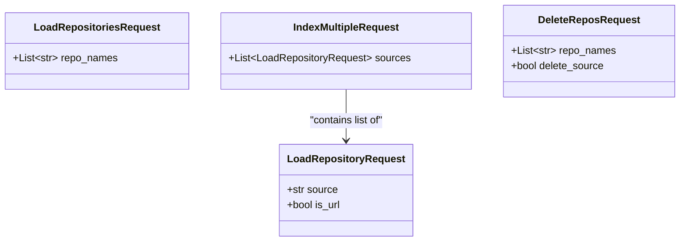
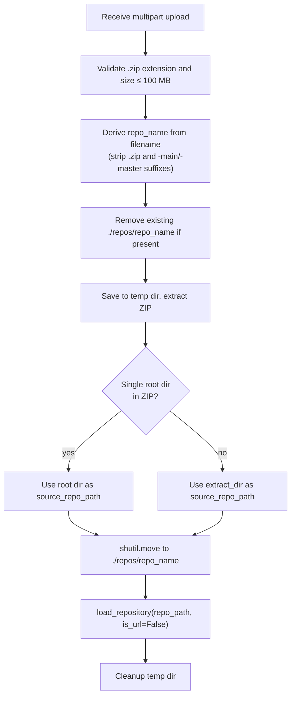
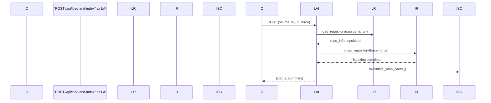
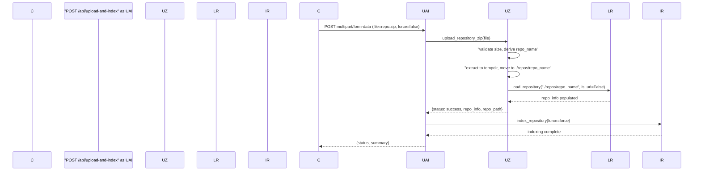
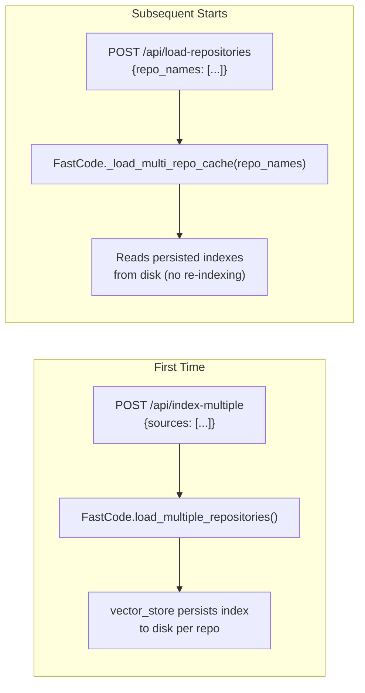

<!-- source: DeepWiki mcp.deepwiki.com · repo HKUDS/FastCode · extra page Repository Endpoints · fetched 2026-11-09 -->

# Repository Endpoints

<details>
<summary>Relevant source files</summary>

The following files were used as context for generating this wiki page:

- [fastcode/loader.py](fastcode/loader.py)
- [web_app.py](web_app.py)

</details>


This page documents the repository management endpoints exposed by `web_app.py`. These endpoints handle the full lifecycle of a repository in FastCode: acquiring source code (via Git URL, local path, or ZIP upload), building the index, loading already-indexed repositories back into memory, and deleting them.

For query endpoints (`/api/query`, `/api/query-stream`), see [Query Endpoints](#6.1.2). For session management, see [Session Management Endpoints](#6.1.3). For the general API overview including base URL, startup lifecycle, and Pydantic conventions, see [REST API](#6.1).

---

## Request & Response Models

The following Pydantic models are defined in `web_app.py` and used across these endpoints.

**Diagram: Request model relationships**



Sources: [web_app.py:36-65](), [web_app.py:751-753]()

| Model | Used by | Key fields |
|---|---|---|
| `LoadRepositoryRequest` | `/api/load`, `/api/load-and-index`, `/api/index-multiple` | `source` (URL or path), `is_url` (bool) |
| `LoadRepositoriesRequest` | `/api/load-repositories` | `repo_names` (list of repo name strings) |
| `IndexMultipleRequest` | `/api/index-multiple` | `sources` (list of `LoadRepositoryRequest`) |
| `DeleteReposRequest` | `/api/delete-repos` | `repo_names`, `delete_source` |

---

## Endpoint Overview

**Diagram: Endpoint-to-engine call mapping**

```mermaid
flowchart TD
    subgraph "POST /api/load"
        L["load_repository()"]
    end
    subgraph "POST /api/index"
        I["index_repository(force)"]
        IC["vector_store.invalidate_scan_cache()"]
    end
    subgraph "POST /api/load-and-index"
        LAI_L["load_repository()"]
        LAI_I["index_repository(force)"]
        LAI_IC["vector_store.invalidate_scan_cache()"]
    end
    subgraph "POST /api/index-multiple"
        IM["load_multiple_repositories()"]
        IM_IC["vector_store.invalidate_scan_cache()"]
    end
    subgraph "POST /api/load-repositories"
        LR["_load_multi_repo_cache(repo_names)"]
    end
    subgraph "POST /api/upload-zip"
        UZ["upload_repository_zip()"]
        UZ_L["load_repository(path, is_url=False)"]
    end
    subgraph "POST /api/upload-and-index"
        UAI["upload_repository_zip()"]
        UAI_I["index_repository(force)"]
        UAI_IC["vector_store.invalidate_scan_cache()"]
    end
    subgraph "POST /api/delete-repos"
        DR["remove_repository(repo_name, delete_source)"]
    end
    subgraph "GET /api/repositories"
        GR_A["vector_store.scan_available_indexes(use_cache)"]
        GR_L["list_repositories()"]
    end

    FC["fastcode_instance\n(FastCode)"]

    L --> FC
    I --> FC
    LAI_L --> FC
    LAI_I --> FC
    IM --> FC
    LR --> FC
    UZ_L --> FC
    UAI --> FC
    UAI_I --> FC
    DR --> FC
    GR_A --> FC
    GR_L --> FC
```



Sources: [web_app.py:205-785]()

---

## GET /api/repositories

Lists all repositories that are (a) indexed on disk and (b) currently loaded in memory.

**Query parameters:**

| Parameter | Type | Default | Description |
|---|---|---|---|
| `full_scan` | bool | `false` | Force a full disk scan; otherwise uses the index scan cache |

**Response:**

```json
{
  "status": "success",
  "available": [...],
  "loaded": [...]
}
```

- `available` — result of `vector_store.scan_available_indexes(use_cache=not full_scan)`
- `loaded` — result of `fastcode_instance.list_repositories()`

Sources: [web_app.py:179-202]()

---

## POST /api/load

Loads a repository into the `fastcode_instance` without indexing it. Accepts a Git URL or a local filesystem path. Does **not** build a vector index; call `/api/index` separately.

**Request body:** `LoadRepositoryRequest`

| Field | Type | Required | Description |
|---|---|---|---|
| `source` | string | yes | Git URL (e.g. `https://github.com/...`) or local path |
| `is_url` | bool | yes | `true` to clone via Git, `false` to load from local path |

**Response:**

```json
{
  "status": "success",
  "message": "Repository loaded successfully",
  "repo_info": { ... }
}
```

The `repo_info` dict is populated by `fastcode_instance.repo_info` after `load_repository()` returns.

Sources: [web_app.py:205-223]()

---

## POST /api/index

Indexes the currently loaded repository. Requires that a repository was already loaded via `/api/load` (or any load step). After indexing, the index scan cache is invalidated so subsequent listing calls see fresh data.

**Query parameters:**

| Parameter | Type | Default | Description |
|---|---|---|---|
| `force` | bool | `false` | Rebuild index even if one already exists |

**Response:**

```json
{
  "status": "success",
  "message": "Repository indexed successfully",
  "summary": { ... }
}
```

Returns HTTP 400 if no repository is loaded.

Sources: [web_app.py:226-250]()

---

## POST /api/load-and-index

Convenience endpoint combining `/api/load` and `/api/index` in a single request. Useful for first-time repository setup.

**Request body:** `LoadRepositoryRequest`

**Query parameters:**

| Parameter | Type | Default | Description |
|---|---|---|---|
| `force` | bool | `false` | Rebuild index even if one already exists |

**Response:**

```json
{
  "status": "success",
  "message": "Repository loaded and indexed successfully",
  "summary": { ... }
}
```

Internally calls `load_repository()` then `index_repository(force=force)` then `vector_store.invalidate_scan_cache()`.

Sources: [web_app.py:279-303]()

---

## POST /api/index-multiple

Loads and indexes several repositories at once. Enables multi-repository mode on the `fastcode_instance`.

**Request body:** `IndexMultipleRequest`

```json
{
  "sources": [
    { "source": "https://github.com/user/repo1", "is_url": true },
    { "source": "/home/user/repo2", "is_url": false }
  ]
}
```

**Response:**

```json
{
  "status": "success",
  "message": "Repositories indexed successfully",
  "stats": { ... }
}
```

`stats` is returned by `fastcode_instance.get_repository_stats()`. Returns HTTP 400 if the `sources` list is empty.

Sources: [web_app.py:253-276]()

---

## POST /api/load-repositories

Loads one or more **already-indexed** repositories back into memory from persisted vector store data. Does not re-index; the index must already exist on disk. This is the fast path for restarting the server and reattaching to previously built indexes.

**Request body:** `LoadRepositoriesRequest`

```json
{
  "repo_names": ["my-repo", "other-repo"]
}
```

Calls `fastcode_instance._load_multi_repo_cache(repo_names=request.repo_names)` internally.

**Response:**

```json
{
  "status": "success",
  "loaded": [...],
  "stats": { ... }
}
```

Returns HTTP 500 if `_load_multi_repo_cache` returns `False`.

Sources: [web_app.py:306-331]()

---

## POST /api/upload-zip

Accepts a multipart ZIP file upload, extracts it to `./repos/<repo_name>/`, and loads the extracted directory into `fastcode_instance` (without indexing). The repository name is derived from the ZIP filename with common suffixes (`-main`, `-master`, `_main`, `_master`) stripped.

**Request:** `multipart/form-data`, field name `file`, must be a `.zip` file ≤ 100 MB.

**Extraction logic:**



**Response:**

```json
{
  "status": "success",
  "message": "ZIP file '...' uploaded and extracted to repos/<repo_name>",
  "repo_info": { ... },
  "repo_path": "./repos/<repo_name>"
}
```

Sources: [web_app.py:334-426]()

---

## POST /api/upload-and-index

Combines `/api/upload-zip` and `/api/index` in one request. Internally calls `upload_repository_zip()` then `index_repository(force=force)`.

**Request:** Same multipart form as `/api/upload-zip`.

**Query parameters:**

| Parameter | Type | Default | Description |
|---|---|---|---|
| `force` | bool | `false` | Rebuild index even if one already exists |

**Response:**

```json
{
  "status": "success",
  "message": "Repository uploaded and indexed successfully",
  "summary": { ... }
}
```

Sources: [web_app.py:429-457]()

---

## POST /api/delete-repos

Deletes one or more repositories and all associated data (vector store index files, graph data, and optionally the cloned source code under `./repos/`).

**Request body:** `DeleteReposRequest`

| Field | Type | Default | Description |
|---|---|---|---|
| `repo_names` | `List[str]` | required | Names of repositories to delete |
| `delete_source` | bool | `true` | Also remove source code from `./repos/` |

Calls `fastcode_instance.remove_repository(repo_name, delete_source=request.delete_source)` for each name.

**Response:**

```json
{
  "status": "success",
  "message": "Deleted 2 repository(ies), freed 45.30 MB",
  "results": [
    {
      "deleted_files": [...],
      "freed_mb": 22.15
    },
    ...
  ]
}
```

Returns HTTP 400 if `repo_names` is empty.

Sources: [web_app.py:751-785]()

---

## Workflow Diagrams

### Single-Repository Workflow

**Diagram: Typical single-repo ingestion sequence**



Sources: [web_app.py:279-303]()

### ZIP Upload Workflow

**Diagram: ZIP upload and index sequence**



Sources: [web_app.py:429-457]()

### Multi-Repository Workflow

**Diagram: Multi-repo load vs load-from-cache paths**



Sources: [web_app.py:253-276](), [web_app.py:306-331]()

---

## Error Handling

All endpoints follow the same pattern: if `fastcode_instance` is `None` (server not yet initialized), HTTP 500 is returned. Business-logic preconditions return HTTP 400. Unexpected exceptions return HTTP 500 with a `detail` string containing the exception message.

| HTTP status | Condition |
|---|---|
| `500` | `fastcode_instance is None` (startup not complete) |
| `400` | Empty input list (`repo_names`, `sources`) |
| `400` | `/api/index` called with no repository loaded |
| `400` | Uploaded file is not a `.zip` or exceeds 100 MB |
| `404` | Session not found (session endpoints only) |
| `500` | Any uncaught exception during processing |

Sources: [web_app.py:205-785]()

---

