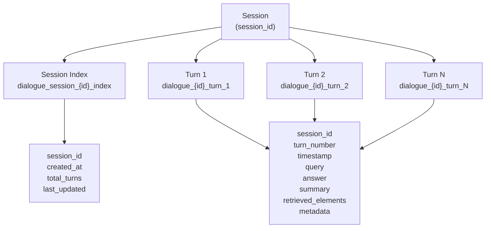
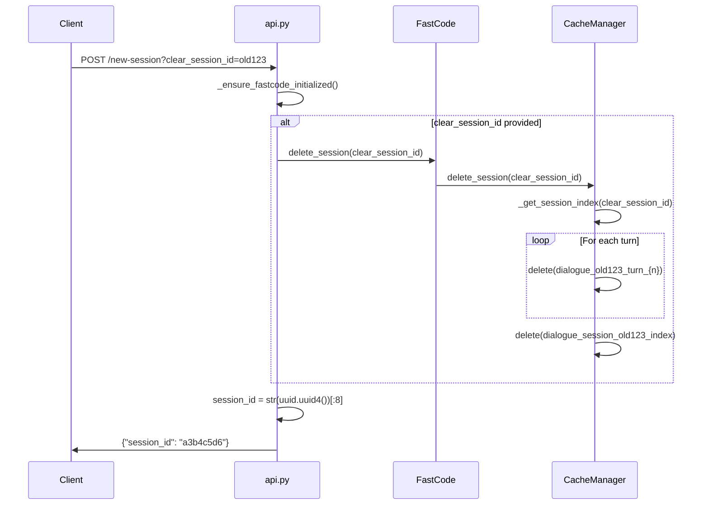
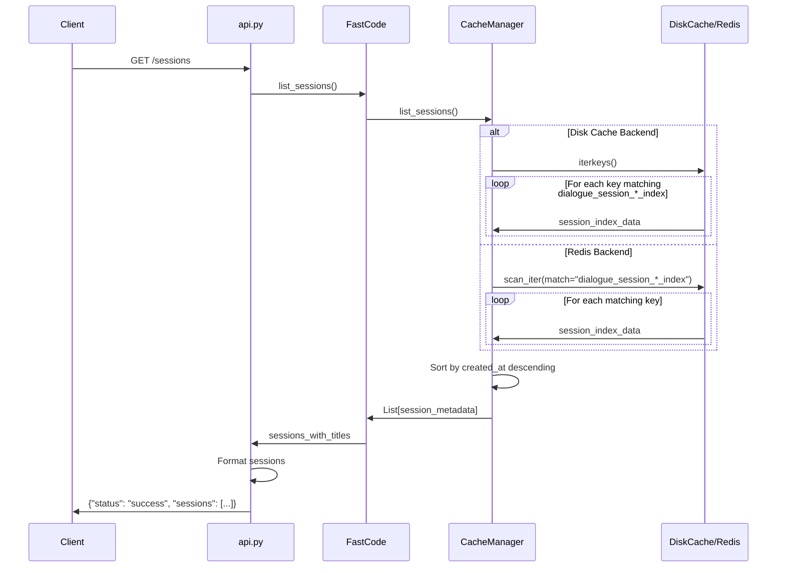
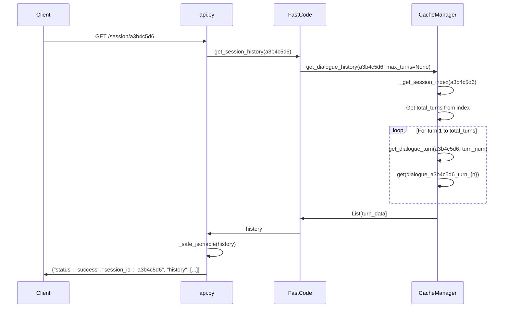
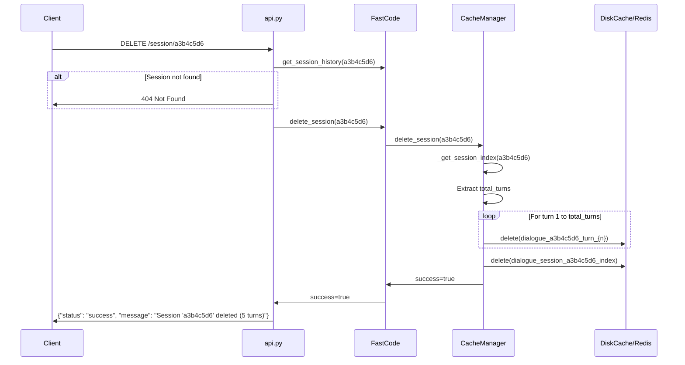
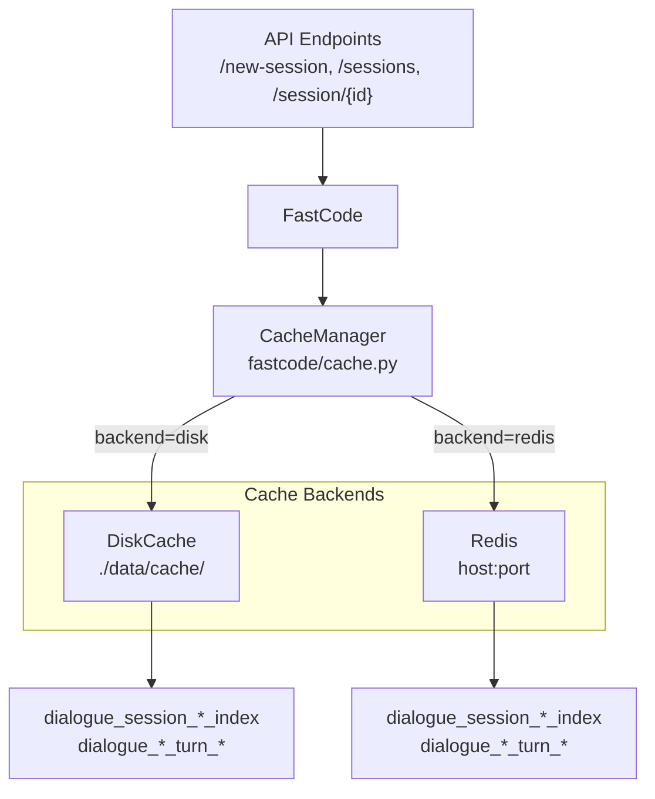
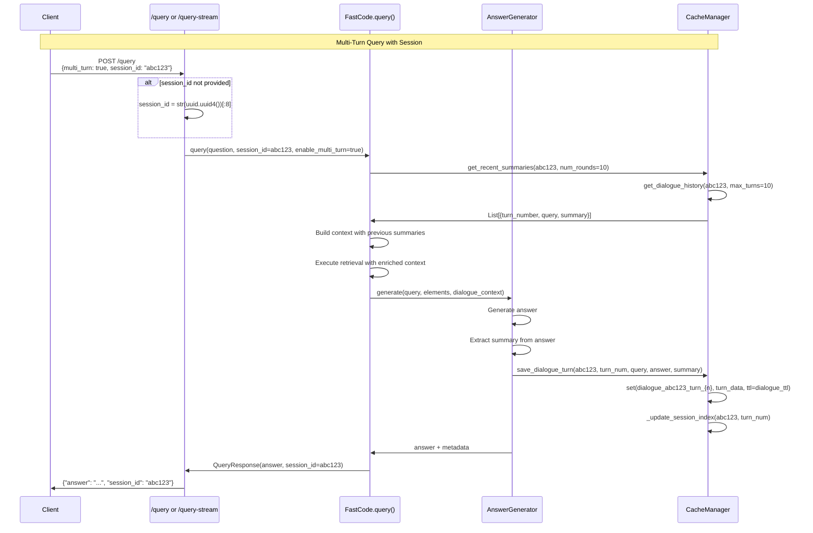
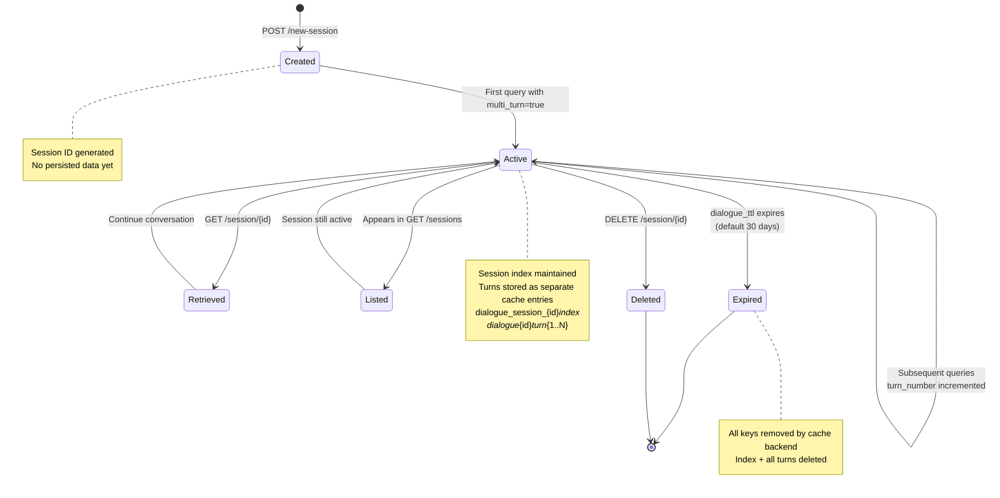

<!-- source: DeepWiki mcp.deepwiki.com · repo HKUDS/FastCode · extra page Session Management Endpoints · fetched 2026-11-09 -->

# Session Management Endpoints

<details>
<summary>Relevant source files</summary>

The following files were used as context for generating this wiki page:

- [fastcode/cache.py](fastcode/cache.py)
- [web_app.py](web_app.py)

</details>


## Purpose and Scope

This document describes the REST API endpoints for managing multi-turn conversation sessions in FastCode. These endpoints enable conversational code queries where the system maintains dialogue history across multiple interactions. For information about executing queries within sessions, see [Query Endpoints](#6.1.2). For general multi-turn dialogue features and configuration, see [Multi-Turn Dialogue](#9.2).

Session management endpoints allow clients to:
- Create new conversation sessions with unique identifiers
- List all active sessions with metadata
- Retrieve complete dialogue history for a session
- Delete sessions and their associated data

## Session Architecture

### Session Data Model

A session represents a multi-turn conversation with the following structure:



**Sources:** [api.py:595-666](), [fastcode/cache.py:209-456]()

### Session Storage Schema

Sessions are stored in the cache backend (disk or Redis) using a hierarchical key structure:

| Key Pattern | Type | Contents | TTL |
|------------|------|----------|-----|
| `dialogue_session_{id}_index` | Session Index | Metadata: session_id, created_at, total_turns, last_updated | `dialogue_ttl` (default 30 days) |
| `dialogue_{id}_turn_{n}` | Turn Data | Full turn: query, answer, summary, retrieved_elements, metadata, timestamp | `dialogue_ttl` (default 30 days) |

The `dialogue_ttl` configuration parameter controls session retention time and defaults to 2,592,000 seconds (30 days).

**Sources:** [fastcode/cache.py:33-34](), [fastcode/cache.py:209-259](), [fastcode/cache.py:352-377]()

## API Endpoints

### POST /new-session

Creates a new conversation session and optionally clears an existing session.



**Request:**

```http
POST /new-session?clear_session_id={optional_session_to_clear}
```

**Query Parameters:**
- `clear_session_id` (optional): Session ID to delete before creating new session

**Response Model:** `NewSessionResponse`

```json
{
  "session_id": "a3b4c5d6"
}
```

**Implementation Details:**
- Generates 8-character session ID from UUID: `str(uuid.uuid4())[:8]`
- If `clear_session_id` provided, calls `fastcode.delete_session()` first
- New session has no persisted data until first query is executed
- Session index is created automatically on first dialogue turn save

**Sources:** [api.py:595-604](), [api.py:27]()

---

### GET /sessions

Lists all active dialogue sessions sorted by creation time (most recent first).



**Request:**

```http
GET /sessions
```

**Response:**

```json
{
  "status": "success",
  "sessions": [
    {
      "session_id": "a3b4c5d6",
      "title": "Authentication flow analysis",
      "total_turns": 5,
      "created": 1703001234.567,
      "last_updated": 1703005678.901
    },
    {
      "session_id": "e7f8g9h0",
      "title": "Database schema review",
      "total_turns": 3,
      "created": 1702995000.123,
      "last_updated": 1702998000.456
    }
  ]
}
```

**Response Fields:**
- `session_id`: Unique session identifier
- `title`: Human-readable session title (derived from first query or defaults to "Session {id}")
- `total_turns`: Number of dialogue turns in session
- `created`: Unix timestamp of session creation
- `last_updated`: Unix timestamp of last activity

**Implementation Flow:**
1. FastCode calls `CacheManager.list_sessions()` [fastcode/cache.py:416-456]()
2. Cache backend scans for keys matching `dialogue_session_*_index` pattern
3. Session index data is retrieved for each matching key
4. Results sorted by `created_at` timestamp descending
5. API formats sessions with title field

**Sources:** [api.py:607-628](), [fastcode/cache.py:416-456]()

---

### GET /session/{session_id}

Retrieves complete dialogue history for a specific session.



**Request:**

```http
GET /session/{session_id}
```

**Path Parameters:**
- `session_id`: Session identifier to retrieve

**Response:**

```json
{
  "status": "success",
  "session_id": "a3b4c5d6",
  "history": [
    {
      "session_id": "a3b4c5d6",
      "turn_number": 1,
      "timestamp": 1703001234.567,
      "query": "How does authentication work?",
      "answer": "The authentication system uses JWT tokens...",
      "summary": "Explained JWT-based authentication flow",
      "retrieved_elements": [
        {
          "file_path": "auth/jwt.py",
          "element_type": "function",
          "name": "generate_token"
        }
      ],
      "metadata": {
        "prompt_tokens": 1500,
        "completion_tokens": 800,
        "total_tokens": 2300
      }
    },
    {
      "turn_number": 2,
      "query": "Where is token validation implemented?",
      "answer": "Token validation occurs in the middleware...",
      "summary": "Described token validation in middleware",
      "retrieved_elements": [...],
      "metadata": {...}
    }
  ]
}
```

**Turn Data Fields:**
- `session_id`: Session identifier
- `turn_number`: Sequential turn number (1-indexed)
- `timestamp`: Unix timestamp when turn was saved
- `query`: User's question
- `answer`: System's generated answer
- `summary`: Brief summary extracted from answer (used for context in subsequent turns)
- `retrieved_elements`: List of code elements retrieved for this turn
- `metadata`: Additional data (token counts, retrieval stats, etc.)

**Implementation Details:**
1. API calls `FastCode.get_session_history(session_id)` which delegates to `CacheManager.get_dialogue_history()`
2. Cache manager retrieves session index to determine total turns
3. Iterates through all turns from 1 to `total_turns`, retrieving each turn data
4. Returns ordered list from oldest to newest turn
5. API applies `_safe_jsonable()` to ensure JSON serialization of complex objects

**Sources:** [api.py:631-641](), [fastcode/cache.py:278-319](), [api.py:753-777]()

---

### DELETE /session/{session_id}

Deletes a conversation session and all associated dialogue history.



**Request:**

```http
DELETE /session/{session_id}
```

**Path Parameters:**
- `session_id`: Session identifier to delete

**Response:**

```json
{
  "status": "success",
  "message": "Session 'a3b4c5d6' deleted (5 turns)"
}
```

**Error Responses:**

| Status Code | Condition | Response |
|-------------|-----------|----------|
| 404 | Session not found | `{"detail": "Session 'xyz' not found"}` |
| 500 | Deletion failed | `{"detail": "Failed to delete session"}` |

**Implementation Flow:**
1. API first calls `get_session_history()` to verify session exists [api.py:650]()
2. Returns 404 if session not found
3. Calls `FastCode.delete_session()` which delegates to `CacheManager.delete_session()`
4. Cache manager retrieves session index to determine number of turns
5. Deletes all turn keys: `dialogue_{session_id}_turn_{1..N}`
6. Deletes session index key: `dialogue_session_{session_id}_index`
7. Returns success with turn count

**Sources:** [api.py:644-666](), [fastcode/cache.py:379-414]()

## Session Storage Mechanism

### Cache Backend Architecture

Sessions utilize the `CacheManager` class which supports two backends:



**Configuration:**

| Parameter | Type | Default | Description |
|-----------|------|---------|-------------|
| `cache.backend` | string | `"disk"` | Storage backend: `"disk"` or `"redis"` |
| `cache.dialogue_ttl` | int | `2592000` | Session retention time in seconds (30 days) |
| `cache.enabled` | bool | `true` | Enable/disable caching |
| `cache.cache_directory` | string | `"./data/cache"` | Directory for disk cache |

**Sources:** [fastcode/cache.py:19-69](), [fastcode/cache.py:33-34]()

### Session Index Structure

Each session maintains an index for efficient metadata access:

```python
# Session Index Key: dialogue_session_{session_id}_index
{
    "session_id": "a3b4c5d6",
    "created_at": 1703001234.567,      # Unix timestamp
    "total_turns": 5,                   # Number of dialogue turns
    "last_updated": 1703005678.901      # Last activity timestamp
}
```

The index is updated on each turn via `_update_session_index()` and ensures `total_turns` tracks the maximum turn number encountered.

**Sources:** [fastcode/cache.py:352-372]()

### Turn Data Structure

Each dialogue turn is stored as a separate cache entry:

```python
# Turn Key: dialogue_{session_id}_turn_{turn_number}
{
    "session_id": "a3b4c5d6",
    "turn_number": 1,
    "timestamp": 1703001234.567,
    "query": "How does authentication work?",
    "answer": "The authentication system uses JWT tokens...",
    "summary": "Explained JWT-based authentication flow",
    "retrieved_elements": [
        {
            "file_path": "auth/jwt.py",
            "element_type": "function",
            "name": "generate_token",
            "code": "def generate_token(user_id: str) -> str: ...",
            "score": 0.92
        }
    ],
    "metadata": {
        "prompt_tokens": 1500,
        "completion_tokens": 800,
        "total_tokens": 2300,
        "retrieval_time_ms": 245,
        "generation_time_ms": 1832
    }
}
```

**Sources:** [fastcode/cache.py:209-259]()

## Integration with Query Endpoints

Session management is tightly integrated with query execution:



### Session-Aware Query Flow

When `multi_turn=true` is specified in a query request:

1. **Session ID Resolution** [api.py:454-458]():
   - If `session_id` not provided, generate new 8-char UUID
   - Log whether session is new or continuing

2. **Context Retrieval** (in FastCode query processing):
   - Call `CacheManager.get_recent_summaries(session_id, num_rounds=10)`
   - Retrieve last 10 dialogue summaries for context
   - Include summaries in retrieval and generation prompts

3. **Answer Generation**:
   - Generate answer using current query + historical context
   - Extract summary from answer using special tags

4. **Turn Persistence** [fastcode/cache.py:209-259]():
   - Call `save_dialogue_turn()` with query, answer, summary, retrieved_elements
   - Store turn data with `dialogue_ttl` expiration
   - Update session index with incremented turn count

**Sources:** [api.py:445-493](), [fastcode/cache.py:321-350]()

## Common Usage Patterns

### Pattern 1: New Multi-Turn Conversation

```bash
# Step 1: Create session
curl -X POST http://localhost:8000/new-session
# Response: {"session_id": "a3b4c5d6"}

# Step 2: First query
curl -X POST http://localhost:8000/query \
  -H "Content-Type: application/json" \
  -d '{
    "question": "How does authentication work?",
    "multi_turn": true,
    "session_id": "a3b4c5d6"
  }'

# Step 3: Follow-up query (benefits from context)
curl -X POST http://localhost:8000/query \
  -H "Content-Type: application/json" \
  -d '{
    "question": "Where is the token validation logic?",
    "multi_turn": true,
    "session_id": "a3b4c5d6"
  }'

# Step 4: Review conversation
curl http://localhost:8000/session/a3b4c5d6

# Step 5: Clean up
curl -X DELETE http://localhost:8000/session/a3b4c5d6
```

**Sources:** [api.py:595-666](), [api.py:445-493]()

### Pattern 2: Session Listing and Recovery

```bash
# List all active sessions
curl http://localhost:8000/sessions
# Response: {"status": "success", "sessions": [...]}

# Recover session by ID
curl http://localhost:8000/session/old_session_id
# Response: {"status": "success", "history": [...]}

# Continue conversation
curl -X POST http://localhost:8000/query \
  -H "Content-Type: application/json" \
  -d '{
    "question": "What about error handling?",
    "multi_turn": true,
    "session_id": "old_session_id"
  }'
```

**Sources:** [api.py:607-641]()

### Pattern 3: Session Replacement

```bash
# Create new session and delete old one atomically
curl -X POST http://localhost:8000/new-session?clear_session_id=old_abc123
# Response: {"session_id": "new_xyz789"}

# Old session deleted, new session ready
```

**Sources:** [api.py:595-604]()

### Pattern 4: Streaming Multi-Turn Query

```bash
# Stream response in multi-turn mode
curl -X POST http://localhost:8000/query-stream \
  -H "Content-Type: application/json" \
  -H "Accept: text/event-stream" \
  -d '{
    "question": "Explain the database schema",
    "multi_turn": true,
    "session_id": "a3b4c5d6"
  }'

# Receives SSE events:
# data: {"type": "status", "status": "retrieving"}
# data: {"type": "status", "status": "generating", "sources": [...], "session_id": "a3b4c5d6"}
# data: {"type": "chunk", "content": "The database schema consists of..."}
# data: {"type": "done", "sources": [...], "context_elements": 8, "session_id": "a3b4c5d6"}
```

**Sources:** [api.py:496-568]()

## Session Lifecycle Diagram



**Sources:** [api.py:595-666](), [fastcode/cache.py:209-456]()

---

