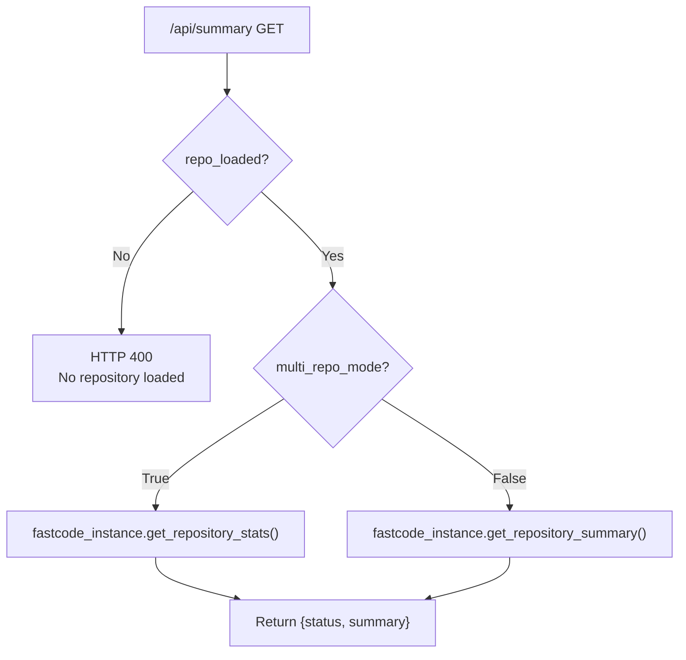
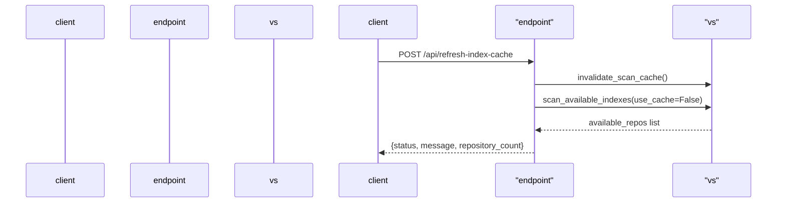
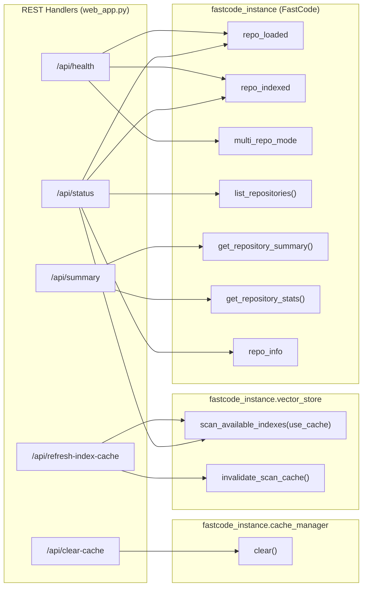

<!-- source: DeepWiki mcp.deepwiki.com · repo HKUDS/FastCode · extra page System Endpoints · fetched 2026-11-09 -->

# System Endpoints

<details>
<summary>Relevant source files</summary>

The following files were used as context for generating this wiki page:

- [web_app.py](web_app.py)

</details>


This page documents the system-level endpoints of the FastCode REST API: `/api/status`, `/api/health`, `/api/summary`, `/api/clear-cache`, and `/api/refresh-index-cache`. These endpoints report internal state and allow administrative operations on the running instance.

For repository management endpoints (`/api/load`, `/api/index`, etc.), see [Repository Endpoints](#6.1.1). For query endpoints, see [Query Endpoints](#6.1.2). For session management endpoints, see [Session Management Endpoints](#6.1.3). For a general overview of the API layer, see [REST API](#6.1).

---

## Endpoint Summary

| Method | Path | Purpose |
|--------|------|---------|
| `GET` | `/api/status` | Full system state: loaded and available repositories |
| `GET` | `/api/health` | Lightweight liveness/readiness check |
| `GET` | `/api/summary` | Repository statistics and overview |
| `POST` | `/api/clear-cache` | Flush the `CacheManager` |
| `POST` | `/api/refresh-index-cache` | Force rescan of persisted vector store indexes |

Sources: [web_app.py:140-176](), [web_app.py:595-654]()

---

## `/api/status`

**Method:** `GET`

Returns a full snapshot of system state, including which repositories are currently loaded in memory and which indexes are persisted on disk.

### Query Parameters

| Parameter | Type | Default | Description |
|-----------|------|---------|-------------|
| `full_scan` | `bool` | `false` | When `true`, bypasses the index scan cache and performs a fresh disk scan. Slower but guarantees up-to-date results. |

### Response Model: `StatusResponse`

Defined at [web_app.py:73-80]().

| Field | Type | Description |
|-------|------|-------------|
| `status` | `str` | `"ready"` if `repo_indexed` is `True`, otherwise `"not_ready"` |
| `repo_loaded` | `bool` | Whether a repository is loaded into the current `FastCode` instance |
| `repo_indexed` | `bool` | Whether the loaded repository has been indexed |
| `repo_info` | `Dict[str, Any]` | Metadata about the currently loaded repository |
| `available_repositories` | `List[Dict[str, Any]]` | Repositories with persisted indexes on disk (from `scan_available_indexes`) |
| `loaded_repositories` | `List[Dict[str, Any]]` | Repositories currently loaded in memory (from `list_repositories`) |

### Behavior

The handler at [web_app.py:140-162]() calls:
- `fastcode_instance.vector_store.scan_available_indexes(use_cache=not full_scan)` to enumerate on-disk indexes
- `fastcode_instance.list_repositories()` to list in-memory repositories

When `full_scan=false` (the default), `scan_available_indexes` uses the index scan cache, which avoids repeated filesystem traversal. Pass `full_scan=true` to guarantee fresh data after manually modifying the index directory.

**Example response:**
```json
{
  "status": "ready",
  "repo_loaded": true,
  "repo_indexed": true,
  "repo_info": {"name": "my-repo", "path": "./repos/my-repo"},
  "available_repositories": [{"name": "my-repo", "...": "..."}],
  "loaded_repositories": [{"name": "my-repo", "...": "..."}]
}
```

Sources: [web_app.py:73-80](), [web_app.py:140-162]()

---

## `/api/health`

**Method:** `GET`

A lightweight liveness check intentionally designed to avoid expensive operations. Use this for load balancer health probes or uptime monitoring.

### Response

Returns a plain JSON object (not a Pydantic model):

| Field | Type | Description |
|-------|------|-------------|
| `status` | `str` | Always `"healthy"` if the `fastcode_instance` is initialized |
| `repo_loaded` | `bool` | Whether a repository is currently loaded |
| `repo_indexed` | `bool` | Whether the current repository is indexed |
| `multi_repo_mode` | `bool` | Whether the instance is operating in multi-repository mode |

Unlike `/api/status`, this endpoint does **not** call `scan_available_indexes` or `list_repositories`. It only reads boolean flags directly from the `fastcode_instance` object.

**Example response:**
```json
{
  "status": "healthy",
  "repo_loaded": true,
  "repo_indexed": true,
  "multi_repo_mode": false
}
```

Sources: [web_app.py:165-176]()

---

## `/api/summary`

**Method:** `GET`

Returns repository statistics. The data returned depends on whether the `FastCode` instance is in single-repo or multi-repo mode.

### Response

| Field | Type | Description |
|-------|------|-------------|
| `status` | `str` | Always `"success"` on a valid response |
| `summary` | `Dict` or `Any` | Output of `get_repository_stats()` (multi-repo) or `get_repository_summary()` (single-repo) |

### Behavior

The handler at [web_app.py:595-617]() checks `fastcode_instance.multi_repo_mode`:

- **Multi-repo mode** → calls `fastcode_instance.get_repository_stats()`
- **Single-repo mode** → calls `fastcode_instance.get_repository_summary()`

Raises `HTTP 400` if no repository is loaded.

**Diagram: `/api/summary` routing logic**



Sources: [web_app.py:595-617]()

---

## `/api/clear-cache`

**Method:** `POST`

Flushes the entire `CacheManager`, which stores embeddings, query results, and dialogue session data.

### Request

No request body.

### Response

| Field | Type | Description |
|-------|------|-------------|
| `status` | `str` | `"success"` or `"failed"` |
| `message` | `str` | Human-readable outcome description |

### Behavior

Calls `fastcode_instance.cache_manager.clear()` at [web_app.py:626]().

If `clear()` returns `False` (cache is disabled or the operation failed), the response has `status: "failed"` but **does not raise an HTTP error**. This is intentional; a disabled cache is not considered an error condition.

> **Warning:** Clearing the cache invalidates all cached embeddings, query results, and active dialogue session histories. Ongoing multi-turn conversations will lose their context.

Sources: [web_app.py:620-631]()

---

## `/api/refresh-index-cache`

**Method:** `POST`

Forces a fresh filesystem scan of the vector store's persisted indexes, updating the in-memory index scan cache.

### Request

No request body.

### Response

| Field | Type | Description |
|-------|------|-------------|
| `status` | `str` | `"success"` on completion |
| `message` | `str` | Always `"Index cache refreshed"` |
| `repository_count` | `int` | Number of repositories found after the fresh scan |

### Behavior

The handler at [web_app.py:634-654]() performs two steps:

1. Calls `fastcode_instance.vector_store.invalidate_scan_cache()` to evict the cached result.
2. Calls `fastcode_instance.vector_store.scan_available_indexes(use_cache=False)` to perform and re-cache a fresh scan.

This endpoint is useful after manually adding or removing index files from the persist directory without going through the API, or after a container restart where the scan cache has been reset.

**Diagram: index cache refresh flow**



Sources: [web_app.py:634-654]()

---

## Interaction Map

The following diagram maps each system endpoint to the underlying `FastCode` or storage method it calls.



Sources: [web_app.py:140-176](), [web_app.py:595-654]()

---

## Error Handling

All five endpoints return `HTTP 500` with `detail: "FastCode not initialized"` if `fastcode_instance` is `None`. This can only occur if the startup event at [web_app.py:123-128]() failed.

`/api/summary` additionally returns `HTTP 400` if no repository is loaded.

`/api/clear-cache` is the only endpoint that returns a non-error response even on partial failure (cache disabled), using `status: "failed"` in the JSON body instead of raising an HTTP exception.

Sources: [web_app.py:148-149](), [web_app.py:167-169](), [web_app.py:598-603](), [web_app.py:626-631](), [web_app.py:637-638]()

---

