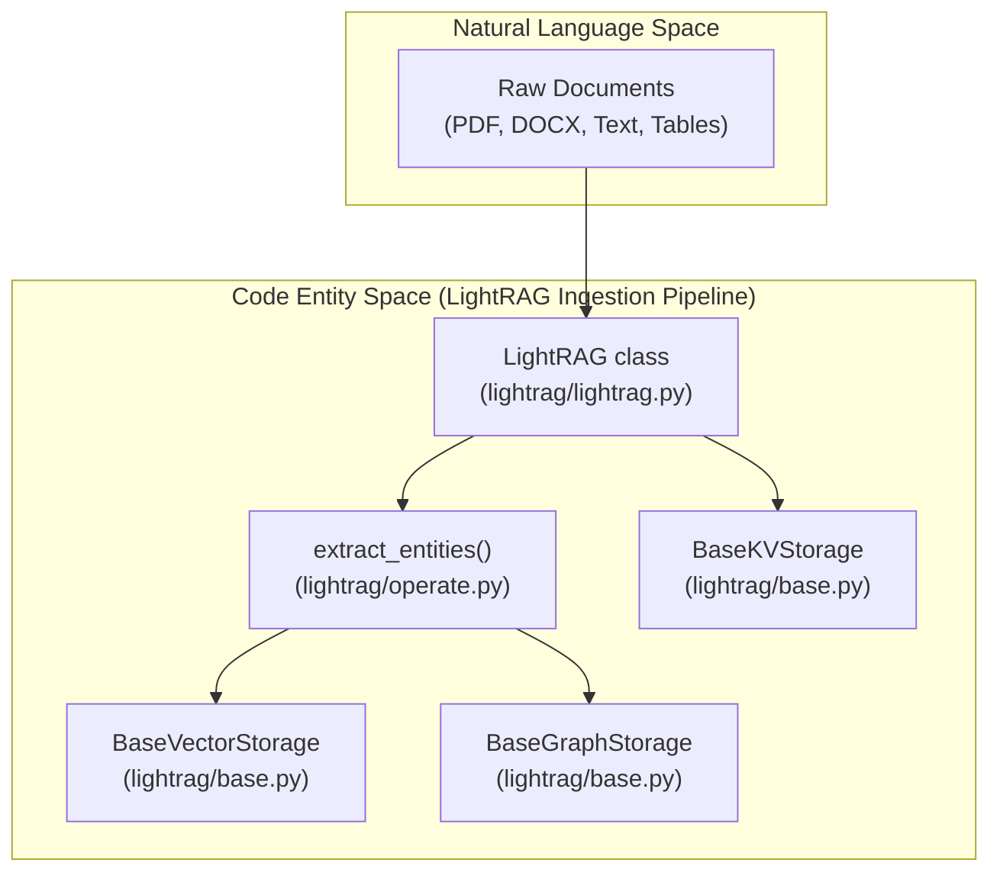
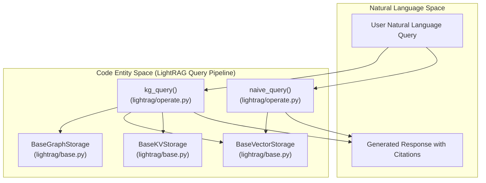

<!-- source: DeepWiki mcp.deepwiki.com · repo HKUDS/LightRAG · page 1 LightRAG Overview · fetched 2026-11-09 -->

# LightRAG Overview

Relevant source files

The following files were used as context for generating this wiki page:

- [README-id.md](README-id.md)
- [README-ja.md](README-ja.md)
- [README-zh.md](README-zh.md)
- [README.md](README.md)
- [docs/design/LatexEscapeRepairContract.md](docs/design/LatexEscapeRepairContract.md)
- [lightrag/__init__.py](lightrag/__init__.py)
- [lightrag/api/__init__.py](lightrag/api/__init__.py)
- [lightrag/lightrag.py](lightrag/lightrag.py)
- [lightrag/operate.py](lightrag/operate.py)
- [lightrag/prompt.py](lightrag/prompt.py)
- [lightrag/utils.py](lightrag/utils.py)
- [setup.py](setup.py)
- [tests/llm/test_vlm_json_escape_repair.py](tests/llm/test_vlm_json_escape_repair.py)
- [tests/utils/test_embedding_func_shape_validation.py](tests/utils/test_embedding_func_shape_validation.py)

LightRAG is a simple and fast Retrieval-Augmented Generation (RAG) framework that combines knowledge graphs and vector-based retrieval to enhance the accuracy, relevance, and efficiency of Large Language Model (LLM) applications [README.md:7-8](). By employing a dual-level architecture that integrates structured relational knowledge with semantic vector embeddings, LightRAG scales efficiently to large datasets while maintaining high extraction and retrieval precision [README.md:8-10]().

The purpose of this parent wiki page is to provide a high-level overview of LightRAG's dual-level architecture, key capabilities, and how its major subsystems interrelate. For detailed implementation guides and foundational concepts, refer to the child pages:
- **[Getting Started](#1.1)** — Installation steps, environment configuration, first inserts and queries via the Python API and server CLI, and quick-start guides.
- **[Core Concepts and Terminology](#1.2)** — In-depth explanations of knowledge graphs, dual-level retrieval modes, storage namespaces, workspaces, and document lifecycle states.

---

## System Architecture Overview

The core of LightRAG is orchestrated by the `LightRAG` class [lightrag/lightrag.py:209-231](), which manages document ingestion, parsing, chunking, and storage interactions. Extraction and query operations are driven by specialized functions in `lightrag/operate.py` [lightrag/lightrag.py:143-152](). To handle diverse AI tasks efficiently, LightRAG supports role-specific LLM configurations via `RoleLLMConfig` and `RoleSpec`, dividing responsibilities across distinct roles such as `EXTRACT`, `QUERY`, `KEYWORDS`, and `VLM` [lightrag/lightrag.py:215-223]().

### Dual-Level Retrieval Architecture

LightRAG overcomes the limitations of single-strategy RAG systems by implementing dual-level retrieval:
1. **Graph-Based Retrieval:** Traverses structured entity and relation knowledge graphs to supply relational context and multi-hop reasoning.
2. **Vector-Based Retrieval:** Executes semantic similarity searches across vector embeddings to capture implicit content relevance and exact phrasing.

---

### Diagram: Document Ingestion - Natural Language Space to Code Entities

This diagram illustrates how raw documents from the natural language space are ingested by the `LightRAG` class [lightrag/lightrag.py:209-231](), processed by `extract_entities()` [lightrag/operate.py:143-147](), and stored across graph (`BaseGraphStorage`), vector (`BaseVectorStorage`), and key-value (`BaseKVStorage`) backends [lightrag/base.py:126-128]().

**Sources:** [lightrag/lightrag.py:143-231](), [lightrag/base.py:126-128](), [README.md:7-10]()

---

### Diagram: Query Retrieval - Natural Language Space to Code Entities

This diagram maps natural language queries to execution routines like `kg_query()` and `naive_query()` in `lightrag/operate.py` [lightrag/lightrag.py:143-152](), interacting with modular storage layers to assemble contexts and generate responses.

**Sources:** [lightrag/lightrag.py:143-152](), [lightrag/base.py:126-128]()

---

## Key Capabilities

- **Dual-Level Retrieval Modes:** Supports multiple query strategies including `local`, `global`, `hybrid`, `mix`, and `naive` retrieval, allowing fine-tuning for specific breadth and depth requirements [README.md:87-89]().
- **Multimodal Document Processing:** Integrates multimodal parsing capabilities (via MinerU/Docling services) to ingest complex formats such as PDFs, office documents, tables, images, and equations [README.md:79-82]().
- **Role-Specific LLM Configuration:** Provides independent configuration parameters for `EXTRACT`, `QUERY`, `KEYWORDS`, and `VLM` roles via `RoleLLMConfig` [lightrag/lightrag.py:215-223]().
- **Pluggable Storage Backends:** Offers modular storage abstractions (`BaseKVStorage`, `BaseVectorStorage`, `BaseGraphStorage`, `DocStatusStorage`) supporting backends like NetworkX, Neo4j, MongoDB, PostgreSQL, Milvus, Qdrant, and OpenSearch [README.md:82-85]().
- **Production Server & Web UI:** Includes a FastAPI REST server and an interactive React/TypeScript Web UI featuring knowledge graph visualization with Sigma.js, document managers, and query testing views [README.md:97-99]().

**Sources:** [lightrag/lightrag.py:209-223](), [README.md:79-99]()

---

## Major Subsystems and Their Relationships

LightRAG is organized into several cooperating subsystems that govern document processing, storage, retrieval, and presentation:

1. **Core RAG Engine & Ingestion Pipeline:** Manages text chunking strategies (Fixed, Recursive, Semantic Vector, Paragraph), entity-relation extraction, and document state tracking. For details, see [Core RAG Engine](#2) and [Document Ingestion Pipeline](#5).
2. **Retrieval and Query Subsystem:** Handles keyword extraction, token budgeting, context assembly, and reranking across graph and vector stores. For details, see [Retrieval and Query Modes](#2.3).
3. **Storage Backends:** Implements pluggable interfaces for key-value, vector, and graph databases with multi-process concurrency control. For details, see [Storage Backends](#4).
4. **LLM and Embedding Providers:** Houses unified binding layers for major model providers and manages role-specific configurations. For details, see [LLM and Embedding Providers](#3).
5. **REST API Server & Web UI:** Exposes programmatic endpoints via FastAPI and an interactive dashboard built with React and Sigma.js. For details, see [REST API Server](#6) and [Web UI (lightrag_webui)](#7).

**Sources:** [lightrag/lightrag.py:1-231](), [README.md:79-99]()

---

## Next Steps

To explore LightRAG in detail, proceed to the child sections:
- **[Getting Started](#1.1)**
- **[Core Concepts and Terminology](#1.2)**

**Sources:** [README.md:7-99](), [lightrag/lightrag.py:1-231]()

---

