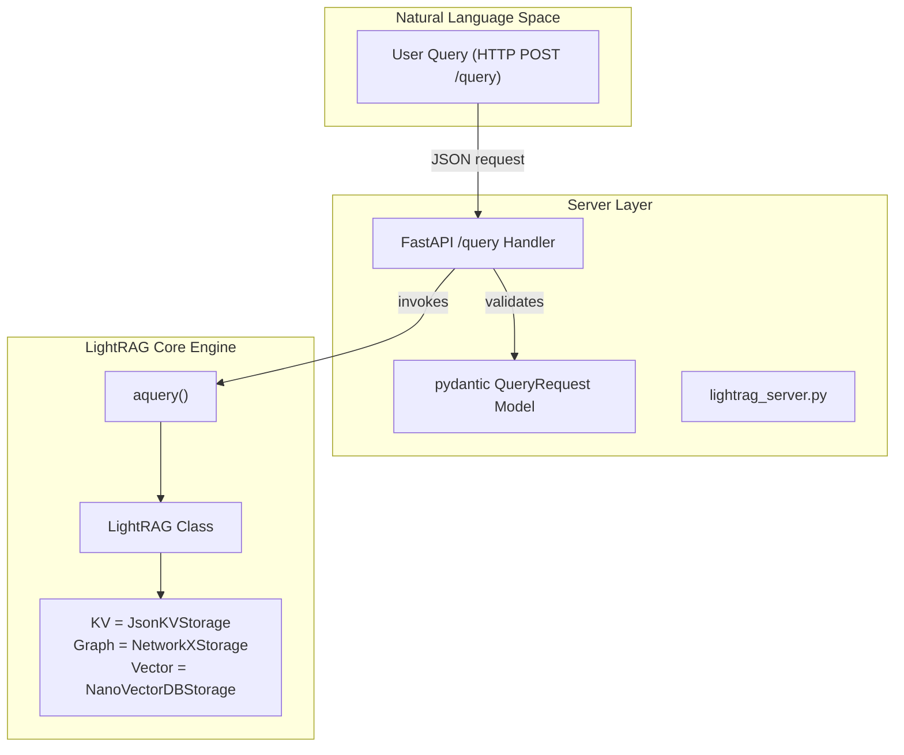
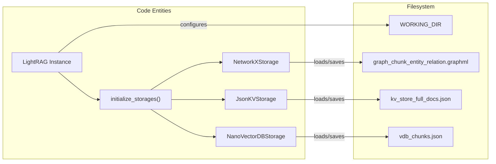
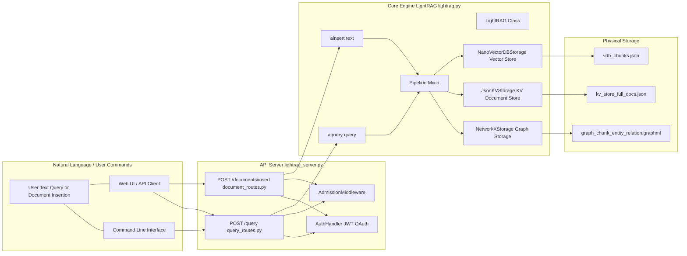

<!-- source: DeepWiki mcp.deepwiki.com · repo HKUDS/LightRAG · page 1.1 Getting Started · fetched 2026-11-09 -->

# Getting Started

<details>
<summary>Relevant source files</summary>

The following files were used as context for generating this wiki page:

- [.gitignore](.gitignore)
- [config.ini.example](config.ini.example)
- [env.example](env.example)
- [examples/generate_query.py](examples/generate_query.py)
- [examples/lightrag_azure_openai_demo.py](examples/lightrag_azure_openai_demo.py)
- [examples/lightrag_ollama_demo.py](examples/lightrag_ollama_demo.py)
- [examples/lightrag_openai_compatible_demo.py](examples/lightrag_openai_compatible_demo.py)
- [examples/lightrag_openai_demo.py](examples/lightrag_openai_demo.py)
- [examples/lightrag_openai_mongodb_graph_demo.py](examples/lightrag_openai_mongodb_graph_demo.py)
- [lightrag/api/config.py](lightrag/api/config.py)
- [lightrag/api/lightrag_server.py](lightrag/api/lightrag_server.py)
- [lightrag/api/utils_api.py](lightrag/api/utils_api.py)
- [lightrag/constants.py](lightrag/constants.py)
- [lightrag/llm/binding_options.py](lightrag/llm/binding_options.py)
- [pyproject.toml](pyproject.toml)
- [requirements-offline-llm.txt](requirements-offline-llm.txt)
- [requirements-offline-storage.txt](requirements-offline-storage.txt)
- [requirements-offline.txt](requirements-offline.txt)
- [uv.lock](uv.lock)

</details>


## Purpose and Scope

This page provides a comprehensive technical guide to begin using LightRAG. It details installation options (`uv`, `pip`, source, and offline requirements), environment configuration via `env.example` and `.env`, and demonstrates first insertions and queries via both the asynchronous Python API and the REST API server CLI. Quick-start demos for OpenAI and Ollama integrations illustrate end-to-end workflows.

---

## Installation

LightRAG is distributed as the package `lightrag-hku` on PyPI [pyproject.toml:6-6](). It supports various installation methods tailored to different workflows and environments.

### 1. Using `uv` (Recommended)

`uv` is a fast and reliable Python package manager preferred for its efficient dependency resolution and reproducibility.

```bash
# Install LightRAG server as a standalone tool
uv tool install "lightrag-hku[api]"

# Alternatively, add to a local project
uv add "lightrag-hku[api]"
```

This method automatically handles dependencies and is well-suited for local development and production deployments.

### 2. Using `pip`

You may also install LightRAG using `pip` in a Python virtual environment:

```bash
python -m venv .venv
source .venv/bin/activate   # On Windows: .venv\Scripts\activate
pip install "lightrag-hku[api]"
```

This ensures package isolation and avoids system-level conflicts.

### 3. From Source

For developers modifying LightRAG or needing unreleased changes, clone the repository and install it in editable mode:

```bash
git clone https://github.com/HKUDS/LightRAG.git
cd LightRAG
pip install -e ".[api]"
```

### 4. Offline Deployment

LightRAG supports fully offline usage with specialized requirements files for complete dependency sets [requirements-offline.txt:1-32]().

- `requirements-offline.txt` installs LightRAG and all offline dependencies (storage backends, LLM providers) [requirements-offline.txt:1-32]().
- Additional focused files exist for offline storage backends or LLMs if you want partial environments [pyproject.toml:144-170]().

| File | Description |
|---|---|
| `requirements-offline.txt` | Full offline package including API & LLMs [requirements-offline.txt:1-32]() |
| `requirements-offline-storage.txt` | Offline storage backends only [pyproject.toml:144-155]() |
| `requirements-offline-llm.txt` | Offline LLM providers only [pyproject.toml:157-170]() |

Sources: [pyproject.toml:6-170](), [requirements-offline.txt:1-32]()

---

## Environment Configuration

LightRAG uses environment variables configured in `.env` files. `env.example` serves as a template to create your own `.env` file with your API keys and runtime parameters [env.example:1-118]().

### Key Environment Variables

| Variable | Description | Example |
|---|---|---|
| `OPENAI_API_KEY` | API key for OpenAI LLM and embedding services | `sk-xxxxxx...` |
| `LLM_MODEL` | Model name for text generation | `gpt-4o-mini`, `qwen2.5-coder:7b` [examples/lightrag_ollama_demo.py:89-89]() |
| `LLM_BINDING_HOST` | URL for locally hosted models (e.g., Ollama) | `http://localhost:11434` [lightrag/api/config.py:80-80]() |
| `EMBEDDING_MODEL` | Model name for embedding provider | `text-embedding-3-small`, `bge-m3:latest` [examples/lightrag_ollama_demo.py:105-105]() |
| `LIGHTRAG_RUNTIME_TARGET` | Runtime environment target (`host`, `compose`) | `host` [env.example:4-5]() |
| `WEBUI_TITLE` | Web UI deployment title | `My Graph KB` [env.example:17-19]() |
| `WEBUI_DESCRIPTION` | Web UI subtitle description | `Simple and Fast Graph Based RAG System` [env.example:20-20]() |
| `LIGHTRAG_API_KEY` | API key for server authorization | `mysecretapikey` [env.example:11-15]() |

### Security Notice

If binding to `0.0.0.0` (all network interfaces), the server must be secured with API keys or authentication (`AUTH_ACCOUNTS`) to prevent unauthorized access to your knowledge graph [env.example:10-15](). Binding to `127.0.0.1` restricts access to local machine clients only.

Sources: [env.example:1-118](), [lightrag/api/config.py:71-94](), [examples/lightrag_openai_demo.py:93-98]()

---

## Python API Quick Start

LightRAG’s core interface is the asynchronous `LightRAG` class, which supports document ingestion and querying [examples/lightrag_openai_demo.py:79-88]().

### 1. OpenAI Demo: Insert & Query

```python
import asyncio
from lightrag import LightRAG, QueryParam
from lightrag.llm.openai import gpt_4o_mini_complete, openai_embed

async def run_demo():
    rag = LightRAG(
        working_dir="./my_rag_data",
        llm_model_func=gpt_4o_mini_complete,
        embedding_func=openai_embed,
    )

    await rag.initialize_storages()

    with open("book.txt", "r") as file:
        text = file.read()
    await rag.ainsert(text)

    response = await rag.aquery(
        "What are the main themes?",
        param=QueryParam(mode="hybrid")
    )

    print(response)

    await rag.finalize_storages()

if __name__ == "__main__":
    asyncio.run(run_demo())
```

- `ainsert(text)`: Asynchronously ingests text for parsing, chunking, embedding, KG extraction, and indexing [examples/lightrag_openai_demo.py:133-133]().
- `aquery(query, param)`: Executes retrieval-augmented generation queries with hybrid KG + vector options [examples/lightrag_openai_demo.py:171-175]().

### 2. Ollama Demo (Local Execution)

```python
from functools import partial
from lightrag import LightRAG
from lightrag.llm.ollama import ollama_model_complete, ollama_embed
from lightrag.utils import EmbeddingFunc

rag = LightRAG(
    working_dir="./local_rag",
    llm_model_func=ollama_model_complete,
    llm_model_name="qwen2.5-coder:7b",
    embedding_func=EmbeddingFunc(
        embedding_dim=1024,
        func=partial(ollama_embed.func, embed_model="bge-m3:latest")
    ),
)
```

Sources: [examples/lightrag_openai_demo.py:79-180](), [examples/lightrag_ollama_demo.py:85-109]()

---

## REST API Server Usage

The FastAPI-based server exposes a REST API and Web UIs (`lightrag_server.py`) [lightrag/api/lightrag_server.py:1-5]() supporting OpenAI- and Ollama-compatible endpoints.

### Starting the Server

```bash
lightrag-server
```

This command loads `.env` automatically and launches the FastAPI server binding on the configured host and port [lightrag/api/lightrag_server.py:102-102]().

### Query Data Flow Overview



Sources: [lightrag/api/lightrag_server.py:1-175](), [examples/lightrag_openai_demo.py:159-162]()

### Workspace and Storage Initialization



Sources: [examples/lightrag_openai_demo.py:102-130](), [examples/lightrag_ollama_demo.py:111-131]()

---

## Appendix: Dual-Level System Association Diagram



Sources: [lightrag/api/lightrag_server.py:1-175](), [examples/lightrag_openai_demo.py:79-180]()

---

