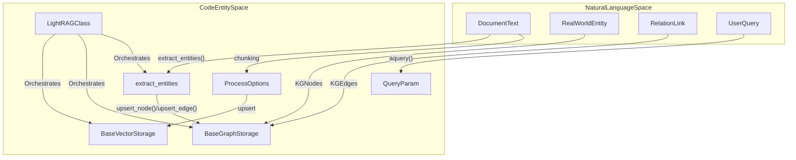
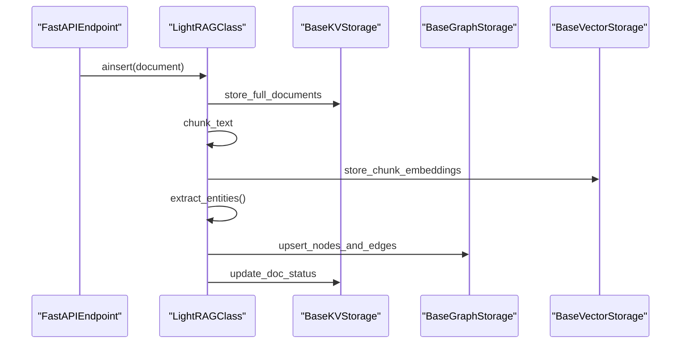

<!-- source: DeepWiki mcp.deepwiki.com · repo HKUDS/LightRAG · page 1.2 Core Concepts and Terminology · fetched 2026-11-09 -->

# Core Concepts and Terminology

Relevant source files

The following files were used as context for generating this wiki page:

- [AGENTS.md](AGENTS.md)
- [CLAUDE.md](CLAUDE.md)
- [README-id.md](README-id.md)
- [README-ja.md](README-ja.md)
- [README-zh.md](README-zh.md)
- [README.md](README.md)
- [docs/FileProcessingPipeline-zh.md](docs/FileProcessingPipeline-zh.md)
- [docs/FileProcessingPipeline.md](docs/FileProcessingPipeline.md)
- [docs/design/PipelineConcurrencyContract.md](docs/design/PipelineConcurrencyContract.md)
- [docs/design/PurgeRecoveryContract.md](docs/design/PurgeRecoveryContract.md)
- [lightrag/exceptions.py](lightrag/exceptions.py)
- [lightrag/parser/param_schema.py](lightrag/parser/param_schema.py)
- [lightrag/parser/routing.py](lightrag/parser/routing.py)
- [tests/chunker/test_chunk_options_persistence.py](tests/chunker/test_chunk_options_persistence.py)
- [tests/parser/test_engine_params.py](tests/parser/test_engine_params.py)
- [tests/parser/test_hint_params.py](tests/parser/test_hint_params.py)
- [tests/pipeline/test_cache_reference_flush_order.py](tests/pipeline/test_cache_reference_flush_order.py)
- [tests/pipeline/test_insert_done_error_handling.py](tests/pipeline/test_insert_done_error_handling.py)
- [tests/utils/test_embedding_func_shape_validation.py](tests/utils/test_embedding_func_shape_validation.py)

This page defines the fundamental architectural concepts and terminology central to LightRAG. It covers how LightRAG models knowledge using knowledge graphs combined with vector retrieval, distinct query modes, storage layout via namespaces and workspaces, document ingestion options, role-specific LLM configurations, and the state machine tracking document lifecycles.

---

## Knowledge Graph and Dual-Level Retrieval

LightRAG employs a **dual-level retrieval** architecture combining:

1. **Knowledge Graph (KG):**  
   A structured graph constructed during document ingestion representing:
   - **Entities (Nodes):** Extracted key concepts or objects (e.g., “OpenAI”) [lightrag/operate.py:130-160]().
   - **Relationships (Edges):** Typed links describing connections between entities (e.g., “Created”) [lightrag/operate.py:130-160]().

   This graph captures complex, semantic interrelations beyond text similarity. It is constructed via the `extract_entities` function that parses LLM outputs into entities and relations, then upserts them into the KG storage interface (`BaseGraphStorage`) [lightrag/operate.py:130-160](), [lightrag/base.py:70-100]().

2. **Vector Retrieval:**  
   Unstructured text chunks, descriptions of entities, and relationship summaries are embedded into vector spaces by an embedding function (`EmbeddingFunc`). These vectors allow approximate nearest-neighbor search via `BaseVectorStorage` to supply semantically related context during query time [lightrag/lightrag.py:113-160](), [lightrag/base.py:120-135]().

This design enables a **hybrid querying** approach, where both symbolic knowledge and dense text similarity are used to provide rich and precise information.

### Code Implementation and Data Flow

- During document ingestion, raw text is split into chunks via chunking strategies (`ProcessOptions`, `chunker/`) producing structured text segments [lightrag/parser/routing.py:148-178]().
- `extract_entities` (in `lightrag/operate.py`) calls the LLM extractor, builds entity and relation tuples, then inserts or merges them into the KG storage [lightrag/operate.py:130-160]().
- The vector database (via `BaseVectorStorage`) stores embeddings computed from chunk content or entity descriptions [lightrag/base.py:120-135]().
- The main orchestrator class (`LightRAG` in `lightrag/lightrag.py`) coordinates the ingestion pipeline, calling all underlying components [lightrag/lightrag.py:100-150]().
- During query execution, retrieval functions collect relevant nodes/edges and text chunks from KG and vector storage, assisted by token budget controls [lightrag/operate.py:110-190]().

### Diagram: Mapping Natural Language Concepts to Code Entities

Sources:  
[lightrag/lightrag.py:100-150](), [lightrag/operate.py:130-160](), [lightrag/base.py:70-135](), [lightrag/parser/routing.py:148-178]()

---

## Query Modes

LightRAG’s query system supports multiple **modes** to balance graph and vector retrieval. These are encapsulated in the `QueryParam.mode` field [lightrag/base.py:90-180]():

| Mode    | Description                                                                 | Implementation Notes                                                      |
|---------|-----------------------------------------------------------------------------|---------------------------------------------------------------------------|
| `local` | Focus retrieval on context-dependent information near extracted entities.   | Query graph locally for neighborhood nodes related to keyword set.        |
| `global`| Employ global knowledge graph aggregates like relationship summaries.       | Aggregate graph data independent of local context.                        |
| `hybrid`| Combine `local` and `global` retrieval results for richer context.          | Merge node neighborhoods with global aggregates.                          |
| `naive` | Simple RAG vector search on text chunks only, without KG guidance.          | Basic vector search; fallback mode.                                       |
| `mix`   | (Default) Integrate both knowledge graph and vector-based retrieval.        | Run KG and vector queries combined with reranking.                        |
| `bypass`| Disable retrieval; pass prompt directly to LLM with no context.             | LLM generates answer without retrieval context (useful for debugging).    |

The core query functions implement these modes by interacting with KG and vector storage accordingly [lightrag/operate.py:110-190]().

Additional relevant query parameters:
- `top_k`: Number of entities/relations/chunks to retrieve initially.
- `chunk_top_k`: Number of chunks retrieved to keep after reranking.
- `max_entity_tokens` / `max_relation_tokens` / `max_total_tokens`: Unified token budgets controlling input context size to LLM [lightrag/base.py:110-140]().

Sources:  
[lightrag/base.py:90-180](), [lightrag/operate.py:110-190]()

---

## Storage Namespaces and Workspaces

To manage data modularity and isolation, LightRAG organizes storage into hierarchical **workspaces** and **namespaces**:

### Workspaces
- Represent logical partitions or tenants (projects, users).
- Each workspace isolates file paths and data segregation across storage layers [lightrag/lightrag.py:110-115]().

### Storage Namespaces
- Represented by logical data categories separated across key-value, vector, graph, and document status backends [lightrag/base.py:110-140]().
- Supported namespaces include:
  - `KV_STORE_FULL_DOCS`: Raw full documents.
  - `KV_STORE_CHUNKS`: Text chunks cache.
  - `VECTOR_STORE`: Vector embeddings of chunks/entities.
  - `GRAPH_STORE`: Knowledge graph nodes and edges.
- Interfaced via abstract base classes: `BaseKVStorage`, `BaseVectorStorage`, `BaseGraphStorage`, and `BaseDocStatusStorage` [lightrag/base.py:110-140]().
- Concurrency, locking, and reservations are managed at workspace+namespace granularity [lightrag/kg/shared_storage.py]().

### Diagram: Data Ingestion Flow Across Storage Layers

Sources:  
[lightrag/lightrag.py:110-115](), [lightrag/base.py:70-140](), [lightrag/kg/shared_storage.py]()

---

## Document Lifecycle State Machine

Documents in LightRAG traverse distinct states during ingestion and indexing to support fault tolerance, recovery, and concurrency control.

### States tracked via `DocStatus` and stored in `DocStatusStorage`:
- `pending`: Document uploaded or detected but not processed.
- `processing`: Currently under parsing, extraction, or indexing.
- `processed`: Fully extracted, indexed in KG and vector DB, ready for querying.
- `failed`: Processing encountered an error (timeout, parsing failure, etc.).

State transitions and worker queues are coordinated via `_PipelineMixin` [lightrag/pipeline.py]().

Sources:  
[lightrag/pipeline.py](), [lightrag/base.py:80-140]()

---

## Token Budgeting and Role-Specific LLM Configuration

The query system enforces unified token budgets, considering combined token counts from context elements (`max_entity_tokens`, `max_relation_tokens`, `max_total_tokens`) [lightrag/base.py:110-140]().

LightRAG also supports four primary LLM roles with separate configurations to optimize performance and cost [lightrag/llm_roles.py]():
- `EXTRACT`: For entity/relation extraction during ingestion.
- `QUERY`: For composing answers from retrieved context.
- `KEYWORDS`: For keyword extraction in the retrieval pipeline.
- `VLM`: For multimodal content analysis (Vision-Language Models).

Sources:  
[lightrag/llm_roles.py](), [lightrag/base.py:110-140]()

---

## Summary Table of Core Classes and Functions

| Concept                   | Code Entity                                      | Description                                                     |
|---------------------------|--------------------------------------------------|-----------------------------------------------------------------|
| Knowledge Graph           | `BaseGraphStorage` (`lightrag/base.py`)          | Graph data structure interface storing entities and relations.  |
| Dual-Level Retrieval      | `LightRAG` (`lightrag/lightrag.py`)              | Main orchestrator for ingestion, querying, and pipeline logic.  |
| Entity Extraction         | `extract_entities` (`lightrag/operate.py`)       | LLM extraction and parsing of entities and relations.           |
| Query Parameters          | `QueryParam` (`lightrag/base.py`)                | Parameters controlling query modes and token budgets.           |
| Vector Storage Interface  | `BaseVectorStorage` (`lightrag/base.py`)         | Abstract class for vector DB operations.                        |
| Document Status Tracking  | `DocStatusStorage` (`lightrag/base.py`)          | Persistence of ingestion lifecycle states.                      |
| Pipeline Coordination     | `_PipelineMixin` (`lightrag/pipeline.py`)        | Class mixin handling full document ingestion and worker queues. |

Sources:  
[lightrag/lightrag.py](), [lightrag/operate.py](), [lightrag/base.py](), [lightrag/pipeline.py]()

---

