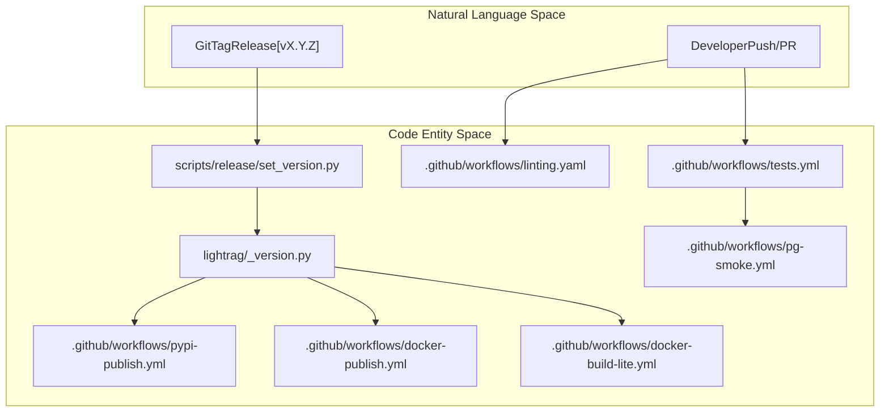
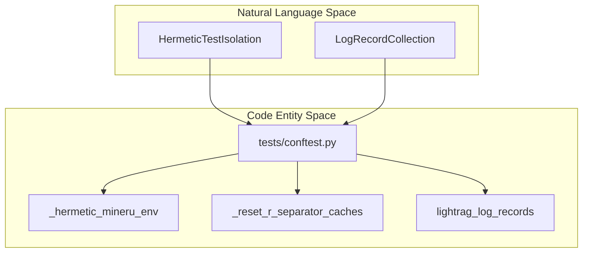

<!-- source: DeepWiki mcp.deepwiki.com · repo HKUDS/LightRAG · page 10 Testing and CI/CD · fetched 2026-11-09 -->

# Testing and CI/CD

Relevant source files

The following files were used as context for generating this wiki page:

- [.github/CONTRIBUTING.md](.github/CONTRIBUTING.md)
- [.github/workflows/copilot-setup-steps.yml](.github/workflows/copilot-setup-steps.yml)
- [.github/workflows/docker-build-lite.yml](.github/workflows/docker-build-lite.yml)
- [.github/workflows/docker-build-manual.yml](.github/workflows/docker-build-manual.yml)
- [.github/workflows/docker-publish.yml](.github/workflows/docker-publish.yml)
- [.github/workflows/linting.yaml](.github/workflows/linting.yaml)
- [.github/workflows/pg-smoke.yml](.github/workflows/pg-smoke.yml)
- [.github/workflows/pypi-publish.yml](.github/workflows/pypi-publish.yml)
- [.github/workflows/setup-tests.yml](.github/workflows/setup-tests.yml)
- [.github/workflows/stale.yaml](.github/workflows/stale.yaml)
- [.github/workflows/tests.yml](.github/workflows/tests.yml)
- [docs/ParserDebugCLI-zh.md](docs/ParserDebugCLI-zh.md)
- [docs/ParserDebugCLI.md](docs/ParserDebugCLI.md)
- [docs/ThirdPartyParser-zh.md](docs/ThirdPartyParser-zh.md)
- [docs/ThirdPartyParser.md](docs/ThirdPartyParser.md)
- [lightrag/parser/registry.py](lightrag/parser/registry.py)
- [tests/conftest.py](tests/conftest.py)
- [tests/parser/test_registry.py](tests/parser/test_registry.py)
- [tests/pipeline/test_chunk_options_regex_scrub.py](tests/pipeline/test_chunk_options_regex_scrub.py)
- [tests/pipeline/test_parse_warnings_split_persist.py](tests/pipeline/test_parse_warnings_split_persist.py)
- [tests/pipeline/test_strict_capability_gate.py](tests/pipeline/test_strict_capability_gate.py)

The LightRAG project maintains a comprehensive testing and automation infrastructure to ensure the reliability and quality of its dual-level Knowledge Graph and vector RAG architecture. This infrastructure covers a broad spectrum from local unit and integration tests to automated GitHub Actions workflows that build, lint, test, and publish Docker images and PyPI packages.

---

## Test Suite Overview

The test suite is structured to validate the core components of LightRAG, including engine orchestration, document parsing, storage backends, and API endpoints. It aims to balance fast local testing with thorough integration validation that involves external services.

### Test Suite Structure and Execution

- **Directory Organization:** Tests are arranged in subdirectories mirroring the core `lightrag/` architecture, such as `tests/api`, `tests/kg`, `tests/parser`, `tests/pipeline`, `tests/llm`, `tests/chunker`, `tests/setup`, and `tests/workspace` [.github/workflows/tests.yml:52-54]().
- **Test Categories:**
  - **Offline Tests:** Hermetic unit and functional tests requiring no external services [.github/workflows/tests.yml:45-54]().
  - **Integration Tests:** Require live database or API connections (e.g., PostgreSQL smoke tests via `.github/workflows/pg-smoke.yml:1-64]`).
- **Execution:** Automated in CI using `uv sync --frozen` to install dependencies with precise lockfile pinning [.github/workflows/tests.yml:33-44]().

For detailed organization, test categories, fixtures, and execution instructions, see the child page [Test Suite](#10.1).

Sources: [.github/workflows/tests.yml:11-64](), [.github/workflows/pg-smoke.yml:1-63]()

---

## CI/CD Workflows and Release Process

LightRAG’s continuous integration and delivery leverage GitHub Actions to enforce code quality, run tests, and automate multi-platform builds and publishing workflows.

### Key CI/CD Workflows

- **Linting and Pre-Commit Checks:** Validates Python formatting and linting using `pre-commit` and `ruff` [.github/workflows/linting.yaml:1-68]().
- **Offline Test Runs:** Executes hermetic tests across Python versions on Ubuntu runners [.github/workflows/tests.yml:11-55]().
- **PostgreSQL Smoke Tests:** Runs targeted integration smoke tests against PostgreSQL database service containers [.github/workflows/pg-smoke.yml:1-63]().
- **Docker Image Builds and Publishing:** Builds multi-architecture container images, signs them with `cosign`, and publishes to GitHub Container Registry [.github/workflows/docker-publish.yml:14-120](), [.github/workflows/docker-build-lite.yml:1-113](), [.github/workflows/docker-build-manual.yml:1-109]().
- **PyPI Package Publishing:** Builds frontend React components via Bun, verifies distribution assets, and publishes packages to PyPI [.github/workflows/pypi-publish.yml:21-101]().

### CI/CD High-Level Workflow Interaction

Sources: [.github/workflows/tests.yml:11-55](), [.github/workflows/linting.yaml:1-68](), [.github/workflows/pg-smoke.yml:1-63](), [.github/workflows/docker-publish.yml:14-120](), [.github/workflows/docker-build-lite.yml:1-113](), [.github/workflows/pypi-publish.yml:21-101]()

For full details, see the child page [CI/CD Workflows and Release Process](#10.2).

---

## Contribution Guidelines for Testing and CI/CD

To maintain code quality and system stability, contributors should adhere to project testing conventions, environment isolation fixtures, and pre-commit checks.

### Test Environment Isolation

- The `tests/conftest.py` module enforces a hermetic test environment by neutralizing parser-routing and endpoint environment variables (e.g., clearing `MINERU_API_MODE`, `LIGHTRAG_PARSER`, and `DOCLING_ENDPOINT`) [tests/conftest.py:44-115]().
- Pytest fixtures automatically clear process-wide chunk separator caches between test runs to ensure state independence [tests/conftest.py:117-137]().

### Test Fixture and Option Summary

Sources: [tests/conftest.py:10-142]()

For thorough explanations on test fixtures, contract tests, and execution steps, see the child page [Test Suite](#10.1).

---

This page provides an overarching view of the LightRAG testing and continuous integration/deployment practices. For detailed instructions, internal structures, and specific command invocations, consult the following child pages:

- [Test Suite](#10.1)
- [CI/CD Workflows and Release Process](#10.2)

---

