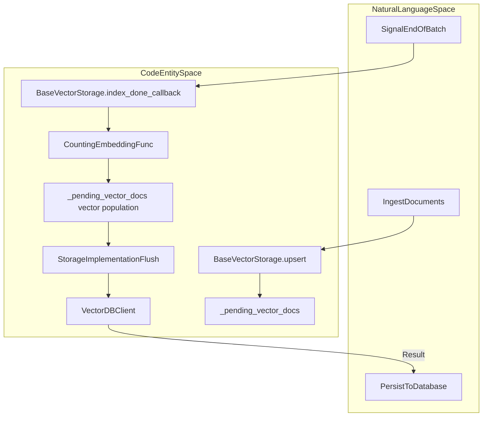
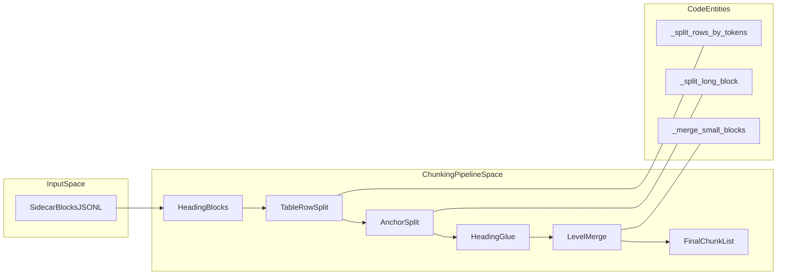
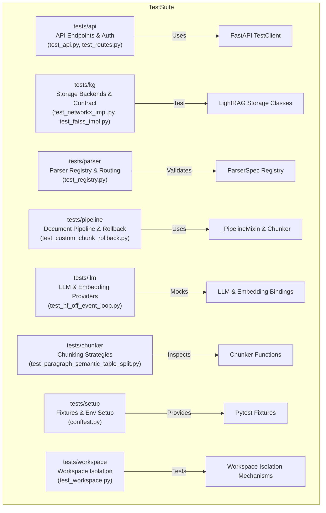

<!-- source: DeepWiki mcp.deepwiki.com · repo HKUDS/LightRAG · page 10.1 Test Suite · fetched 2026-11-09 -->

# Test Suite

<details>
<summary>Relevant source files</summary>

The following files were used as context for generating this wiki page:

- [AGENTS.md](AGENTS.md)
- [CLAUDE.md](CLAUDE.md)
- [docs/ParserDebugCLI-zh.md](docs/ParserDebugCLI-zh.md)
- [docs/ParserDebugCLI.md](docs/ParserDebugCLI.md)
- [docs/ThirdPartyParser-zh.md](docs/ThirdPartyParser-zh.md)
- [docs/ThirdPartyParser.md](docs/ThirdPartyParser.md)
- [docs/design/PurgeRecoveryContract.md](docs/design/PurgeRecoveryContract.md)
- [lightrag/parser/exceptions.py](lightrag/parser/exceptions.py)
- [lightrag/parser/llm_bridge.py](lightrag/parser/llm_bridge.py)
- [lightrag/parser/registry.py](lightrag/parser/registry.py)
- [lightrag/tools/README_KG_INTEGRITY_REPAIR.md](lightrag/tools/README_KG_INTEGRITY_REPAIR.md)
- [lightrag/tools/kg_integrity_repair.py](lightrag/tools/kg_integrity_repair.py)
- [tests/api/routes/test_clear_documents_ingress.py](tests/api/routes/test_clear_documents_ingress.py)
- [tests/api/routes/test_scan_manual_retry.py](tests/api/routes/test_scan_manual_retry.py)
- [tests/conftest.py](tests/conftest.py)
- [tests/extraction/test_write_ahead_indexes.py](tests/extraction/test_write_ahead_indexes.py)
- [tests/kg/faiss_impl/test_faiss_drop.py](tests/kg/faiss_impl/test_faiss_drop.py)
- [tests/kg/nano_impl/test_nano_drop.py](tests/kg/nano_impl/test_nano_drop.py)
- [tests/kg/networkx_impl/test_networkx_drop.py](tests/kg/networkx_impl/test_networkx_drop.py)
- [tests/kg/test_committed_background_task.py](tests/kg/test_committed_background_task.py)
- [tests/llm/hf_impl/_fork_probe.py](tests/llm/hf_impl/_fork_probe.py)
- [tests/llm/hf_impl/conftest.py](tests/llm/hf_impl/conftest.py)
- [tests/llm/hf_impl/test_hf_off_event_loop.py](tests/llm/hf_impl/test_hf_off_event_loop.py)
- [tests/parser/markdown/test_download_deadline.py](tests/parser/markdown/test_download_deadline.py)
- [tests/parser/test_llm_bridge.py](tests/parser/test_llm_bridge.py)
- [tests/parser/test_parser_exceptions.py](tests/parser/test_parser_exceptions.py)
- [tests/parser/test_registry.py](tests/parser/test_registry.py)
- [tests/pipeline/test_cache_reference_flush_order.py](tests/pipeline/test_cache_reference_flush_order.py)
- [tests/pipeline/test_chunk_options_regex_scrub.py](tests/pipeline/test_chunk_options_regex_scrub.py)
- [tests/pipeline/test_delete_fail_closed.py](tests/pipeline/test_delete_fail_closed.py)
- [tests/pipeline/test_doc_status_reset_metadata.py](tests/pipeline/test_doc_status_reset_metadata.py)
- [tests/pipeline/test_fault_injection_matrix.py](tests/pipeline/test_fault_injection_matrix.py)
- [tests/pipeline/test_insert_done_error_handling.py](tests/pipeline/test_insert_done_error_handling.py)
- [tests/pipeline/test_parse_warnings_split_persist.py](tests/pipeline/test_parse_warnings_split_persist.py)
- [tests/pipeline/test_pipeline_cancellation.py](tests/pipeline/test_pipeline_cancellation.py)
- [tests/pipeline/test_purge_fail_closed.py](tests/pipeline/test_purge_fail_closed.py)
- [tests/pipeline/test_strict_capability_gate.py](tests/pipeline/test_strict_capability_gate.py)
- [tests/utils/test_log_without_raising.py](tests/utils/test_log_without_raising.py)

</details>


The LightRAG test suite provides a comprehensive framework to validate core functionality, storage backend contracts, document ingestion pipelines, and fault-tolerance mechanics. It ensures reliability across asynchronous operations, concurrency edge cases, and crash recovery scenarios. The suite is implemented primarily with `pytest` and extended with `pytest-asyncio` for testing asynchronous coroutines [AGENTS.md:13-14]().

## Test Organization

The test suite is organized under the `tests/` directory, mirroring the structure of the main codebase and grouping tests by subsystem and purpose [AGENTS.md:13-14]().

### Key Directories and Subsystems

- **`tests/api/`**: Tests for FastAPI service endpoints, authentication, CORS, document clearing ingress, and server configuration [AGENTS.md:13-14](), [tests/api/routes/test_clear_documents_ingress.py:1-1]().
- **`tests/kg/`**: Backend-specific tests for knowledge graph, vector, and KV storage implementations (`networkx_impl`, `faiss_impl`, `nano_impl`, `milvus_impl`, `postgres_impl`), covering deferred embedding and concurrency locks [AGENTS.md:13-14](), [tests/kg/nano_impl/test_nano_drop.py:1-1]().
- **`tests/parser/`**: Validation for parser engine registrations, routing rules, suffix capability environment variables, and the parser debug CLI [AGENTS.md:13-14](), [tests/parser/test_registry.py:1-10]().
- **`tests/pipeline/`**: Tests for the multi-stage document ingestion pipeline including chunking, document insertion completion (`_insert_done`), error handling, cancellation propagation, and purge recovery contracts [AGENTS.md:13-14](), [tests/pipeline/test_insert_done_error_handling.py:1-14](), [tests/pipeline/test_pipeline_cancellation.py:1-10]().
- **`tests/llm/`**: Tests for LLM and embedding provider bindings, thread-pool execution safety off the event loop, and role-specific configurations [AGENTS.md:13-14](), [tests/llm/hf_impl/test_hf_off_event_loop.py:1-10]().
- **`tests/chunker/`**: Tests for text chunking strategies like Paragraph Semantic chunking, table row splitting, and reference dropping [AGENTS.md:13-14]().
- **`tests/setup/`**: Fixtures and environment setup helpers like `conftest.py`, providing hermetic test environment configuration [AGENTS.md:13-14](), [tests/conftest.py:1-5]().
- **`tests/workspace/`**: Workspace isolation and multi-tenant data partitioning tests [AGENTS.md:13-14]().

Sources: [AGENTS.md:13-14](), [tests/conftest.py:1-5](), [tests/parser/test_registry.py:1-10]()

---

## Key Test Categories

### 1. Storage and Deferred Embedding Contract

Storage backends implement a delayed embedding flush mechanism to batch operations and reduce redundant LLM calls. The test suite validates:

- **Buffering Behavior**: Calls to `upsert()` queue items in local memory structures without triggering immediate remote database writes or embeddings. Actual flushes occur when `index_done_callback()` or `finalize()` are invoked [tests/kg/milvus_impl/test_milvus_deferred_embedding.py:118-130](), [tests/kg/nano_impl/test_nano_deferred_embedding.py:33-52]().
- **Batch Size Management**: Automatic splitting of large upsert sets into compliant batches when exceeding maximum token or item limits [tests/kg/milvus_impl/test_milvus_deferred_embedding.py:169-180]().

Sources: [tests/kg/milvus_impl/test_milvus_deferred_embedding.py:118-180](), [tests/kg/nano_impl/test_nano_deferred_embedding.py:33-52]()

### 2. Paragraph Semantic Chunking Strategy

The Paragraph Semantic chunker evaluates structural headers and semantic markers. Tests confirm:

- **Table Row Splitting**: Splitting tabular data by row boundaries and injecting structural role indicators for glued blocks [tests/chunker/test_paragraph_semantic_table_split.py:119-152]().
- **Reference Block Dropping**: Pruning trailing bibliography or reference sections based on heading hierarchies [tests/chunker/test_paragraph_semantic_drop_references.py:125-142]().
- **Heading Glue and Level Merge**: Structural merging of undersized sibling text blocks [lightrag/chunker/paragraph_semantic.py:15-47]().

Sources: [tests/chunker/test_paragraph_semantic_table_split.py:119-152](), [tests/chunker/test_paragraph_semantic_drop_references.py:125-142](), [lightrag/chunker/paragraph_semantic.py:15-47]()

### 3. Pipeline, Cancellation, and Error Handling

Pipeline tests assert robust behavior under exceptional conditions:

- **Storage Flush Error Handling (`IndexFlushError`)**: Validates that storage-flush failures during `LightRAG._insert_done` bubble up cleanly or trigger appropriate cleanups using spy storages (`_SpyStorage`) without cascading every subsequent document into a permanent `FAILED` state [tests/pipeline/test_insert_done_error_handling.py:1-126]().
- **Cache Reference Flush Ordering**: Asserts that chunk references are committed *before* LLM response cache rows to prevent orphaned cache entries on crash [tests/pipeline/test_cache_reference_flush_order.py:1-22]().
- **Worker Cancellation**: Verifies that cancellation flags (`cancellation_requested`) propagate into `_parse_worker`, `_analyze_worker`, and multimodal analysis tasks, draining queues safely with `PipelineCancelledException` [tests/pipeline/test_pipeline_cancellation.py:1-18]().

Sources: [tests/pipeline/test_insert_done_error_handling.py:1-126](), [tests/pipeline/test_cache_reference_flush_order.py:1-22](), [tests/pipeline/test_pipeline_cancellation.py:1-18]()

---

## Test Infrastructure and Fixtures

### Hermetic Environment Control (`conftest.py`)

Test runs are isolated via fixtures defined in `tests/conftest.py` and package conftests:

- **Environment Isolation**: The `_hermetic_mineru_env` fixture clears parser-related environment variables (`MINERU_API_MODE`, `LIGHTRAG_PARSER`, `DOCLING_ENDPOINT`, etc.) prior to each test to prevent local `.env` files from leaking into test processes [tests/conftest.py:44-115]().
- **Cache Resets**: The `_reset_r_separator_caches` fixture clears process-wide chunk separator caches between tests to prevent warning emission side effects [tests/conftest.py:117-137]().
- **Logging Capture**: The `lightrag_log_records` fixture attaches a dedicated handler to the `lightrag` logger to collect log records directly, bypassing non-propagating logger settings [tests/conftest.py:13-42]().

Sources: [tests/conftest.py:13-137]()

### Mocking and Test Doubles

- **Embedding Function Counters**: Counting embedding functions track call counts and dimensions without invoking remote models [tests/kg/milvus_impl/test_milvus_deferred_embedding.py:37-56]().
- **Thread Execution Offload**: Tests in `tests/llm/hf_impl/test_hf_off_event_loop.py` verify that synchronous PyTorch compute operations run on worker threads (`_run_hf_inference`) to prevent event loop blocking [tests/llm/hf_impl/test_hf_off_event_loop.py:1-10]().

Sources: [tests/kg/milvus_impl/test_milvus_deferred_embedding.py:37-56](), [tests/llm/hf_impl/test_hf_off_event_loop.py:1-10]()

---

## Fault-Injection and Contract Tests

### Purge Recovery and Fail-Closed Contract

Document deletion and graph contribution purges rely on recovery anchors (`full_entities`, `full_relations`) and write-state markers (`kg_write_state`, `kg_purge`) [docs/design/PurgeRecoveryContract.md:1-22](). 

- **Fail-Closed Protection**: `_purge_kg_contributions` fails closed with `RecoveryAnchorMissingError` (surfaced as HTTP 409) if recovery anchors are missing, preventing orphaned graph nodes from being left behind when chunks are removed [docs/design/PurgeRecoveryContract.md:1-12]().
- **Integrity Repair**: The offline audit tool `audit_kg_integrity` (`lightrag/tools/kg_integrity_repair.py`) rebuilds missing anchors from surviving chunk provenance and certifies graph state [docs/design/PurgeRecoveryContract.md:28-30](), [tests/pipeline/test_delete_fail_closed.py:1-17]().

Sources: [docs/design/PurgeRecoveryContract.md:1-30](), [tests/pipeline/test_delete_fail_closed.py:1-17]()

### Fault-Injection Matrix with Restart Simulation

The test suite includes matrix suites (`tests/pipeline/test_fault_injection_matrix.py`) that inject artificial persistence failures across ingestion boundaries (anchor pre-write flushes, graph mutations, derived store flushes, final status writes) [tests/pipeline/test_fault_injection_matrix.py:1-195](). 

- **Restart Simulation**: After injecting a failure, tests simulate a process restart by dropping storages, instantiating a fresh `LightRAG` over the working directory, and running a retry [tests/pipeline/test_fault_injection_matrix.py:1-11]().
- **Convergence Verification**: Asserts that documents reach `PROCESSED` state successfully upon retry, and `audit_kg_integrity` confirms zero orphan entities or relations [tests/pipeline/test_fault_injection_matrix.py:110-123]().

Sources: [tests/pipeline/test_fault_injection_matrix.py:1-195]()

---

## Running Tests

### Preferred Script Runner

Run the test aggregation script located in the repository root [AGENTS.md:13-13]():

```bash
scripts/test.sh
```

### Direct Pytest Invocation

Run specific test subsets or offline tests using `pytest`:

```bash
pytest tests/ -m offline -v --tb=short
```

Sources: [AGENTS.md:13-13]()

---

## Diagrams

### Deferred Embedding Flush Flow in Vector Storage

This diagram maps natural language ingestion actions to code entity calls inside `BaseVectorStorage` and counting embedding functions.



Sources: [tests/kg/milvus_impl/test_milvus_deferred_embedding.py:118-151](), [tests/kg/nano_impl/test_nano_deferred_embedding.py:33-88]()

---

### Paragraph Semantic Chunking Pipeline

This diagram traces blocks through structural splitting and merging functions within the chunker module.



Sources: [lightrag/chunker/paragraph_semantic.py:15-47](), [tests/chunker/test_paragraph_semantic_table_split.py:119-152]()

---

### Test Suite Architecture Overview

This high-level diagram correlates test directories with underlying subsystems and modules.



Sources: [AGENTS.md:13-14](), [tests/conftest.py:10-115](), [tests/kg/networkx_impl/test_networkx_drop.py:1-1](), [tests/parser/test_registry.py:1-10]()

---

