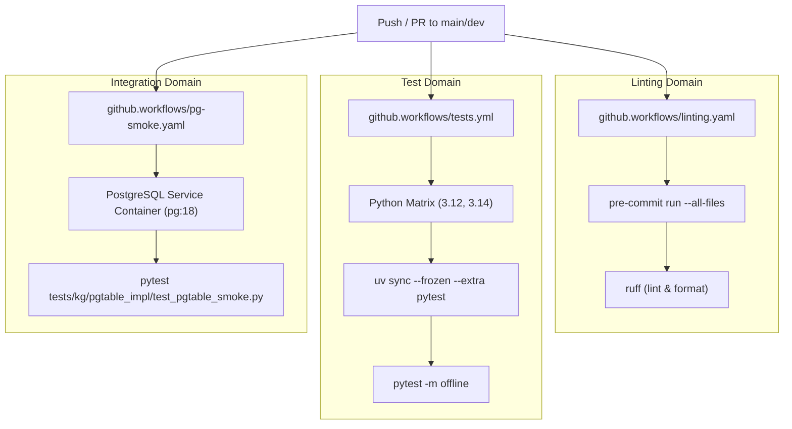
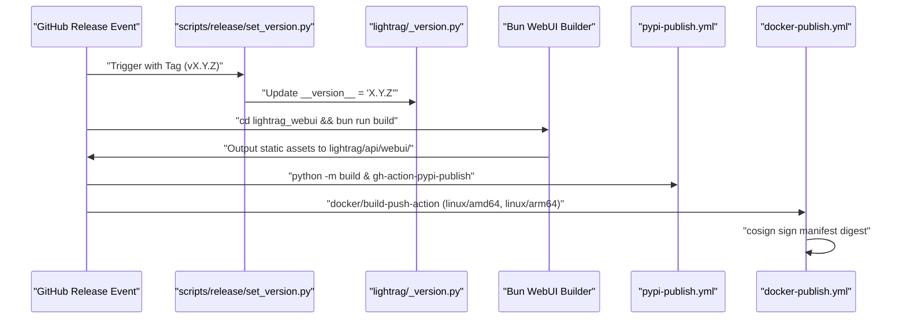
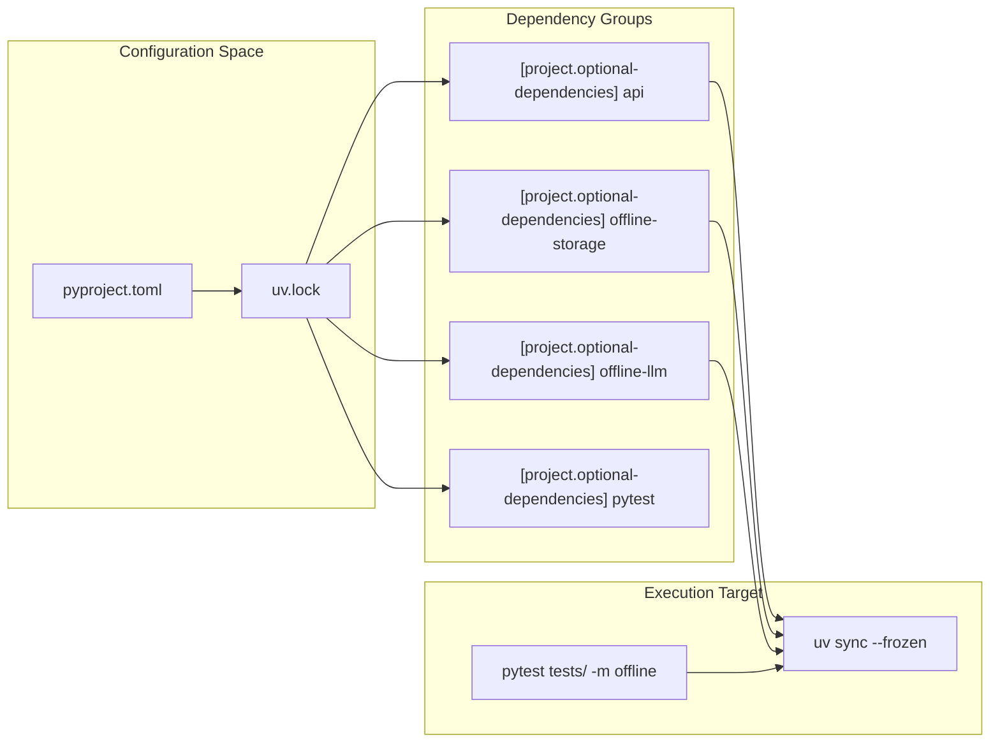

<!-- source: DeepWiki mcp.deepwiki.com · repo HKUDS/LightRAG · page 10.2 CI/CD Workflows and Release Process · fetched 2026-11-09 -->

# CI/CD Workflows and Release Process

Relevant source files

The following files were used as context for generating this wiki page:

- [.github/CONTRIBUTING.md](.github/CONTRIBUTING.md)
- [.github/workflows/copilot-setup-steps.yml](.github/workflows/copilot-setup-steps.yml)
- [.github/workflows/docker-build-lite.yml](.github/workflows/docker-build-lite.yml)
- [.github/workflows/docker-build-manual.yml](.github/workflows/docker-build-manual.yml)
- [.github/workflows/docker-publish.yml](.github/workflows/docker-publish.yml)
- [.github/workflows/linting.yaml](.github/workflows/linting.yaml)
- [.github/workflows/pg-smoke.yml](.github/workflows/pg-smoke.yml)
- [.github/workflows/pypi-publish.yml](.github/workflows/pypi-publish.yml)
- [.github/workflows/setup-tests.yml](.github/workflows/setup-tests.yml)
- [.github/workflows/stale.yaml](.github/workflows/stale.yaml)
- [.github/workflows/tests.yml](.github/workflows/tests.yml)
- [lightrag/_version.py](lightrag/_version.py)
- [lightrag/llm/binding_options.py](lightrag/llm/binding_options.py)
- [pyproject.toml](pyproject.toml)
- [requirements-offline-llm.txt](requirements-offline-llm.txt)
- [requirements-offline-storage.txt](requirements-offline-storage.txt)
- [requirements-offline.txt](requirements-offline.txt)
- [uv.lock](uv.lock)

The LightRAG project uses a GitHub Actions-driven Continuous Integration and Continuous Deployment (CI/CD) pipeline to automate testing, dependency verification, linting, PostgreSQL smoke tests, multi-platform container publishing, and PyPI distribution[.github/workflows/tests.yml:1-15](), [.github/workflows/linting.yaml:1-18](), [.github/workflows/docker-publish.yml:1-15](), [.github/workflows/pypi-publish.yml:1-15](), [.github/workflows/pg-smoke.yml:1-15](). Version synchronization across Python core modules and frontend assets is handled by centralized version files and build scripts.

---

## Quality Assurance and Testing Workflows

Code quality, formatting compliance, and core stability are enforced via dedicated GitHub Actions workflows triggered on pushes and pull requests to `main`, `dev`, and wildcard branches (`dev-*`) [.github/workflows/tests.yml:3-8](), [.github/workflows/linting.yaml:3-8](), [.github/workflows/pg-smoke.yml:3-8]().

### Linting and Formatting (`linting.yaml`)

The linting pipeline executes pre-commit hooks to validate code style, trailing whitespace, file endings, and requirement sorting [.github/workflows/linting.yaml:13-36](). 
- **Tooling**: Uses `ruff` for linting and formatting, along with standard `pre-commit-hooks` [.github/workflows/linting.yaml:60-68]().
- **Automation**: If formatting checks fail on a pull request, the workflow automatically comments on the pull request with remediation steps and inline command instructions [.github/workflows/linting.yaml:72-134]().

### Offline Unit Tests (`tests.yml`)

Unit tests run across a Python version matrix (`3.12` and `3.14`) on `ubuntu-latest` runners [.github/workflows/tests.yml:11-19]().
- **Dependency Locking**: Uses `astral-sh/setup-uv` and executes `uv sync --frozen` with extras for API, offline storage, offline LLM, and pytest to guarantee exact parity with `uv.lock` [.github/workflows/tests.yml:28-44]().
- **Execution**: Runs `pytest tests/ -m offline -v --tb=short` to isolate tests that do not require external cloud endpoints or live database services [.github/workflows/tests.yml:45-54]().

### PostgreSQL Smoke Tests (`pg-smoke.yml`)

Integration smoke tests targeting relational and vector capabilities under PostgreSQL run against an ephemeral PostgreSQL service container [.github/workflows/pg-smoke.yml:11-35]().
- **Service Container**: Spins up `postgres:18` with health checks (`pg_isready`) [.github/workflows/pg-smoke.yml:21-34]().
- **Test Target**: Executes `pytest tests/kg/pgtable_impl/test_pgtable_smoke.py -m pg_smoke --run-integration` using `asyncpg` [.github/workflows/pg-smoke.yml:56-63]().

### CI Quality Control Flow

Sources: [.github/workflows/tests.yml:1-64](), [.github/workflows/linting.yaml:1-134](), [.github/workflows/pg-smoke.yml:1-63]()

---

## Release and Distribution Process

Releases are triggered when a GitHub Release is published or via manual workflow dispatch, driving container builds and PyPI distribution [.github/workflows/docker-publish.yml:3-7](), [.github/workflows/pypi-publish.yml:3-7]().

### Versioning Mechanism

Version state is shared between packaging metadata and runtime modules via `lightrag/_version.py`:
- `__version__` specifies the semantic release version (e.g., `"1.5.8"`) [lightrag/_version.py:3-3]().
- `__api_version__` tracks internal API schema numbering (e.g., `"0347"`) [lightrag/_version.py:4-4]().
- Release workflows extract Git tags and execute `scripts/release/set_version.py` to synchronize these definitions prior to building packages [.github/workflows/docker-publish.yml:40-74](), [.github/workflows/pypi-publish.yml:47-68]().

### PyPI Package Publishing (`pypi-publish.yml`)

1. **WebUI Build**: Sets up `oven-sh/setup-bun`, installs frontend dependencies with frozen lockfiles, and compiles the React application into `lightrag/api/webui/` [.github/workflows/pypi-publish.yml:21-39]().
2. **Distribution**: Runs `python -m build` to generate source distributions and universal wheels [.github/workflows/pypi-publish.yml:70-74]().
3. **Publishing**: Uploads the release distributions to PyPI via `pypa/gh-action-pypi-publish` using OIDC token authentication [.github/workflows/pypi-publish.yml:81-101]().

### Docker Image Publishing (`docker-publish.yml`)

1. **Tag Resolution**: Resolves release tags or Git descriptions, classifying tags containing `rc` or `dev` as pre-releases [.github/workflows/docker-publish.yml:40-67]().
2. **Multi-Platform Build**: Builds container images for `linux/amd64` and `linux/arm64` architectures using `docker/build-push-action` and GitHub Actions caching [.github/workflows/docker-publish.yml:27-96]().
3. **Supply Chain Security**: Signs container manifests using `sigstore/cosign` [.github/workflows/docker-publish.yml:37-111]().

### Release Data Flow

Sources: [.github/workflows/pypi-publish.yml:1-101](), [.github/workflows/docker-publish.yml:1-120](), [lightrag/_version.py:1-4]()

---

## Dependency Management and Optional Extras

Project dependencies and development environments are defined in `pyproject.toml` [pyproject.toml:1-179](). The repository uses `uv` for reproducible environment resolution, backed by `uv.lock` [uv.lock:1-18]().

### Optional Extras and Environments

- **`api`**: Core FastAPI server dependencies, document parsers, and processing utilities [pyproject.toml:66-141]().
- **`offline-storage`**: Pinning requirements for self-hosted database and vector storage providers (e.g., `asyncpg`, `neo4j`, `faiss-cpu`, `qdrant-client`, `redis`) [pyproject.toml:144-155](), [requirements-offline-storage.txt:1-19]().
- **`offline-llm`**: Self-hosted LLM and embedding provider SDKs (`openai`, `anthropic`, `ollama`, `voyageai`) [pyproject.toml:157-170](), [requirements-offline-llm.txt:1-20]().
- **`pytest`**: Test runner harness dependencies including `pytest`, `pytest-asyncio`, and `ruff` [pyproject.toml:57-64]().

### Dependency Ecosystem Flow

Sources: [pyproject.toml:1-179](), [uv.lock:1-18](), [.github/workflows/tests.yml:33-54]()

---

