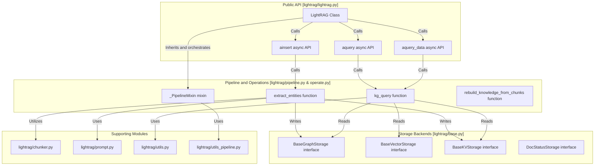
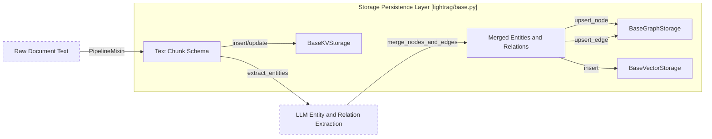
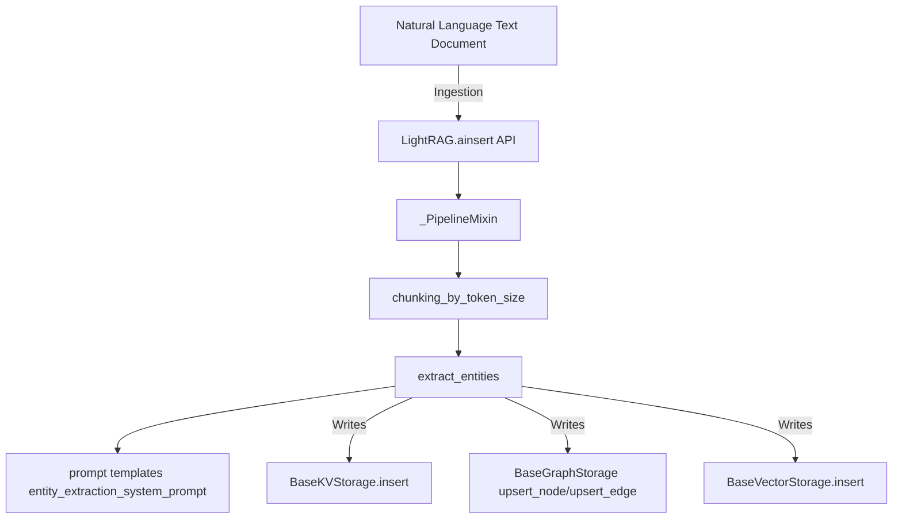
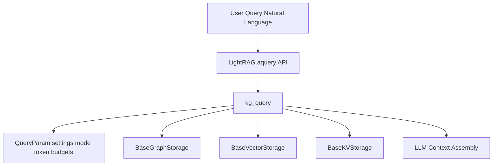

<!-- source: DeepWiki mcp.deepwiki.com · repo HKUDS/LightRAG · page 2 Core RAG Engine · fetched 2026-11-09 -->

# Core RAG Engine

Relevant source files

The following files were used as context for generating this wiki page:

- [docs/design/LatexEscapeRepairContract.md](docs/design/LatexEscapeRepairContract.md)
- [lightrag/lightrag.py](lightrag/lightrag.py)
- [lightrag/operate.py](lightrag/operate.py)
- [lightrag/prompt.py](lightrag/prompt.py)
- [lightrag/utils.py](lightrag/utils.py)
- [tests/llm/test_vlm_json_escape_repair.py](tests/llm/test_vlm_json_escape_repair.py)

The Core RAG Engine forms the computational backbone of the LightRAG Python library. It manages the conversion of raw text documents into a structured Knowledge Graph (KG) representation and executes flexible multi-level retrieval queries that combine symbolic graph search with vector semantic search.

This engine bridges natural language data and structured code entities through layered components handling text chunking, LLM-driven extraction of entities and relationships, vector indexing, graph storage, and query execution. It balances fully automated KG construction with efficient retrieval modes suitable for diverse user scenarios.

---

### High-Level Architecture and Code Mapping

To situate the core engine within the codebase, the diagram below visualizes the main logical components and the primary modules and classes that implement them:

Title: Core RAG Engine Components to Code Entities

Sources: [lightrag/lightrag.py:162-231](), [lightrag/operate.py:114-196](), [lightrag/base.py:83-139]()

---

### Core Subsystems Overview

The Core RAG Engine is organized into five major subsystems. Each handles a distinct responsibility:

#### 1. LightRAG Class and Pipeline Orchestration
The `LightRAG` class serves as the primary orchestrator for the KG ingestion and query lifecycle [lightrag/lightrag.py:1-231](). It coordinates asynchronous insertion (`ainsert`) and query (`aquery`) APIs, document lifecycle management via `_PipelineMixin`, and safe concurrency controls [lightrag/lightrag.py:162-208]().

For details, see [LightRAG Class and Pipeline Orchestration](#2.1).
Sources: [lightrag/lightrag.py:162-231](), [lightrag/pipeline.py:1-100]()

#### 2. Entity and Relation Extraction
Transforming document text chunks into graph elements is accomplished via `extract_entities` [lightrag/operate.py:147](), driven by LLM prompts governed by templates defined in `lightrag/prompt.py` [lightrag/prompt.py:56-102](). It extracts structured entities and binary relationships with support for gleaning and deduplication.

For details, see [Entity and Relation Extraction](#2.2).
Sources: [lightrag/operate.py:114-196](), [lightrag/prompt.py:56-102]()

#### 3. Retrieval and Query Modes
Querying the KG supports local, global, hybrid, mix, and naive modes encapsulated by `QueryParam` [lightrag/base.py:133](). The core retrieval logic executes in `kg_query` [lightrag/operate.py:148](), managing token budgets, keyword extraction, vector search, and reranking.

For details, see [Retrieval and Query Modes](#2.3).
Sources: [lightrag/operate.py:114-196](), [lightrag/base.py:133-139]()

#### 4. Text Chunking Strategies
Input text is split into segments compatible with model token limits using strategies such as fixed-size token chunks, recursive semantic chunking, and vector semantic chunking via `chunking_by_token_size` [lightrag/lightrag.py:142]().

For details, see [Text Chunking Strategies](#2.4).
Sources: [lightrag/lightrag.py:142](), [lightrag/chunker.py:1-50]()

#### 5. Concurrency, Caching, and Utilities
Robust concurrent execution is managed via `priority_limit_async_func_call` [lightrag/utils.py:188](), storage locks, LLM response caches, vector DB operation wrappers (`safe_vdb_operation_with_exception`) [lightrag/utils.py:156](), and text sanitization utilities including LaTeX escape repair [lightrag/utils.py:27]().

For details, see [Concurrency, Caching, and Utilities](#2.5).
Sources: [lightrag/utils.py:156-209](), [lightrag/operate.py:15-63]()

---

### Data Flow: From Natural Language Input to Knowledge Graph

Title: Data Flow from Raw Text to KG Storage

Sources: [lightrag/operate.py:146-152](), [lightrag/base.py:64-72]()

---

### Key Classes and Interfaces in the Core RAG Engine

| Class / Function | File Path | Role and Responsibility |
| --- | --- | --- |
| `LightRAG` | `lightrag/lightrag.py` | Entry point class managing pipeline, LLM roles, and storage backends [lightrag/lightrag.py:1-231](). |
| `_PipelineMixin` | `lightrag/pipeline.py` | Mixin implementing document ingestion lifecycle and chunk processing [lightrag/lightrag.py:209](). |
| `extract_entities` | `lightrag/operate.py` | Performs entity and relation extraction from text chunks [lightrag/operate.py:147](). |
| `kg_query` | `lightrag/operate.py` | Core query executor supporting multi-mode retrieval [lightrag/operate.py:148](). |
| `QueryParam` | `lightrag/base.py` | Typed dataclass specifying query modes and token budgets [lightrag/base.py:133](). |
| `BaseGraphStorage` | `lightrag/base.py` | Abstract interface for knowledge graph storage backends [lightrag/base.py:126](). |
| `BaseVectorStorage` | `lightrag/base.py` | Abstract interface for vector embedding storage backends [lightrag/base.py:128](). |
| `BaseKVStorage` | `lightrag/base.py` | Abstract interface for key-value storage backends [lightrag/base.py:127](). |

Sources: [lightrag/lightrag.py:1-231](), [lightrag/base.py:126-139]()

---

### Bridging Natural Language to Code Entities

Title: Natural Language Input to Extraction Code Path

Sources: [lightrag/lightrag.py:162-231](), [lightrag/operate.py:147](), [lightrag/prompt.py:56-102]()

Title: Query Request to Retrieval Components

Sources: [lightrag/lightrag.py:162-231](), [lightrag/operate.py:148](), [lightrag/base.py:133-139]()

---

For a deeper technical dive, each subsystem is expanded in dedicated child pages:
- [LightRAG Class and Pipeline Orchestration](#2.1)
- [Entity and Relation Extraction](#2.2)
- [Retrieval and Query Modes](#2.3)
- [Text Chunking Strategies](#2.4)
- [Concurrency, Caching, and Utilities](#2.5)

---

# Summary

The Core RAG Engine is the central coordinator converting raw text into structured knowledge and enabling sophisticated querying powered by a hybrid KG + vector approach. Its architecture balances modular storage abstractions, LLM-driven extraction intelligence, and multi-mode retrieval to deliver scalable, extensible RAG capabilities in LightRAG.

Sources: [lightrag/lightrag.py:1-231](), [lightrag/operate.py:1-196](), [lightrag/base.py:64-139](), [lightrag/prompt.py:56-102](), [lightrag/utils.py:156-209]()

---

