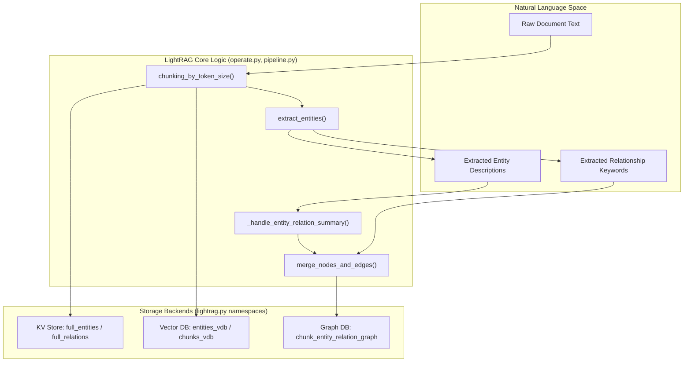
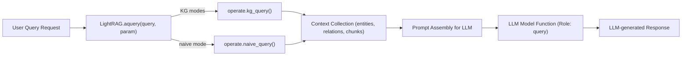

<!-- source: DeepWiki mcp.deepwiki.com · repo HKUDS/LightRAG · page 2.1 LightRAG Class and Pipeline Orchestration · fetched 2026-11-09 -->

# LightRAG Class and Pipeline Orchestration

Relevant source files

The following files were used as context for generating this wiki page:

- [docs/ProgramingWithCore.md](docs/ProgramingWithCore.md)
- [docs/design/LatexEscapeRepairContract.md](docs/design/LatexEscapeRepairContract.md)
- [lightrag/lightrag.py](lightrag/lightrag.py)
- [lightrag/operate.py](lightrag/operate.py)
- [lightrag/prompt.py](lightrag/prompt.py)
- [lightrag/tools/README_KG_INTEGRITY_REPAIR.md](lightrag/tools/README_KG_INTEGRITY_REPAIR.md)
- [lightrag/tools/kg_integrity_repair.py](lightrag/tools/kg_integrity_repair.py)
- [lightrag/utils.py](lightrag/utils.py)
- [lightrag/utils_graph.py](lightrag/utils_graph.py)
- [tests/extraction/test_vdb_content_truncation_coverage.py](tests/extraction/test_vdb_content_truncation_coverage.py)
- [tests/extraction/test_write_ahead_indexes.py](tests/extraction/test_write_ahead_indexes.py)
- [tests/kg/json_impl/test_json_commit_reconciliation.py](tests/kg/json_impl/test_json_commit_reconciliation.py)
- [tests/kg/networkx_impl/test_networkx_commit_gate.py](tests/kg/networkx_impl/test_networkx_commit_gate.py)
- [tests/kg/networkx_impl/test_networkx_index_done.py](tests/kg/networkx_impl/test_networkx_index_done.py)
- [tests/llm/test_vlm_json_escape_repair.py](tests/llm/test_vlm_json_escape_repair.py)
- [tests/pipeline/test_admin_write_gate.py](tests/pipeline/test_admin_write_gate.py)
- [tests/pipeline/test_delete_fail_closed.py](tests/pipeline/test_delete_fail_closed.py)
- [tests/pipeline/test_doc_status_reset_metadata.py](tests/pipeline/test_doc_status_reset_metadata.py)
- [tests/pipeline/test_fault_injection_matrix.py](tests/pipeline/test_fault_injection_matrix.py)
- [tests/pipeline/test_graph_deletion_tracking_ordering.py](tests/pipeline/test_graph_deletion_tracking_ordering.py)
- [tests/pipeline/test_graph_merge_rename_tracking_order.py](tests/pipeline/test_graph_merge_rename_tracking_order.py)
- [tests/pipeline/test_purge_fail_closed.py](tests/pipeline/test_purge_fail_closed.py)
- [tests/utils/test_deferred_cancellation_stamp.py](tests/utils/test_deferred_cancellation_stamp.py)

This page provides a comprehensive technical deep dive into the central `LightRAG` class and the orchestration of its core document ingestion and query pipelines. We analyze the lifecycle of `LightRAG`, its public asynchronous APIs (`ainsert`, `aquery`), the multi-stage Knowledge Graph (KG) construction pipeline, the role of the `_PipelineMixin`, and the administration-level write gate mechanism enforcing exclusive graph write access. This detailed exploration covers the interplay of code modules `lightrag/lightrag.py` and `lightrag/operate.py` for LightRAG's core logic.

---

## 1. LightRAG Class Lifecycle and Initialization

The `LightRAG` class is the primary orchestrator coordinating document ingestion, KG construction, storage access, and querying. It is declared as a `final` dataclass inheriting several mixins for role-based LLM configuration (`_RoleLLMMixin`), pipeline orchestration (`_PipelineMixin`), and schema migration support (`_StorageMigrationMixin`) [lightrag/lightrag.py:32](), [lightrag/lightrag.py:209-224]().

### Storage Backend Setup

- LightRAG supports pluggable backends for Key-Value, Vector, Graph, and Document Status storage. Backend types are specified by string keys and resolved via `get_storage_class` [lightrag/lightrag.py:210]().
- The asynchronous method `initialize_storages()` instantiates and initializes all required storage backends based on configuration parameters such as `kv_storage`, `vector_storage`, and `graph_storage` [lightrag/lightrag.py:440-496](), [lightrag/kg/factory.py:17-34]().
- The counterpart method `finalize_storages()` flushes and closes storages cleanly, guaranteeing that any buffered state is persisted by calling `finalize()` and `index_done_callback()` on storage instances [lightrag/lightrag.py:516-525]().

### Workspace Isolation and Namespaces

- The `workspace` parameter configures logical data isolation; it prefixes storage namespaces ensuring multiple LightRAG instances can share physical storage safely by namespace partitioning.
- Namespace data and locks are managed through helper functions from `shared_storage` such as `get_namespace_data` and `get_namespace_lock` to segregate pipeline status, reservations, and pipeline ingress [lightrag/lightrag.py:113-116]().

---

## 2. Core Asynchronous APIs: `ainsert`, `aquery`

LightRAG exposes three main async operations for client use, directly accessible from the `LightRAG` instance:

| API Method   | Purpose                                           | Key Parameters                                      |
|--------------|-------------------------------------------------|----------------------------------------------------|
| `ainsert`    | Ingest raw text content into the KG data system | `content`: `str` or list of strings to insert      |
| `aquery`     | Perform retrieval-augmented generation queries  | `query` string and a `QueryParam` specifying mode  |
| `aquery_data`| Retrieve raw context data without LLM completion| `query` string and a `QueryParam`                   |

- `ainsert`: This entry point triggers chunking, entity/relation extraction, merging with existing KG entries, and vector index updates [lightrag/lightrag.py:560-602]().
- `aquery`: Wraps different retrieval modes forwarding to `kg_query` (for graph-enhanced modes) or `naive_query` (for vector-only search), then assembles LLM prompt and invokes the completion functions [lightrag/lightrag.py:657-686]().
- `aquery_data`: Returns context chunks directly, suitable for raw context preview or offline processing needs [lightrag/lightrag.py:687-709]().

---

## 3. Knowledge Graph Construction Pipeline

The core KG construction logic integrates deep text analysis via LLMs with chunking and vectorization to build a dual-level KG + Vector index for semantic retrieval. This multi-stage pipeline is largely dispersed between `lightrag/operate.py`, `lightrag/lightrag.py`, and `lightrag/pipeline.py`.

### Pipeline Stages

1. **Chunking**: Input text is split into token-length bounded chunks using `chunking_by_token_size()`. Supports multiple chunking strategies (Fixed, Recursive, Semantic Vector, etc.) allowing flexibility depending on document type and scale [lightrag/lightrag.py:142]().

2. **Entity and Relation Extraction**: The `extract_entities` function calls an LLM (configured via `RoleLLMConfig`) to analyze chunk text and extract structured entity and relation tuples. It uses a system prompt template that guides the LLM specifically for KG extraction tasks [lightrag/operate.py:147](), [lightrag/prompt.py:56-102]().

3. **Merging and Summarization**: To reconcile multiple or conflicting extracted entity descriptions, `_handle_entity_relation_summary()` performs map-reduce style summarization, condensing multiple texts into unified entity and relation nodes with stable descriptions. This ensures KG coherence across many uploaded documents [lightrag/operate.py:212-230]().

4. **Indexing and Storage**:
   - Entities, relationships, and final text chunks are persisted into vector stores (`entities_vdb`, `relationships_vdb`, `chunks_vdb`) and KV stores, and linked to the main graph database (`chunk_entity_relation_graph`).
   - This dual-level storage supports powerful hybrid semantic search modes combining structured graph traversal and vector similarity search [lightrag/lightrag.py:460-475]().

---

### Diagram: Natural Language to Code and Storage Entity Mapping

This diagram maps the natural language concepts and text processing stages to their specific functions and storage namespaces within the LightRAG codebase:

_Sources: [lightrag/lightrag.py:580-610](), [lightrag/operate.py:140-230](), [lightrag/pipeline.py:100-160]()_

---

## 4. The _PipelineMixin: Async Document Pipeline Control

The `_PipelineMixin` in `lightrag/pipeline.py` provides the asynchronous machinery managing document ingestion workflows including parsing, LLM extraction workers, and multimodal analysis.

### Key Responsibilities

- **Task Queues and Concurrency**: Maintains and schedules multiple async queues for parsing, native and external extraction workers, as well as multimodal (VLM) processing. Uses concurrency limits to ensure rate limits and resource fairness across different pipeline stages and LLM roles [lightrag/pipeline.py:100-160]().

- **Cancellation and Retry**: Supports task cancellation, deferred cancellations, and retry logic around pipeline steps, safeguarding stability against partial failures.

- **Metadata and State Tracking**: Updates document processing states using `DocStatusStorage`, marking each phase (e.g., PARSING, ANALYZING, PROCESSING) with detailed error messages/logs for observability [lightrag/base.py:130]().

- **Extraction Hooks and Validation**: Invokes `kg_extraction_validator` hooks between extraction and merging allowing custom filtering of candidate entities and relations, enhancing extraction quality control.

---

## 5. Admin Write Gate: Coordinating Exclusive Graph Writes

Graph backends like `NetworkXStorage` require serialization of graph writes to avoid lost updates or corrupted state due to concurrent modifications. LightRAG enforces exclusive graph write access via an **admin write gate** implemented at the core level.

- The gate uses the namespace reservation system with a special kind `"admin"` reservation that blocks the pipeline's `"busy"` reservation and vice versa, preventing pipeline ingestion tasks from running concurrently with admin-level graph writes [lightrag/lightrag.py:170-174](), [tests/pipeline/test_admin_write_gate.py:1-190]().

- If an admin write holds the gate, any new pipeline tasks attempting to start are deferred until the admin write releases the lock. This ensures strong consistency and serializability of graph mutations [lightrag/lightrag.py:180-183]().

- This mechanism is enforced transparently by LightRAG's core ingestion and mutation APIs, including `ainsert_custom_kg()` and graph mutation endpoints in the REST server, shielding users from concurrency anomalies.

---

## 6. Retrieval Pipeline Orchestration

The retrieval API `aquery()` supports multiple modes: local, global, hybrid, mix, naive, and bypass. It delegates processing to either:

- `kg_query()` which performs graph-enhanced semantic retrieval (local/global/hybrid/mix modes) [lightrag/operate.py:148]().

- `naive_query()` which is a simpler vector-only retrieval ignoring graph context [lightrag/operate.py:150]().

This modular design allows flexible control over the retrieval approach depending on user scenario and backend capabilities [lightrag/lightrag.py:650-690](), [lightrag/operate.py:112-150]().

---

### Diagram: Query Handling Workflow in LightRAG

_Sources: [lightrag/lightrag.py:650-686](), [lightrag/operate.py:112-150](), [lightrag/llm_roles.py:210-230]()_

---

## 7. Summary of Key Functions and Classes

| File              | Key Function / Class           | Description                                      |
|-------------------|-------------------------------|------------------------------------------------|
| `lightrag/lightrag.py`  | `LightRAG`                     | Main orchestrator: lifecycle, API entrypoints  |
|                   | `ainsert()`                    | Text ingestion pipeline start                   |
|                   | `aquery()`                    | Query execution entrypoint                       |
| `lightrag/operate.py`   | `extract_entities()`           | Invokes LLM extraction of entities/relations   |
|                   | `kg_query()`                   | Graph-based retrieval modes                      |
|                   | `_handle_entity_relation_summary()` | Map-reduce summarization of merged entities     |
| `lightrag/pipeline.py`  | `_PipelineMixin`               | Async pipeline management for ingestion         |
| `lightrag/kg/shared_storage.py` | `acquire_reservation()` / admin write gate | Reservation locking methods for concurrency control |

---

This page synthesizes the core architecture and implementation details for the LightRAG class and its pipeline orchestration, connecting code entities with natural language concepts, and revealing how the complex ingestion and retrieval processes are managed in an asynchronous, consistent, and modular manner.

---

# References / Sources

- `lightrag/lightrag.py:32, 113-116, 170-183, 209-224, 440-496, 516-525, 560-602, 657-709`  
- `lightrag/operate.py:112-150, 147, 150, 212-230`  
- `lightrag/pipeline.py:100-160`  
- `lightrag/kg/factory.py:17-34`  
- `lightrag/base.py:130`  
- `lightrag/prompt.py:56-102`  
- `lightrag/llm_roles.py:210-230`  
- `tests/pipeline/test_admin_write_gate.py:1-190`

---

