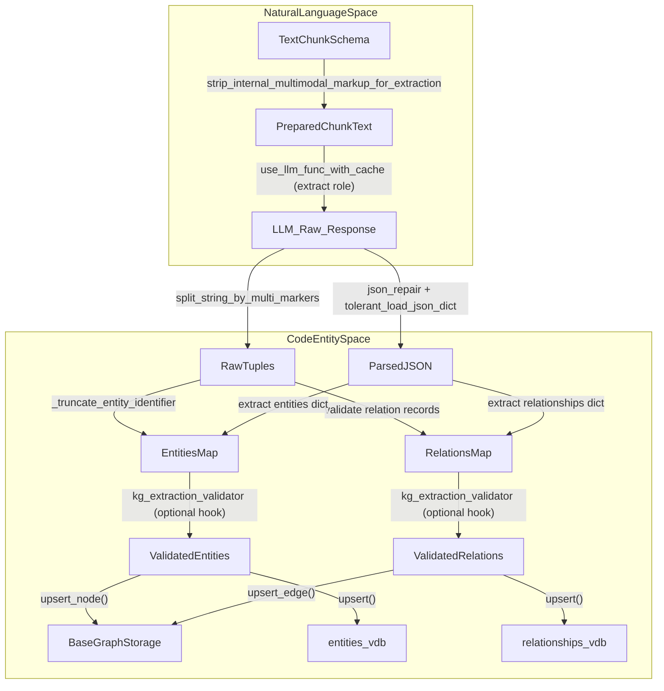
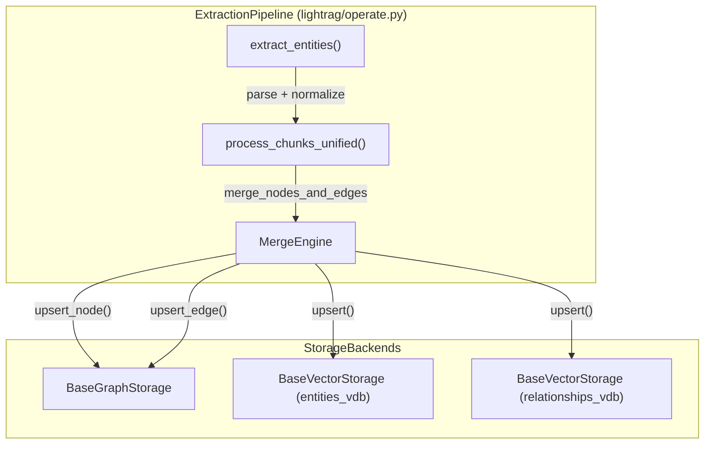
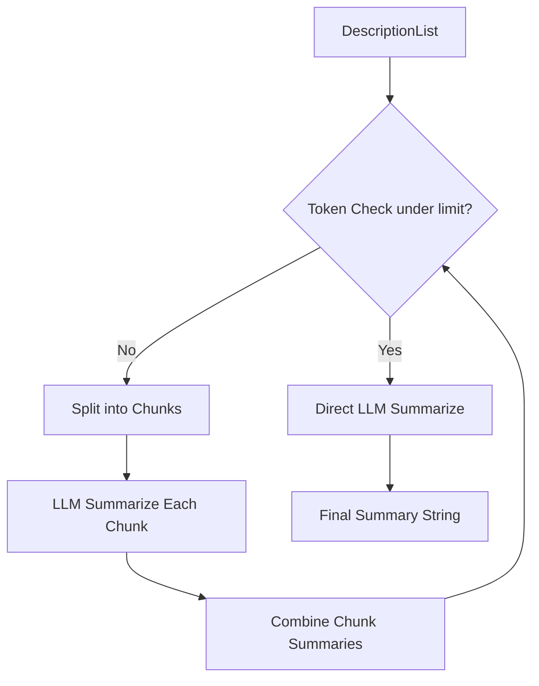

<!-- source: DeepWiki mcp.deepwiki.com · repo HKUDS/LightRAG · page 2.2 Entity and Relation Extraction · fetched 2026-11-09 -->

# Entity and Relation Extraction

Relevant source files

The following files were used as context for generating this wiki page:

- [docs/design/LatexEscapeRepairContract.md](docs/design/LatexEscapeRepairContract.md)
- [lightrag/chunk_schema.py](lightrag/chunk_schema.py)
- [lightrag/lightrag.py](lightrag/lightrag.py)
- [lightrag/llm/_vision_utils.py](lightrag/llm/_vision_utils.py)
- [lightrag/operate.py](lightrag/operate.py)
- [lightrag/prompt.py](lightrag/prompt.py)
- [lightrag/prompt_multimodal.py](lightrag/prompt_multimodal.py)
- [lightrag/utils.py](lightrag/utils.py)
- [prompts/samples/entity_type_prompt.sample.yml](prompts/samples/entity_type_prompt.sample.yml)
- [tests/extraction/test_entity_extraction_stability.py](tests/extraction/test_entity_extraction_stability.py)
- [tests/extraction/test_extract_cache_orphans.py](tests/extraction/test_extract_cache_orphans.py)
- [tests/extraction/test_keyword_prompt_template.py](tests/extraction/test_keyword_prompt_template.py)
- [tests/extraction/test_kg_extraction_validator.py](tests/extraction/test_kg_extraction_validator.py)
- [tests/llm/test_utils_llm_cache.py](tests/llm/test_utils_llm_cache.py)
- [tests/llm/test_vlm_json_escape_repair.py](tests/llm/test_vlm_json_escape_repair.py)
- [tests/utils/test_update_chunk_cache_list.py](tests/utils/test_update_chunk_cache_list.py)

Entity and Relation Extraction is the core stage of the LightRAG pipeline where unstructured text chunks are transformed into structured knowledge graph entities and relations. This process leverages Large Language Models (LLMs) via `extract_entities` [lightrag/operate.py:147-702]() to identify meaningful entities and their interconnections, which are subsequently indexed into the Knowledge Graph (KG) and Vector databases.

---

## Extraction Process Overview

The main orchestration of the extraction process is implemented in the `extract_entities` function located in `lightrag/operate.py` [lightrag/operate.py:147-702](). This function takes as input a dictionary of chunks (document fragments) and runs multi-stage extraction flows:

- **Primary extraction** of entities and relationships from chunk text using the `extract` LLM role.
- **Gleaning passes** (optional) that query the LLM for missed entities or relations, improving recall.
- **Token budget management** to avoid exceeding LLM context capacity (`DEFAULT_MAX_EXTRACT_INPUT_TOKENS`) [lightrag/constants.py:48-55]().
- **Parsing and validation** of LLM response, with support for both delimiter-separated tuples and JSON output (`json_repair`) [lightrag/operate.py:11-30]().
- **Extraction validation hook** (`kg_extraction_validator`) allowing custom per-chunk quality filtering before downstream persistence [tests/extraction/test_kg_extraction_validator.py:1-7]().
- **Data deduplication and normalization** before returning extraction results.

The outcome maps input text chunks into structured entity and relation records suitable for insertion into the knowledge graph backend.

---

### Data Flow: Natural Language to Code Entities

The entire flow from raw text chunks to final code-level data structures is outlined below:

- **TextChunkSchema**: Raw chunk dictionary representing the text to extract from [lightrag/base.py:68-72]().
- **PreparedChunkText**: Chunk content cleaned from multimodal markup and with optional section breadcrumb injected [lightrag/chunk_schema.py:13-16]().
- **LLM_Raw_Response**: Raw LLM output string (either delimiter-separated lines or JSON) [lightrag/operate.py:410-480]().
- **RawTuples**: Split tuple lines extracted by tokenized delimiter [lightrag/operate.py:450-470]().
- **ParsedJSON**: JSON-mode parsing result with explicit entities and relationship lists [lightrag/operate.py:525-580]().
- **EntitiesMap**, **RelationsMap**: Dicts mapping normalized entity/relation names to their extraction records [lightrag/operate.py:480-520]().
- **BaseGraphStorage**: Graph storage interface updated with extracted nodes and edges [lightrag/base.py:126-130]().
- **entities_vdb** and **relationships_vdb**: Vector DB upserts for embeddings on entities and relations.

Sources: [lightrag/operate.py:410-580](), [lightrag/chunk_schema.py:13-16](), [lightrag/base.py:68-130]()

---

## LLM-Driven Extraction

Extraction employs a specialized LLM role denoted as `extract`. The extraction LLM call is controlled via role-specific configuration available in the main class `LightRAG` [lightrag/lightrag.py:215-223]().

Extraction prompts adhere to strict templates defined in `lightrag/prompt.py`:

- The **`entity_extraction_system_prompt`** describes the extraction role as a Knowledge Graph Specialist and details the expected output record types (entity vs relation rows) and formatting rules [lightrag/prompt.py:56-102]().
- An optional **`entity_extraction_section_context`** snippet can inject section heading breadcrumb context into the prompt to help disambiguate entity semantics from chunk hierarchy [lightrag/prompt.py:51-54]().
- The **`default_entity_types_guidance`** provides a standard classification scheme prompting the LLM to label entity types among a fixed set (e.g., Person, Organization, Location, etc.) [lightrag/prompt.py:20-34]().

---

### Prompt Formatting and Output Modes

LightRAG supports two output formats from the LLM extraction:

1. **Delimiter-based extraction (default)**:  
   Entities and relations are output as lines each containing fields separated by a fixed atomic delimiter `DEFAULT_TUPLE_DELIMITER` (`<|#|>` by default) [lightrag/prompt.py:13-16](). This plain-text format requires post-processing to split and map tuple parts [lightrag/operate.py:450-460]().
   
2. **JSON format extraction (optional)**:  
   When `entity_extraction_use_json` is enabled, the LLM is instructed to produce a structured JSON object with separate `entities` and `relationships` arrays. The system runs `json_repair` on outputs to handle common escape errors in LLM JSON strings [lightrag/operate.py:11-30](). This mode provides more robust parsing but requires JSON-valid outputs from the LLM.

Sources: [lightrag/prompt.py:13-102](), [lightrag/operate.py:11-30]()

---

### Gleaning: Iterative Refinement Passes

To improve extraction recall, LightRAG optionally performs one or more gleaning passes controlled by the `entity_extract_max_gleaning` configuration (default `1`) [lightrag/constants.py:48-55]().

- Each gleaning pass re-queries the LLM with a summary of previously extracted entities and relationships, politely asking if anything was missed.
- This process respects input token limits: if the token budget estimate plus the appended gleaning prompt exceeds `DEFAULT_MAX_EXTRACT_INPUT_TOKENS` (e.g., 20480 tokens), gleaning is safely skipped to avoid LLM errors.
- Gleaning outputs are merged with initial extractions for final deduplicated results.

Sources: [lightrag/constants.py:48-55](), [lightrag/lightrag.py:215-223]()

---

## Implementation Details

### Core `extract_entities` Workflow

`extract_entities` is an asynchronous function taking:

- `chunks`: `dict[str, TextChunkSchema]` representing document chunks.
- `global_config`: dict of extraction config including LLM function for extraction.
- Optional `max_gleaning` and `max_records` value overrides.

Key algorithm steps:

1. **Normalize Input Chunks**  
   Each text chunk is cleaned with `strip_internal_multimodal_markup_for_extraction` to remove internal XML-like tags for tables, figures, equations etc. [lightrag/chunk_schema.py:13-16]().

2. **Breadcrumb Context Injection**  
   If chunk headings are available, breadcrumb context is constructed and truncated for token budget using `format_heading_context` and private `_truncate_section_context` [lightrag/chunk_schema.py:148-164](), [lightrag/operate.py:150-176]().

3. **Form Extraction Prompt**  
   For each chunk, build prompt with system prompt + extracted contextual blocks + chunk text + entity types guidance + delimiter instructions [lightrag/prompt.py:56-102]().

4. **LLM Invocation**  
   Calls configured extraction LLM function (`extract` role) via `use_llm_func_with_cache` with assembled prompt and concurrency controls [lightrag/utils.py:37-45]().  

5. **Parse Output**  
   - In delimiter mode, the output is split by `DEFAULT_COMPLETION_DELIMITER` and `DEFAULT_TUPLE_DELIMITER` into entity & relation tuples.  
   - In JSON mode, LLM output is repaired by `json_repair` and parsed into structured entities/relationships.  
   Validation and token truncation of entity IDs occur to ensure compatibility with storage limits [lightrag/operate.py:11-30]().  

6. **Gleaning Loop**  
   If enabled, one or more gleaning passes execute, merging new entities/relations with prior ones to improve completeness.

7. **Extraction Validation Hook**  
   If `kg_extraction_validator` is configured in `global_config`, the extracted entity and relation records are passed through this custom callback function before returning, enabling downstream application-level filtering [tests/extraction/test_kg_extraction_validator.py:1-7]().

8. **Return**  
   The function returns a list of `(EntitiesMap, RelationsMap)` pairs for each chunk, ready for merging into the KG.

Sources: [lightrag/operate.py:147-702](), [lightrag/chunk_schema.py:13-16](), [tests/extraction/test_kg_extraction_validator.py:1-105]()

---

### Pipeline Execution and Storage Interaction

The following diagram illustrates how extracted entities and relations flow from the extraction function into storage interfaces:

Sources: [lightrag/operate.py:147-702](), [lightrag/base.py:65-130]()

---

### Entity and Relation Identifier Truncation

Entities are truncated in length and byte width when generating IDs to avoid backend storage errors (e.g., Milvus key length limits):

- Character count truncated to `DEFAULT_ENTITY_NAME_MAX_LENGTH` (e.g., 256 chars) [lightrag/constants.py:97-98]().
- UTF-8 byte truncated to `DEFAULT_ENTITY_NAME_MAX_BYTES` (e.g., 512 bytes) [lightrag/constants.py:98-99]().
- This truncation happens during entity map construction.

This normalization ensures stable deduplication and graph storage compatibility [lightrag/operate.py:100-155]().

Sources: [lightrag/constants.py:97-99](), [lightrag/operate.py:100-155]()

---

### Map-Reduce Summarization of Entity and Relation Descriptions

The extraction and merging process can produce multiple textual descriptions for the same entity/relation. To consolidate these, LightRAG applies a Map-Reduce style summarization strategy in `_handle_entity_relation_summary` [lightrag/operate.py:210-280]():

- If the total token count of descriptions is under a small threshold, all combined texts are sent once to the `summary` LLM role for merging.
- For larger descriptions that exceed token limits, descriptions are chunked recursively:
  - **Map:** Split descriptions into token-budgeted parts and summarize each.
  - **Reduce:** Combine these summaries and recursively summarize until final condensed output.
- This approach manages LLM token constraints while producing a concise, merged description.

Sources: [lightrag/operate.py:210-280]()

---

## Summary of Key Constants for Extraction

| Constant                           | Default    | Description                                                       |
|----------------------------------|------------|-------------------------------------------------------------------|
| `DEFAULT_MAX_GLEANING`            | `1`        | Maximum iterative gleaning passes for recall enhancement.        |
| `DEFAULT_MAX_EXTRACTION_RECORDS`  | `100`      | Max total rows (entities + relations) returned in one LLM output. |
| `DEFAULT_MAX_EXTRACTION_ENTITIES` | `40`       | Max number of entity rows in a single LLM extraction response.    |
| `DEFAULT_ENTITY_NAME_MAX_LENGTH`  | `256`      | Max characters allowed for entity/relation names in storage.      |
| `DEFAULT_ENTITY_NAME_MAX_BYTES`   | `512`      | Max bytes UTF-8 encoded for entity/relation names.                |
| `DEFAULT_TUPLE_DELIMITER`         | `<|#|>`    | Delimiter string used to separate tuple fields in text mode.      |
| `DEFAULT_COMPLETION_DELIMITER`    | `<|COMPLETE|>` | Delimiter string indicating end of extraction output.          |
| `DEFAULT_MAX_EXTRACT_INPUT_TOKENS`| `20480`    | Token limit for LLM prompt inputs to avoid context overflow.      |

Sources: [lightrag/constants.py:48-55](), [lightrag/operate.py:50-100](), [lightrag/prompt.py:13-16]()

---

## Additional Details: LaTeX Escape Repair

LLM outputs containing LaTeX commands inside JSON strings may incur escape character corruption due to under-escaping backslashes (e.g., `"\frac"` is parsed as invalid JSON) [docs/design/LatexEscapeRepairContract.md:7-12]().

LightRAG uses a robust repair mechanism `repair_vlm_json_escape_damage_nested` to detect and correct such malformed escapes, preserving valid LaTeX in JSON extraction results [lightrag/utils.py:20-60](). The design contract and rules governing whitelist patterns (`_WS_LATEX_RESIDUES`, `_WS_LATEX_SUSPECT_PATTERN`, `_WS_LATEX_MATH_PATTERN`) are fully documented under `docs/design/LatexEscapeRepairContract.md` [docs/design/LatexEscapeRepairContract.md:1-128]().

Regression tests for this repair are present in the test suite `tests/llm/test_vlm_json_escape_repair.py` [tests/llm/test_vlm_json_escape_repair.py:1-35]().

Sources: [lightrag/utils.py:20-60](), [docs/design/LatexEscapeRepairContract.md:1-128](), [tests/llm/test_vlm_json_escape_repair.py:1-35]()

---

# Summary

The **Entity and Relation Extraction** subsystem is critical for converting free text chunks into structured KG data. It uses configurable LLM-driven methods with:

- Comprehensive prompt templates ensuring consistent entity typing and relationship extraction.
- Robust handling of delimiter-separated and JSON LLM outputs, including error repair.
- Multi-pass gleaning and map-reduce summarization to improve recall and data quality.
- Proper token budgeting, custom extraction validation hooks, and ID truncation to maintain backend compatibility.

Together, these mechanisms enable effective and scalable extraction of structured knowledge from diverse text content.

---

# Sources

- [lightrag/operate.py:147-702]()
- [lightrag/lightrag.py:215-223]()
- [lightrag/prompt.py:13-102]()
- [lightrag/chunk_schema.py:13-16]()
- [lightrag/base.py:65-130]()
- [lightrag/constants.py:48-55]()
- [lightrag/utils.py:20-60]()
- [docs/design/LatexEscapeRepairContract.md:1-128]()
- [tests/llm/test_vlm_json_escape_repair.py:1-35]()
- [tests/extraction/test_kg_extraction_validator.py:1-105]()

---

