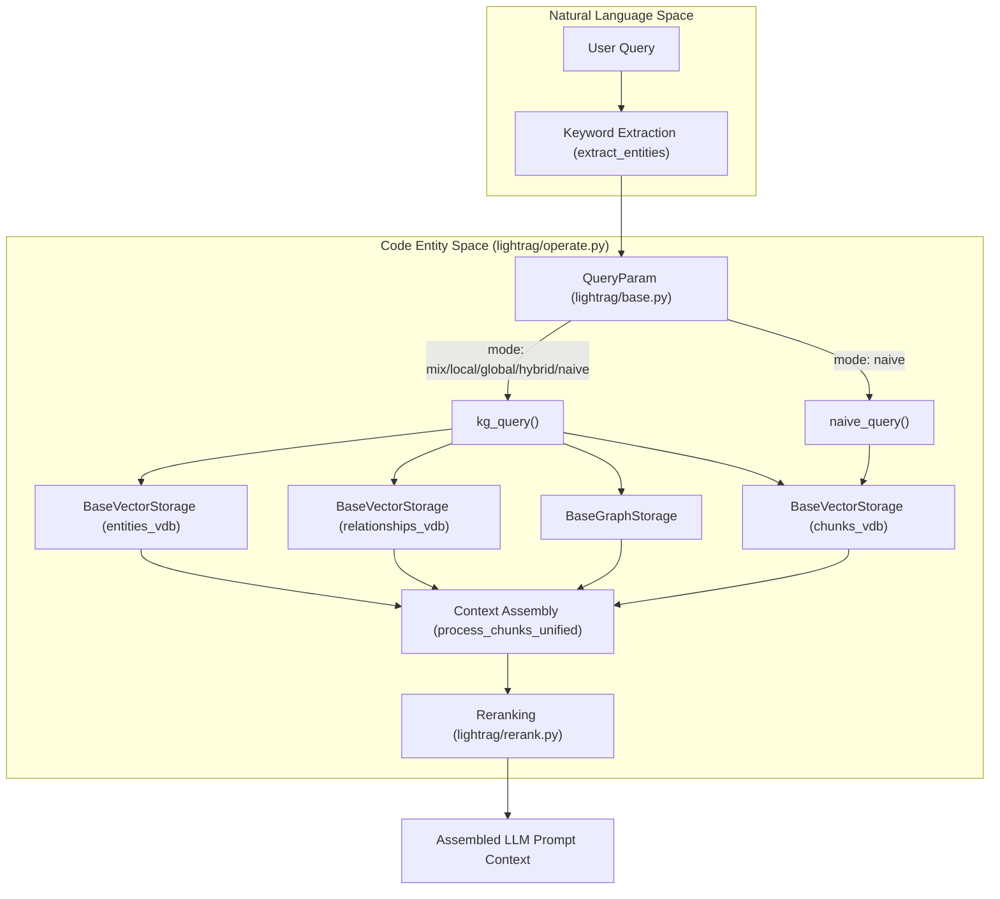
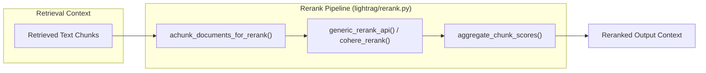

<!-- source: DeepWiki mcp.deepwiki.com · repo HKUDS/LightRAG · page 2.3 Retrieval and Query Modes · fetched 2026-11-09 -->

# Retrieval and Query Modes

Relevant source files

The following files were used as context for generating this wiki page:

- [docs/design/LatexEscapeRepairContract.md](docs/design/LatexEscapeRepairContract.md)
- [examples/rerank_example.py](examples/rerank_example.py)
- [lightrag/api/input_limits.py](lightrag/api/input_limits.py)
- [lightrag/lightrag.py](lightrag/lightrag.py)
- [lightrag/operate.py](lightrag/operate.py)
- [lightrag/prompt.py](lightrag/prompt.py)
- [lightrag/query_validation.py](lightrag/query_validation.py)
- [lightrag/rerank.py](lightrag/rerank.py)
- [lightrag/utils.py](lightrag/utils.py)
- [lightrag_webui/src/utils/queryValidation.test.ts](lightrag_webui/src/utils/queryValidation.test.ts)
- [lightrag_webui/src/utils/queryValidation.ts](lightrag_webui/src/utils/queryValidation.ts)
- [tests/api/routes/test_ollama_input_limits.py](tests/api/routes/test_ollama_input_limits.py)
- [tests/chunker/test_rerank_chunking.py](tests/chunker/test_rerank_chunking.py)
- [tests/llm/test_vlm_json_escape_repair.py](tests/llm/test_vlm_json_escape_repair.py)
- [tests/test_query_validation.py](tests/test_query_validation.py)

The retrieval and query subsystem in LightRAG bridges structured Knowledge Graph (KG) data with unstructured vector embeddings, providing context-aware information retrieval. This page documents the technical implementation of query modes (`local`, `global`, `hybrid`, `mix`, `naive`, `bypass`), LLM-driven keyword extraction, token budget enforcement, context assembly, chunk reranking, and query validation.

---

## 1. Retrieval Architecture and `QueryParam`

The core retrieval pipeline is driven by `kg_query` and `naive_query` defined in `lightrag/operate.py` [lightrag/operate.py:140-151](). Configuration options are encapsulated in the `QueryParam` dataclass defined in `lightrag/base.py` [lightrag/base.py:133](), which controls retrieval mode, token ceilings, search limits, and reranking flags.

### Natural Language to Code Entity Mapping

The following diagram maps user interaction from natural language input to internal LightRAG storage and execution primitives.

**Diagram: Natural Language to Retrieval Code Entities**

Sources: [lightrag/operate.py:140-152](), [lightrag/base.py:133](), [lightrag/rerank.py:3-140]()

---

## 2. Query Modes in Detail

LightRAG supports multiple retrieval modes via the `QueryParam.mode` attribute. Each mode governs how graph structures and vector indices are traversed.

| Mode | Description | Retrieval Strategy | Implementation |
| :--- | :--- | :--- | :--- |
| `local` | Focuses on context-dependent data around specific entities. | Vector search on entities, 1-hop graph expansion, and associated chunk retrieval. | `kg_query` local branch [lightrag/operate.py:1213-1240]() |
| `global` | Focuses on broad graph relationships and high-level summaries. | Searches relationship vectors and global summaries using abstract keywords. | `kg_query` global branch [lightrag/operate.py:1242-1253]() |
| `hybrid` | Combines local and global retrieval pathways. | Executes local and global graph paths concurrently, merging results. | `kg_query` hybrid branch [lightrag/operate.py:1255-1270]() |
| `mix` | Merges KG retrieval with raw vector chunk search. | Combines KG entity/relation context with direct keyword vector search on raw chunks. | `kg_query` mix branch [lightrag/operate.py:1272-1288]() |
| `naive` | Traditional vector search without knowledge graph structures. | Bypasses graph storage, executing vector similarity directly over text chunks. | `naive_query` [lightrag/operate.py:148-150]() |
| `bypass` | Direct LLM prompting without retrieval. | Skips storage lookups entirely, passing the prompt string straight to the LLM. | Handled via API routing [lightrag/base.py:133]() |

Sources: [lightrag/base.py:133](), [lightrag/operate.py:148-151]()

---

## 3. Keyword Extraction

Before querying vector or graph stores, LightRAG extracts low-level and high-level keywords from the user prompt. This is performed using LLM bindings with prompt templates defined in `lightrag/prompt.py` [lightrag/prompt.py:56-102](). The extracted terms serve as query vectors for semantic matching against `entities_vdb`, `relationships_vdb`, and `chunks_vdb`.

Sources: [lightrag/prompt.py:56-102](), [lightrag/operate.py:140-152]()

---

## 4. Token Budgeting and Context Assembly

To prevent context window overflow while maximizing semantic relevance, LightRAG enforces strict token limits during context aggregation.

### Key Token Budget Parameters

- `max_entity_tokens`: Ceiling for entity description contexts (default: `DEFAULT_MAX_ENTITY_TOKENS`, 1000).
- `max_relation_tokens`: Ceiling for relationship text contexts (default: `DEFAULT_MAX_RELATION_TOKENS`, 1000).
- `max_total_tokens`: Total token budget allowed across all retrieved context components (default: `DEFAULT_MAX_TOTAL_TOKENS`, 4000).

During assembly, retrieved lists are truncated dynamically using helper utilities such as `atruncate_list_by_token_size` [lightrag/operate.py:33]() to ensure items fit within these boundaries.

Sources: [lightrag/operate.py:25-34](), [lightrag/constants.py:55-57]()

---

## 5. Reranking Pipeline

If `enable_rerank=True` is set in `QueryParam`, candidate chunks pass through a reranking layer implemented in `lightrag/rerank.py`.

### Key Functions
- `chunk_documents_for_rerank`: Splits oversized documents into overlapping, token-limited windows (`DEFAULT_RERANK_MAX_TOKENS_PER_DOC = 4096`) [lightrag/rerank.py:36-41]().
- `achunk_documents_for_rerank`: Asynchronous wrapper executing document chunking inside a tokenizer executor [lightrag/rerank.py:142-162]().
- `aggregate_chunk_scores`: Aggregates chunk-level relevance scores back to parent documents using strategies like `max`, `mean`, or `first` [lightrag/rerank.py:165-178]().

**Diagram: Reranking Data Flow to Code Entities**

Sources: [lightrag/rerank.py:36-178]()

---

## 6. Query Validation and Multilingual Weighting

LightRAG validates queries before executing retrieval via functions in `lightrag/query_validation.py` [lightrag/query_validation.py:1-136]().

### Validation Rules
- `validate_query_not_empty`: Strips whitespace and raises `EmptyQueryError` if the query is blank [lightrag/query_validation.py:117-127]().
- `validate_rag_query`: Asserts that queries meet a minimum English-equivalent length threshold (`MIN_RAG_QUERY_WEIGHT = 3`), raising `RAGQueryTooShortError` otherwise [lightrag/query_validation.py:6-136]().

### East Asian Character Weighting
To ensure fair length validation across different writing systems, CJK characters are assigned a weight of `2`, while standard alphabetic characters count as `1`. This is computed efficiently via `rag_query_weight` and short-circuited via `meets_min_rag_query_weight` [lightrag/query_validation.py:81-114](). The frontend implementation mirrors this logic in `lightrag_webui/src/utils/queryValidation.ts` [lightrag_webui/src/utils/queryValidation.ts:1-71]().

Sources: [lightrag/query_validation.py:1-136](), [lightrag_webui/src/utils/queryValidation.ts:1-71]()

---

