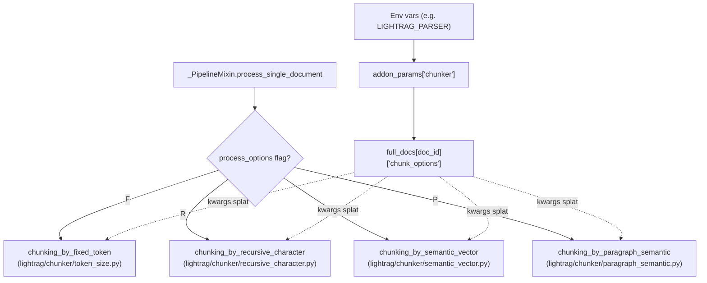
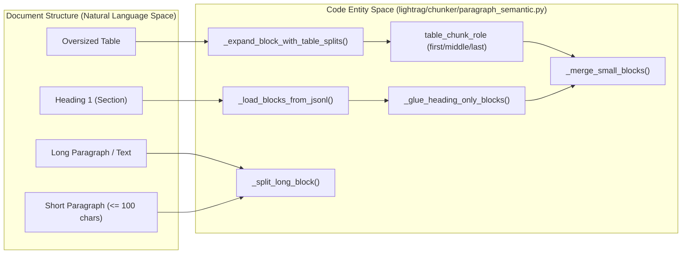
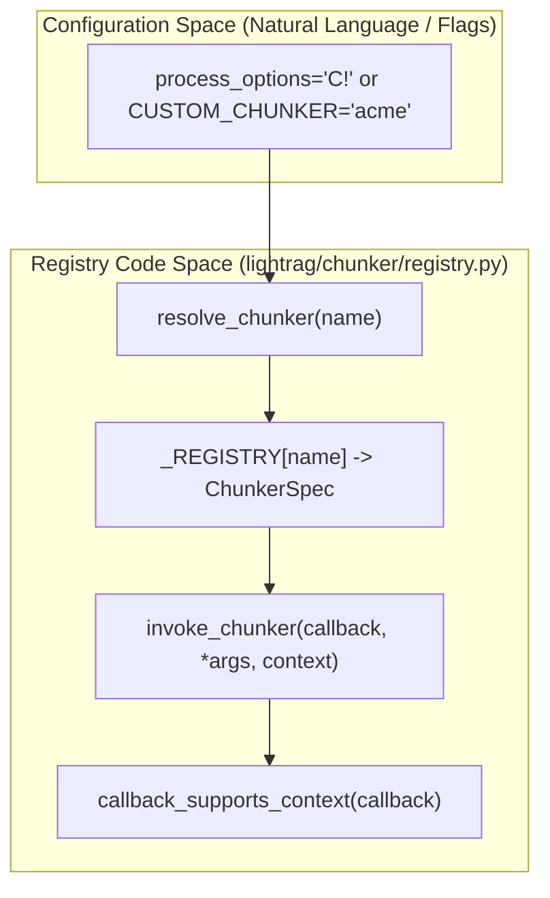

<!-- source: DeepWiki mcp.deepwiki.com · repo HKUDS/LightRAG · page 2.4 Text Chunking Strategies · fetched 2026-11-09 -->

# Text Chunking Strategies

Relevant source files

The following files were used as context for generating this wiki page:

- [docs/ParagraphSemanticChunking-zh.md](docs/ParagraphSemanticChunking-zh.md)
- [docs/ParagraphSemanticChunking.md](docs/ParagraphSemanticChunking.md)
- [docs/ThirdPartyChunker-zh.md](docs/ThirdPartyChunker-zh.md)
- [docs/ThirdPartyChunker.md](docs/ThirdPartyChunker.md)
- [lightrag/chunker/__init__.py](lightrag/chunker/__init__.py)
- [lightrag/chunker/paragraph_semantic.py](lightrag/chunker/paragraph_semantic.py)
- [lightrag/chunker/recursive_character.py](lightrag/chunker/recursive_character.py)
- [lightrag/chunker/registry.py](lightrag/chunker/registry.py)
- [lightrag/chunker/semantic_vector.py](lightrag/chunker/semantic_vector.py)
- [lightrag/chunker/token_size.py](lightrag/chunker/token_size.py)
- [lightrag/sidecar/__init__.py](lightrag/sidecar/__init__.py)
- [lightrag/sidecar/backfill.py](lightrag/sidecar/backfill.py)
- [lightrag/table_markup.py](lightrag/table_markup.py)
- [tests/chunker/test_chunker_recursive_character.py](tests/chunker/test_chunker_recursive_character.py)
- [tests/chunker/test_chunker_semantic_vector.py](tests/chunker/test_chunker_semantic_vector.py)
- [tests/chunker/test_chunking.py](tests/chunker/test_chunking.py)
- [tests/chunker/test_paragraph_semantic_drop_references.py](tests/chunker/test_paragraph_semantic_drop_references.py)
- [tests/chunker/test_paragraph_semantic_merge_and_fallback.py](tests/chunker/test_paragraph_semantic_merge_and_fallback.py)
- [tests/chunker/test_paragraph_semantic_split_long_block.py](tests/chunker/test_paragraph_semantic_split_long_block.py)
- [tests/chunker/test_paragraph_semantic_table_split.py](tests/chunker/test_paragraph_semantic_table_split.py)
- [tests/chunker/test_recursive_character_bounds.py](tests/chunker/test_recursive_character_bounds.py)
- [tests/chunker/test_registry.py](tests/chunker/test_registry.py)
- [tests/chunker/test_sidecar_backfill_integration.py](tests/chunker/test_sidecar_backfill_integration.py)
- [tests/chunker/test_token_window_source_span.py](tests/chunker/test_token_window_source_span.py)
- [tests/pipeline/test_custom_chunking_selector.py](tests/pipeline/test_custom_chunking_selector.py)
- [tests/sidecar/test_backfill.py](tests/sidecar/test_backfill.py)

LightRAG employs a multi-strategy chunking architecture designed to balance semantic integrity with strict token constraints. The system provides a flexible, per-document strategy dispatcher driven by `process_options` flags and custom registry integrations [lightrag/chunker/__init__.py:1-48](). This page details the available chunking strategies, selection mechanisms, API contracts, the chunker registry, and the underlying pipeline implementations.

---

## Overview of Chunking Strategies and Selection

LightRAG supports four primary chunking strategies, selected via `process_options` flags or environment variables like `LIGHTRAG_PARSER` [lightrag/chunker/__init__.py:1-48](). Each strategy fits different input types and goals:

| Flag | Strategy | Mechanism & Behavior | Best Suited For |
|---|---|---|---|
| **F** | Fixed Token Chunking | Splits text into fixed-size token windows, allowing overlap; optionally splits on delimiter characters [lightrag/chunker/token_size.py:1-148](). | Plain text, log files, and simple documents |
| **R** | Recursive Character | Uses recursive splitting by cascading separators (`\n\n` → `\n` → punctuation → space) and recursively splits oversized chunks [lightrag/chunker/recursive_character.py:1-35](). | Markdown, code, unstructured text |
| **V** | Semantic Vector | Splits by sentence embeddings and semantic cosine distance breakpoints using asynchronous embedding providers [lightrag/chunker/semantic_vector.py:1-30](). | Prose with shifting topics and semantic coherence |
| **P** | Paragraph Semantic | Leverages heading hierarchies, block boundaries, and preserves table integrity using `.blocks.jsonl` sidecars [lightrag/chunker/paragraph_semantic.py:1-47](). | Structured DOCX/PDF with tables and nested headings |

### Strategy Selection and Data Flow

Sources: `[lightrag/chunker/__init__.py:1-48]()`, `[lightrag/chunker/token_size.py:1-148]()`, `[lightrag/chunker/recursive_character.py:1-35]`, `[lightrag/chunker/semantic_vector.py:1-30]()`, `[lightrag/chunker/paragraph_semantic.py:1-47]()`

---

## Dual API Contracts for Chunkers

LightRAG supports two chunker API contracts to ensure backward compatibility while enabling rich context-aware extensions:

1. **Legacy Contract:** Six positional arguments—`tokenizer, content, split_by_character, split_by_character_only, chunk_overlap_token_size, chunk_token_size`. Used by older code and when `process_options` do not designate a chunker explicitly [lightrag/chunker/__init__.py:10-25]().
2. **File-Chunker Contract:** Standardized signature for strategy chunkers with explicit keyword arguments for chunk sizes and options, plus optional `context` metadata [lightrag/chunker/__init__.py:15-30]().

For context-aware chunk functions, the `@accepts_chunking_context` decorator marks a callback to receive a `context=ChunkingContext` keyword argument [lightrag/chunker/registry.py:38-66](). `ChunkingContext` exposes document metadata such as `doc_id`, `file_path`, `sidecar_location`, and `process_options` [lightrag/chunker/registry.py:38-54]().

Sources: `[lightrag/chunker/__init__.py:10-30]()`, `[lightrag/chunker/registry.py:38-66]()`

---

## Detailed Strategy Implementations

### 1. Fixed Token Chunker (F)
Implemented in `lightrag/chunker/token_size.py`, `chunking_by_fixed_token()` and `chunking_by_token_size()` divide text into windows of at most `chunk_token_size` with `chunk_overlap_token_size` overlap [lightrag/chunker/token_size.py:1-148](). When `split_by_character` is provided, the text is first segmented on that delimiter before token-windowing [lightrag/chunker/token_size.py:133-170]().

Sources: `[lightrag/chunker/token_size.py:1-170]()`

### 2. Recursive Character Chunker (R)
Wrapped around LangChain's `RecursiveCharacterTextSplitter`, `chunking_by_recursive_character` cascades through separators (`\n\n`, `\n`, punctuation, space, character) [lightrag/chunker/recursive_character.py:1-35](). It uses LightRAG's `Tokenizer` for accurate token counting and records exact source character spans (`_source_span`) for sidecar backfilling [lightrag/chunker/recursive_character.py:1-25](), [lightrag/chunker/recursive_character.py:100-136]().

Sources: `[lightrag/chunker/recursive_character.py:1-136]()`

### 3. Semantic Vector Chunker (V)
Implemented in `lightrag/chunker/semantic_vector.py`, `chunking_by_semantic_vector` relies on `langchain_experimental`'s `SemanticChunker` to segment text by sentence-level embedding distance thresholds [lightrag/chunker/semantic_vector.py:1-30](). Because embedding functions in LightRAG are asynchronous, `_AsyncEmbeddingFuncAdapter` bridges sync LangChain calls back to the async event loop via worker threads, handling batching and concurrency limits [lightrag/chunker/semantic_vector.py:97-155]().

Sources: `[lightrag/chunker/semantic_vector.py:1-155]()`

### 4. Paragraph Semantic Chunker (P)
The most structured strategy, `chunking_by_paragraph_semantic` targets documents with clear sectional hierarchies and tables (DOCX, PDF) [lightrag/chunker/paragraph_semantic.py:1-47](), [docs/ParagraphSemanticChunking.md:1-17](). It requires a `.blocks.jsonl` sidecar produced by parsers such as `native`, `mineru`, or `docling` [lightrag/chunker/paragraph_semantic.py:1-17]()

#### Natural Language Structure to Code Mapping: P Strategy

Sources: `[lightrag/chunker/paragraph_semantic.py:1-47]`, `[docs/ParagraphSemanticChunking.md:1-62]()`

---

## Chunker Registry and Third-Party Plugins

LightRAG maintains a closed set of built-in chunker aliases (`fixed_token`, `recursive_character`, `semantic_vector`, `paragraph_semantic`, plus short codes `f`, `r`, `v`, `p`, `c`) [lightrag/chunker/registry.py:22-34](). 

Third-party implementations register through `register_chunker()` by passing a `ChunkerSpec` dataclass [lightrag/chunker/registry.py:99-149](). The registry enforces lazy imports, preventing implementation loading during initial application startup until explicit selection [lightrag/chunker/registry.py:1-5](), [lightrag/chunker/registry.py:149-182]().

#### Natural Language Selection to Chunker Registry Mapping

Sources: `[lightrag/chunker/registry.py:1-96]`, `[lightrag/chunker/registry.py:99-182]()`

---

## Sidecar Backfilling and Metadata Preservation

For chunkers (`F`, `R`, `V`) that do not natively emit hierarchical block metadata, LightRAG applies sidecar backfilling [lightrag/sidecar/backfill.py:1-20](). Each generated chunk is matched against the original `.blocks.jsonl` lines using exact character spans (`_source_span`), attaching parent headings, outline levels, and source provenance to the chunks prior to downstream vector and graph ingestion [lightrag/sidecar/backfill.py:1-20]().

Sources: `[lightrag/sidecar/backfill.py:1-20]()`

---

