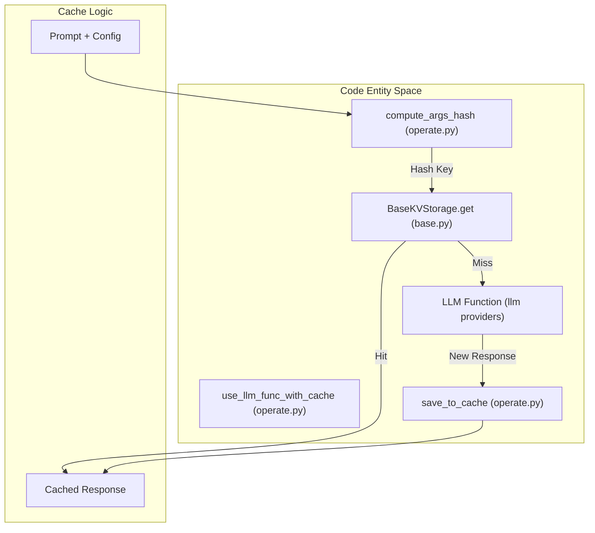
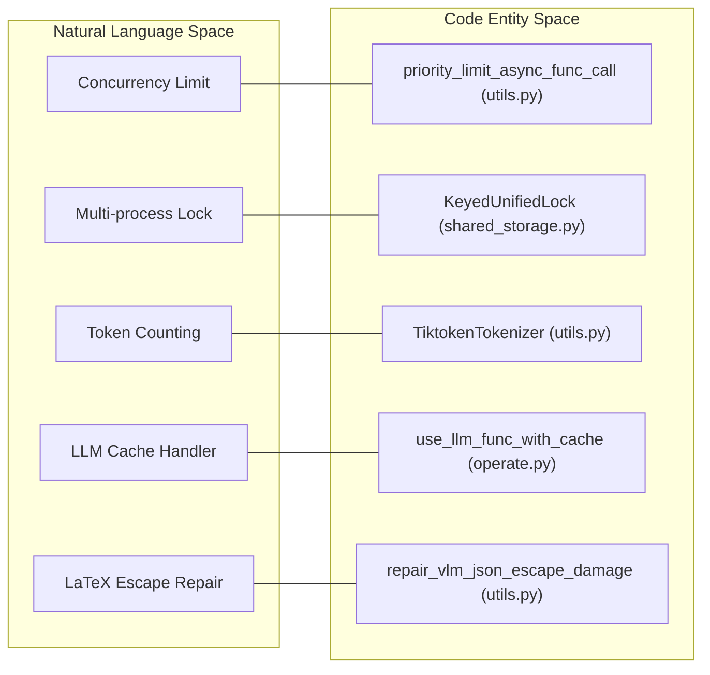

<!-- source: DeepWiki mcp.deepwiki.com · repo HKUDS/LightRAG · page 2.5 Concurrency, Caching, and Utilities · fetched 2026-11-09 -->

# Concurrency, Caching, and Utilities

<details>
<summary>Relevant source files</summary>

The following files were used as context for generating this wiki page:

- [docs/design/LatexEscapeRepairContract.md](docs/design/LatexEscapeRepairContract.md)
- [lightrag/file_atomic.py](lightrag/file_atomic.py)
- [lightrag/kg/write_seq.py](lightrag/kg/write_seq.py)
- [lightrag/lightrag.py](lightrag/lightrag.py)
- [lightrag/operate.py](lightrag/operate.py)
- [lightrag/prompt.py](lightrag/prompt.py)
- [lightrag/utils.py](lightrag/utils.py)
- [tests/api/routes/test_document_status_truncation_metadata.py](tests/api/routes/test_document_status_truncation_metadata.py)
- [tests/extraction/test_pipeline_log_delock.py](tests/extraction/test_pipeline_log_delock.py)
- [tests/extraction/test_truncation_reporting.py](tests/extraction/test_truncation_reporting.py)
- [tests/kg/faiss_impl/test_faiss_deferred_delete.py](tests/kg/faiss_impl/test_faiss_deferred_delete.py)
- [tests/kg/faiss_impl/test_faiss_deferred_embedding.py](tests/kg/faiss_impl/test_faiss_deferred_embedding.py)
- [tests/kg/faiss_impl/test_faiss_write_off_event_loop.py](tests/kg/faiss_impl/test_faiss_write_off_event_loop.py)
- [tests/kg/nano_impl/test_nano_deferred_delete.py](tests/kg/nano_impl/test_nano_deferred_delete.py)
- [tests/kg/nano_impl/test_nano_deferred_embedding.py](tests/kg/nano_impl/test_nano_deferred_embedding.py)
- [tests/kg/nano_impl/test_nano_save_off_event_loop.py](tests/kg/nano_impl/test_nano_save_off_event_loop.py)
- [tests/kg/test_file_atomic.py](tests/kg/test_file_atomic.py)
- [tests/kg/test_pipeline_status_logger.py](tests/kg/test_pipeline_status_logger.py)
- [tests/kg/test_write_seq.py](tests/kg/test_write_seq.py)
- [tests/llm/test_vlm_json_escape_repair.py](tests/llm/test_vlm_json_escape_repair.py)
- [tests/pipeline/test_custom_chunk_patch.py](tests/pipeline/test_custom_chunk_patch.py)
- [tests/pipeline/test_custom_chunk_rollback.py](tests/pipeline/test_custom_chunk_rollback.py)
- [tests/pipeline/test_doc_status_chunk_preservation.py](tests/pipeline/test_doc_status_chunk_preservation.py)
- [tests/pipeline/test_truncation_doc_status_metadata.py](tests/pipeline/test_truncation_doc_status_metadata.py)
- [tests/utils/test_truncation_tally.py](tests/utils/test_truncation_tally.py)

</details>


This page details the internal mechanisms LightRAG uses to manage asynchronous execution, ensure data consistency across processes, optimize LLM interactions through caching, perform atomic file operations, and provide robust utility functions for text normalization, JSON sanitization, and LaTeX escape damage repair.

---

## Asynchronous Execution and Concurrency Control

LightRAG leverages Python's `asyncio` for non-blocking I/O and coordinates concurrent invocations of expensive functions such as LLM completions or vector database operations. It employs throttling, cooperative scheduling, synchronization primitives, and process-level coordination to maintain responsiveness and resource limits.

### Priority-Limited Async Calls

The core concurrency control mechanism is the `priority_limit_async_func_call` function, which wraps asynchronous callable objects enforcing concurrency limits with priority awareness [lightrag/utils.py:188-197]().

- **Implementation Details:**
  - Provides a decorator/wrapper construction that enforces maximum concurrency based on semaphores keyed by concurrency group names.
  - Supports priority queues where higher priority calls preempt if slots are saturated.
  - Integrates optional timeout enforcement to ensure tasks do not stall indefinitely.
- **Use Cases:**
  - Rate limiting calls to LLM providers such as OpenAI or Ollama.
  - Throttling internal async workers that use limited resources.
- **Key Elements:**
  - `DEFAULT_MAX_ASYNC` constant defines the global default concurrency limit [lightrag/lightrag.py:67-75]().
  - `priority_limit_async_func_call` returns a wrapped async function respecting concurrency gating [lightrag/utils.py:188-197]().

Sources: [lightrag/utils.py:188-197](), [lightrag/lightrag.py:67-75]()

---

### Cooperative Yielding

To maintain event loop fairness during long-running synchronous or CPU-bound operations, LightRAG uses cooperative yielding via `_cooperative_yield()` [lightrag/operate.py:60-61]():

```python
async def _cooperative_yield():
    await asyncio.sleep(0)
```

- Called periodically during document parsing, graph merges, and heavy tasks to allow other async tasks to proceed.
- Avoids starvation of I/O, cancellation, or progress reporting tasks.

Sources: [lightrag/operate.py:60-61]()

---

### Multi-Process Synchronization and Locks

In multi-worker deployments, LightRAG synchronizes storage and stages across processes using unified locking constructs:

| Class / Function | Purpose | Reference |
|------------------|---------|-----------|
| `UnifiedLock` | Unified interface to `asyncio.Lock` and `multiprocessing.Lock` with async context manager | [lightrag/kg/shared_storage.py:146-163]() |
| `KeyedUnifiedLock` | Manages string-keyed locks for fine-grained entity or namespace synchronization | [lightrag/kg/shared_storage.py:91-115]() |
| `get_namespace_lock` | Provides namespace-scoped locking protecting entire logical namespaces during critical ops | [lightrag/kg/shared_storage.py:90-90]() |

Sources: [lightrag/kg/shared_storage.py:90-115](), [lightrag/kg/shared_storage.py:146-163]()

---

## Health Checks, Exceptions, and Worker Recovery

### Safe VDB Operations with Retries and Timeouts

To avoid indefinite stalls from vector database (VDB) operations involving remote I/O or embedding calls, LightRAG uses `safe_vdb_operation_with_exception` [lightrag/utils.py:156-209]().

- Enforces maximum retries, delays between attempts, and per-invocation timeouts.
- Logs warnings for slow or retried operations for operational awareness.

Sources: [lightrag/utils.py:156-209](), [lightrag/operate.py:184-192]()

---

### Custom Exceptions and Pipeline Fault Handling

LightRAG defines domain-specific exceptions to handle operational errors cleanly:
- `IndexFlushError`: Raised when flushing index changes or vector buffers fails [lightrag/exceptions.py:174-174]().
- `AdminWriteGateRefusedError` and `AdminWriteHoldExceededError`: Manage admin-level write locks and pipeline congestion [lightrag/exceptions.py:172-173]().
- `PipelineCancelledException`: Propagates cancellation signals cleanly through multi-stage ingestion tasks [lightrag/operate.py:17-17]().

Sources: [lightrag/exceptions.py:172-179](), [lightrag/operate.py:15-18]()

---

## LLM Response Caching

To optimize calls to LLMs and reduce cost/latency, LightRAG caches responses of LLM completions in its KV storage.

### Flattened Key Scheme and Data Flow

- Unique cache keys are computed by hashing a canonical representation of the LLM provider, model, parameters, and prompt input using `get_llm_cache_identity` and `compute_args_hash` [lightrag/operate.py:44-45]().
- The `use_llm_func_with_cache` function mediates cache lookup, API fallback, and storage insertion [lightrag/operate.py:42-42]().



Sources: [lightrag/operate.py:26-45](), [lightrag/base.py:161-193]()

---

## Utilities, Atomic File Writes, and LaTeX Repair

### Atomic File Writes

To prevent index corruption and split-brain metadata states (such as `index > meta` on-disk skew during crashes), file operations across storage backends utilize atomic file write patterns (e.g., temporary file staging followed by an atomic `os.replace` rename). This guarantees that partially written indices or configuration files are never exposed to readers.

Sources: [tests/kg/faiss_impl/test_faiss_deferred_embedding.py:14-17]()

---

### LaTeX Escape Damage Repair for VLM Responses

Models writing LaTeX inside JSON strings routinely under-escape backslashes (e.g., emitting `\frac` as a form feed character followed by `rac`). LightRAG includes `repair_vlm_json_escape_damage` in `utils.py` to restore these zero-risk escape sequences and handle whitespace-class LaTeX damage inside dollar math spans safely [tests/llm/test_vlm_json_escape_repair.py:1-14]().

Sources: [tests/llm/test_vlm_json_escape_repair.py:1-25](), [docs/design/LatexEscapeRepairContract.md:1-12]()

---

## Natural Language Utility Concepts to Code Entities Mapping



Sources: [lightrag/utils.py:184-197](), [lightrag/kg/shared_storage.py:91-115](), [lightrag/operate.py:42-42]()

---

# Summary

This section covered LightRAG's concurrency throttles, multi-process locking primitives, exception models, LLM response caching workflows, atomic file operations, and text/LaTeX sanitization utilities.

---

## Sources

- [lightrag/utils.py:156-209, 188-197]()
- [lightrag/lightrag.py:67-75]()
- [lightrag/operate.py:15-18, 42-45, 60-61]()
- [lightrag/kg/shared_storage.py:90-115, 146-163]()
- [lightrag/base.py:161-193]()
- [lightrag/exceptions.py:172-179]()
- [tests/llm/test_vlm_json_escape_repair.py:1-25]()
- [docs/design/LatexEscapeRepairContract.md:1-12]()
- [tests/kg/faiss_impl/test_faiss_deferred_embedding.py:14-17]()

---

