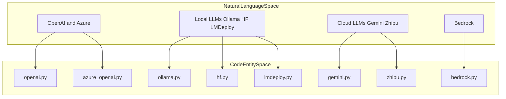
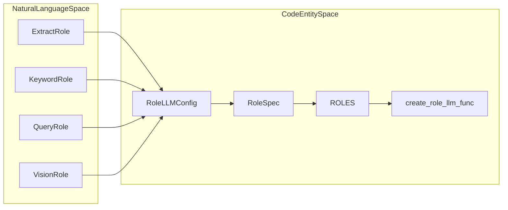

<!-- source: DeepWiki mcp.deepwiki.com · repo HKUDS/LightRAG · page 3 LLM and Embedding Providers · fetched 2026-11-09 -->

# LLM and Embedding Providers

Relevant source files

The following files were used as context for generating this wiki page:

- [lightrag/llm/azure_openai.py](lightrag/llm/azure_openai.py)
- [lightrag/llm/bedrock.py](lightrag/llm/bedrock.py)
- [lightrag/llm/gemini.py](lightrag/llm/gemini.py)
- [lightrag/llm/hf.py](lightrag/llm/hf.py)
- [lightrag/llm/lmdeploy.py](lightrag/llm/lmdeploy.py)
- [lightrag/llm/lollms.py](lightrag/llm/lollms.py)
- [lightrag/llm/ollama.py](lightrag/llm/ollama.py)
- [lightrag/llm/openai.py](lightrag/llm/openai.py)
- [lightrag/llm/zhipu.py](lightrag/llm/zhipu.py)
- [tests/llm/hf_impl/test_hf_model_if_cache_device_placement.py](tests/llm/hf_impl/test_hf_model_if_cache_device_placement.py)
- [tests/llm/lmdeploy_impl/__init__.py](tests/llm/lmdeploy_impl/__init__.py)
- [tests/llm/lmdeploy_impl/test_lmdeploy_do_sample.py](tests/llm/lmdeploy_impl/test_lmdeploy_do_sample.py)
- [tests/llm/zhipu_impl/test_zhipu_llm.py](tests/llm/zhipu_impl/test_zhipu_llm.py)

LightRAG implements a modular provider binding layer in `lightrag/llm/` that decouples the core RAG logic from specific model implementations. This page serves as a high-level overview of completion bindings, embedding bindings, and role-specific configurations.

## Architecture Overview

The provider layer is composed of distinct functional bindings supporting text completions, embeddings, and role management. It leverages robust retry logic via `tenacity` [lightrag/llm/openai.py:23-29]() and dynamic dependency management via `pipmaster` [lightrag/llm/openai.py:8-13]().

### Provider to Code Entity Mapping

The following diagram bridges natural language provider concepts to their concrete implementation files in the codebase:

**Provider Binding Map**

Sources: [lightrag/llm/openai.py:12-22](), [lightrag/llm/ollama.py:8-12](), [lightrag/llm/gemini.py:41-48](), [lightrag/llm/zhipu.py:10-16](), [lightrag/llm/bedrock.py:9-15]()

---

## Completion Bindings

LightRAG supports a broad spectrum of LLM providers for text generation. The design targets OpenAI-compatible interfaces while providing specialized adapters for Anthropic, Bedrock, Gemini, Zhipu, and local engines.

Key characteristics include:
- **Unified Async Interface:** Standardized async functions (`*_complete_if_cache`) across providers [lightrag/llm/openai.py:314-335](), [lightrag/llm/ollama.py:90-108](), [lightrag/llm/zhipu.py:45-57]().
- **Retry Mechanics:** Exponential backoff and tenacity-based decorators handling rate limits (`429`), timeouts, and connection errors [lightrag/llm/openai.py:23-29](), [lightrag/llm/bedrock.py:178-186]().
- **Local Inference:** Native support for HuggingFace transformers (`hf.py`), LMDeploy (`lmdeploy.py`), and Ollama (`ollama.py`) [lightrag/llm/hf.py:116-123](), [lightrag/llm/lmdeploy.py:58-68](), [lightrag/llm/ollama.py:90-108]().

For details on completion bindings, retries, streaming, and binding options, see [LLM Completion Bindings](#3.1).

Sources: [lightrag/llm/openai.py:12-40](), [lightrag/llm/ollama.py:8-24](), [lightrag/llm/hf.py:109-115](), [lightrag/llm/gemini.py:19-25](), [lightrag/llm/bedrock.py:16-22](), [lightrag/llm/zhipu.py:21-27](), [lightrag/llm/lmdeploy.py:14-20]()

---

## Embedding Bindings and Asymmetric Support

Embedding functions are wrapped with metadata decorators to annotate dimensionality and token limits, enabling vector backends to configure indices correctly.

- **Metadata Decoration:** Functions use decorators like `wrap_embedding_func_with_attrs` to attach `embedding_dim` and `max_token_size` [lightrag/llm/lollms.py:191-193]().
- **Asymmetric Support:** Optimization for query vs. document vector generation across providers.
- **Payload Efficiency:** Base64 encoding support for high-throughput embedding calls [lightrag/llm/openai.py:147-154]().

For details on embedding functions, dimension handling, and vector space provenance, see [Embedding Bindings and Asymmetric Embedding](#3.2).

Sources: [lightrag/llm/lollms.py:191-200](), [lightrag/llm/openai.py:30-36]()

---

## Role-Specific LLM Configuration

LightRAG defines explicit pipeline roles (`EXTRACT`, `KEYWORD`, `QUERY`, `VLM`) to allocate different LLM configurations per task.

### Role Configuration Mapping

The following diagram maps pipeline role concepts to their internal configuration and factory structures:

**Role Configuration Map**

Sources: [lightrag/llm/openai.py:1-50]()

- **Specialization:** Assign powerful models to extraction and lightweight models to keyword extraction.
- **Vision Integration:** Dedicated VLM roles for multimodal processing [lightrag/llm/lollms.py:73-78]().
- **Runtime Switching:** Dynamic resolution via `create_role_llm_func` and global role registries.

For an in-depth exploration of role assignment and runtime switching, see [Role-Specific LLM Configuration](#3.3).

Sources: [lightrag/llm/lollms.py:73-78](), [lightrag/llm/openai.py:30-40]()

---

