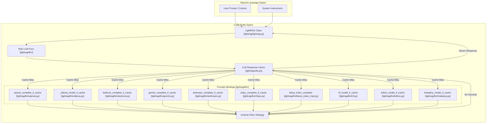
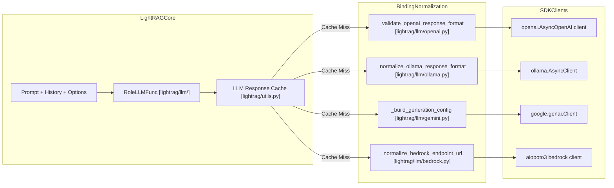

<!-- source: DeepWiki mcp.deepwiki.com · repo HKUDS/LightRAG · page 3.1 LLM Completion Bindings · fetched 2026-11-09 -->

# LLM Completion Bindings

Relevant source files

The following files were used as context for generating this wiki page:

- [lightrag/llm/anthropic.py](lightrag/llm/anthropic.py)
- [lightrag/llm/azure_openai.py](lightrag/llm/azure_openai.py)
- [lightrag/llm/bedrock.py](lightrag/llm/bedrock.py)
- [lightrag/llm/gemini.py](lightrag/llm/gemini.py)
- [lightrag/llm/hf.py](lightrag/llm/hf.py)
- [lightrag/llm/llama_index_impl.py](lightrag/llm/llama_index_impl.py)
- [lightrag/llm/lmdeploy.py](lightrag/llm/lmdeploy.py)
- [lightrag/llm/lollms.py](lightrag/llm/lollms.py)
- [lightrag/llm/ollama.py](lightrag/llm/ollama.py)
- [lightrag/llm/openai.py](lightrag/llm/openai.py)
- [lightrag/llm/zhipu.py](lightrag/llm/zhipu.py)
- [tests/api/conftest.py](tests/api/conftest.py)
- [tests/llm/anthropic_impl/__init__.py](tests/llm/anthropic_impl/__init__.py)
- [tests/llm/anthropic_impl/test_anthropic_client_cleanup.py](tests/llm/anthropic_impl/test_anthropic_client_cleanup.py)
- [tests/llm/anthropic_impl/test_anthropic_token_usage.py](tests/llm/anthropic_impl/test_anthropic_token_usage.py)
- [tests/llm/bedrock_impl/test_bedrock_llm.py](tests/llm/bedrock_impl/test_bedrock_llm.py)
- [tests/llm/gemini_impl/test_gemini_llm.py](tests/llm/gemini_impl/test_gemini_llm.py)
- [tests/llm/hf_impl/test_hf_model_if_cache_device_placement.py](tests/llm/hf_impl/test_hf_model_if_cache_device_placement.py)
- [tests/llm/llama_index_impl/__init__.py](tests/llm/llama_index_impl/__init__.py)
- [tests/llm/llama_index_impl/test_llama_index_complete_and_embed.py](tests/llm/llama_index_impl/test_llama_index_complete_and_embed.py)
- [tests/llm/lmdeploy_impl/__init__.py](tests/llm/lmdeploy_impl/__init__.py)
- [tests/llm/lmdeploy_impl/test_lmdeploy_do_sample.py](tests/llm/lmdeploy_impl/test_lmdeploy_do_sample.py)
- [tests/llm/ollama_impl/test_ollama_truncation.py](tests/llm/ollama_impl/test_ollama_truncation.py)
- [tests/llm/openai_impl/test_openai_length_finish_reason.py](tests/llm/openai_impl/test_openai_length_finish_reason.py)
- [tests/llm/test_bypass_truncated_response.py](tests/llm/test_bypass_truncated_response.py)
- [tests/llm/test_query_truncated_response_not_cached.py](tests/llm/test_query_truncated_response_not_cached.py)
- [tests/llm/zhipu_impl/test_zhipu_llm.py](tests/llm/zhipu_impl/test_zhipu_llm.py)

The LLM Completion Bindings layer in LightRAG provides a standardized, robust, and asynchronous interface to interact with various Large Language Model (LLM) providers. It normalizes disparate provider SDKs and APIs—handling retry logic, streaming, structured output, and configuration options—to enable seamless LLM usage within the LightRAG ecosystem.

---

## Core Architecture and Data Flow

LightRAG’s LLM bindings are integral in processing generation requests coming from the core RAG engine (e.g., `LightRAG` class), transforming input prompts and conversation history into API calls to various LLM providers.

### Key Patterns

- **`complete_if_cache` Functions:** These asynchronous functions execute low-level API calls, implement provider-specific request construction and retry logic, and return generation results or an async stream.
- **`complete` Wrappers:** Higher-level convenience wrappers wrapping `complete_if_cache` calls.

All completion bindings are highly configurable with parameters such as `model`, `prompt`, `system_prompt`, conversation `history_messages`, `enable_cot` (chain-of-thought), and `**kwargs` which may include `temperature`, `max_tokens`, `response_format`, and streaming toggles.

### Data Flow Diagram

This diagram shows how a natural language generation query flows through the LightRAG system and is dispatched to provider-specific bindings:

Sources: [lightrag/llm/openai.py:23-35](), [lightrag/llm/ollama.py:14-24](), [lightrag/llm/bedrock.py:178-186](), [lightrag/llm/gemini.py:19-25](), [lightrag/llm/anthropic.py:46-52](), [lightrag/llm/zhipu.py:38-44](), [lightrag/llm/llama_index_impl.py:92-98](), [lightrag/llm/hf.py:109-115](), [lightrag/llm/lollms.py:35-41](), [lightrag/llm/lmdeploy.py:51-57]()

---

## Supported LLM Providers and Key Binding Functions

| Provider | Key Binding Function(s) | Highlights |
|---|---|---|
| **OpenAI** | `openai_complete_if_cache` | Langfuse observability; tiktoken integration; base64 embeddings; detailed error handling and retry [lightrag/llm/openai.py:1-192](). |
| **Azure OpenAI** | `azure_openai_complete` (wrapper) | Re-exported for backward compatibility; actual logic in OpenAI [lightrag/llm/azure_openai.py:1-22](). |
| **Ollama** | `_ollama_model_if_cache` | Local inference + cloud model detection; OpenAI-like interface; image input support; streaming [lightrag/llm/ollama.py:1-174](). |
| **Bedrock** | `bedrock_complete_if_cache` | AWS SigV4 authentication; specialized retry on AWS-specific errors; reasoning content skipping [lightrag/llm/bedrock.py:177-202](). |
| **Gemini** | `gemini_complete_if_cache` | Vertex AI compatibility; native JSON schema translation; retry on Google client errors [lightrag/llm/gemini.py:19-75](). |
| **Anthropic** | `anthropic_complete_if_cache` | Message-based model interface; streaming with client cleanup; no JSON mode support; deprecation warnings for legacy flags [lightrag/llm/anthropic.py:45-128](). |
| **ZhipuAI** | `zhipu_complete_if_cache` | Official "thinking" support to enable reasoning tokens; GLM-4 optimized; structured output support [lightrag/llm/zhipu.py:38-73](). |
| **LlamaIndex** | `llama_index_complete` | Adapts llama-index library’s LLM wrappers; configures chat messages to LlamaIndex format; no JSON mode [lightrag/llm/llama_index_impl.py:99-160](). |
| **HuggingFace Transformers** | `hf_model_if_cache` | Local model loading with caching; single-threaded executor to avoid blocking event loop; no JSON mode support [lightrag/llm/hf.py:109-176](). |
| **lollms** | `lollms_model_if_cache` | Client for local lollms server; no JSON mode; no image input support; streaming supported [lightrag/llm/lollms.py:35-72](). |
| **lmdeploy** | `lmdeploy_model_if_cache` | Fully async turbomind pipeline with tensor parallelism and chat template support; no JSON mode; supports various local and HF hosted models [lightrag/llm/lmdeploy.py:51-103](). |

Sources: [lightrag/llm/openai.py:1-192](), [lightrag/llm/azure_openai.py:1-22](), [lightrag/llm/ollama.py:1-174](), [lightrag/llm/bedrock.py:177-202](), [lightrag/llm/gemini.py:19-75](), [lightrag/llm/anthropic.py:45-128](), [lightrag/llm/zhipu.py:38-73](), [lightrag/llm/llama_index_impl.py:99-160](), [lightrag/llm/hf.py:109-176](), [lightrag/llm/lollms.py:35-72](), [lightrag/llm/lmdeploy.py:51-103]()

---

## Implementation Details and Concepts

### Retry Logic and Exception Handling

All LLM completion functions use the `tenacity` library to implement retry logic on transient errors such as rate limits, connection drops, and timeouts. The typical strategy includes:
- Exponential backoff starting low (e.g., 1 second) growing up to a max (e.g., 10 or 60 seconds).
- Limited attempts (usually 3 to 5 retries).
- Custom predicates capturing provider-specific retryable exceptions.

For example, OpenAI handles rate limits and connection errors via predicates like `_is_retryable_rate_limit_error` [lightrag/llm/openai.py:117-130](). Bedrock converts AWS error codes into custom exceptions like `BedrockRateLimitError` and `BedrockConnectionError` and retries on these [lightrag/llm/bedrock.py:107-186](), while Gemini implements logic to retry on 429 rate-limit wrapped in Google client errors [lightrag/llm/gemini.py:58-76]().

Sources: [lightrag/llm/openai.py:109-130](), [lightrag/llm/bedrock.py:107-186](), [lightrag/llm/gemini.py:58-76]()

### Structured Output (JSON Mode Support)

Structured output enables downstream modules (e.g., entity extraction, summarization) to consume JSON rather than free text.

- **OpenAI and Zhipu:** Directly support `response_format={"type": "json_object"}` to receive structured JSON responses [lightrag/llm/openai.py:133-141](), [lightrag/llm/zhipu.py:109-133]().
- **Ollama:** Translates OpenAI-style `response_format` dict into `format="json"` or native JSON schema formats understood by Ollama [lightrag/llm/ollama.py:142-168]().
- **Gemini:** Converts structured output requests into `response_mime_type` and `response_json_schema` native Gemini config [lightrag/llm/gemini.py:174-195]().
- **Unsupported providers:** Anthropic, Bedrock, and LlamaIndex strip the `response_format` option and issue deprecation warnings if legacy boolean flags are used [lightrag/llm/anthropic.py:92-108](), [lightrag/llm/llama_index_impl.py:184-200]().

Sources: [lightrag/llm/openai.py:133-141](), [lightrag/llm/zhipu.py:109-133](), [lightrag/llm/ollama.py:142-168](), [lightrag/llm/gemini.py:174-195](), [lightrag/llm/anthropic.py:92-108](), [lightrag/llm/llama_index_impl.py:184-200]()

### Chain-of-Thought (CoT) and Reasoning Output

LightRAG optionally preserves complex reasoning or "Chain-of-Thought" tokens:

- **Zhipu:** Supports an official `thinking` parameter; if enabled, reasoning content can be handled or output [lightrag/llm/zhipu.py:51-73]().
- **Bedrock / OpenAI / Others:** Filter or adapt reasoning content blocks depending on configuration flags like `enable_cot` [lightrag/llm/anthropic.py:75-78](), [lightrag/llm/hf.py:124-127]().

Sources: [lightrag/llm/zhipu.py:51-73](), [lightrag/llm/anthropic.py:75-78](), [lightrag/llm/hf.py:124-127]()

### Streaming Support

Most bindings support streaming completions with asynchronous generators returning incremental text chunks:
- **OpenAI:** Uses streaming via OpenAI SDK async iterators, yielding partial chunks.
- **Anthropic:** Uses an async generator that yields streaming content and ensures proper client cleanup on completion or error [lightrag/llm/anthropic.py:173-191]().
- **Ollama:** Implements a streaming inner async generator yielding response chunks.

Bindings without streaming support (e.g., lmdeploy, lollms) return full string completions or custom iterators [lightrag/llm/lollms.py:141-153](), [lightrag/llm/lmdeploy.py:174-186]().

Sources: [lightrag/llm/anthropic.py:173-191](), [lightrag/llm/lollms.py:141-153](), [lightrag/llm/lmdeploy.py:174-186]()

---

## Technical Flow Inside Provider Bindings

The flow inside each binding generally follows these steps:

1. **Parameter normalization:** Input parameters such as `model`, `prompt`, `system_prompt`, `history_messages`, and LightRAG-specific flags are normalized.
2. **Handling structured output:** Options like `response_format` are validated or translated into provider-specific config fields [lightrag/llm/openai.py:133-141](), [lightrag/llm/ollama.py:142-168]().
3. **Retry wrapper:** The actual API call is wrapped in a `tenacity.retry` decorator specifying retry logic for transient exceptions [lightrag/llm/openai.py:23-29](), [lightrag/llm/anthropic.py:46-52]().
4. **API call construction:** A well-formed request is built, assembling messages from system prompt + chat history + user prompt.
5. **Execution:** The API call is performed asynchronously (or off event loop for blocking SDKs via `asyncio.to_thread` or `ThreadPoolExecutor`) [lightrag/llm/hf.py:91-107](), [lightrag/llm/zhipu.py:155-158]().
6. **Streaming handling:** If enabled, returns an async generator yielding content chunks.
7. **Token usage tracking:** Passes usage data to `token_tracker` if provided [lightrag/llm/zhipu.py:170-177]().
8. **Response validation & Post-processing:** Checks response validity and applies formatting transformations.
9. **Return final output:** Either a full string or async stream of text chunks.

The following diagram demonstrates relationships between core LightRAG components and typical provider binding normalization and SDK clients.

Sources: [lightrag/llm/openai.py:133-141](), [lightrag/llm/ollama.py:142-168](), [lightrag/llm/gemini.py:174-195](), [lightrag/llm/bedrock.py:64-73]()

---

## Binding Options and Flags

### Common Parameters

| Parameter | Description |
|---|---|
| `model` | Model identifier string, e.g., `"gpt-4o"`, `"glm-4-flashx"` |
| `prompt` | User prompt or query string for generation |
| `system_prompt` | Optional system-level instructions (context) |
| `history_messages` | Chat conversation history as list of dicts with `role` and `content` |
| `enable_cot` | Boolean; preserve chain-of-thought reasoning tokens when supported |
| `response_format` | Dict specifying structured JSON output request (OpenAI style) |
| `stream` | Boolean; whether to use streaming output (async iterator) |
| Provider-specific flags | E.g., `base_url`, `api_key`, `timeout` |

### Deprecated Flags

Older boolean flags like `keyword_extraction` and `entity_extraction` are deprecated in favor of structured `response_format`. Bindings strip them and emit warnings if present to maintain backward compatibility [lightrag/llm/anthropic.py:94-107](), [lightrag/llm/zhipu.py:103-128]().

Sources: [lightrag/llm/anthropic.py:94-107](), [lightrag/llm/zhipu.py:103-128]()

---

## Summary

The LLM Completion Bindings provide a sophisticated abstraction over multiple provider SDKs, exposing a consistent async interface with:

- Unified retry logic via `tenacity`.
- Support for streaming incremental responses.
- Structured output JSON support or graceful degradation.
- Optional chain-of-thought / reasoning output.
- Transparent provider-specific normalization and error handling.
- Dynamic dependency installation via `pipmaster`.

This design enables LightRAG’s RAG pipelines to flexibly target an extensive set of LLMs while keeping the core system agnostic to provider-specific API quirks.

---

**This concludes the LLM Completion Bindings leaf documentation.**

---

### References

- `lightrag/llm/openai.py` lines 1–192  
- `lightrag/llm/ollama.py` lines 1–174  
- `lightrag/llm/bedrock.py` lines 1–202  
- `lightrag/llm/gemini.py` lines 1–195  
- `lightrag/llm/anthropic.py` lines 1–192  
- `lightrag/llm/zhipu.py` lines 1–177  
- `lightrag/llm/llama_index_impl.py` lines 1–202  
- `lightrag/llm/hf.py` lines 1–176  
- `lightrag/llm/lollms.py` lines 1–201  
- `lightrag/llm/lmdeploy.py` lines 1–190

---

