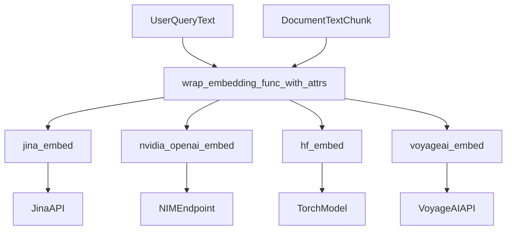
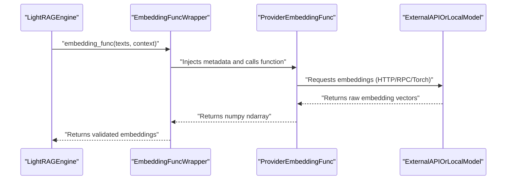

<!-- source: DeepWiki mcp.deepwiki.com · repo HKUDS/LightRAG · page 3.2 Embedding Bindings and Asymmetric Embedding · fetched 2026-11-09 -->

# Embedding Bindings and Asymmetric Embedding

Relevant source files

The following files were used as context for generating this wiki page:

- [docs/design/VectorSpaceProvenance.md](docs/design/VectorSpaceProvenance.md)
- [lightrag/llm/jina.py](lightrag/llm/jina.py)
- [lightrag/llm/nvidia_openai.py](lightrag/llm/nvidia_openai.py)
- [tests/kg/milvus_impl/test_milvus_vector_space.py](tests/kg/milvus_impl/test_milvus_vector_space.py)
- [tests/kg/mongo_impl/test_mongo_deferred_embedding.py](tests/kg/mongo_impl/test_mongo_deferred_embedding.py)
- [tests/kg/mongo_impl/test_mongo_vector_space.py](tests/kg/mongo_impl/test_mongo_vector_space.py)
- [tests/kg/postgres_impl/test_postgres_halfvec.py](tests/kg/postgres_impl/test_postgres_halfvec.py)
- [tests/kg/postgres_impl/test_postgres_vector_deferred.py](tests/kg/postgres_impl/test_postgres_vector_deferred.py)
- [tests/kg/postgres_impl/test_postgres_vector_space.py](tests/kg/postgres_impl/test_postgres_vector_space.py)
- [tests/kg/qdrant_impl/test_qdrant_deferred_embedding.py](tests/kg/qdrant_impl/test_qdrant_deferred_embedding.py)
- [tests/kg/qdrant_impl/test_qdrant_upsert_batching.py](tests/kg/qdrant_impl/test_qdrant_upsert_batching.py)
- [tests/kg/qdrant_impl/test_qdrant_vector_space.py](tests/kg/qdrant_impl/test_qdrant_vector_space.py)
- [tests/kg/test_file_backed_vector_space.py](tests/kg/test_file_backed_vector_space.py)
- [tests/llm/jina_impl/test_jina_api_key_isolation.py](tests/llm/jina_impl/test_jina_api_key_isolation.py)
- [tests/llm/nvidia_impl/__init__.py](tests/llm/nvidia_impl/__init__.py)
- [tests/llm/nvidia_impl/test_nvidia_client_cleanup.py](tests/llm/nvidia_impl/test_nvidia_client_cleanup.py)
- [tests/llm/test_dimension_mismatch.py](tests/llm/test_dimension_mismatch.py)

This section documents the embedding provider bindings in LightRAG comprising multiple third-party services and local models with a unifying interface. It also explains how asymmetric embedding is implemented, embedding dimension handling, and vector space provenance critical for consistent retrieval across pluggable vector storage backends.

---

## Embedding Provider Architecture

LightRAG’s embedding layer provides an extensible framework that wraps provider-specific embedding functions with standardized metadata and interfaces. These providers include OpenAI, Jina AI, VoyageAI, Gemini, HuggingFace, Ollama, Bedrock, LlamaIndex, and ZhipuAI.

### `wrap_embedding_func_with_attrs`

At the core is the decorator `wrap_embedding_func_with_attrs` defined in `lightrag/utils.py` [lightrag/utils.py:27-30](). This decorator attaches essential attributes to the embedding functions:

- **embedding_dim**: Integer specifying the output vector dimension of the embedding.
- **max_token_size**: The maximum number of tokens the embedding model supports.
- **model_name**: A string naming the underlying model.
- **supports_asymmetric**: Boolean flag indicating if the model supports embedding queries and documents differently (asymmetric embedding).

This metadata helps the RAG engine manage embedding compatibility, vector store alignment, and execute asymmetric embedding logic.

### Provider Bindings and Characteristics

The following providers have dedicated embedding function implementations, each wrapped with `wrap_embedding_func_with_attrs`:

| Provider | Python Module and Lines | Details |
|:---------|:------------------------|:--------|
| **OpenAI** | `lightrag/llm/openai.py:1-664` | Supports large dimensions (1536), Base64 encoding for efficient API payloads [lightrag/llm/openai.py:110](), optional `dimensions` arg with env var toggle. |
| **Jina AI** | `lightrag/llm/jina.py:61-182` | Supports asymmetric embedding via `task` param (`retrieval.query` for queries, `retrieval.passage` for documents) [lightrag/llm/jina.py:130-146](). Embedding dim=2048. |
| **VoyageAI** | `lightrag/llm/voyageai.py:1-100` | Passes `input_type` `"query"` or `"document"` to API, enabling asymmetric support [lightrag/llm/voyageai.py:75-80](). |
| **NVIDIA NIM** | `lightrag/llm/nvidia_openai.py:35-86` | Maps `context` to `input_type` (`query` vs `passage`) for NVIDIA embedqa models, utilizing `AsyncOpenAI` with automated connection pool cleanup [lightrag/llm/nvidia_openai.py:65-85](). |
| **Gemini (Google GenAI)** | `lightrag/llm/gemini.py:1-400` | Uses Google `google-genai` SDK, configurable for Vertex AI mode, manages context mapping internally. |
| **HuggingFace** | `lightrag/llm/hf.py:1-213` | Local embedding on torch device, supports asymmetric embedding by prefixing queries or documents [lightrag/llm/hf.py:198-213](). |
| **Ollama** | `lightrag/llm/ollama.py:215-256` | Local client, supports embedding with configurable host/model; asymmetry handled by prefix wrapping. |
| **Bedrock (AWS)** | `lightrag/llm/bedrock.py:330-385` | Embedding via AWS Bedrock Runtime API with SigV4 signing. |
| **LlamaIndex** | `lightrag/llm/llama_index_impl.py:212-240` | Wraps `llama_index.embeddings.BaseEmbedding` subclasses as embedding functions. |
| **ZhipuAI** | `lightrag/llm/zhipu.py:230-265` | Dedicated integration for ZhipuAI models. |

Each embedding function is asynchronous, receives a list of texts, and returns a NumPy ndarray of embeddings. The wrapper decorator enforces embedding dimensionality and token size metadata constraints, which are critical for later storage and retrieval consistency.

Sources:  
`lightrag/utils.py:20-40`,  
`lightrag/llm/openai.py:1-664`,  
`lightrag/llm/jina.py:61-182`,  
`lightrag/llm/voyageai.py:1-100`,  
`lightrag/llm/nvidia_openai.py:35-86`,  
`lightrag/llm/gemini.py:1-400`,  
`lightrag/llm/hf.py:1-213`,  
`lightrag/llm/ollama.py:215-256`,  
`lightrag/llm/bedrock.py:330-385`,  
`lightrag/llm/llama_index_impl.py:212-240`,  
`lightrag/llm/zhipu.py:230-265`.

---

## Asymmetric Embedding

Asymmetric embedding allows queries and documents to be embedded into related but distinct vector subspaces, improving accuracy of nearest neighbor retrieval by explicitly encoding task context.

### How It Works

If a function is decorated with `supports_asymmetric=True`, the embedding caller injects a `context` parameter into the function call, whose canonical values are `"query"` or `"document"`.

- The embedding function adjusts its processing accordingly, sometimes switching model tasks or applying prefixes.
- This enables providers to treat search queries and stored passages differently, embedding for optimal similarity matching.

### Provider-specific Asymmetric Handling

- **Jina AI**: Translates `context` into a `task` string for the API request:
  - `"query"` → `"retrieval.query"`
  - `"document"` → `"retrieval.passage"`
  - Defaults to `"text-matching"` when no context given [lightrag/llm/jina.py:130-138]().

- **NVIDIA NIM**: Maps `context == "query"` to `input_type="query"` and otherwise defaults to `input_type="passage"` [lightrag/llm/nvidia_openai.py:65-66]().

- **HuggingFace**: Applies a prefix (configurable strings) before embedding input depending on context `[lightrag/llm/hf.py:209-213]()`. This is a local textual transform distinguishing queries from documents.

- **VoyageAI**: Passes `input_type` parameter as `"query"` or `"document"` directly to the API, matching LightRAG's context [lightrag/llm/voyageai.py:75-80]().

- **Custom Wrappers**: Users can manually wrap an embedding function using `wrap_embedding_func_with_attrs` and custom prefix logic for finer control [examples/unofficial-sample/lightrag_embedding_prefixes.py:116-129]().

### Diagram: Asymmetric Embedding Context Flow

Diagram: Asymmetric Embedding Context Flow

Sources:  
`lightrag/utils.py:20-40`,  
`lightrag/llm/jina.py:130-146`,  
`lightrag/llm/nvidia_openai.py:65-66`,  
`lightrag/llm/hf.py:198-213`,  
`lightrag/llm/voyageai.py:75-80`,  
`examples/unofficial-sample/lightrag_embedding_prefixes.py:116-129`.

---

## Embedding Dimension Handling and `send_dimensions`

LightRAG supports embedding models that allow clients to request smaller output dimensions than the model’s maximum (Matryoshka Embeddings). This improves flexibility and storage efficiency.

### Key Concepts

- **embedding_dim** from the decorator metadata dictates the dimension passed to storage backends and used for validation.
- Some providers accept an explicit `dimensions` parameter in their API request, asking the model to reduce its output vectors to a subset dimension.
- However, not all providers support this parameter, or their APIs may reject it with an error.

### OpenAI Binding Example

The OpenAI binding (`openai.py`) implements a configuration-controlled flag `EMBEDDING_SEND_DIMENSIONS` (an environment variable), which controls if the `dimensions` argument is sent to the embeddings API call.

- If `True`, the `dimensions` parameter is included when requesting embeddings, enabling smaller dimension vectors from a larger model.
- Providers or API-compliant third-party implementations might fail if this is sent unexpectedly, so this toggle avoids breakage [lightrag/llm/openai.py:590-645]().

### Summary Table: Dimension Flags

| Parameter | Description | Provider Impact |
|-----------|-------------|-----------------|
| `embedding_dim` | Decorator-set dimension for output vectors | Used by all providers to inform downstream storage and retrieval. |
| `send_dimensions` (env var) | Controls sending explicit dimension in API call | Mainly OpenAI and those compatible with its embedding API. |

Sources:  
`lightrag/llm/openai.py:590-645`,  
`lightrag/llm/jina.py:61-65`.

---

## Vector Space Provenance and Compatibility

Embedding vector spaces must be provenance-tracked for reliable operation to prevent silent errors when swapping embedding models or dimensions [docs/design/VectorSpaceProvenance.md:1-130]().

### Isolation Taxonomy

As detailed in `docs/design/VectorSpaceProvenance.md`, storage backends divide into two categories regarding how they isolate model spaces:

1. **Nano, FAISS, MongoDB, OpenSearch**: Carry no model information in their container names. A same-dimension model swap reuses the exact same container. Therefore, these backends **record explicit metadata markers** (`vector_space_marker(embedding_func)`) owning model name and dimension [docs/design/VectorSpaceProvenance.md:24-44]().
2. **Milvus, Qdrant, PostgreSQL**: Encode model names and dimensions directly into their container/table names (e.g., `{base_table}_{folded_model}_{dim}d`) [docs/design/VectorSpaceProvenance.md:31-38](). A model change automatically provisions a distinct container by construction, so they record no separate marker file.

### Fail-Closed Gate

LightRAG asserts embedding function attributes (`model_name`, `embedding_dim`) match stored vector space metadata on attach or initialization via `assert_vector_space_matches`, raising a typed `VectorSpaceMismatchError` if incompatible [tests/kg/test_file_backed_vector_space.py:13-36](). The server refuses to start if `EMBEDDING_MODEL` is unset or empty to prevent unprovenanced containers [docs/design/VectorSpaceProvenance.md:121-126]().

Sources:  
`docs/design/VectorSpaceProvenance.md:1-130`,  
`lightrag/kg/vector_space.py:1-100`,  
`tests/kg/test_file_backed_vector_space.py:1-40`,  
`tests/kg/postgres_impl/test_postgres_vector_space.py:1-35`.

---

## System Integration of Embedding Calls

Diagram: Embedding Integration Sequence

This sequence demonstrates how the RAG core interacts with the embedding abstraction, which multiplexes calls to diverse provider implementations with uniform handling of attributes like dimension and asymmetric context.

Sources:  
`lightrag/utils.py:20-40`,  
`lightrag/llm/openai.py:1-664`,  
`lightrag/llm/jina.py:61-182`.

---

## Summary Table: Environment Variables and Their Roles

| Env Variable Name | Role / Effect | Providers Mentioned |
|-------------------|---------------|---------------------|
| `EMBEDDING_USE_BASE64` | OpenAI base64-encoded payloads to reduce data transfer size | OpenAI |
| `EMBEDDING_SEND_DIMENSIONS` | Whether to send `dimensions` param to OpenAI API | OpenAI |
| `JINA_API_KEY` | API key required for Jina AI embedding calls | Jina AI |
| `VOYAGE_API_KEY` | API key for VoyageAI embeddings | VoyageAI |
| `EMBEDDING_QUERY_PREFIX` | Default prefix strings for query asymmetric embedding | HuggingFace, Ollama |
| `GOOGLE_GENAI_USE_VERTEXAI` | Toggles Gemini binding to use Vertex AI mode | Gemini |
| `GOOGLE_CLOUD_PROJECT` | Needed for Gemini Vertex AI mode | Gemini |

Sources:  
`lightrag/llm/openai.py`,  
`lightrag/llm/jina.py`,  
`lightrag/llm/voyageai.py`,  
`lightrag/llm/gemini.py`,  
`examples/unofficial-sample/lightrag_embedding_prefixes.py`.

---

# Summary

This section described the embedding provider bindings, covering a variety of third-party and local models wrapped through a uniform interface with metadata, including support for:

- Asymmetric embeddings that distinguish queries/documents using a `context` parameter.
- Dimension management via decorator metadata and optionally sending dimension control to providers.
- Vector space provenance for strict embedding model and dimension validation on vector backend attach.

The encapsulation and unification allow the LightRAG core to operate seamlessly with multiple embedding sources while preserving retrieval accuracy and durability against model changes.

# End of 3.2 Embedding Bindings and Asymmetric Embedding

---

