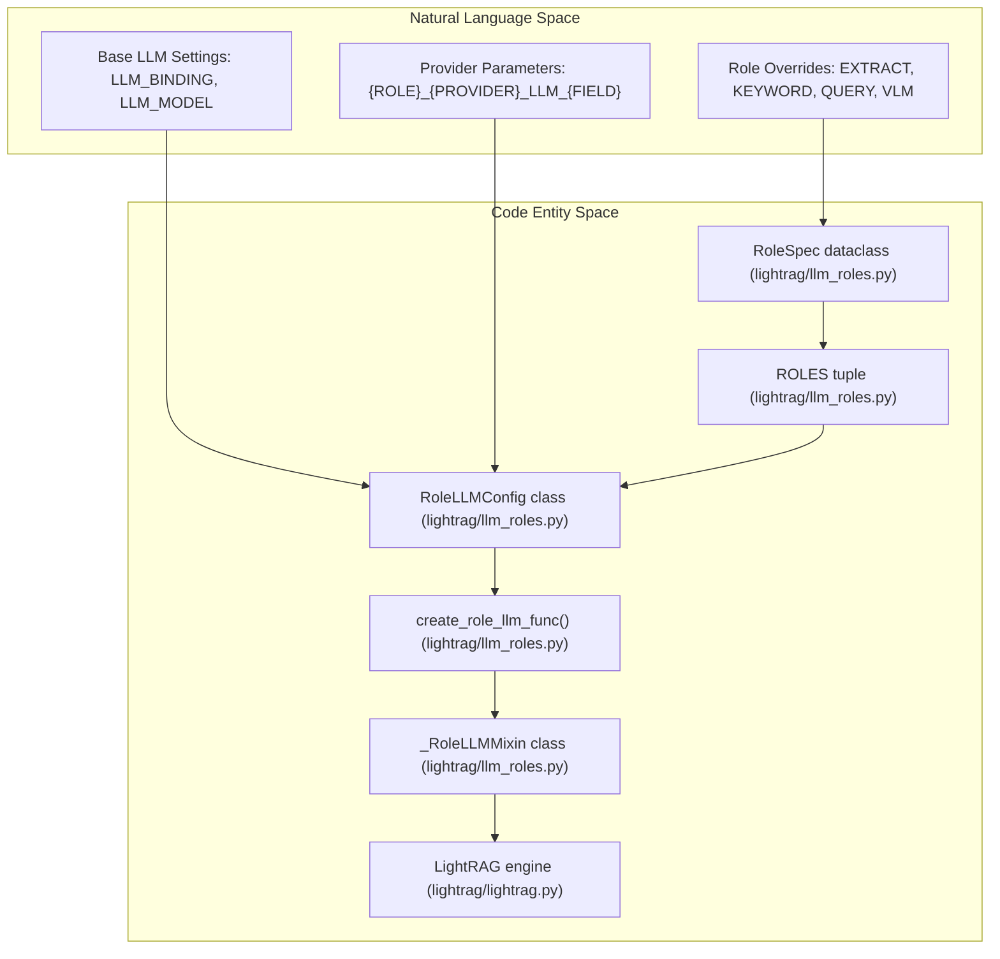
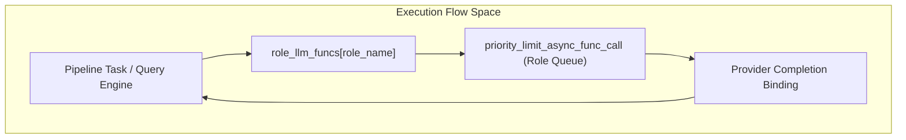

<!-- source: DeepWiki mcp.deepwiki.com · repo HKUDS/LightRAG · page 3.3 Role-Specific LLM Configuration · fetched 2026-11-09 -->

# Role-Specific LLM Configuration

<details>
<summary>Relevant source files</summary>

The following files were used as context for generating this wiki page:

- [docs/RoleSpecificLLMConfiguration-zh.md](docs/RoleSpecificLLMConfiguration-zh.md)
- [docs/RoleSpecificLLMConfiguration.md](docs/RoleSpecificLLMConfiguration.md)
- [lightrag/__init__.py](lightrag/__init__.py)
- [lightrag/api/__init__.py](lightrag/api/__init__.py)
- [setup.py](setup.py)

</details>


## Purpose and Scope
This page details the role-specific LLM and VLM configuration subsystem in LightRAG (`lightrag/llm_roles.py`), which allows operators to assign specialized language models to distinct pipeline stages. This includes resource optimization by deploying lightweight high-throughput models for extraction and keyword generation, robust reasoning models for final query answers, and dedicated vision-language models for multimodal content processing.

Sources: [lightrag/llm_roles.py:1-50](), [docs/RoleSpecificLLMConfiguration.md:1-15]()

---

## Role Overview

LightRAG defines four primary processing roles, each tailored to specific operational requirements within the insertion and retrieval pipelines:

| Role | Purpose | Recommended Specifications |
| --- | --- | --- |
| `EXTRACT` | Entity/relation extraction and description summarization during file ingestion [docs/RoleSpecificLLMConfiguration.md:11-11](). | High-throughput, complex reasoning disabled, 30B+ parameters, ≥32KB context [docs/RoleSpecificLLMConfiguration.md:11-11](). |
| `KEYWORD` | Query-stage keyword generation prior to dual-level retrieval [docs/RoleSpecificLLMConfiguration.md:12-12](). | Ultra-fast, thinking mode disabled, 7B+ parameters [docs/RoleSpecificLLMConfiguration.md:12-12](). |
| `QUERY` | Final answer generation based on retrieved context [docs/RoleSpecificLLMConfiguration.md:13-13](). | High-quality reasoning model enabled, 30B+ parameters, ≥32KB context [docs/RoleSpecificLLMConfiguration.md:13-13](). |
| `VLM` | Multimodal analysis of images, tables, and equations during insertion [docs/RoleSpecificLLMConfiguration.md:14-14](). | Vision-capable high-quality model, 30B+ parameters [docs/RoleSpecificLLMConfiguration.md:14-14](). |

If a specific role lacks an explicit configuration, LightRAG falls back to the base `LLM_*` configuration settings.

Sources: [lightrag/llm_roles.py:32-57](), [docs/RoleSpecificLLMConfiguration.md:7-16]()

---

## Natural Language to Code Entity Mapping

The following diagram bridges natural language configuration spaces (environment variables and role definitions) with the concrete classes and functions in the codebase (`lightrag/llm_roles.py` and `lightrag/lightrag.py`).


Sources: [lightrag/llm_roles.py:32-100](), [lightrag/lightrag.py:1-50]()

---

## Core Classes and Functions

### `RoleSpec` and `ROLES`
Roles are modeled via the immutable `RoleSpec` dataclass, encapsulating the role name, its environment variable prefix, and its concurrency queue identifier. The global `ROLES` tuple aggregates all supported role specifications [lightrag/llm_roles.py:32-57]().

```python
@dataclass(frozen=True)
class RoleSpec:
    name: str
    env_prefix: str
    concurrency_queue: str

ROLES = (
    RoleSpec("EXTRACT", "EXTRACT", "llm:extract"),
    RoleSpec("KEYWORD", "KEYWORD", "llm:keyword"),
    RoleSpec("QUERY", "QUERY", "llm:query"),
    RoleSpec("VLM", "VLM", "llm:vlm"),
)
```
[lightrag/llm_roles.py:32-57]()

Sources: [lightrag/llm_roles.py:32-57]()

### `RoleLLMConfig`
`RoleLLMConfig` represents the evaluated configuration state for a single role, binding parameters such as the active async LLM function (`func`), provider-specific keyword arguments (`kwargs`), concurrency ceilings (`max_async`), and timeouts (`timeout`) [lightrag/llm_roles.py:63-79]().

Sources: [lightrag/llm_roles.py:63-79]()

### `create_role_llm_func`
The helper function `create_role_llm_func` initializes and wraps the low-level provider completion routine with rate-limiting semaphores, timeout controls, and caching wrappers based on the resolved `RoleLLMConfig` [lightrag/llm_roles.py:125-194]().

Sources: [lightrag/llm_roles.py:125-194]()

---

## Runtime Role Switching and Execution Architecture

The execution and switching of role-specific LLMs are governed by `_RoleLLMMixin`, which is mixed into the core `LightRAG` class. 


Sources: [lightrag/llm_roles.py:125-194](), [tests/llm/test_global_concurrency_queue.py:88-90]()

- **Dynamic Registration**: `register_role_llm_builder()` enables runtime modification or hot-reloading of role LLM behaviors without restarting application worker processes [lightrag/llm_roles.py:125-132]().
- **Concurrency Isolation**: Each role maintains an isolated queue (`llm:extract`, `llm:query`, etc.) through `priority_limit_async_func_call`, ensuring that heavy document insertion tasks do not starve query responsiveness [lightrag/llm_roles.py:175-194]().

Sources: [lightrag/llm_roles.py:125-194](), [tests/llm/test_global_concurrency_queue.py:88-90]()

---

## Inheritance Rules and Provider Overrides

LightRAG applies strict hierarchy rules when resolving configuration values:
1. **Same-Provider Inheritance**: If `{ROLE}_LLM_BINDING` matches the base `LLM_BINDING` (or is unset), the role inherits base models, endpoints, API keys, timeouts, and concurrency settings [docs/RoleSpecificLLMConfiguration.md:117-124]().
2. **Cross-Provider Override**: If a role specifies a distinct provider, parameters do not inherit base provider options; the role configuration must explicitly define its model and credentials [docs/RoleSpecificLLMConfiguration.md:141-147]().
3. **Bedrock Authentication**: Amazon Bedrock utilizes IAM SigV4 credentials (either global or role-specific `{ROLE}_AWS_*` variables) instead of traditional API keys [docs/RoleSpecificLLMConfiguration.md:165-172]().

Sources: [docs/RoleSpecificLLMConfiguration.md:113-191]()

---

## Multimodal (VLM) Configuration

The `VLM` role handles vision-language execution during multimodal document ingestion. When `VLM_PROCESS_ENABLE=true` is set, the ingestion pipeline routes images and sidecar visual artifacts to the configured `VLM` role LLM binding [docs/RoleSpecificLLMConfiguration.md:14-14](), [lightrag/llm/ollama.py:165-170]().

Sources: [docs/RoleSpecificLLMConfiguration.md:14-14](), [lightrag/llm/ollama.py:165-170](), [tests/llm/bedrock_impl/test_bedrock_llm.py:112-168]()

---

