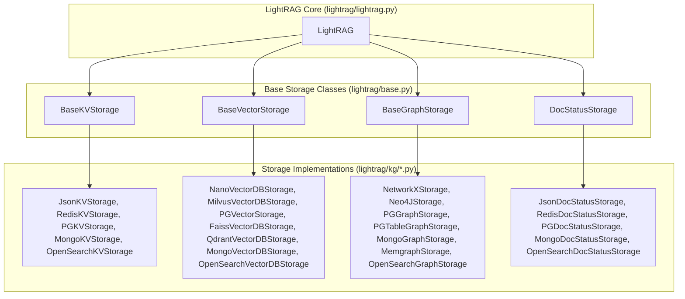

<!-- source: DeepWiki mcp.deepwiki.com · repo HKUDS/LightRAG · page 4 Storage Backends · fetched 2026-11-09 -->

# Storage Backends

Relevant source files

The following files were used as context for generating this wiki page:

- [lightrag/base.py](lightrag/base.py)
- [lightrag/kg/__init__.py](lightrag/kg/__init__.py)
- [lightrag/kg/memgraph_impl.py](lightrag/kg/memgraph_impl.py)
- [lightrag/kg/mongo_impl.py](lightrag/kg/mongo_impl.py)
- [lightrag/kg/neo4j_impl.py](lightrag/kg/neo4j_impl.py)
- [lightrag/kg/postgres_impl.py](lightrag/kg/postgres_impl.py)
- [lightrag/kg/qdrant_impl.py](lightrag/kg/qdrant_impl.py)
- [lightrag/kg/redis_impl.py](lightrag/kg/redis_impl.py)
- [tests/kg/memgraph_impl/test_memgraph_all_edges_dedup.py](tests/kg/memgraph_impl/test_memgraph_all_edges_dedup.py)

LightRAG features a pluggable storage architecture designed to handle the diverse data persistence needs of a dual-level Knowledge Graph (KG) and Vector RAG system. It abstracts storage into four primary categories:

- **Key-Value (KV) Storage**
- **Vector Storage**
- **Graph Storage**
- **Document Status Storage**

This modular approach enables LightRAG to scale ranging from local JSON files for development to distributed, high-performance databases like Neo4j, Milvus, and PostgreSQL for production.

---

### Overview of Storage Abstractions

All storage implementations derive from core abstract base classes defined in `lightrag/base.py`:

- `BaseKVStorage`
- `BaseVectorStorage`
- `BaseGraphStorage`
- `DocStatusStorage`

These base classes provide lifecycle and interface methods—such as `initialize()`, `finalize()`, `upsert()`, and `get_by_id()`—that concrete storage classes implement. This abstraction enables LightRAG’s core components, including the `LightRAG` class, to operate independently of the underlying storage backend, improving flexibility and extensibility [lightrag/base.py:1-105](), [lightrag/kg/__init__.py:1-48]().

The storage types and their implementations are registered in the storage registry located in `lightrag/kg/__init__.py`. This registry maps storage categories to their concrete implementations and required methods, and links storage names to corresponding Python module paths. Environment variables controlling backend connectivity requirements are also tracked here [lightrag/kg/__init__.py:1-48]().

---

### High-Level Architecture Diagram

This diagram shows how the LightRAG core manages each storage category through their respective base classes, with multiple pluggable concrete backend implementations [lightrag/kg/__init__.py:1-48](), [lightrag/base.py:1-105]().

Sources:
- [lightrag/kg/__init__.py:1-48]()
- [lightrag/base.py:1-105]()

---

### 1. Key-Value (KV) and Document Status Storage

KV storage holds unstructured or semi-structured data, such as LLM response cache and auxiliary mapping information. Document Status storage tracks document lifecycle states during ingestion and processing (e.g., `PENDING`, `PROCESSING`, `PROCESSED`), using enums such as `DocProcessingStatus` [lightrag/base.py:1-52]() [lightrag/kg/postgres_impl.py:29-49]().

Key KV implementations include:

- `JsonKVStorage` — Local JSON file storage
- `RedisKVStorage` — High-performance, in-memory key-value store [lightrag/kg/redis_impl.py:33-52]()
- `PGKVStorage` — PostgreSQL-backed key-value store [lightrag/kg/postgres_impl.py:29-49]()
- `MongoKVStorage` — MongoDB-based KV store [lightrag/kg/mongo_impl.py:15-35]()
- `OpenSearchKVStorage` — OpenSearch-backed key-value store

Document status storage uses similar backends:

- `JsonDocStatusStorage`
- `RedisDocStatusStorage`
- `PGDocStatusStorage`
- `MongoDocStatusStorage`
- `OpenSearchDocStatusStorage`

These backends offer fast, atomic operations such as `get_by_id`, `upsert` (KV), and `get_docs_by_status` (Doc Status) to support efficient ingestion scheduling and tracking [lightrag/kg/__init__.py:2-11, 38-47]().

For an in-depth discussion, see [KV and Document Status Storage](#4.3).

Sources:
- [lightrag/kg/__init__.py:1-48]()
- [lightrag/base.py:1-52]()
- [lightrag/kg/postgres_impl.py:29-49]()
- [lightrag/kg/mongo_impl.py:15-35]()
- [lightrag/kg/redis_impl.py:33-52]()

---

### 2. Vector Storage Backends

Vector storage manages embedding vectors essential for similarity search across text chunks, entities, and relations. Vector stores are central to LightRAG’s retrieval capabilities in "naive", "local", and "mix" query modes.

Default and production backends include:

- `NanoVectorDBStorage` — Default file-based vector store [lightrag/kg/__init__.py:24-37]()
- `MilvusVectorDBStorage` — High-performance vector database with advanced indexing [lightrag/kg/__init__.py:24-37]()
- `QdrantVectorDBStorage` — Vector DB with workspace-aware collection management and legacy collection migration support [lightrag/kg/qdrant_impl.py:170-198]()
- `FaissVectorDBStorage`, `PGVectorStorage`, `MongoVectorDBStorage`, `OpenSearchVectorDBStorage`

Responsibilities around upserting vectors, querying by similarity, deferred embedding, and managing collection suffixes for workspace isolation are implemented here [lightrag/kg/__init__.py:24-35](), [lightrag/base.py:1-100]().

For details, see [Vector Storage Backends](#4.2).

Sources:
- [lightrag/kg/__init__.py:24-37]()
- [lightrag/base.py:1-100]()
- [lightrag/kg/qdrant_impl.py:170-198]()

---

### 3. Graph Storage Backends

Graph storage persists the KG: entities as nodes and relationships as edges. This storage supports workspace isolation and graph traversal operations vital for local and hybrid retrieval strategies.

Notable implementations include:

- `NetworkXStorage` — Default in-memory graph with GraphML persistence [lightrag/kg/__init__.py:12-23]()
- `Neo4JStorage` — Production-grade graph DB offering ACID compliance and Cypher query support; workspace isolation is managed by careful label normalization and query parameterization to avoid injection [lightrag/kg/neo4j_impl.py:78-176]()
- `PGGraphStorage` (Apache AGE extension for PostgreSQL), `PGTableGraphStorage` [lightrag/kg/__init__.py:12-23]()
- `MongoGraphStorage` — Graph data modeled in MongoDB collections [lightrag/kg/__init__.py:12-23]()
- `MemgraphStorage` — Neo4j-compatible graph DB with similar workspace label management [lightrag/kg/memgraph_impl.py:33-177]()
- `OpenSearchGraphStorage` [lightrag/kg/__init__.py:12-23]()

This layer defines primary CRUD operations such as `upsert_node` and `upsert_edge`, plus graph BFS subgraph retrieval with batch loading optimizations. It is also responsible for migration and concurrency handling in graph contexts [lightrag/kg/__init__.py:12-22](), [lightrag/kg/memgraph_impl.py:33-177]().

For details, see [Graph Storage Backends](#4.1).

Sources:
- [lightrag/kg/__init__.py:12-23]()
- [lightrag/kg/neo4j_impl.py:78-176]()
- [lightrag/kg/memgraph_impl.py:33-177]()

---

### 4. Shared Storage and Multi-Process Concurrency

LightRAG operates in multi-process and multi-worker deployments requiring robust concurrency controls and resource synchronization.

Key mechanisms include:

- `KeyedUnifiedLock`, `NamespaceLock`, and `UnifiedLock` abstractions for cross-process locking in shared storage scenarios.
- Use of Python `multiprocessing.Manager` proxies to share locks, flags (e.g., `pipeline_status`), reservations, and file fingerprint fences between processes.
- Coordination for pipeline status flags, task reservations, and consistency fences around scan job stores, ensuring safe concurrent ingestion and indexing operations.

Workspace isolation is a major theme, using namespaced keys and controlled locking to prevent cross-workspace data leaks or race conditions.

For details, see [Shared Storage and Multi-Process Concurrency](#4.4).

Sources:
- [lightrag/kg/__init__.py:1-48]()

---

### Storage Implementation Registry

All known storage backends are enumerated in the storage registry (`lightrag/kg/__init__.py`) with these groupings and selected implementations:

| Storage Type       | Implementations (examples)                                                | Required Methods                |
|--------------------|--------------------------------------------------------------------------|--------------------------------|
| KV Storage         | JsonKVStorage, RedisKVStorage, PGKVStorage, MongoKVStorage, OpenSearchKVStorage | `get_by_id`, `upsert`           |
| Graph Storage      | NetworkXStorage, Neo4JStorage, PGGraphStorage, PGTableGraphStorage, MongoGraphStorage, MemgraphStorage, OpenSearchGraphStorage | `upsert_node`, `upsert_edge`    |
| Vector Storage     | NoopVectorDBStorage, NanoVectorDBStorage, MilvusVectorDBStorage, PGVectorStorage, FaissVectorDBStorage, QdrantVectorDBStorage, MongoVectorDBStorage, OpenSearchVectorDBStorage | `query`, `upsert`               |
| Doc Status Storage | JsonDocStatusStorage, RedisDocStatusStorage, PGDocStatusStorage, MongoDocStatusStorage, OpenSearchDocStatusStorage | `get_docs_by_statuses`          |

Environment variable requirements to connect these backends are also listed here for deployment reference [lightrag/kg/__init__.py:1-48]().

Sources:
- [lightrag/kg/__init__.py:1-48]()

---

This modular storage backend design allows LightRAG to flexibly adapt to various deployment contexts, trade-offs in performance versus operational complexity, and evolving technical needs.

---

### Child Pages for Details

This page offers a high-level introduction and architectural perspective. For technical deep-dives into each storage category and their individual backends, please see the following detailed child pages:

- [Graph Storage Backends](#4.1) — NetworkX, Neo4j, PostgreSQL AGE, pgtable, MongoDB, Memgraph, OpenSearch graph storage; workspace isolation, BFS subgraph retrieval, migration tooling.
- [Vector Storage Backends](#4.2) — NanoVectorDB, Milvus, Qdrant, FAISS, pgvector, OpenSearch, MongoDB Atlas vector search; deferred embedding, index configs, vector space markers.
- [KV and Document Status Storage](#4.3) — JsonKVStorage, JsonDocStatusStorage, PostgreSQL/Mongo/Redis/OpenSearch KV and doc-status; flattened cache keys, scheduling pages, track_id hydration.
- [Shared Storage and Multi-Process Concurrency](#4.4) — KeyedUnifiedLock, NamespaceLock, UnifiedLock, Manager proxies, pipeline_status flags, reservations, file fingerprint fences, scan job store.

---

Sources:  
- [lightrag/kg/__init__.py:1-48]()  
- [lightrag/base.py:1-105]()  
- [lightrag/kg/postgres_impl.py:29-49]()  
- [lightrag/kg/mongo_impl.py:15-35]()  
- [lightrag/kg/redis_impl.py:33-52]()  
- [lightrag/kg/qdrant_impl.py:170-198]()  
- [lightrag/kg/neo4j_impl.py:78-176]()  
- [lightrag/kg/memgraph_impl.py:33-177]()

---

