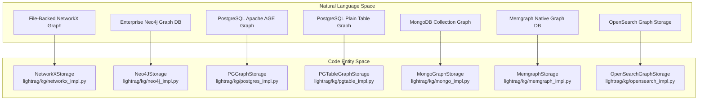
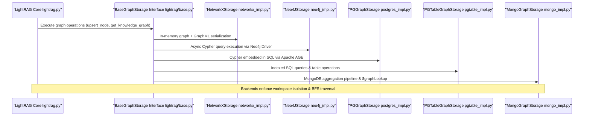

<!-- source: DeepWiki mcp.deepwiki.com · repo HKUDS/LightRAG · page 4.1 Graph Storage Backends · fetched 2026-11-09 -->

# Graph Storage Backends

Relevant source files

The following files were used as context for generating this wiki page:

- [lightrag/base.py](lightrag/base.py)
- [lightrag/kg/memgraph_impl.py](lightrag/kg/memgraph_impl.py)
- [lightrag/kg/mongo_impl.py](lightrag/kg/mongo_impl.py)
- [lightrag/kg/neo4j_impl.py](lightrag/kg/neo4j_impl.py)
- [lightrag/kg/opensearch_impl.py](lightrag/kg/opensearch_impl.py)
- [lightrag/kg/pgtable_impl.py](lightrag/kg/pgtable_impl.py)
- [lightrag/kg/postgres_impl.py](lightrag/kg/postgres_impl.py)
- [lightrag/kg/qdrant_impl.py](lightrag/kg/qdrant_impl.py)
- [lightrag/kg/redis_impl.py](lightrag/kg/redis_impl.py)
- [lightrag/storage_migrations.py](lightrag/storage_migrations.py)
- [tests/api/routes/test_graph_attribute_validation.py](tests/api/routes/test_graph_attribute_validation.py)
- [tests/extraction/test_merge_entities_relation_weight.py](tests/extraction/test_merge_entities_relation_weight.py)
- [tests/kg/memgraph_impl/test_memgraph_all_edges_dedup.py](tests/kg/memgraph_impl/test_memgraph_all_edges_dedup.py)
- [tests/kg/memgraph_impl/test_memgraph_kg_tie_break.py](tests/kg/memgraph_impl/test_memgraph_kg_tie_break.py)
- [tests/kg/mongo_impl/test_mongo_attribute_names.py](tests/kg/mongo_impl/test_mongo_attribute_names.py)
- [tests/kg/mongo_impl/test_mongo_bfs_tie_break.py](tests/kg/mongo_impl/test_mongo_bfs_tie_break.py)
- [tests/kg/mongo_impl/test_mongo_edge_batch_methods.py](tests/kg/mongo_impl/test_mongo_edge_batch_methods.py)
- [tests/kg/mongo_impl/test_mongo_scheduling_pages.py](tests/kg/mongo_impl/test_mongo_scheduling_pages.py)
- [tests/kg/mongo_impl/test_mongo_storage.py](tests/kg/mongo_impl/test_mongo_storage.py)
- [tests/kg/neo4j_impl/test_neo4j_kg_tie_break.py](tests/kg/neo4j_impl/test_neo4j_kg_tie_break.py)
- [tests/kg/networkx_impl/test_networkx_attribute_validation.py](tests/kg/networkx_impl/test_networkx_attribute_validation.py)
- [tests/kg/opensearch_impl/test_opensearch_bfs_tie_break.py](tests/kg/opensearch_impl/test_opensearch_bfs_tie_break.py)
- [tests/kg/opensearch_impl/test_opensearch_storage.py](tests/kg/opensearch_impl/test_opensearch_storage.py)
- [tests/kg/opensearch_impl/test_opensearch_strict_reads.py](tests/kg/opensearch_impl/test_opensearch_strict_reads.py)
- [tests/kg/opensearch_impl/test_os_scheduling_pages.py](tests/kg/opensearch_impl/test_os_scheduling_pages.py)
- [tests/kg/pgtable_impl/__init__.py](tests/kg/pgtable_impl/__init__.py)
- [tests/kg/pgtable_impl/test_pgtable_graph_storage.py](tests/kg/pgtable_impl/test_pgtable_graph_storage.py)
- [tests/kg/pgtable_impl/test_pgtable_smoke.py](tests/kg/pgtable_impl/test_pgtable_smoke.py)
- [tests/kg/postgres_impl/test_postgres_cypher_injection.py](tests/kg/postgres_impl/test_postgres_cypher_injection.py)
- [tests/kg/postgres_impl/test_postgres_doc_status_lookup.py](tests/kg/postgres_impl/test_postgres_doc_status_lookup.py)
- [tests/kg/postgres_impl/test_postgres_graph_batch.py](tests/kg/postgres_impl/test_postgres_graph_batch.py)
- [tests/kg/postgres_impl/test_postgres_upsert_edge_cypher.py](tests/kg/postgres_impl/test_postgres_upsert_edge_cypher.py)
- [tests/kg/redis_impl/test_redis_doc_status_lookup.py](tests/kg/redis_impl/test_redis_doc_status_lookup.py)
- [tests/kg/test_batch_graph_operations.py](tests/kg/test_batch_graph_operations.py)
- [tests/kg/test_graph_storage.py](tests/kg/test_graph_storage.py)
- [tests/pipeline/test_graph_deletion_tracking.py](tests/pipeline/test_graph_deletion_tracking.py)
- [tests/utils/test_graph_attribute_validator.py](tests/utils/test_graph_attribute_validator.py)

LightRAG provides a modular and extensible architecture for Knowledge Graph (KG) storage through multiple backend implementations that adhere to the `BaseGraphStorage` interface (`lightrag/base.py`). These backends vary from simple in-memory graph persistence to powerful distributed graph databases, relational extensions, document stores, and search engines, enabling flexible deployment choices for different scale and performance needs.

This page covers the supported graph storage backends in full technical detail, outlining their implementation strategies, data flow, workspace isolation mechanisms, retrieval methods such as BFS-based subgraph queries, and migration tooling.

---

## Supported Graph Storage Backends

### 1. NetworkXStorage (File-backed in-memory graph)

- Implements `BaseGraphStorage` using the Python `networkx` library for graph representation in process memory [lightrag/kg/networkx_impl.py]().
- The entire graph is persisted as a GraphML file located at `working_dir/[workspace/]graph_<namespace>.graphml` for cross-process durability and synchronization [lightrag/kg/networkx_impl.py:36-152]().
- Enforces a **single-writer-per-workspace** concurrency contract to avoid race conditions; readers tolerate eventual consistency [lightrag/kg/networkx_impl.py:51-63]().
- The commit is atomic using a *two-channel commit fence* pattern: file writes are done via `atomic_write` (temporary file then rename) and coordinated update flags broadcast availability of fresh data [lightrag/kg/networkx_impl.py:102-110, 131-151]().
- All mutations run synchronously on the event loop thread, except serialization which offloads to a worker thread under lock exclusion [lightrag/kg/networkx_impl.py:59-61]().

Sources: `lightrag/kg/networkx_impl.py` [36-152]()

---

### 2. Neo4JStorage (Enterprise-grade graph database)

- Interfaces with a Neo4j instance via the official Async Python driver `neo4j.AsyncGraphDatabase` [lightrag/kg/neo4j_impl.py:27-32, 79-176]().
- Uses **workspace isolation** by assigning a sanitized workspace label to nodes; this label is escaped safely for use inside Cypher queries [lightrag/kg/neo4j_impl.py:117-142]().
- Implements robust **BFS subgraph retrieval** using Neo4j procedures when APOC plugin is available (e.g., `apoc.path.subgraphAll`) or fallback Cypher queries that perform breadth-first traversal [lightrag/kg/neo4j_impl.py]().
- Implements a specialized **full-text index for multilingual entity IDs**, identifying CJK (Chinese, Japanese, Korean) characters via regex to apply appropriate analyzers and query sanitization [lightrag/kg/neo4j_impl.py:146-176]().
- Resilient read operations use a `READ_RETRY` decorator implementing exponential backoff on transient errors like service unavailability or connection loss [lightrag/kg/neo4j_impl.py:49-63]().

Sources: `lightrag/kg/neo4j_impl.py` [27-63](), [79-176]()

---

### 3. PGGraphStorage (PostgreSQL + Apache AGE graph extension)

- Utilizes PostgreSQL with the Apache AGE extension to enable graph capabilities inside an RDBMS [lightrag/kg/postgres_impl.py:29-124]().
- Executes graph queries by embedding Cypher inside SQL calls via `ag_catalog.cypher`.
- Implements batching strategies for upserts and deletes to limit client memory usage and transaction times, with configurable payload and record count caps [lightrag/kg/postgres_impl.py:89-101]().
- Workspace isolation is enforced by naming AGE graphs using workspace and namespace identifiers, preventing data mixing across tenants [lightrag/kg/postgres_impl.py]().
- Contains logic to handle PostgreSQL's 63-byte identifier length limit: long identifier names are truncated and suffixed with hashes to avoid collisions [lightrag/kg/postgres_impl.py:87]().
- Respects constraints to avoid graph inconsistencies, with retries on transient failures (`TRANSIENT_DB_EXCEPTIONS`) [lightrag/kg/postgres_impl.py:106-117]().

Sources: `lightrag/kg/postgres_impl.py` [29-166]()

---

### 4. PGTableGraphStorage (PostgreSQL native plain tables)

- Implements `BaseGraphStorage` on ordinary indexed PostgreSQL tables (`lightrag_graph_nodes`, `lightrag_graph_edges`) without requiring the Apache AGE extension [lightrag/kg/pgtable_impl.py:1-21]().
- Stores edges in canonical order (`src_id = min(a, b)`, `tgt_id = max(a, b)`) normalized via Python `min`/`max` to prevent collation divergence and duplicate entries [lightrag/kg/pgtable_impl.py:14-16]().
- Uses an index-friendly UNION pattern for batch edge lookups and a frontier-capped iterative BFS (bounded by `max_depth` / `max_nodes`) for exact-label knowledge graph traversal [lightrag/kg/pgtable_impl.py:8-15, 173-188]().
- Integrates with the shared `ClientManager` pool and `POSTGRES_*` environment configuration [lightrag/kg/pgtable_impl.py:18-21]().

Sources: `lightrag/kg/pgtable_impl.py` [1-21](), [173-188]()

---

### 5. MongoGraphStorage (MongoDB Collections simulating graph)

- Uses MongoDB collections to represent nodes and edges as documents, leveraging aggregation operators like `$graphLookup` to simulate graph traversals [lightrag/kg/mongo_impl.py]().
- Supports BFS subgraph extraction over the graph by using aggregation with configurable traversal modes (`"bidirectional"`, `"upstream"`, or `"downstream"`) via environment variable `MONGO_GRAPH_BFS_MODE` [lightrag/kg/mongo_impl.py:85-86]().
- Uses a canonicalization function `_canonical_edge_endpoints` to store edges as direction-independent sorted pairs `(edge_lo, edge_hi)`, enabling a unique compound index and preventing insertion races on reversed edge directions [lightrag/kg/mongo_impl.py:147-161]().
- Performs degree lookups and BFS expansions efficiently by chunking operations and limiting query payload sizes (`_GRAPH_BATCH_QUERY_MAX_PAYLOAD_BYTES`) to avoid large round trips [lightrag/kg/mongo_impl.py:106-121]().

Sources: `lightrag/kg/mongo_impl.py` [85-161]()

---

### 6. MemgraphStorage (Memgraph native graph database)

- Implements `BaseGraphStorage` against a Memgraph database using the Neo4j bolt driver and Cypher queries [lightrag/kg/memgraph_impl.py:35-177]().
- Uses a workspace label isolation approach similar to Neo4j; the workspace name is sanitized and quoted backtick-style inside Cypher queries [lightrag/kg/memgraph_impl.py:62-75]().
- On initialization, creates indexes on `entity_id` nodes within the workspace to optimize entity lookups [lightrag/kg/memgraph_impl.py:102-105]().
- Persistence is automatically managed by Memgraph; the backend requires no explicit flush to disk.

Sources: `lightrag/kg/memgraph_impl.py` [35-177]()

---

### 7. OpenSearchGraphStorage (OpenSearch index-backed graph)

- Implements `BaseGraphStorage` using OpenSearch indices for nodes and edges, leveraging document-based storage and query analyzers for graph entities [lightrag/kg/opensearch_impl.py:1-35]().
- Integrates with OpenSearch bulk APIs and retry handlers (`_run_chunked_async_bulk`, `_RETRYABLE_BULK_STATUSES`) for robust batch writes [lightrag/kg/opensearch_impl.py:79-116]().
- Enforces workspace isolation via index naming conventions and mapping metadata (`_workspace_index_meta`) [lightrag/kg/opensearch_impl.py:39-40]().

Sources: `lightrag/kg/opensearch_impl.py` [1-86]()

---

## Workspace Isolation Across Backends

LightRAG supports multiple tenants/workspaces isolated logically within the same database instance. Strategies differ per backend:

| Backend       | Isolation Mechanism                                | Code Reference                          |
|---------------|--------------------------------------------------|---------------------------------------|
| **NetworkX**  | GraphML files stored under workspace directory   | File path: `working_dir/[workspace]/graph_<namespace>.graphml` [lightrag/kg/networkx_impl.py]() |
| **Neo4j**     | Nodes tagged with workspace label (`:workspace`) | `_get_workspace_label()` returns sanitized label [lightrag/kg/neo4j_impl.py:117-142]() |
| **PostgreSQL AGE** | AG_GRAPH name includes workspace name             | Graph creation SQL uses workspace names [lightrag/kg/postgres_impl.py]() |
| **PostgreSQL Table** | `workspace` column in primary keys (`lightrag_graph_nodes`) | `lightrag/kg/pgtable_impl.py:80-87]() |
| **MongoDB**   | Collection names prefixed with workspace          | `{workspace}_{namespace}` pattern [lightrag/kg/mongo_impl.py]() |
| **Memgraph**  | Nodes tagged with backtick-quoted workspace label | `_get_workspace_label()` [lightrag/kg/memgraph_impl.py:62-75]() |
| **OpenSearch** | Index naming and mapping metadata (`_meta`)       | `_workspace_index_meta()` [lightrag/kg/opensearch_impl.py]() |

Sources: `lightrag/kg/networkx_impl.py` [36-152](), `lightrag/kg/neo4j_impl.py` [117-142](), `lightrag/kg/pgtable_impl.py` [80-87](), `lightrag/kg/memgraph_impl.py` [62-75]()

---

## BFS Subgraph Retrieval

Most backends implement a Breadth-First Search (BFS) style retrieval of a subgraph centered on specific node(s), supporting graph queries and visualization:

- **Neo4j / Memgraph:** Use Cypher procedures (`apoc.path.subgraphAll`) or standard recursive Cypher traversals to fetch connected subgraphs up to a max depth [lightrag/kg/neo4j_impl.py]().
- **NetworkX:** Maintains graphs fully loaded in-memory, allowing synchronous BFS traversals using `collections.deque` for queue management over nodes and edges [lightrag/kg/networkx_impl.py]().
- **MongoDB:** Leverages the `$graphLookup` aggregation stage with `maxDepth` to emulate BFS traversal over documents [lightrag/kg/mongo_impl.py]().
- **PostgreSQL Table / AGE:** Executes SQL-wrapped Cypher or iterative frontier-bounded BFS queries over relational tables [lightrag/kg/pgtable_impl.py:8-15]() [lightrag/kg/postgres_impl.py]().

Sources: `lightrag/kg/networkx_impl.py` [210-253](), `lightrag/kg/neo4j_impl.py` [435-457](), `lightrag/kg/pgtable_impl.py` [8-15]()

---

## Migration Tooling

- Migration utilities (such as `migrate_graph_storage.py`) allow transitioning graph storage between backends or upgrading schemas [lightrag/tools/migrate_graph_storage.py]().
- Migration handles retention of workspace isolation keys, batching limits during data copying, and compatibility with vector and document status stores under namespace locks (`get_namespace_lock()`).

Sources: `lightrag/tools/migrate_graph_storage.py` (), `lightrag/kg/shared_storage.py` ()

---

## Summary Diagram: Natural Language Space to Code Entity Space

Sources: `lightrag/kg/networkx_impl.py` (), `lightrag/kg/neo4j_impl.py` (), `lightrag/kg/postgres_impl.py` (), `lightrag/kg/pgtable_impl.py` (), `lightrag/kg/mongo_impl.py` (), `lightrag/kg/memgraph_impl.py` (), `lightrag/kg/opensearch_impl.py` ()

---

## Data Flow: Core Pipeline to Graph Storage Backends

Sources: `lightrag/base.py` (), `lightrag/kg/networkx_impl.py` (), `lightrag/kg/neo4j_impl.py` (), `lightrag/kg/postgres_impl.py` (), `lightrag/kg/pgtable_impl.py` (), `lightrag/kg/mongo_impl.py` ()

---

## Key Classes and Functions

| Feature                              | Class/Function                            | File Path                         | Notes                                          |
|------------------------------------|-----------------------------------------|----------------------------------|------------------------------------------------|
| Base graph storage interface        | `BaseGraphStorage`                      | `lightrag/base.py`               | Abstract base for all graph backends            |
| File-backed in-memory graph         | `NetworkXStorage`                       | `lightrag/kg/networkx_impl.py`  | Uses GraphML files, synchronous in-process ops  |
| Enterprise graph DB                 | `Neo4JStorage`                         | `lightrag/kg/neo4j_impl.py`     | Async Neo4j driver, workspace label isolation   |
| PostgreSQL + AGE integration         | `PGGraphStorage`                        | `lightrag/kg/postgres_impl.py`  | Cypher via SQL, batch upsert/delete, workspace  |
| PostgreSQL plain table graph        | `PGTableGraphStorage`                   | `lightrag/kg/pgtable_impl.py`   | Indexed tables, canonical edges, iterative BFS  |
| MongoDB graph with `$graphLookup`   | `MongoGraphStorage`                     | `lightrag/kg/mongo_impl.py`     | Aggregation pipelines for BFS, canonical edges  |
| Memgraph async graph client          | `MemgraphStorage`                      | `lightrag/kg/memgraph_impl.py`  | Async Cypher, workspace label isolation         |
| OpenSearch graph backend             | `OpenSearchGraphStorage`                | `lightrag/kg/opensearch_impl.py`| Index-backed graph storage with bulk APIs       |
| Workspace label function             | `_get_workspace_label()`                | Neo4j / Memgraph classes         | Sanitizes workspace names for query safety      |

Sources: `lightrag/base.py` (), `lightrag/kg/networkx_impl.py` (), `lightrag/kg/neo4j_impl.py` (), `lightrag/kg/postgres_impl.py` (), `lightrag/kg/pgtable_impl.py` (), `lightrag/kg/mongo_impl.py` (), `lightrag/kg/memgraph_impl.py` (), `lightrag/kg/opensearch_impl.py` ()

---

# Sources

- `lightrag/base.py` ()
- `lightrag/kg/networkx_impl.py` [36-152](), [210-253]()
- `lightrag/kg/neo4j_impl.py` [27-63](), [79-176](), [435-457]()
- `lightrag/kg/postgres_impl.py` [29-124](), [87-117]()
- `lightrag/kg/pgtable_impl.py` [1-21](), [8-15](), [80-87](), [173-188]()
- `lightrag/kg/mongo_impl.py` [85-161]()
- `lightrag/kg/memgraph_impl.py` [35-177](), [62-75]()
- `lightrag/kg/opensearch_impl.py` [1-86]()
- `lightrag/tools/migrate_graph_storage.py` ()

---

