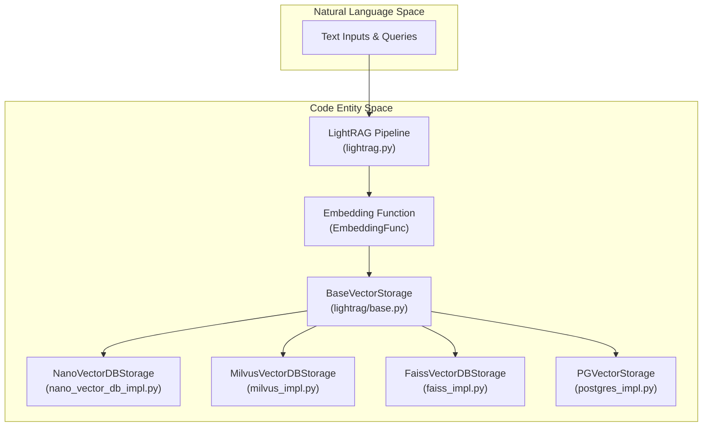
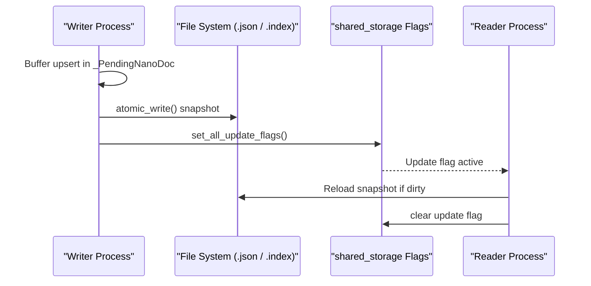

<!-- source: DeepWiki mcp.deepwiki.com · repo HKUDS/LightRAG · page 4.2 Vector Storage Backends · fetched 2026-11-09 -->

# Vector Storage Backends

Relevant source files

The following files were used as context for generating this wiki page:

- [docs/design/PgVectorFilteredSearch.md](docs/design/PgVectorFilteredSearch.md)
- [lightrag/kg/faiss_impl.py](lightrag/kg/faiss_impl.py)
- [lightrag/kg/json_doc_status_impl.py](lightrag/kg/json_doc_status_impl.py)
- [lightrag/kg/json_kv_impl.py](lightrag/kg/json_kv_impl.py)
- [lightrag/kg/milvus_impl.py](lightrag/kg/milvus_impl.py)
- [lightrag/kg/nano_vector_db_impl.py](lightrag/kg/nano_vector_db_impl.py)
- [lightrag/kg/networkx_impl.py](lightrag/kg/networkx_impl.py)
- [lightrag/kg/write_seq.py](lightrag/kg/write_seq.py)
- [tests/kg/faiss_impl/test_faiss_deferred_delete.py](tests/kg/faiss_impl/test_faiss_deferred_delete.py)
- [tests/kg/faiss_impl/test_faiss_deferred_embedding.py](tests/kg/faiss_impl/test_faiss_deferred_embedding.py)
- [tests/kg/faiss_impl/test_faiss_write_off_event_loop.py](tests/kg/faiss_impl/test_faiss_write_off_event_loop.py)
- [tests/kg/milvus_impl/test_milvus_deferred_embedding.py](tests/kg/milvus_impl/test_milvus_deferred_embedding.py)
- [tests/kg/milvus_impl/test_milvus_index_creation.py](tests/kg/milvus_impl/test_milvus_index_creation.py)
- [tests/kg/milvus_impl/test_milvus_off_event_loop.py](tests/kg/milvus_impl/test_milvus_off_event_loop.py)
- [tests/kg/nano_impl/test_nano_deferred_delete.py](tests/kg/nano_impl/test_nano_deferred_delete.py)
- [tests/kg/nano_impl/test_nano_deferred_embedding.py](tests/kg/nano_impl/test_nano_deferred_embedding.py)
- [tests/kg/nano_impl/test_nano_save_off_event_loop.py](tests/kg/nano_impl/test_nano_save_off_event_loop.py)
- [tests/kg/postgres_impl/test_postgres_iterative_scan.py](tests/kg/postgres_impl/test_postgres_iterative_scan.py)
- [tests/kg/test_write_seq.py](tests/kg/test_write_seq.py)

## Purpose and Scope

This wiki page documents the vector storage subsystem of LightRAG, covering the abstract interface `BaseVectorStorage` (`lightrag/base.py`), pluggable backend implementations (NanoVectorDB, Milvus, Qdrant, FAISS, PostgreSQL pgvector, OpenSearch, and MongoDB Atlas), deferred embedding optimization, concurrency protocols, index configuration, and vector space provenance markers.

Sources: [lightrag/base.py:1-180](), [lightrag/kg/nano_vector_db_impl.py:41-79](), [lightrag/kg/milvus_impl.py:1-125](), [lightrag/kg/faiss_impl.py:61-110]()

---

## Core Interface and Architecture

LightRAG abstracts similarity search and vector persistence behind `BaseVectorStorage`. Every backend manages three primary namespaces corresponding to knowledge graph components: chunks, entities, and relations.

Title: Vector Storage Bridging Natural Language to Code Entities

Sources: [lightrag/base.py:1-180](), [lightrag/kg/nano_vector_db_impl.py:60-98](), [lightrag/kg/milvus_impl.py:37-44](), [lightrag/kg/faiss_impl.py:61-110]()

---

## Backend Implementation Details

### 1. NanoVectorDB and FAISS (File-Backed Snapshot Backends)

Both `NanoVectorDBStorage` (`lightrag/kg/nano_vector_db_impl.py`) and `FaissVectorDBStorage` (`lightrag/kg/faiss_impl.py`) maintain process-local memory synchronized via file snapshots and shared-storage update flags.

- **NanoVectorDB**: Serializes an in-memory `NanoVectorDB` instance to `vdb_<namespace>.json`. Uses `_PendingNanoDoc` to buffer documents before embedding [lightrag/kg/nano_vector_db_impl.py:41-58]().
- **FAISS**: Splits state between a FAISS index (`faiss_index_<namespace>.index`) and a metadata dictionary (`.index.meta.json`), with `.space.json` storing vector space provenance markers [lightrag/kg/faiss_impl.py:62-154](). Buffers inserts in `_PendingFaissDoc` using L2-normalized float32 numpy arrays [lightrag/kg/faiss_impl.py:42-59]().

Title: File-Backed Synchronization Protocol

Sources: [lightrag/kg/nano_vector_db_impl.py:41-160](), [lightrag/kg/faiss_impl.py:42-154](), [lightrag/kg/shared_storage.py:23-37]()

---

### 2. MilvusVectorDBStorage

`MilvusVectorDBStorage` (`lightrag/kg/milvus_impl.py`) integrates with Milvus 2.x via `MilvusClient`. Because synchronous gRPC calls block the event loop, database operations run inside a dedicated thread pool (`_MILVUS_EXECUTOR`) managed by `run_in_milvus_executor` and `run_in_milvus_executor_uninterruptible` [lightrag/kg/milvus_impl.py:80-158]().

- **Index Configurations**: Parses parameters like `hnsw_m`, `ef_construction`, `ivf_nlist` via `MilvusIndexConfig`.
- **Payload Limits**: Chunks upserts to respect the ~64 MB gRPC message size ceiling.

Sources: [lightrag/kg/milvus_impl.py:80-158](), [lightrag/kg/milvus_impl.py:180-218]()

---

### 3. PostgreSQL Vector Storage (`pgvector`)

`PGVectorStorage` (`lightrag/kg/postgres_impl.py`) uses PostgreSQL with `pgvector` for vector persistence. 
- **Iterative Scan**: To overcome global HNSW index limitations across multiple workspaces, it utilizes `SET hnsw.iterative_scan = strict_order` (pgvector >= 0.8) within transactions via `_fetch_with_iterative_scan` [docs/design/PgVectorFilteredSearch.md:1-45]().
- **Budget Chunking**: Splits large upsert payloads via `_chunk_by_budget` to stay within statement limits [lightrag/kg/postgres_impl.py:10-100]().

Sources: [lightrag/kg/postgres_impl.py:10-100](), [docs/design/PgVectorFilteredSearch.md:1-45]()

---

## Deferred Embedding and Batching

To avoid redundant model invocation overhead, all major backends implement **deferred embedding**:
1. `upsert()` stores raw record content in a pending dictionary (`_pending_vector_docs`) without invoking the embedding function [lightrag/kg/nano_vector_db_impl.py:41-58]().
2. The embedding function is called in batched arrays only during `index_done_callback()` or lazy point lookups (`get_vectors_by_ids()`).
3. Cached vectors prevent re-computation during subsequent flushes.

Sources: [lightrag/kg/nano_vector_db_impl.py:41-60](), [lightrag/kg/faiss_impl.py:42-60](), [lightrag/kg/milvus_impl.py:180-210]()

---

## Vector Space Provenance

To guard against catastrophic failures from embedding model or dimension changes, backends employ **vector space markers**:
- Metadata or collection naming incorporates model identifiers and dimensions (e.g., `modelname_dim128`) [lightrag/kg/faiss_impl.py:24-32]().
- When loading storage, `assert_vector_space_matches` validates active configurations and raises `VectorSpaceMismatchError` on discrepancies [lightrag/kg/nano_vector_db_impl.py:27-32]().

Sources: [lightrag/kg/nano_vector_db_impl.py:27-32](), [lightrag/kg/faiss_impl.py:24-32](), [lightrag/exceptions.py:28-30]()

---

