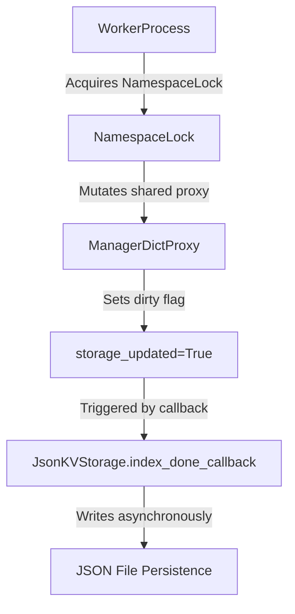
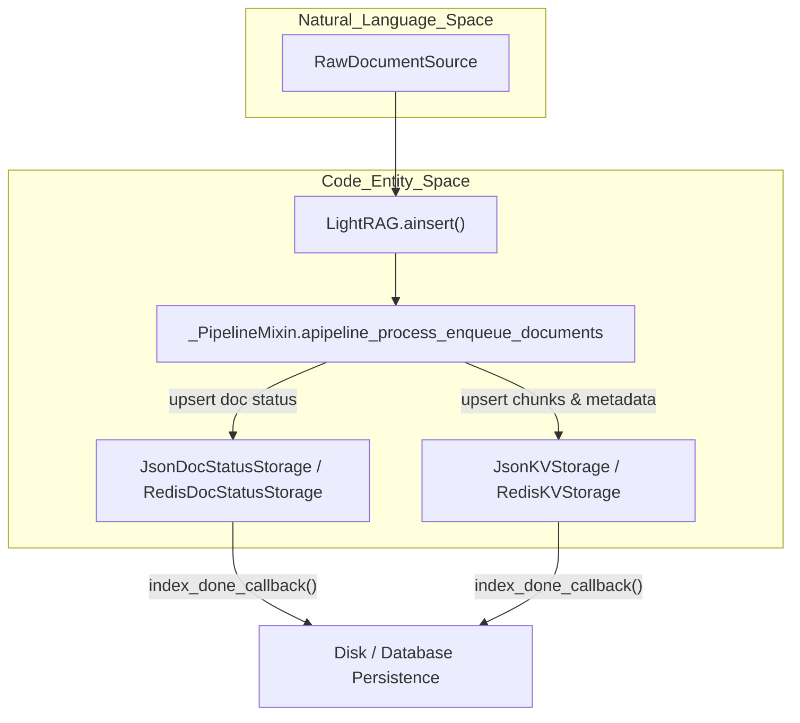
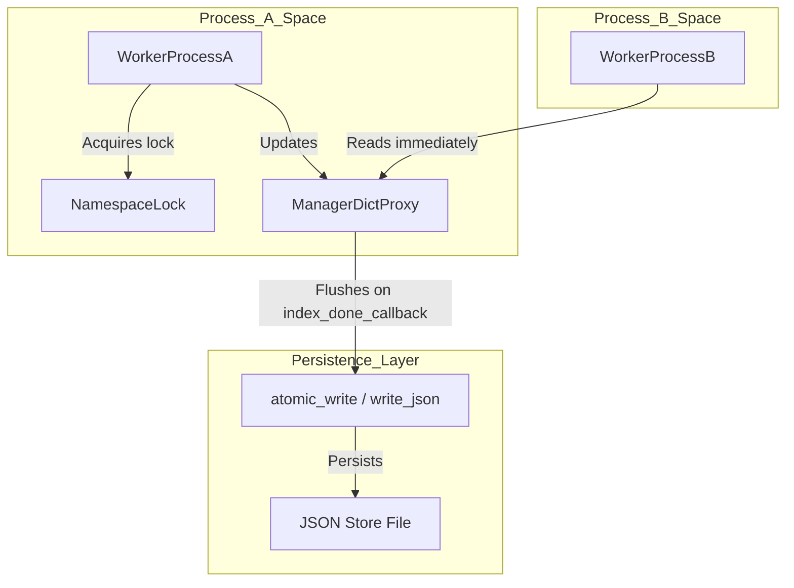

<!-- source: DeepWiki mcp.deepwiki.com · repo HKUDS/LightRAG · page 4.3 KV and Document Status Storage · fetched 2026-11-09 -->

# KV and Document Status Storage

Relevant source files

The following files were used as context for generating this wiki page:

- [lightrag/kg/faiss_impl.py](lightrag/kg/faiss_impl.py)
- [lightrag/kg/json_doc_status_impl.py](lightrag/kg/json_doc_status_impl.py)
- [lightrag/kg/json_kv_impl.py](lightrag/kg/json_kv_impl.py)
- [lightrag/kg/nano_vector_db_impl.py](lightrag/kg/nano_vector_db_impl.py)
- [lightrag/kg/networkx_impl.py](lightrag/kg/networkx_impl.py)
- [tests/kg/json_impl/test_json_doc_status_copy_on_read.py](tests/kg/json_impl/test_json_doc_status_copy_on_read.py)
- [tests/kg/json_impl/test_json_doc_status_track_id_hydration.py](tests/kg/json_impl/test_json_doc_status_track_id_hydration.py)
- [tests/kg/json_impl/test_json_kv_upsert_create_time.py](tests/kg/json_impl/test_json_kv_upsert_create_time.py)
- [tests/kg/mongo_impl/test_mongo_doc_status_track_id_hydration.py](tests/kg/mongo_impl/test_mongo_doc_status_track_id_hydration.py)
- [tests/kg/opensearch_impl/test_opensearch_kv_create_time_integration.py](tests/kg/opensearch_impl/test_opensearch_kv_create_time_integration.py)
- [tests/kg/opensearch_impl/test_opensearch_kv_upsert_create_time.py](tests/kg/opensearch_impl/test_opensearch_kv_upsert_create_time.py)
- [tests/kg/postgres_impl/test_postgres_doc_status_track_id_hydration.py](tests/kg/postgres_impl/test_postgres_doc_status_track_id_hydration.py)
- [tests/kg/redis_impl/fake_redis.py](tests/kg/redis_impl/fake_redis.py)
- [tests/kg/redis_impl/test_redis_doc_status_track_id_hydration.py](tests/kg/redis_impl/test_redis_doc_status_track_id_hydration.py)
- [tests/kg/redis_impl/test_redis_eviction_guard.py](tests/kg/redis_impl/test_redis_eviction_guard.py)
- [tests/kg/redis_impl/test_redis_kv_create_time_integration.py](tests/kg/redis_impl/test_redis_kv_create_time_integration.py)
- [tests/kg/redis_impl/test_redis_kv_upsert_create_time.py](tests/kg/redis_impl/test_redis_kv_upsert_create_time.py)
- [tests/kg/redis_impl/test_redis_scheduling_pages.py](tests/kg/redis_impl/test_redis_scheduling_pages.py)
- [tests/test_doc_processing_status_from_stored.py](tests/test_doc_processing_status_from_stored.py)

Key-Value (KV) and Document Status storage systems form the core persistence layer in LightRAG. They store metadata, text chunks, LLM cache data, and maintain the document lifecycle state machine during ingestion. To accommodate different deployment scenarios, LightRAG supports multiple pluggable backend implementations ranging from JSON-file based for simplicity to scalable storage using PostgreSQL, MongoDB, Redis, and OpenSearch.

This page details the architecture, implementation, and key mechanisms behind KV and Document Status storages. It covers the shared-memory and locking protocols, flattened cache key schemes, scheduling page support, and `track_id` hydration resilience used across backend systems.

---

## 1. Pluggable Storage Architecture

LightRAG’s KV and document status storages implement one of two primary base interfaces:

| Interface            | Purpose                                         |
|----------------------|------------------------------------------------|
| `BaseKVStorage`      | Generic key-value persistence for chunks, caches, and general metadata. |
| `DocStatusStorage`   | Specialized storage to track document lifecycle states and scheduling.  |

Both interfaces enforce support for asynchronous methods like `get_by_id`, `get_by_ids`, `upsert`, and paged querying for efficient scheduling.

Storage backends are initialized in LightRAG's core lifecycle (`_initialize_storages` in `lightrag.py`) and registered with namespaces like `text_chunks`, `full_docs`, `doc_status`, and cache namespaces. Different namespaces isolate persisted data logically per use case and workspace [lightrag/base.py:29-36](), [lightrag/lightrag.py:211-218]().

Sources: [lightrag/base.py:29-36](), [lightrag/lightrag.py:211-218]()

---

## 2. File-Based Implementations: JsonKVStorage and JsonDocStatusStorage

### Shared Memory and Concurrency Protocol

- Both `JsonKVStorage` and `JsonDocStatusStorage` provide JSON-file-backed storage while sharing in-memory state across multiple processes [lightrag/kg/json_kv_impl.py:32-66](), [lightrag/kg/json_doc_status_impl.py:57-97]().
- The shared data is managed via a cross-process `multiprocessing.Manager.dict()` proxy, enabling immediate mutation visibility among workers without explicit reloads.
- All accesses to the shared memory dictionary `_data` are guarded by an asynchronous `NamespaceLock` acquired via `get_namespace_lock`.
- The `storage_updated` flag operates with reversed semantics compared to vector/graph stores: it signals that there is dirty in-memory data awaiting disk persistence.

Sources: [lightrag/kg/json_kv_impl.py:32-159](), [lightrag/kg/json_doc_status_impl.py:57-174](), [lightrag/kg/shared_storage.py:10-54]()

### Copy-on-Read Protection and Cache Flattening

- **Copy-on-Read:** Read methods in `JsonDocStatusStorage` (such as `get_by_id`, `get_by_ids`, and `get_docs_paginated`) return deep copies of dictionaries and mutable structures (like `chunks_list` and nested `metadata`) to prevent external callers from corrupting internal storage state [tests/kg/json_impl/test_json_doc_status_copy_on_read.py:1-138]().
- **Flattened Cache Keys:** During `initialize`, legacy nested cache structures in `_cache` namespaces are migrated and flattened to unify access patterns and optimize point lookups [lightrag/kg/json_kv_impl.py:115-127]().

Sources: [lightrag/kg/json_kv_impl.py:115-127](), [tests/kg/json_impl/test_json_doc_status_copy_on_read.py:1-138]()

---

## 3. Database-Native Implementations

### PostgreSQL and MongoDB Storage Backends
- **PostgreSQL:** Implements batched upserts and retrievals via `asyncpg` with support for vector operations using `pgvector`. Keys are sanitized or hashed to respect database identifier constraints, and large batches are split using `_chunk_by_budget` heuristics [lightrag/kg/postgres_impl.py:69-171]().
- **MongoDB:** Manages KV and document status in dedicated collections combining workspace and namespace scoping. Bulk writes respect limits configured via `DEFAULT_MONGO_UPSERT_MAX_PAYLOAD_BYTES` [lightrag/kg/mongo_impl.py:64-121]().

### Redis KV Storage and Create-Time Preservation
- High-performance in-memory KV store using a connection pool managed by `RedisConnectionManager`.
- Resolves issue #3870 (replacement upserts dropping `create_time`) by utilizing a Lua script (`_CREATE_TIME_UPSERT_LUA`) combined with bounded `GETRANGE` prefix reads. This preserves the original `create_time` timestamp atomically on updates without pulling full values over the network [tests/kg/redis_impl/test_redis_kv_create_time_integration.py:1-120]().

Sources: [lightrag/kg/postgres_impl.py:69-171](), [lightrag/kg/mongo_impl.py:64-121](), [tests/kg/redis_impl/test_redis_kv_create_time_integration.py:1-120]()

---

## 4. Scheduling Pages for Document Processing

- Document Status Storage backends support paged listing of documents filtered by status (`get_docs_by_statuses_page`) to schedule pipeline workers efficiently [tests/kg/redis_impl/test_redis_scheduling_pages.py:100-122]().
- **Keyset Pagination:** Employs bounded memory heaps or composite cursors to page through large collections reliably without offset drift.
- **Filter Keys:** The `filter_keys` method quickly determines which document keys are absent or require retry processing [lightrag/kg/json_doc_status_impl.py:155-161]().

Sources: [lightrag/kg/json_doc_status_impl.py:155-161](), [tests/kg/redis_impl/test_redis_scheduling_pages.py:1-122]()

---

## 5. Track ID Hydration and Resilience

- Document status records group ingestion batches using a `track_id` field.
- **Hydration Resilience:** When executing `get_docs_by_track_id`, rows are hydrated using `_doc_processing_status_from_stored`. The implementation catches `KeyError` and `TypeError` exceptions to skip unhydratable or corrupted rows gracefully, preventing an invalid record in an upload batch from crashing queries for the entire `track_id` group [tests/kg/json_impl/test_json_doc_status_track_id_hydration.py:1-92]().
- **Backward/Forward Compatibility:** Unknown or future fields added by newer builds are safely ignored during instantiation rather than failing validation [tests/kg/json_impl/test_json_doc_status_track_id_hydration.py:94-118]().

Sources: [tests/kg/json_impl/test_json_doc_status_track_id_hydration.py:1-148]()

---

## 6. Architecture & Data Flow Diagrams

### Diagram 1: Natural Language Space to Storage Code Entity Space

Sources: [lightrag/lightrag.py:530-550](), [lightrag/kg/json_doc_status_impl.py:59-174](), [lightrag/kg/json_kv_impl.py:33-140]()

### Diagram 2: Commit and Shared-Memory Synchronization Flow

Sources: [lightrag/kg/json_kv_impl.py:90-159](), [lightrag/kg/json_doc_status_impl.py:125-154](), [lightrag/kg/shared_storage.py:10-54]()

---

## 7. Key Classes and Functions

| Class / Method                   | Description                                                                                   | Source                                                |
|--------------------------------|-----------------------------------------------------------------------------------------------|-------------------------------------------------------|
| `JsonKVStorage`                | Shared in-memory JSON KV store with atomic flush to disk and reversed flag semantics.        | [lightrag/kg/json_kv_impl.py:32-66]()                 |
| `JsonDocStatusStorage`         | Document status implementation with synchronous flush on upsert for process recovery.         | [lightrag/kg/json_doc_status_impl.py:57-97]()       |
| `JsonDocStatusStorage.get_docs_by_track_id` | Hydrates document batch by track_id with strict error trapping for malformed rows.     | [tests/kg/json_impl/test_json_doc_status_track_id_hydration.py:1-92]() |
| `get_namespace_lock`            | Returns async lock object for a namespace and workspace, critical for concurrency control.     | [lightrag/kg/shared_storage.py:14-28]()               |
| `try_initialize_namespace`      | Ensures only one process loads data from persistent store into shared dict at startup.          | [lightrag/kg/shared_storage.py:30-52]()               |

Sources: [lightrag/kg/json_kv_impl.py:32-66](), [lightrag/kg/json_doc_status_impl.py:57-97](), [lightrag/kg/shared_storage.py:10-52](), [tests/kg/json_impl/test_json_doc_status_track_id_hydration.py:1-92]()

---

