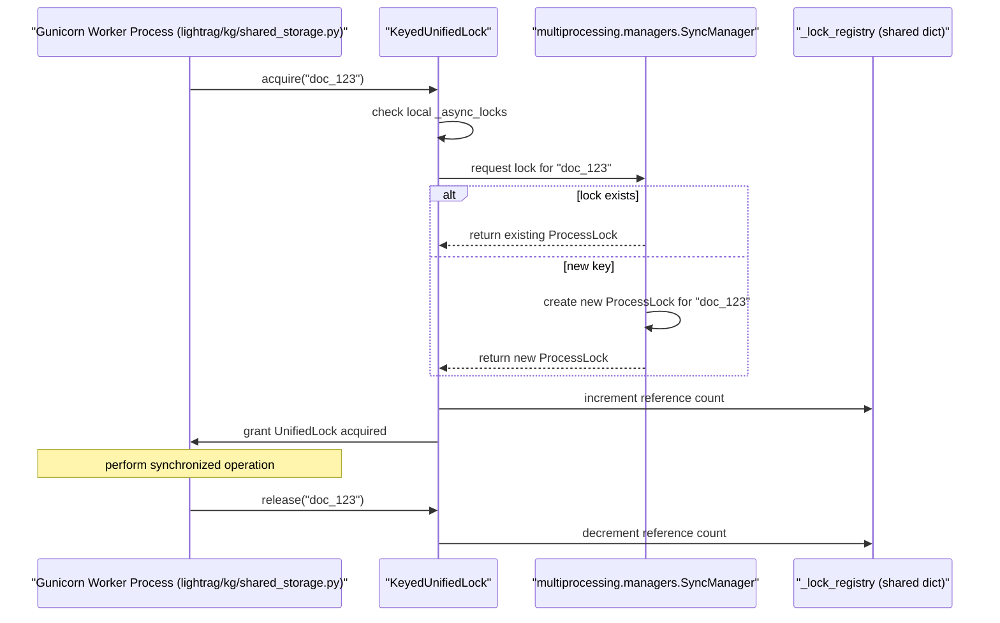
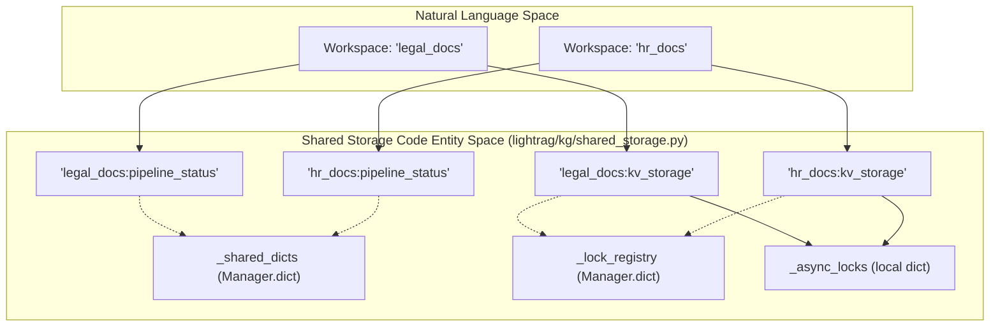

<!-- source: DeepWiki mcp.deepwiki.com · repo HKUDS/LightRAG · page 4.4 Shared Storage and Multi-Process Concurrency · fetched 2026-11-09 -->

# Shared Storage and Multi-Process Concurrency

Relevant source files

The following files were used as context for generating this wiki page:

- [docs/design/FileBackedSnapshotContract.md](docs/design/FileBackedSnapshotContract.md)
- [lightrag/api/routers/document_routes.py](lightrag/api/routers/document_routes.py)
- [lightrag/kg/file_fingerprint.py](lightrag/kg/file_fingerprint.py)
- [lightrag/kg/scan_job_store.py](lightrag/kg/scan_job_store.py)
- [lightrag/kg/shared_storage.py](lightrag/kg/shared_storage.py)
- [lightrag/pipeline.py](lightrag/pipeline.py)
- [lightrag/utils_pipeline.py](lightrag/utils_pipeline.py)
- [tests/api/config/test_api_config_scan_batch.py](tests/api/config/test_api_config_scan_batch.py)
- [tests/api/routes/test_admission_released_before_processing.py](tests/api/routes/test_admission_released_before_processing.py)
- [tests/api/routes/test_document_routes_chunking.py](tests/api/routes/test_document_routes_chunking.py)
- [tests/api/routes/test_document_routes_docx_archive.py](tests/api/routes/test_document_routes_docx_archive.py)
- [tests/api/routes/test_force_reset_drops_stalled_enqueues.py](tests/api/routes/test_force_reset_drops_stalled_enqueues.py)
- [tests/api/routes/test_scan_job_record.py](tests/api/routes/test_scan_job_record.py)
- [tests/api/test_recovery_fence_visibility.py](tests/api/test_recovery_fence_visibility.py)
- [tests/kg/faiss_impl/test_faiss_fingerprint_fence.py](tests/kg/faiss_impl/test_faiss_fingerprint_fence.py)
- [tests/kg/nano_impl/test_nano_fingerprint_fence.py](tests/kg/nano_impl/test_nano_fingerprint_fence.py)
- [tests/kg/networkx_impl/test_networkx_fingerprint_fence.py](tests/kg/networkx_impl/test_networkx_fingerprint_fence.py)
- [tests/kg/test_reservation_dead_process_recovery.py](tests/kg/test_reservation_dead_process_recovery.py)
- [tests/kg/test_reservation_primitives.py](tests/kg/test_reservation_primitives.py)
- [tests/kg/test_scan_job_store.py](tests/kg/test_scan_job_store.py)
- [tests/pipeline/conftest.py](tests/pipeline/conftest.py)
- [tests/pipeline/test_enqueue_ingress_exclusion.py](tests/pipeline/test_enqueue_ingress_exclusion.py)
- [tests/pipeline/test_manual_drain_enqueue_stall_fence.py](tests/pipeline/test_manual_drain_enqueue_stall_fence.py)
- [tests/pipeline/test_manual_drain_progress.py](tests/pipeline/test_manual_drain_progress.py)
- [tests/pipeline/test_parse_failure_doc_status_fields.py](tests/pipeline/test_parse_failure_doc_status_fields.py)
- [tests/pipeline/test_pipeline_analyze_multimodal.py](tests/pipeline/test_pipeline_analyze_multimodal.py)
- [tests/pipeline/test_pipeline_release_closure.py](tests/pipeline/test_pipeline_release_closure.py)
- [tests/test_docstring_budget.py](tests/test_docstring_budget.py)

This section details the shared storage infrastructure and concurrency control mechanisms in LightRAG. It explains the multi-process synchronization model, the key locking primitives (`KeyedUnifiedLock`, `NamespaceLock`, and `UnifiedLock`), the usage of multiprocessing `Manager` proxies, pipeline status flags, reservation semantics, and file fingerprint fences. These components collectively ensure consistent, deadlock-free operations across multiple concurrent processes and asynchronous workers, especially relevant for production deployments with Gunicorn or similar multi-worker servers.

---

## Purpose and Scope

LightRAG’s storage and indexing subsystems operate in environments with multiple worker processes running asynchronously. To ensure consistency and reliable coordination, the system implements:

- **Cross-process locks** combining multiprocessing locks with asyncio coroutine locks for intra-process concurrency,
- **Keyed and namespace locks** to provide fine-grained synchronization per logical unit (document, storage namespace),
- **Shared state dictionaries** managed by a multiprocessing `SyncManager` for inter-process communication,
- **Pipeline status flags and reservation tokens** for coordinating pipeline task states and preventing conflicts,
- **File fingerprint fences** to detect stale local caches or lost update notifications,
- **Scan job stores with leasing** for multi-worker scan job concurrency control.

This page is a detailed technical reference explaining the classes, data flows, and key functions supporting this concurrency and synchronization layer.

Sources: `lightrag/kg/shared_storage.py:1-188]`, `lightrag/pipeline.py:60-85]()`

---

## Shared Data Infrastructure

LightRAG uses a hybrid combination of:

- **`multiprocessing.Manager`**: A server process manages shared proxy dictionaries, locks, and counters,
- **`asyncio` primitives**: Per-worker event loop coroutine locks to prevent deadlocks within a worker,
- **In-memory caching with explicit invalidation** through update flags.

### Initialization and Lifecycle

- Initialization is performed by calling `initialize_share_data(workers: int = 1)` which sets up shared Manager proxies for:

  - `_shared_dicts`: a global dict mapping `namespace -> dict` of shared data,
  - `_lock_registry`: keyed locks mapping string keys to process locks,
  - `_lock_registry_count`: reference counts for keyed locks,
  - `_async_locks`: per-process asyncio.Lock for each key to protect coroutine-level access [lightrag/kg/shared_storage.py:122-134]().
  
- If `workers > 1`, a multiprocessing `SyncManager` instance is created to serve these proxies; otherwise, single-process fallback mechanisms are used.

- `finalize_share_data()` cleanly shuts down the Manager [lightrag/kg/shared_storage.py:43-46]() (see also cleanup hooks).

- In typical Gunicorn deployments, this initialization occurs in the master process before forking workers, so all worker processes inherit the proxy references [lightrag/kg/shared_storage.py:137-142]().

### Workspace Isolation and Namespacing

- All shared keys are prefixed by a concatenation of `workspace:namespace` (called *final_namespace*), enforcing workspace-level data isolation.

- For example, pipeline status for workspace `"legal_docs"` is stored in `_shared_dicts["legal_docs:pipeline_status"]`, inaccessible by another workspace `"hr_docs"`.

- Locks and data structures are similarly namespaced, allowing parallel isolated operations without contention across different workspaces [lightrag/kg/shared_storage.py:168-179]().

### Multiprocess + Coroutine Dual-Lock Strategy

- Each `UnifiedLock` internally manages two locks:

  1. **A cross-process lock**: a `multiprocessing.Lock` (obtained from the Manager), which prevents simultaneous access from different OS processes.

  2. **An asynchronous coroutine lock**: an `asyncio.Lock` local to the worker process, which prevents concurrent tasks within the same process from blocking each other.

- This hybrid approach is crucial because `multiprocessing.Lock.acquire()` is blocking and cannot be awaited, so cross-process lock acquisition is done inside a thread executor, allowing the event loop to remain responsive.

- The `UnifiedLock` class offers a seamless async context manager interface that acquires both locks in order and releases them together [lightrag/kg/shared_storage.py:100-103]().

Sources: `lightrag/kg/shared_storage.py:120-188]()`

---

## Key Locking Primitives

### KeyedUnifiedLock

- Implements a registry of locks keyed by arbitrary strings (e.g., document IDs, resource names).

- On `.acquire(key)`:

  - Obtains or creates a cross-process `multiprocessing.Lock` for the key from `_lock_registry`.

  - Uses a per-process `asyncio.Lock` for local coroutine synchronization on the same key.

  - Maintains reference counts to track active users of each lock.

- Includes periodic cleanup of lock entries that are idle and unused to prevent memory bloat [lightrag/kg/shared_storage.py:109-115]().

- Logging via `direct_log()` ensures lock acquisition/release events are visible even in multi-process forks [lightrag/kg/shared_storage.py:64-98]().

#### Diagram: Multi-Process Lock Acquisition Flow

Sources: `lightrag/kg/shared_storage.py:100-135]()`

### NamespaceLock

- Built on top of `UnifiedLock` and `KeyedUnifiedLock`, namespace locks enforce concurrency bounds per workspace and storage namespace (e.g., `kv_storage`, `graph_storage`, `vector_storage`).

- Functions:

  - `get_namespace_lock(workspace: str, namespace: str)` returns a cached `UnifiedLock` for that combination [lightrag/kg/shared_storage.py:70-75]().

  - `get_data_init_lock(workspace)` returns a global process lock used exclusively during backend initialization [lightrag/kg/shared_storage.py:128]().

Sources: `lightrag/kg/shared_storage.py:70-76]()`

---

## Manager Proxies and Shared Dictionaries

- Using the multiprocessing manager, the system makes `Manager.dict()` proxies to hold:

  - Arbitrary state per workspace (e.g., pipeline status flags),

  - Job tracking and reservation structures (scan jobs, pipeline reservations),

  - Lock registries for keyed locks.

- These proxies are thread-safe and multiprocess-safe but impose some overhead on frequent RPC calls; thus, the system uses:

  - Local caching of namespace data (`_namespace_data_cache`),

  - Periodic pruning and explicit signal flags to minimize cross-process chatter [lightrag/kg/shared_storage.py:173-178]().

Sources: `lightrag/kg/shared_storage.py:120-188]()`

---

## Pipeline Status Flags and State Coordination

- The central pipeline state is stored in the `pipeline_status` namespace dictionary for each workspace.

- Key flags include:

  - `busy`: Indicates ongoing operations (inserts, queries).

  - `destructive_busy`: Marks critical operations that may disrupt normal processing.

  - `request_pending`: Signals an incoming exclusive pipeline request awaiting current tasks to finish.

- These flags enable external and internal components to understand and coordinate pipeline operation phases, facilitating admission gating, safe exclusive resets, and parallel routine queries.

Sources: `lightrag/kg/shared_storage.py:153-161]()`

---

## Reservations and Conflict Management

- Reservation tokens and locks prevent multiple workers from processing the same document concurrently or conflicting on batch operations.

- Reservations have lease timeouts and can be reaped if a worker dies unexpectedly via `reap_dead_reservations_locked()` [lightrag/kg/shared_storage.py:78-82]().

- Functions like `acquire_processing_reservation` provide atomic acquisition of reservation ownership [lightrag/kg/shared_storage.py:70]().

Sources: `lightrag/kg/shared_storage.py:60-82]`, `lightrag/pipeline.py:60-85]()`

---

## File Fingerprint Fences

- File-backed storage backends (e.g., `NetworkXStorage`, `NanoVectorDBStorage`, `FaissVectorDBStorage`) use a **dual channel fence** to detect changes:

  1. A volatile `storage_updated` flag distributed via the Manager (can be lost transiently),

  2. A persistent **file fingerprint** consisting of `(st_mtime_ns, st_size)` metadata sampled **before** reading the file [lightrag/kg/file_fingerprint.py:64-105]().

- The fence prevents a process from silently overwriting another process's committed changes due to missed flags.

- If an unreadable or partially available stat is detected, the system treats it conservatively (`UNREADABLE`), avoiding false reloads or data loss [lightrag/kg/file_fingerprint.py:60-102]().

Sources: `lightrag/kg/file_fingerprint.py:1-145]()`, `tests/kg/networkx_impl/test_networkx_fingerprint_fence.py:1-135]()`

---

## Scan Job Store and Multi-Worker Coordination

- `ScanJobStore` (backs read and write of scan jobs in shared storage) uses Manager proxies for synchronized job leasing and status updates [lightrag/kg/scan_job_store.py:54-58]().

- Key features:

  - Job leases have TTLs (`SCAN_JOB_LEASE_SECONDS`) to avoid indefinite lockouts [lightrag/kg/scan_job_store.py:102]().

  - Conflict detection and automatic retry protocols to handle multi-worker races [lightrag/kg/scan_job_store.py:106]().

Sources: `lightrag/kg/scan_job_store.py:53-58]()`

---

## Summary Diagram: Logical Namespace to Code Entity Mapping

Sources: `lightrag/kg/shared_storage.py:120-188]()`

---

## Code Entity Overview

| Function / Class | Role | Source |
|------------------|------|--------|
| `initialize_share_data` | Initialize shared data and Manager proxies | [lightrag/kg/shared_storage.py:122-134]() |
| `UnifiedLock` | Async context manager combining multiprocessing and asyncio locks | [lightrag/kg/shared_storage.py:100-103]() |
| `KeyedUnifiedLock` | Registry of keyed locks with reference counting | [lightrag/kg/shared_storage.py:109-115]() |
| `acquire_processing_reservation` | Atomically acquire pipeline processing reservation | [lightrag/kg/shared_storage.py:70]() |
| `pipeline_status` dict in `_shared_dicts` | Flags for pipeline busy state, destructive operations, etc. | [lightrag/kg/shared_storage.py:153-161]() |
| `sample()` and `adopted()` | File fingerprinting for reload fence | [lightrag/kg/file_fingerprint.py:77-108]() |
| `ScanJobStore` and `ManagerScanJobStore` | Shared scan job state with leasing and conflict detection | [lightrag/kg/scan_job_store.py:54-58]() |

Sources: `lightrag/kg/shared_storage.py:1-188]`, `lightrag/kg/file_fingerprint.py:1-108]`, `lightrag/kg/scan_job_store.py:53-58]()`

---

