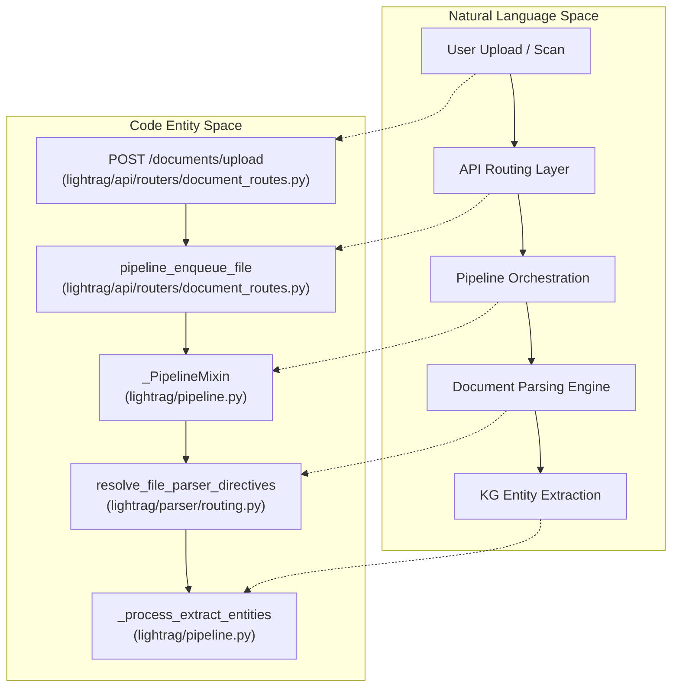
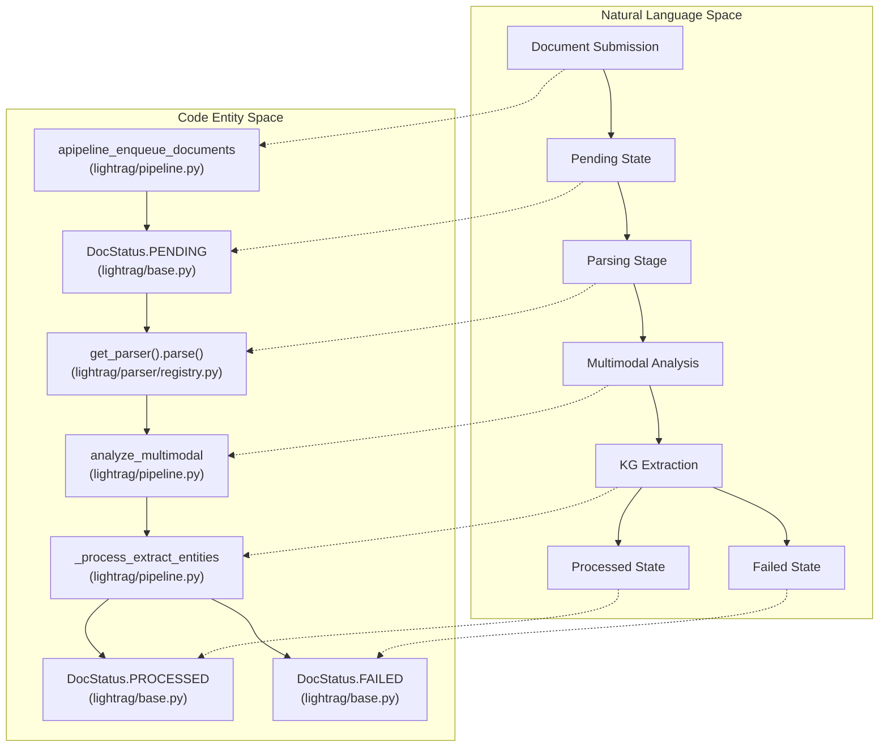

<!-- source: DeepWiki mcp.deepwiki.com · repo HKUDS/LightRAG · page 5 Document Ingestion Pipeline · fetched 2026-11-09 -->

# Document Ingestion Pipeline

Relevant source files

The following files were used as context for generating this wiki page:

- [docs/FileProcessingPipeline-zh.md](docs/FileProcessingPipeline-zh.md)
- [docs/FileProcessingPipeline.md](docs/FileProcessingPipeline.md)
- [docs/design/PipelineConcurrencyContract.md](docs/design/PipelineConcurrencyContract.md)
- [lightrag/api/routers/document_routes.py](lightrag/api/routers/document_routes.py)
- [lightrag/exceptions.py](lightrag/exceptions.py)
- [lightrag/kg/shared_storage.py](lightrag/kg/shared_storage.py)
- [lightrag/parser/param_schema.py](lightrag/parser/param_schema.py)
- [lightrag/parser/routing.py](lightrag/parser/routing.py)
- [lightrag/pipeline.py](lightrag/pipeline.py)
- [lightrag/utils_pipeline.py](lightrag/utils_pipeline.py)
- [tests/api/routes/test_document_routes_chunking.py](tests/api/routes/test_document_routes_chunking.py)
- [tests/api/routes/test_document_routes_docx_archive.py](tests/api/routes/test_document_routes_docx_archive.py)
- [tests/chunker/test_chunk_options_persistence.py](tests/chunker/test_chunk_options_persistence.py)
- [tests/parser/test_engine_params.py](tests/parser/test_engine_params.py)
- [tests/parser/test_hint_params.py](tests/parser/test_hint_params.py)
- [tests/pipeline/conftest.py](tests/pipeline/conftest.py)
- [tests/pipeline/test_parse_failure_doc_status_fields.py](tests/pipeline/test_parse_failure_doc_status_fields.py)
- [tests/pipeline/test_pipeline_analyze_multimodal.py](tests/pipeline/test_pipeline_analyze_multimodal.py)
- [tests/pipeline/test_pipeline_release_closure.py](tests/pipeline/test_pipeline_release_closure.py)

The document ingestion pipeline is a multi-stage, asynchronous system designed to transform raw files into structured Knowledge Graph (KG) entities and vector indices. It manages file parsing, multimodal analysis (images, tables, equations), text chunking, and LLM-driven entity-relation extraction, supporting both internal and external parsing engines.

## Pipeline Overview

The pipeline operates as a cascading series of worker queues, with documents transitioning through well-defined states tracked in persistent storage (`DocStatusStorage`). It is implemented primarily via `_PipelineMixin` in `lightrag/pipeline.py`, which integrates tightly with the `LightRAG` class core. Multiple parsing engines and chunking strategies allow flexible processing of diverse file types and content modalities [lightrag/pipeline.py:1-200](), [lightrag/base.py:20-50](), [lightrag/parser/routing.py:20-70]().

### High-Level Flow

1. **Document Ingress:**
   - Users upload documents through API endpoints exposed in `lightrag/api/routers/document_routes.py` (e.g., `POST /documents/upload`, `POST /documents/scan`, `POST /documents/texts`) that return a `track_id` for tracking [lightrag/api/routers/document_routes.py:40-60]().
2. **Admission and Queueing:**
   - Using distributed locks and admission control (`adopt_admission_ticket`, `_reserve_enqueue_slot`), documents are marked with `DocStatus.PENDING` or `DocStatus.PARSING` and fed into asynchronous queues [lightrag/pipeline.py:170-210](), [lightrag/kg/shared_storage.py:120-180]().
3. **Parsing:**
   - Files are parsed into an Intermediate Representation (IR) or simple text blocks by parser engines resolved through `resolve_file_parser_directives` or filename hints [lightrag/parser/routing.py:50-120](), [lightrag/api/routers/document_routes.py:108-117]().
4. **Multimodal Analysis:**
   - Extracted modality sidecars (images, tables, equations) are processed via Vision Language Models (VLMs) based on `process_options` flags [lightrag/pipeline.py:900-980]().
5. **Entity and Relation Extraction:**
   - Text chunks and multimodal descriptions are processed via LLMs to extract structured entities and relations, merged via `merge_nodes_and_edges` into KG and vector stores [lightrag/pipeline.py:10-40](), [lightrag/operate.py:30-60]().
6. **Finalization:**
   - The final integration marks documents as `DocStatus.PROCESSED`.

### Diagram: Natural Language Space to Code Entity Space (Ingestion Flow)

Sources:  
[lightrag/api/routers/document_routes.py:40-60](), [lightrag/pipeline.py:1-200](), [lightrag/parser/routing.py:50-120](), [lightrag/operate.py:30-60]()

---

## 5.1 Document Routes and Pipeline Orchestration

The API routing layer, implemented in `lightrag/api/routers/document_routes.py`, manages document ingestion endpoints including uploads, scans, and direct text insertion. It applies sophisticated locking and admission controls to prevent concurrency conflicts such as overlapping scans or destructive pipeline states (`destructive_busy`, `scanning_exclusive`) [lightrag/api/routers/document_routes.py:160-190]().

The actual pipeline orchestration is encapsulated in `_PipelineMixin` within `lightrag/pipeline.py`, which manages document state transitions through lifecycle states defined in `DocStatus` (`PENDING`, `PARSING`, `ANALYZING`, `PROCESSING`, `PROCESSED`, `FAILED`) [lightrag/pipeline.py:150-210]().

For details, see [Document Routes and Pipeline Orchestration](#5.1).

Sources:  
[lightrag/api/routers/document_routes.py:160-191](), [lightrag/pipeline.py:150-210](), [lightrag/base.py:20-40](), [lightrag/kg/shared_storage.py:160-180]()

---

## 5.2 Parser Engines and Routing

LightRAG supports multiple parsing engines to accommodate diverse document formats and extraction needs. Parsing engine selection respects a precedence order governed by `resolve_file_parser_directives` and filename hints [lightrag/parser/routing.py:50-120]().

- **Native:** Built-in support for `.docx`, `.md`, and `.textpack` formats, performing detailed document structure and multimodal element extraction [lightrag/parser/routing.py:30-70]().
- **MinerU and Docling:** External parser services for complex formats like PDFs and Office documents, configured via endpoint settings [lightrag/parser/routing.py:30-50](), [lightrag/parser/param_schema.py:150-180]().
- **Legacy:** Fallback parser for plaintext and unsupported files.

Parsing behavior can be configured using `ProcessOptions` flags controlling multimodal analysis (`i`, `t`, `e`), KG extraction bypass (`!`), and chunking strategies (`F`, `R`, `V`, `P`, `C`) [lightrag/parser/routing.py:140-180]().

For details, see [Parser Engines and Routing](#5.2).

Sources:  
[lightrag/parser/routing.py:50-180](), [lightrag/parser/param_schema.py:150-180](), [docs/FileProcessingPipeline.md:120-150](), [lightrag/api/routers/document_routes.py:108-117]()

---

## 5.3 Sidecar Format and Multimodal Processing

Advanced parsers (`native`, `mineru`, `docling`) produce an Intermediate Representation (IR) stored as sidecar files in the `__parsed__` directory. This includes structural blocks (`*.blocks.jsonl`), tables (`*.tables.json`), equations (`*.equations.json`), and assets (`*.blocks.assets/`) [docs/FileProcessingPipeline.md:90-105]().

Multimodal processing uses Vision Language Models (VLMs) via `analyze_multimodal` to generate summaries of images, tables, and equations, enriching downstream KG entity extraction [lightrag/pipeline.py:900-980]().

For details, see [Sidecar Format and Multimodal Processing](#5.3).

Sources:  
[lightrag/pipeline.py:900-980](), [lightrag/utils_pipeline.py:770-830](), [lightrag/constants.py:80-90]()

---

## Data Consistency and Storage

Document statuses are persisted in `DocStatusStorage`, ensuring reliable tracking and state durability across runs.

### Diagram: Natural Language Space to Code Entity Space (Lifecycle & State Transitions)

### Pipeline States Summary Table

| State          | Responsible Worker / Class                 | Output Artifact                         |
|----------------|-------------------------------------------|---------------------------------------|
| `PENDING`      | Admission control & queue assignment      | Metadata, status update               |
| `PARSING`      | Parser registry (`get_parser`)            | IR sidecar files, blocks JSONL        |
| `ANALYZING`    | VLM analyzer (`analyze_multimodal`)       | Image/Table/Equation semantic metadata|
| `PROCESSING`   | KG extraction (`_process_extract_entities`) | KG nodes/edges, text chunks           |
| `PROCESSED`    | Finalization / status update              | Persisted graph, vector indices       |

Sources:  
[lightrag/pipeline.py:150-210](), [lightrag/base.py:20-40](), [lightrag/utils_pipeline.py:20-60]()

---

Refer to the dedicated child pages for in-depth technical details and implementation:

- [Document Routes and Pipeline Orchestration](#5.1)  
- [Parser Engines and Routing](#5.2)  
- [Sidecar Format and Multimodal Processing](#5.3)

---

