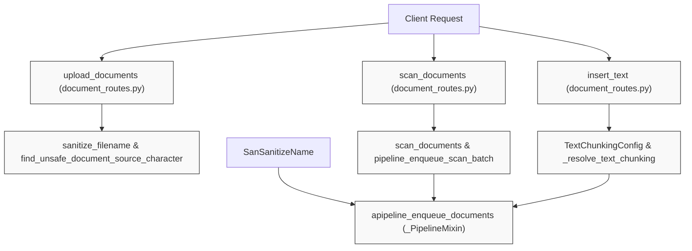
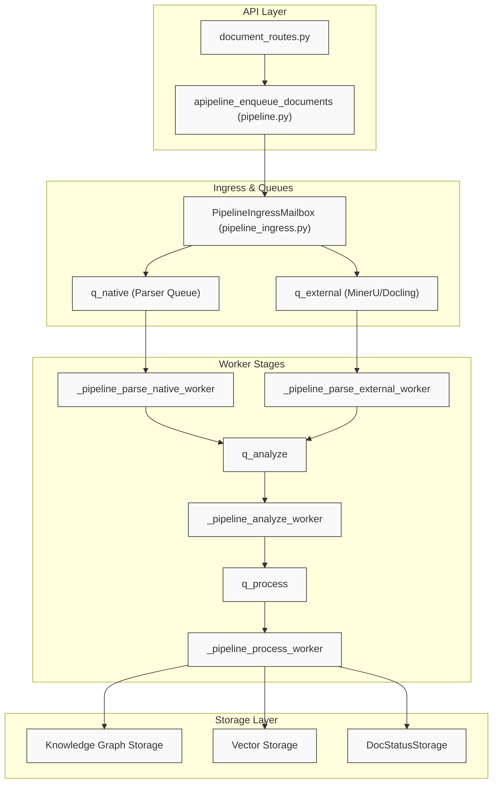
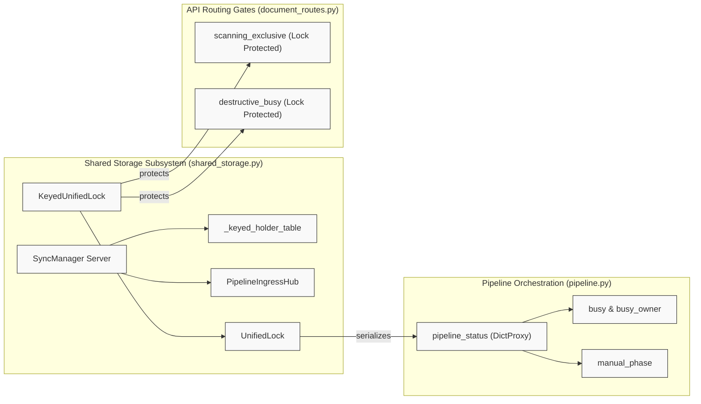

<!-- source: DeepWiki mcp.deepwiki.com · repo HKUDS/LightRAG · page 5.1 Document Routes and Pipeline Orchestration · fetched 2026-11-09 -->

# Document Routes and Pipeline Orchestration

Relevant source files

The following files were used as context for generating this wiki page:

- [lightrag/api/routers/document_routes.py](lightrag/api/routers/document_routes.py)
- [lightrag/kg/pipeline_ingress.py](lightrag/kg/pipeline_ingress.py)
- [lightrag/kg/shared_storage.py](lightrag/kg/shared_storage.py)
- [lightrag/pipeline.py](lightrag/pipeline.py)
- [lightrag/tools/README_SOURCE_CONFLICT_REPAIR.md](lightrag/tools/README_SOURCE_CONFLICT_REPAIR.md)
- [lightrag/tools/source_conflict_repair.py](lightrag/tools/source_conflict_repair.py)
- [lightrag/utils_pipeline.py](lightrag/utils_pipeline.py)
- [tests/api/routes/test_document_routes_chunking.py](tests/api/routes/test_document_routes_chunking.py)
- [tests/api/routes/test_document_routes_docx_archive.py](tests/api/routes/test_document_routes_docx_archive.py)
- [tests/api/routes/test_scan_candidate_spool.py](tests/api/routes/test_scan_candidate_spool.py)
- [tests/api/routes/test_scan_classification_exits.py](tests/api/routes/test_scan_classification_exits.py)
- [tests/api/routes/test_scan_streaming_batches.py](tests/api/routes/test_scan_streaming_batches.py)
- [tests/api/routes/test_source_conflict_routes.py](tests/api/routes/test_source_conflict_routes.py)
- [tests/kg/test_pipeline_ingress.py](tests/kg/test_pipeline_ingress.py)
- [tests/pipeline/conftest.py](tests/pipeline/conftest.py)
- [tests/pipeline/test_parse_failure_doc_status_fields.py](tests/pipeline/test_parse_failure_doc_status_fields.py)
- [tests/pipeline/test_pipeline_analyze_multimodal.py](tests/pipeline/test_pipeline_analyze_multimodal.py)
- [tests/pipeline/test_pipeline_failed_retry_semantics.py](tests/pipeline/test_pipeline_failed_retry_semantics.py)
- [tests/pipeline/test_pipeline_ingress_exit.py](tests/pipeline/test_pipeline_ingress_exit.py)
- [tests/pipeline/test_pipeline_release_closure.py](tests/pipeline/test_pipeline_release_closure.py)
- [tests/pipeline/test_scheduler_memory_bounded.py](tests/pipeline/test_scheduler_memory_bounded.py)
- [tests/pipeline/test_scheduler_memory_bounded_e2e.py](tests/pipeline/test_scheduler_memory_bounded_e2e.py)
- [tests/tools/test_source_conflict_repair_cli.py](tests/tools/test_source_conflict_repair_cli.py)

This page details the FastAPI-based document management routes (`lightrag/api/routers/document_routes.py`) and the underlying multi-stage ingestion pipeline (`lightrag/pipeline.py`). It explains the implementation of document endpoints, the `_PipelineMixin` enqueue and processing lifecycle, cascading worker queues, pipeline ingress mechanisms (`lightrag/kg/pipeline_ingress.py`), admission control, hybrid locking (`lightrag/kg/shared_storage.py`), cancellation, and automatic or manual resumption.

---

## API Endpoints and Document Management

The API for document operations is defined in `lightrag/api/routers/document_routes.py`. It provides RESTful endpoints to manage documents through their lifecycle stages (upload, scan, insert text, delete, and status queries). These routes integrate with the `LightRAG` instance and its document status tracking system (`DocStatusStorage`).

### Core API Endpoints Summary

| Endpoint | HTTP Method | Handler Function | Description |
|---|---|---|---|
| `/documents/upload` | POST | `upload_documents` | Accepts multipart file uploads, sanitizes filenames, moves files to the workspace input directory. |
| `/documents/scan` | POST | `scan_documents` | Initiates a background directory scan to detect new, modified, or deleted files. |
| `/documents/insert_text` | POST | `insert_text` | Inserts raw text content directly into the document pipeline with per-request chunking options. |
| `/documents/delete` | DELETE | `delete_documents` | Deletes documents, cleaning up associated KG entities and vector embeddings. |
| `/documents/status` | GET | `get_document_status` | Retrieves processing status and metadata for specified documents. |
| `/documents/pipeline_status` | GET | `get_pipeline_status` | Returns global ingestion pipeline status flags (busy, scanning, etc.). |

Upload routes sanitize filenames to prevent path traversal or injection issues via `sanitize_filename` and enforce safe document source naming conventions using `find_unsafe_document_source_character`.

Sources: `[lightrag/api/routers/document_routes.py:522-754]()`, `[lightrag/api/routers/document_routes.py:1120-1280]()`

### Filename Sanitization and Parser Directives

- Filenames are checked against `_UNSAFE_DOCUMENT_SOURCE_CHAR_PATTERN` to block control characters, surrogates, and un-serializable symbols.
- LightRAG supports parser hints embedded in filenames (e.g. `document.[native-iet].pdf`) to specify parsing engines and options.
- The parser engine and options are resolved via `resolve_file_parser_directives` and `resolve_stored_document_parser_engine` in `lightrag/parser/routing.py` and `lightrag/pipeline.py`.

Sources: `[lightrag/api/routers/document_routes.py:118-183]()`, `[lightrag/pipeline.py:101-116]()`

Diagram: API Routing and Document Ingestion Entrypoint

Sources: `[lightrag/api/routers/document_routes.py:522-780](), [lightrag/pipeline.py:168-213]()`

---

## Pipeline Orchestration via _PipelineMixin and Cascading Worker Queues

The core orchestration of document ingestion is implemented within the `_PipelineMixin` class in `lightrag/pipeline.py`. This mixin isolates the asynchronous processing pipeline from storage management and querying.

### Enqueueing and Workspace Ingress Mailbox

- Clients invoke `apipeline_enqueue_documents` to submit documents.
- The enqueue stage performs content hash deduplication, status initialization as `PENDING`, and chunking parameters snapshotting.
- Notifications are posted to the workspace-scoped `PipelineIngressMailbox` (`lightrag/kg/pipeline_ingress.py`), which manages document messages, auto-rescan dirty flags, and sticky manual retries.

### Cascading Worker Architecture

Sources: `[lightrag/pipeline.py:168-213]()`, `[lightrag/kg/pipeline_ingress.py:1-128]()`

### Worker Stage Responsibilities

| Stage | Worker Method | Description |
|---|---|---|
| Parsing | `_pipeline_parse_native_worker`, `_pipeline_parse_external_worker` | Consumes from parser-specific queues and parses documents via native or external (MinerU/Docling) engines. |
| Analysis | `_pipeline_analyze_worker` | Performs multimodal content analysis (images, drawings, tables, equations) using Vision Language Models (VLM). |
| Processing | `_pipeline_process_worker` | Final stage: chunks text, extracts entities/relations via LLM handlers, merges results into the KG, and marks the document as `PROCESSED`. |

Sources: `[lightrag/pipeline.py:615-700](), [lightrag/pipeline.py:720-760](), [lightrag/pipeline.py:809-860]()`

---

## Admission Control, Locking, Cancellation, and Resumption

### Admission Control and Backpressure

The pipeline uses explicit admission control to manage processing backpressure and prevent resource exhaustion.

- Upload, scan, or insert requests may be refused with HTTP 429 (`PipelineBackpressureError`) when active document counts or queue sizes exceed configured limits.
- Admission tickets are adopted via `adopt_admission_ticket` in `lightrag/api/admission.py`.
- If rejected, `_ADMISSION_RETRY_AFTER_SECONDS` (30 seconds) guides client retry intervals.

Sources: `[lightrag/api/routers/document_routes.py:168-182](), [lightrag/api/admission.py:1-50]()`

### Locking and Concurrency

LightRAG employs a hybrid locking mechanism (`lightrag/kg/shared_storage.py`) supporting both inter-process synchronization and async coroutine-safe locks:

- `KeyedUnifiedLock` and `UnifiedLock` manage lock keys globally across workers using `multiprocessing.Lock` and `asyncio.Lock`.
- Critical pipeline state flags (`busy`, `scanning_exclusive`, `destructive_busy`) protect against concurrent conflicting operations (e.g., running a directory scan during document deletion).
- `source_candidate_set_lock` and `ENQUEUE_SERIALIZE_LOCK_NAMESPACE` serialize document inserts and conflict resolutions.

Diagram: Concurrency and Shared State Locking

Sources: `[lightrag/kg/shared_storage.py:120-190](), [lightrag/pipeline.py:40-70](), [lightrag/api/routers/document_routes.py:170-180]()`

### Cancellation and Resumption

- Ingestion tracking honors the `cancellation_requested` flag within `pipeline_status`.
- Worker coroutines check cancellation states at each loop iteration.
- Upon cancellation, affected documents are marked `FAILED`, and the worker terminates gracefully.
- The pipeline is resumable: documents stuck in intermediate states (`PROCESSING`, `PARSING`, `ANALYZING`) are automatically re-enqueued on subsequent startup (`_AUTO_RESUME_DOC_STATUSES`).
- Failed documents require explicit manual retry triggers.

Sources: `[lightrag/pipeline.py:165-190](), [lightrag/pipeline.py:540-600]()`

---

## References and Sources

- `lightrag/api/routers/document_routes.py:1-780, 1120-1280`
- `lightrag/pipeline.py:1-213, 367-600, 615-860`
- `lightrag/kg/shared_storage.py:100-190`
- `lightrag/kg/pipeline_ingress.py:1-128`
- `lightrag/utils_pipeline.py:70-140`
- `lightrag/base.py:20-45`

---

