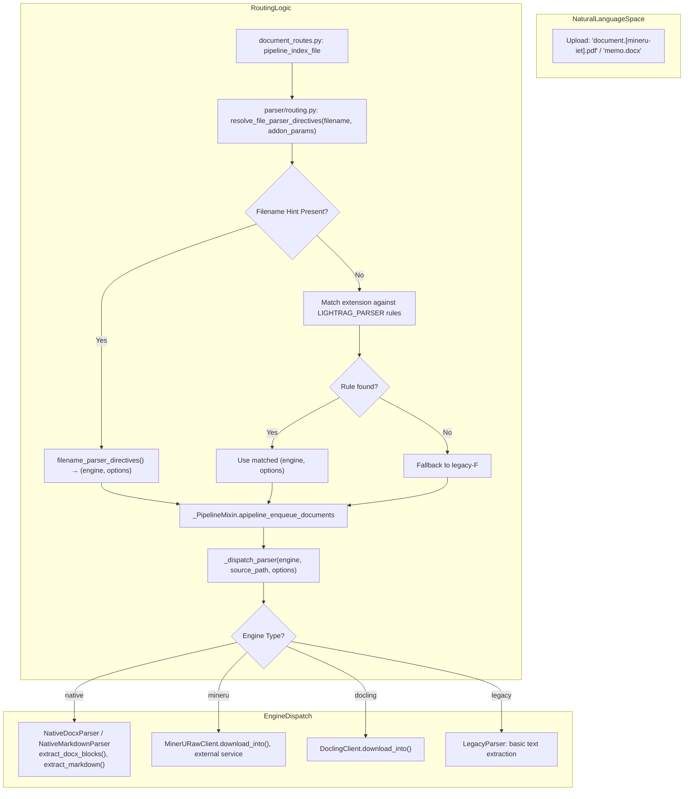
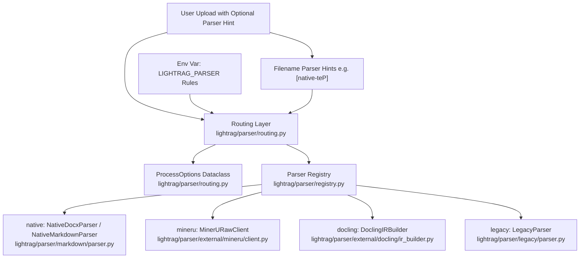

<!-- source: DeepWiki mcp.deepwiki.com · repo HKUDS/LightRAG · page 5.2 Parser Engines and Routing · fetched 2026-11-09 -->

# Parser Engines and Routing

<details>
<summary>Relevant source files</summary>

The following files were used as context for generating this wiki page:

- [docs/FileProcessingPipeline-zh.md](docs/FileProcessingPipeline-zh.md)
- [docs/FileProcessingPipeline.md](docs/FileProcessingPipeline.md)
- [docs/ParserDebugCLI-zh.md](docs/ParserDebugCLI-zh.md)
- [docs/ParserDebugCLI.md](docs/ParserDebugCLI.md)
- [docs/ThirdPartyParser-zh.md](docs/ThirdPartyParser-zh.md)
- [docs/ThirdPartyParser.md](docs/ThirdPartyParser.md)
- [docs/design/PipelineConcurrencyContract.md](docs/design/PipelineConcurrencyContract.md)
- [lightrag/exceptions.py](lightrag/exceptions.py)
- [lightrag/parser/cli.py](lightrag/parser/cli.py)
- [lightrag/parser/debug.py](lightrag/parser/debug.py)
- [lightrag/parser/external/_common.py](lightrag/parser/external/_common.py)
- [lightrag/parser/external/_zip.py](lightrag/parser/external/_zip.py)
- [lightrag/parser/external/docling/client.py](lightrag/parser/external/docling/client.py)
- [lightrag/parser/external/mineru/client.py](lightrag/parser/external/mineru/client.py)
- [lightrag/parser/legacy/extractors.py](lightrag/parser/legacy/extractors.py)
- [lightrag/parser/legacy/parser.py](lightrag/parser/legacy/parser.py)
- [lightrag/parser/markdown/extract.py](lightrag/parser/markdown/extract.py)
- [lightrag/parser/markdown/ir_builder.py](lightrag/parser/markdown/ir_builder.py)
- [lightrag/parser/markdown/parser.py](lightrag/parser/markdown/parser.py)
- [lightrag/parser/markdown/raw_cache.py](lightrag/parser/markdown/raw_cache.py)
- [lightrag/parser/param_schema.py](lightrag/parser/param_schema.py)
- [lightrag/parser/registry.py](lightrag/parser/registry.py)
- [lightrag/parser/routing.py](lightrag/parser/routing.py)
- [tests/chunker/test_chunk_options_persistence.py](tests/chunker/test_chunk_options_persistence.py)
- [tests/chunker/test_chunking_raw_lightrag_parity.py](tests/chunker/test_chunking_raw_lightrag_parity.py)
- [tests/conftest.py](tests/conftest.py)
- [tests/parser/docx/test_native_docx_golden.py](tests/parser/docx/test_native_docx_golden.py)
- [tests/parser/docx/test_validation_raises.py](tests/parser/docx/test_validation_raises.py)
- [tests/parser/external/docling/test_client.py](tests/parser/external/docling/test_client.py)
- [tests/parser/external/docling/test_docling_download_bounds.py](tests/parser/external/docling/test_docling_download_bounds.py)
- [tests/parser/external/docling/test_parse_docling_sidecar.py](tests/parser/external/docling/test_parse_docling_sidecar.py)
- [tests/parser/external/mineru/test_cache.py](tests/parser/external/mineru/test_cache.py)
- [tests/parser/external/mineru/test_client.py](tests/parser/external/mineru/test_client.py)
- [tests/parser/external/mineru/test_mineru_download_bounds.py](tests/parser/external/mineru/test_mineru_download_bounds.py)
- [tests/parser/external/test_common.py](tests/parser/external/test_common.py)
- [tests/parser/markdown/conftest.py](tests/parser/markdown/conftest.py)
- [tests/parser/markdown/test_e2e_sidecar.py](tests/parser/markdown/test_e2e_sidecar.py)
- [tests/parser/markdown/test_extract.py](tests/parser/markdown/test_extract.py)
- [tests/parser/markdown/test_image_budgets.py](tests/parser/markdown/test_image_budgets.py)
- [tests/parser/markdown/test_ir_builder.py](tests/parser/markdown/test_ir_builder.py)
- [tests/parser/markdown/test_parser.py](tests/parser/markdown/test_parser.py)
- [tests/parser/markdown/test_raw_cache.py](tests/parser/markdown/test_raw_cache.py)
- [tests/parser/markdown/test_redirect_guard.py](tests/parser/markdown/test_redirect_guard.py)
- [tests/parser/test_engine_params.py](tests/parser/test_engine_params.py)
- [tests/parser/test_hint_params.py](tests/parser/test_hint_params.py)
- [tests/parser/test_legacy_extractors.py](tests/parser/test_legacy_extractors.py)
- [tests/parser/test_legacy_parser.py](tests/parser/test_legacy_parser.py)
- [tests/parser/test_parse_native_lightrag_e2e.py](tests/parser/test_parse_native_lightrag_e2e.py)
- [tests/parser/test_parser_cli.py](tests/parser/test_parser_cli.py)
- [tests/parser/test_registry.py](tests/parser/test_registry.py)
- [tests/pipeline/test_chunk_options_regex_scrub.py](tests/pipeline/test_chunk_options_regex_scrub.py)
- [tests/pipeline/test_manual_exclusive_reset.py](tests/pipeline/test_manual_exclusive_reset.py)
- [tests/pipeline/test_parse_engine_early_persist.py](tests/pipeline/test_parse_engine_early_persist.py)
- [tests/pipeline/test_parse_warnings_split_persist.py](tests/pipeline/test_parse_warnings_split_persist.py)
- [tests/pipeline/test_pipeline_internal_abort.py](tests/pipeline/test_pipeline_internal_abort.py)
- [tests/pipeline/test_strict_capability_gate.py](tests/pipeline/test_strict_capability_gate.py)
- [tests/pipeline/test_validator_strict_content_probe.py](tests/pipeline/test_validator_strict_content_probe.py)

</details>


The LightRAG document ingestion pipeline employs a flexible and extensible routing system to decide how each uploaded file is parsed into a structured representation suitable for chunking, indexing, and knowledge graph construction. This section outlines the core concepts, resolution precedence, and key components involved in selecting and using parsing engines, configuring processing options, and integrating external parsers. This is a parent page describing the high-level orchestration; for detailed DOCX internals, see the child page [Native DOCX Parser and Smart Heading](#5.2.1).

---

## Purpose and Scope

This section focuses on:

- How `resolve_file_parser_directives` determines the parsing engine and process options for each file.
- The interpretation and role of process options flags affecting multimodal analysis, chunking, and KG extraction.
- The use of the environment variable `LIGHTRAG_PARSER` and filename hints for routing.
- Overview of the main parsing engines: native DOCX/Markdown, MinerU, Docling externals, and the legacy fallback.
- The parser registry and interaction with the CLI tool for developer testing.

Sources: `lightrag/parser/routing.py:80-142()`, `docs/FileProcessingPipeline.md:30-76()`

---

## Parser Directive Resolution and Routing Precedence

The core routing authority is implemented in `lightrag/parser/routing.py`. The directives resolved here determine which parser engine and what processing options apply to a given file throughout ingestion.

### Resolution Precedence

The resolution follows this strict precedence:

1. **Filename Hint Parsing**: Immediate overrides embedded in the filename, such as `report.[native-teP].docx`. `filename_parser_directives` extracts an explicit parse engine and option flags if present. If invalid, an error is raised. [lightrag/parser/routing.py:441-460]()

2. **Environment-Configured Rules (`LIGHTRAG_PARSER`)**: A globally scoped, comma-separated set of extension-based rules maps file types to engines and options. The first matching rule by file extension applies. Missing or invalid rules fall through. [lightrag/parser/routing.py:453-460](), [docs/FileProcessingPipeline.md:51-75]()

3. **Legacy Fallback**: When neither filename hint nor global routing matches, the system falls back to the `legacy` parser and `F` (fixed) chunking as a safe default. [lightrag/parser/routing.py:458-460]()

### Filename Hint Syntax

Filename hints allow per-file precise control without modifying global config:

- `[engine]` — sets only the parser engine; uses that engine's default options.
- `[engine-options]` — sets both engine and processing options (e.g., `native-teP`).
- `[-options]` — overrides options only, keeping the engine resolved by global rules.

This is parsed via the regex `_PARSER_HINT_RE` and associated helper functions. [lightrag/parser/routing.py:58-70]()

### Environment Variable `LIGHTRAG_PARSER`

This environment variable defines the default routing rules:

```
EXTENSION:ENGINE-OPTIONS[,EXTENSION:ENGINE-OPTIONS,...]
```

**Example:**
```bash
LIGHTRAG_PARSER=*:native-iteP,*:mineru-iteP,*:legacy-R
```

- `*:` as a wildcard matches any extension if no more specific rules apply.
- `native`, `mineru`, and `legacy` denote parsing engines.
- Options like `i` (images), `t` (tables), `e` (equations), and chunking strategies (`P`, `R`, etc.) tailor processing.

Rules are evaluated left to right by extension; the first applicable rule applies. If the engine specified requires an endpoint (e.g., MinerU local/official HTTP endpoint), the rule is skipped if not configured. [docs/FileProcessingPipeline.md:40-75](), [lightrag/parser/routing.py:418-455]()

Sources: `lightrag/parser/routing.py:58-70()`, `docs/FileProcessingPipeline.md:30-76()`

---

## Process Options Flags

File processing behavior is controlled by single-character flags encoded as a string, parsed into an immutable `ProcessOptions` dataclass instance [lightrag/parser/routing.py:149-163](). This class decodes these flags into booleans and an enum-like chunking strategy, influencing multimodal analysis and chunking algorithms.

| Flag | Description                              | Details                                                                                 |
|-------|----------------------------------------|-----------------------------------------------------------------------------------------|
| `i`   | Enable Image Analysis                   | Calls VLM to analyze images for summary embedding and metadata. [lightrag/parser/routing.py:158]() |
| `t`   | Enable Table Analysis                   | Enables VLM-powered processing of detected tables. [lightrag/parser/routing.py:159]() |
| `e`   | Enable Equation Analysis                | Extracts and analyzes mathematical formulas and equations. [lightrag/parser/routing.py:160]() |
| `!`   | Skip KG Entity/Relation Extraction     | Prevents entity and relation extraction, vector embedding only (naive/mix retrievals). [lightrag/parser/routing.py:161]() |
| `F`   | Fixed Chunking                         | Legacy fixed-length or split-by-delimiter chunking. [lightrag/parser/routing.py:162]() |
| `R`   | Recursive Chunking                     | Adaptive split on paragraph and sentence boundaries (Default fallback chunker). [docs/FileProcessingPipeline.md:131]() |
| `V`   | Vector Semantic Chunking               | Embedding-based semantic chunking, combined with recursive fallback for oversize chunks. [docs/FileProcessingPipeline.md:132]() |
| `P`   | Paragraph Semantic Chunking (native)  | Chunks strictly by heading paragraphs, avoiding cross-heading mixing; requires native IR. [docs/FileProcessingPipeline.md:133]() |

The `chunking_explicit` property indicates if chunking was explicitly set or fallen back to default. [lightrag/parser/routing.py:165-176]()

### Parameterized Hint Options

Hints and environment rules may embed parameter blocks, e.g., `[-R(chunk_ts=800,chunk_ol=80)]`, providing fine-grained control over chunk token sizes, chunk overlap, and engine-specific configurations.

- Chunking parameters:
  - `chunk_token_size` (`chunk_ts`): Number of tokens per chunk. [lightrag/parser/param_schema.py:145-151]()
  - `chunk_overlap_token_size` (`chunk_ol`): Overlap tokens between chunks. [lightrag/parser/param_schema.py:152-166]()
  - `drop_references` (`drop_rf`): Drop reference paragraphs before chunking (paragraph chunker only). [lightrag/parser/param_schema.py:170-175]()

- Engine parameters: Examples include `page_range`, `language` for MinerU, or `force_ocr` for Docling.

Parsing and validation of these parameters is handled in `lightrag/parser/param_schema.py`. [lightrag/parser/param_schema.py:60-103]()

Sources: `lightrag/parser/routing.py:149-176()`, `lightrag/parser/param_schema.py:60-175()`, `docs/FileProcessingPipeline.md:120-170()`

---

## Supported Parser Engines Overview

LightRAG supports multiple parsing engines, usable independently or combined by routing rules:

### 1. Native Parsers (`native`)

- **DOCX Parser**: Deeply inspects `.docx` files extracting paragraph, heading, numbering, table, and equation information. Uses `python-docx` to read document xml, applies guardrails for zip bomb risks and malformed content, and extracts a rich IR for paragraph semantic chunking. For details, see [Native DOCX Parser and Smart Heading](#5.2.1).

- **Markdown Parser**: Handles `.md` and `.textpack` (zipped TextBundle) formats. Features safe image handling including base64 decoding, file reference resolution with whitelists, SSRF-protected external HTTP image download with size and timeout limits, and SVG rasterization with `cairosvg`. [lightrag/parser/markdown/parser.py:1-39]()

### 2. External Service Parsers

- **MinerU (`mineru`)**: An external Microservice offering rich PDF, office, and image parsing with multimodal capabilities. Supports both official cloud and local endpoints, downloading parsed JSON bundles and converting them into LightRAG IR structures. [lightrag/parser/registry.py:45-62]()

- **Docling (`docling`)**: Another external parser focused on robust document IR building, preserving heading structure and complex coordinate systems from annotated JSON source. Produces IRDocs consumable by the pipeline.

### 3. Legacy Parser (`legacy`)

The fallback parser that uses basic text extraction from files without multimodal analysis or IR sidecars. Suitable for unsupported or simple file types.

Sources: `lightrag/parser/markdown/parser.py:1-39()`, `lightrag/parser/registry.py:45-62()`

---

## Parser Registry and Lazy Loader

The registry module `lightrag/parser/registry.py` holds metadata about all supported parsers including their suffixes, concurrency limits, and endpoint requirements via `ParserSpec`. Importing this module does *not* load any heavy implementations or dependencies; actual parser classes are imported lazily when first needed via `get_parser`, reducing startup cost and avoiding unnecessary external dependencies. [lightrag/parser/registry.py:1-12(), 141-162]()

Endpoint availability is checked via environment variables dynamically, informing rule application. For example, MinerU requires `MINERU_LOCAL_ENDPOINT` or a valid token depending on mode, disabling rules if absent. [lightrag/parser/registry.py:45-62]()

Sources: `lightrag/parser/registry.py:1-162()`

---

## CLI Tool for Parser Debugging

LightRAG includes a parser CLI for development and debugging (`python -m lightrag.parser.cli`). It accepts a filepath and engine argument, calls the selected parser's parse method, and outputs all sidecar files and artifacts into a specified or default directory, simulating the pipeline's local parse step. This facilitates iterative parser development and reproduction outside the server context.

Sources: `docs/ParserDebugCLI.md:1-50()`

---

## High-Level Workflow and Routing Diagram

Title: "Parser Routing and Resolution Architecture"



Sources: `lightrag/parser/routing.py:441-480()`, `docs/FileProcessingPipeline.md:60-110()`

---

## How Natural Language Processing Maps to Code Components

Title: "Code Entity Mapping for Parser Engines and Routing"



Sources: `lightrag/parser/routing.py:1-180()`, `lightrag/parser/registry.py:1-162()`

---

## Summary

LightRAG's parser engines and routing mechanism provide:

- Flexible, multi-layered parse engine selection prioritized from explicit filename hints to environment rules to legacy fallbacks.
- Composable process options controlling multimodal analysis (images, tables, equations), KG construction, and chunking strategies.
- Native, lightweight DOCX and Markdown parsing with advanced IR and resource safeguards.
- External integrations (MinerU, Docling) for complex multimodal PDFs and office documents.
- A registry and CLI facilitating capability discovery, validation, and parser debugging.

For detailed DOCX parsing internals including smart heading handling, title block logic, table extraction, and zip-bomb defenses, see [Native DOCX Parser and Smart Heading](#5.2.1).

Sources: `lightrag/parser/routing.py:1-1575()`, `docs/FileProcessingPipeline.md:1-150()`

---

