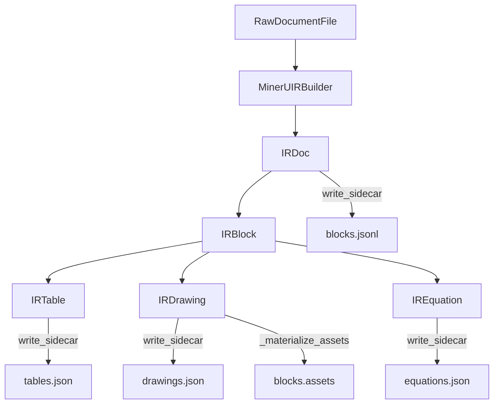
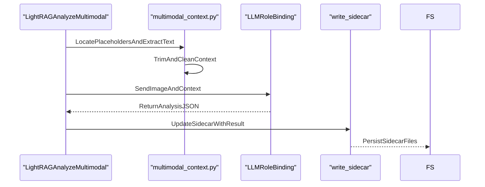
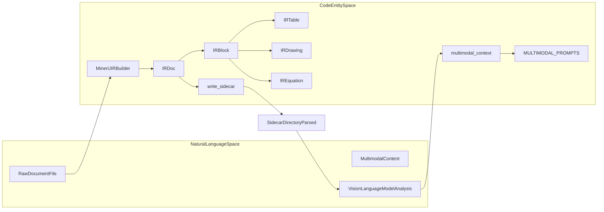

<!-- source: DeepWiki mcp.deepwiki.com · repo HKUDS/LightRAG · page 5.3 Sidecar Format and Multimodal Processing · fetched 2026-11-09 -->

# Sidecar Format and Multimodal Processing

<details>
<summary>Relevant source files</summary>

The following files were used as context for generating this wiki page:

- [docs/LightRAGSidecarFormat-zh.md](docs/LightRAGSidecarFormat-zh.md)
- [docs/LightRAGSidecarFormat.md](docs/LightRAGSidecarFormat.md)
- [lightrag/multimodal_context.py](lightrag/multimodal_context.py)
- [lightrag/parser/_markdown.py](lightrag/parser/_markdown.py)
- [lightrag/parser/docx/table_extractor.py](lightrag/parser/docx/table_extractor.py)
- [lightrag/parser/external/docling/ir_builder.py](lightrag/parser/external/docling/ir_builder.py)
- [lightrag/parser/external/mineru/ir_builder.py](lightrag/parser/external/mineru/ir_builder.py)
- [lightrag/sidecar/ir.py](lightrag/sidecar/ir.py)
- [lightrag/sidecar/writer.py](lightrag/sidecar/writer.py)
- [tests/parser/docx/test_native_docx_extract.py](tests/parser/docx/test_native_docx_extract.py)
- [tests/parser/external/docling/test_ir_builder.py](tests/parser/external/docling/test_ir_builder.py)
- [tests/parser/external/mineru/test_ir_builder.py](tests/parser/external/mineru/test_ir_builder.py)
- [tests/parser/external/mineru/test_parse_mineru_sidecar.py](tests/parser/external/mineru/test_parse_mineru_sidecar.py)
- [tests/parser/test_markdown.py](tests/parser/test_markdown.py)
- [tests/pipeline/test_multimodal_content_truncation.py](tests/pipeline/test_multimodal_content_truncation.py)
- [tests/sidecar/test_writer.py](tests/sidecar/test_writer.py)

</details>


LightRAG employs a "Sidecar" architecture to effectively handle multimodal document content, specifically images, tables, and equations. When leveraging multimodal-capable parsing engines such as `native`, `mineru`, or `docling`, LightRAG separates the document’s textual content from its multimodal objects and metadata. These separated data pieces are stored following a standardized directory and file layout inside a `*.parsed/` directory. This design supports specialized downstream processing including Vision Language Model (VLM) analysis, multimodal context assembly, chunking strategies, entity extraction, and aids in traceable cache management.

## Purpose and Scope

The Sidecar format is the universal internal representation (IR) for multimodal documents within LightRAG. It standardizes how documents are parsed and represented internally to ensure consistency across different parsing engines and pipeline stages. The key purposes are:

- **Clear object separation**: Document body text is stored separately from multimodal objects (images, tables, equations) and metadata, maintaining clean boundaries between data types essential for specialized analysis [docs/LightRAGSidecarFormat-zh.md:3-20]().

- **Traceability and stable referencing**: Unique and stable `blockid`s link vector chunks downstream back to document blocks and multimodal objects for provenance and incremental updates [docs/LightRAGSidecarFormat-zh.md:124-125]().

- **Interoperability of parsing engines**: The Sidecar format acts as a canonical interchange format enabling different parsers (`native`, `mineru`, `docling`) to provide uniform output that feeds into a single RAG pipeline [docs/LightRAGSidecarFormat-zh.md:3-20]().

- **Facilitates multimodal analysis**: Provides well-defined placeholders and data structures facilitating the invocation of LLMs and VLMs for different object types with context [lightrag/sidecar/writer.py:5-20]().

Sources: [docs/LightRAGSidecarFormat-zh.md:1-20](), [lightrag/sidecar/writer.py:1-20]()

---

## The `__parsed__` Directory Layout

When a document is processed, LightRAG creates a sidecar directory for that document inside the workspace:

```text
inputs/space1/__parsed__/<canonical_filename>.parsed/
├── <canonical_filename>.blocks.jsonl       # Main text blocks + meta line
├── <canonical_filename>.drawings.json      # Drawing/image sidecar (keyed by IDs)
├── <canonical_filename>.tables.json         # Table sidecar objects
├── <canonical_filename>.equations.json      # Equation sidecar objects
├── <canonical_filename>.blocks.assets/      # Folder with original image asset files
└── <canonical_filename>.smart_audit.json    # Optional native DOCX smart-heading audit ledger
```

### Description of Sidecar Files

| File                       | Format   | Content & Role                                           |
|----------------------------|----------|---------------------------------------------------------|
| `blocks.jsonl`             | JSONL    | First line is a **meta** line describing document info; each subsequent line is a **content** block representing minimal document "block" units with textual content and embedded placeholders for multimodal objects [docs/LightRAGSidecarFormat-zh.md:40-110](). |
| `drawings.json`            | JSON     | Dictionary keyed by drawing IDs (`im-<hash>-NNNN`) storing image asset references, metadata, captions, and VLM analysis results [docs/LightRAGSidecarFormat-zh.md:151-160](). |
| `tables.json`              | JSON     | Dictionary keyed by table IDs (`tb-<hash>-NNNN`) storing table content either as JSON arrays or HTML, including captions and LLM analysis results [lightrag/sidecar/writer.py:160-166](). |
| `equations.json`           | JSON     | Dictionary keyed by equation IDs (`eq-<hash>-NNNN`) storing LaTeX content and captions, with LLM analysis results [lightrag/sidecar/writer.py:170-180](). |
| `blocks.assets/`           | Folder   | Contains original image asset files (byte contents) referenced by the drawings sidecar [docs/LightRAGSidecarFormat-zh.md:29-37](). |
| `smart_audit.json` (opt.) | JSON     | Audit ledger for native DOCX smart heading processing; not generated by other parsers [docs/LightRAGSidecarFormat-zh.md:14-14](). |

This directory structure cleanly segments concerns and supports incremental processing and caching.

Sources: [docs/LightRAGSidecarFormat-zh.md:22-38](), [lightrag/sidecar/writer.py:60-166]()

---

## Data Flow: From Parser Engines to Sidecar Files

The document ingestion pipeline transforms raw files into the Sidecar IR objects and finally into on-disk sidecar files via the writer component.

- Parser engines like `MinerUIRBuilder` in `lightrag/parser/external/mineru/ir_builder.py` read raw extracted content (e.g., MinerU's `content_list.json` plus images/) and produce an in-memory `IRDoc` data structure representing the document's semantic blocks, tables, images, and equations [lightrag/parser/external/mineru/ir_builder.py:1-163]().

- The `IRDoc` contains `IRBlock` instances which hold block-level text and references to `IRTable`, `IRDrawing`, and `IREquation` objects [lightrag/sidecar/ir.py:33-150]().

- The sidecar writer (`write_sidecar` function) takes the `IRDoc` and serializes it according to the spec, allocating unique IDs (prefixes `tb-`, `im-`, `eq-` per document), computing block IDs as `md5(doc_id:block_index:heading:content)`, writing main block text with embedded placeholders like `{{TBL:...}}`, and materializing image assets into the asset folder [lightrag/sidecar/writer.py:60-166]().

**IRDoc to Sidecar Files and Ids Mapping**



Sources: [lightrag/sidecar/ir.py:1-162](), [lightrag/parser/external/mineru/ir_builder.py:1-163](), [lightrag/sidecar/writer.py:60-166]()

---

## Multimodal Context Assembly and Analysis

### Purpose

To improve downstream LLM and VLM analyses of tables, equations, and images, LightRAG extracts surrounding textual context for each multimodal object within its containing block. This context is used to prompt the language models with relevant descriptive text before or after the object.

### Process Overview

- For each entry in `drawings.json`, `tables.json`, `equations.json`:
  - Locate the matching XML placeholder tag (`<drawing id="..."/>`, `<table id="...">...</table>`, `<equation id="...">...</equation>`) inside the single document block (`blocks.jsonl`) that references the object.
  - Extract `leading` and `trailing` textual content around the placeholder tag without crossing into other blocks.
  - For tables, remove other nested `<table>` tags in the surrounding text to avoid contamination.
  - Strip parser internal attributes (`id`, `path`, `src`, `refid`) from the extracted context but preserve visible citation tags (`<cite>` for images and equations) for disambiguation.
  - Cap the extracted context according to a token budget using recursive splitting by paragraph, sentence, and clause boundaries, falling back to character-level trimming if necessary.
  - This enrichment is stored in the multimodal item's `surrounding` field, containing trimmed `leading` and `trailing` strings [lightrag/multimodal_context.py:1-60]().

### Multimodal Prompt Routing

- Images route to the VLM role which runs a Vision-Language Model for image understanding and captioning.
- Tables and equations route to the EXTRACT role which uses text-based LLM prompts for analysis [lightrag/prompt_multimodal.py:1-224]().

### Budget Management and Truncation

- Image size is pre-checked; images below the `VLM_MIN_IMAGE_PIXEL` threshold (32px) skip VLM to avoid unproductive inference [tests/pipeline/test_pipeline_analyze_multimodal.py:15-18]().

- Large tables or equations exceeding token limits are trimmed by dedicated trimming functions which preserve structural markup but reduce rows or characters while appending truncation markers.

- The extracted context and VLM/LLM outputs (`llm_analyze_result`) are written back to the sidecar JSON files, augmenting the object records with semantic analysis for downstream RAG retrieval [docs/LightRAGSidecarFormat-zh.md:172-179]().

**Multimodal Analysis Pipeline**



Sources: [lightrag/multimodal_context.py:1-179](), [lightrag/prompt_multimodal.py:100-224](), [tests/pipeline/test_pipeline_analyze_multimodal.py:1-20](), [docs/LightRAGSidecarFormat-zh.md:171-179]()

---

## Placeholder Tags: Format and Role

Inside the text blocks stored in `blocks.jsonl`:

| Tag Type    | Format Example                                            | Notes                                                                                                    |
|-------------|------------------------------------------------------------|----------------------------------------------------------------------------------------------------------|
| Table       | `<table id="tb-..." format="json">[...]</table>`          | Stored as JSON array or HTML inside; preserves original whitespace. Referenced in `tables.json` sidecar. |
| Drawing     | `<drawing id="im-..." format="png" path="..." caption="..." src="..." />` | Self-closing tag pointing to an image asset and metadata.                                               |
| Equation    | `<equation id="eq-..." format="latex" caption="...">...</equation>`      | Block-level equations have IDs, inline do not. Inline equations not stored separately.                   |

These tags maintain positional integrity in the text, allowing parsers to embed multimodal references inline without fragmenting the logical text blocks. The writer expands `{{TBL:k}}`, `{{IMG:k}}`, and `{{EQ:k}}` placeholders into these tags with allocated IDs during sidecar serialization [docs/LightRAGSidecarFormat-zh.md:129-140](), [lightrag/sidecar/writer.py:40-110]().

Sources: [docs/LightRAGSidecarFormat-zh.md:129-140](), [lightrag/sidecar/writer.py:40-110]()

---

## Key Classes and Functions

| Symbol                              | Purpose                                                                                                  | Location/Lines                        |
|-----------------------------------|----------------------------------------------------------------------------------------------------------|--------------------------------------|
| `IRDoc`                           | Intermediate Representation of the whole document: blocks, multimodal objects, document-level meta      | `lightrag/sidecar/ir.py:30-176`      |
| `IRBlock`                        | Contains text `content_template` with multimodal placeholders, headings, and multimodal object refs      | `lightrag/sidecar/ir.py:72-127`      |
| `IRTable`, `IRDrawing`, `IREquation` | Represent multimodal objects referencing asset bytes, raw content, captions, metadata                   | `lightrag/sidecar/ir.py:73-161`      |
| `write_sidecar()`                 | Takes an `IRDoc` and writes all sidecar files and asset folders with proper ID allocation and placeholders | `lightrag/sidecar/writer.py:60-166`  |
| `MinerUIRBuilder`                 | Adapter converting MinerU raw files (`content_list.json`) into `IRDoc`                                 | `lightrag/parser/external/mineru/ir_builder.py:112-163` |
| `multimodal_context.find_target_span` | Finds multimodal placeholder tag position in block text for extracting surrounding context             | `lightrag/multimodal_context.py:162-179` |
| `MULTIMODAL_PROMPTS`              | Prompt templates for VLM image analysis, table and equation LLM extraction                              | `lightrag/prompt_multimodal.py:83-224` |
| `build_chunks_dict_from_chunking_result()` | Aggregates chunk data with `llm_cache_list` for deletion and multimodal downstream processing tracking | `lightrag/utils_pipeline.py:43-100`  |

Sources: [lightrag/sidecar/ir.py:30-176](), [lightrag/sidecar/writer.py:60-166](), [lightrag/parser/external/mineru/ir_builder.py:112-163](), [lightrag/multimodal_context.py:162-179]()

---

## Additional Notes

- Sidecar file `document_hash` in the `meta` line of `blocks.jsonl` is calculated as a SHA256 hash of all concatenated non-empty block contents joined by `\n\n`. This aids in external deduplication and validation [docs/LightRAGSidecarFormat-zh.md:53-73]().

- The Sidecar format maintains a stable naming scheme for IDs in `tb-<hash>-NNNN`, `im-<hash>-NNNN`, `eq-<hash>-NNNN` form, where `<hash>` is the document hash and `NNNN` is a zero-padded sequence per object type [lightrag/sidecar/writer.py:9-13]().

- Multimodal surrounding text extraction uses recursive splitting by paragraphs, sentences, and clauses to truncate without losing meaningful boundaries; fallback to character-level trimming prevents exceeding token budgets [lightrag/multimodal_context.py:45-60]().

- Asset files referenced by drawings are materialized on disk inside the `blocks.assets` directory to ensure VLM modules can access original image bytes for analysis [lightrag/sidecar/writer.py:130-135]().

Sources: [docs/LightRAGSidecarFormat-zh.md:53-73](), [lightrag/sidecar/writer.py:9-13](), [lightrag/multimodal_context.py:45-60]()

---

# Summary Diagram: Natural Language Elements to Code Entities and Outputs



Sources: [lightrag/parser/external/mineru/ir_builder.py:1-163](), [lightrag/sidecar/ir.py:30-176](), [lightrag/sidecar/writer.py:60-166](), [lightrag/multimodal_context.py:1-179](), [lightrag/prompt_multimodal.py:83-224]()

---

# References

- Sidecar Format Specification (Chinese): `docs/LightRAGSidecarFormat-zh.md`
- Sidecar Writer Implementation: `lightrag/sidecar/writer.py`
- Sidecar Intermediate Representation: `lightrag/sidecar/ir.py`
- MinerU IR Builder Adapter: `lightrag/parser/external/mineru/ir_builder.py`
- Multimodal Context Extraction: `lightrag/multimodal_context.py`
- Multimodal Prompt Definitions: `lightrag/prompt_multimodal.py`
- Testing Examples for Sidecar Writer: `tests/sidecar/test_writer.py`

Sources: [docs/LightRAGSidecarFormat-zh.md:1-20](), [lightrag/sidecar/writer.py:1-20](), [lightrag/sidecar/ir.py:1-30](), [lightrag/parser/external/mineru/ir_builder.py:1-50](), [lightrag/multimodal_context.py:1-40](), [tests/sidecar/test_writer.py:1-30]()

---

