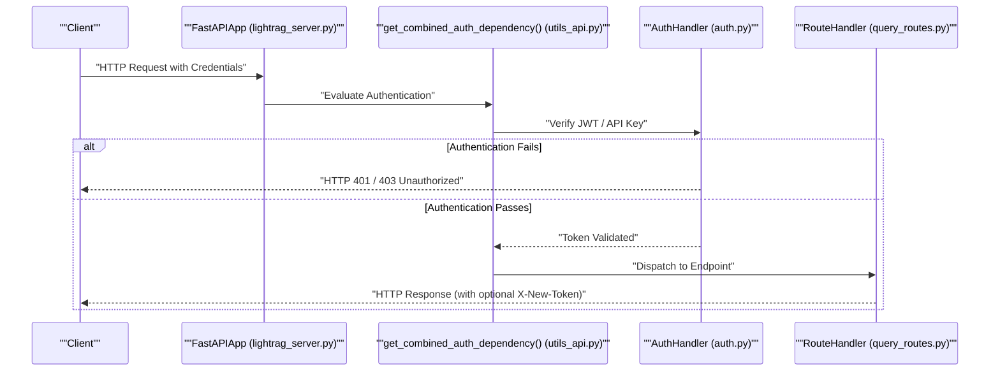

<!-- source: DeepWiki mcp.deepwiki.com · repo HKUDS/LightRAG · page 6 REST API Server · fetched 2026-11-09 -->

# REST API Server

<details>
<summary>Relevant source files</summary>

The following files were used as context for generating this wiki page:

- [docs/LightRAG-API-Server-zh.md](docs/LightRAG-API-Server-zh.md)
- [docs/LightRAG-API-Server.md](docs/LightRAG-API-Server.md)
- [env.docker-compose-full](env.docker-compose-full)
- [env.example](env.example)
- [lightrag/api/config.py](lightrag/api/config.py)
- [lightrag/api/lightrag_server.py](lightrag/api/lightrag_server.py)
- [lightrag/api/utils_api.py](lightrag/api/utils_api.py)
- [lightrag/constants.py](lightrag/constants.py)

</details>


The LightRAG REST API server is a modern FastAPI application (`lightrag_server.py`) that exposes the LightRAG core RAG engine over HTTP endpoints. It offers a comprehensive interface for document ingestion, knowledge graph interaction, and advanced querying while supporting multi-tenant workspaces and robust authentication. Additionally, it provides an Ollama-compatible API emulation layer to facilitate seamless integration with external AI chat frameworks like Open WebUI.

---

## System Overview and Architecture

The server acts as an orchestration and management layer wrapping the core `LightRAG` engine (`lightrag.py`). It handles workspace isolation via HTTP headers, user authentication, routing and request dispatch, and server lifecycle management.

Below is a system architecture diagram bridging natural language concepts to code entities in `lightrag/api/lightrag_server.py` and `lightrag/api/config.py`:

```mermaid
graph TD
    subgraph "NaturalLanguageSpace"
        Client[""WebUI / API Client""]
        Workspace[""Multi-Tenant Workspace Isolation""]
        AuthSystem[""User Authentication & Security""]
    end

    subgraph "CodeEntitySpace"
        FastAPIApp[""FastAPI App (lightrag_server.py)""]
        CreateApp[""create_app() factory""]
        GlobalArgs[""global_args & _GlobalArgsProxy (config.py)""]
        AuthHandler[""AuthHandler & get_combined_auth_dependency (auth.py)""]
        QueryRouter[""create_query_routes() (query_routes.py)""]
        DocRouter[""create_document_routes() (document_routes.py)""]
        GraphRouter[""create_graph_routes() (graph_routes.py)""]
        OllamaRouter[""OllamaAPI router (ollama_api.py)""]
    end

    Client --> FastAPIApp
    FastAPIApp --> CreateApp
    CreateApp --> GlobalArgs
    Workspace -.-> GlobalArgs
    AuthSystem --> AuthHandler
    FastAPIApp --> QueryRouter
    FastAPIApp --> DocRouter
    FastAPIApp --> GraphRouter
    FastAPIApp --> OllamaRouter
```
Sources: [lightrag/api/lightrag_server.py:1-85](), [lightrag/api/config.py:35-50]()

---

## Key Server Components

| Component | Code Entity | Responsibility |
|---|---|---|
| **App Factory** | `create_app` | Initializes FastAPI with all middleware, static file mounts, routers, and configuration [lightrag/api/lightrag_server.py:1-60]() |
| **Global Config** | `global_args` | Stores configuration arguments, embedding creation, and workspace-aware settings [lightrag/api/config.py:35-50]() |
| **Authentication** | `AuthHandler` | Performs JWT token creation/validation, OAuth2 password flow, and API key checking [lightrag/api/auth.py:20-60]() |
| **Workspace Isolation** | `LIGHTRAG-WORKSPACE` header | Multiplexes requests by logical workspace to isolate documents, graphs, and queries [lightrag/api/lightrag_server.py:1-50]() |
| **Ollama Emulation** | `OllamaAPI` | Emulates Ollama-compatible endpoints (`/api/chat`, `/api/generate`) for external chat clients [lightrag/api/routers/ollama_api.py:1-50]() |

Sources: [lightrag/api/lightrag_server.py:1-60](), [lightrag/api/config.py:35-50](), [lightrag/api/auth.py:20-60](), [lightrag/api/routers/ollama_api.py:1-50]()

---

## Server Configuration and Startup

The server derives its configuration from environment variables (loaded via `load_dotenv` in `lightrag/api/lightrag_server.py`) and optionally from CLI arguments parsed in `lightrag/api/config.py`. Variables such as `HOST`, `PORT`, `WORKERS`, and `WEBUI_TITLE` govern server execution.

The critical server initialization occurs within the `create_app` factory, which manages lifespan context (`asynccontextmanager`) to handle shared state initialization and cleanup across multi-worker deployments (such as Gunicorn/Uvicorn).

For full technical details, see the child page: [Server Configuration and Startup](#6.1).

Sources: [lightrag/api/lightrag_server.py:30-105](), [lightrag/api/config.py:35-60](), [env.example:8-30]()

---

## Query, Graph, and Ollama API Routes

The server organizes its HTTP API into specialized routers:
- **Query Routes**: Handles `/query`, `/query/stream`, and batch processing via `create_query_routes` [lightrag/api/routers/query_routes.py:1-30]().
- **Graph Routes**: Manages knowledge graph interactions including subgraphs, labels, and entity/relation editing via `create_graph_routes` [lightrag/api/routers/graph_routes.py:1-40]().
- **Ollama API Emulation**: Mimics Ollama endpoints (`/api/chat`, `/api/generate`) via the `OllamaAPI` class [lightrag/api/routers/ollama_api.py:1-50]().

For further details, refer to the child page: [Query, Graph, and Ollama API Routes](#6.2).

Sources: [lightrag/api/routers/query_routes.py:1-30](), [lightrag/api/routers/graph_routes.py:1-40](), [lightrag/api/routers/ollama_api.py:1-50]()

---

## Authentication and Security

LightRAG secures its API through a layered security model:
1. **JWT Authentication & OAuth2**: Managed by `AuthHandler` supporting token generation, validation, and login rate-limiting (`LoginRateLimiter`) [lightrag/api/auth.py:20-60](), [lightrag/api/login_rate_limit.py:1-30]().
2. **API Key Authentication**: Checks headers against `LIGHTRAG_API_KEY`.
3. **Token Auto-Renewal**: Implements sliding window token renewals via `_renew_token_if_needed` [lightrag/api/utils_api.py:135-175]().
4. **Whitelisting**: Bypasses authentication for designated paths like `/health` and Ollama routes.

Below is a sequence diagram illustrating request processing and authentication dispatch:


Sources: [lightrag/api/utils_api.py:135-175](), [lightrag/api/auth.py:20-60]()

For full technical details, see the child page: [Authentication and Security](#6.3).

---

### Summary and Navigation

This page serves as a high-level overview of the REST API server design in LightRAG. For deeper technical details, please explore the following child pages:
- [Server Configuration and Startup](#6.1)
- [Query, Graph, and Ollama API Routes](#6.2)
- [Authentication and Security](#6.3)

Sources: [lightrag/api/lightrag_server.py:1-105](), [lightrag/api/config.py:35-60](), [lightrag/api/auth.py:20-60]()

---

