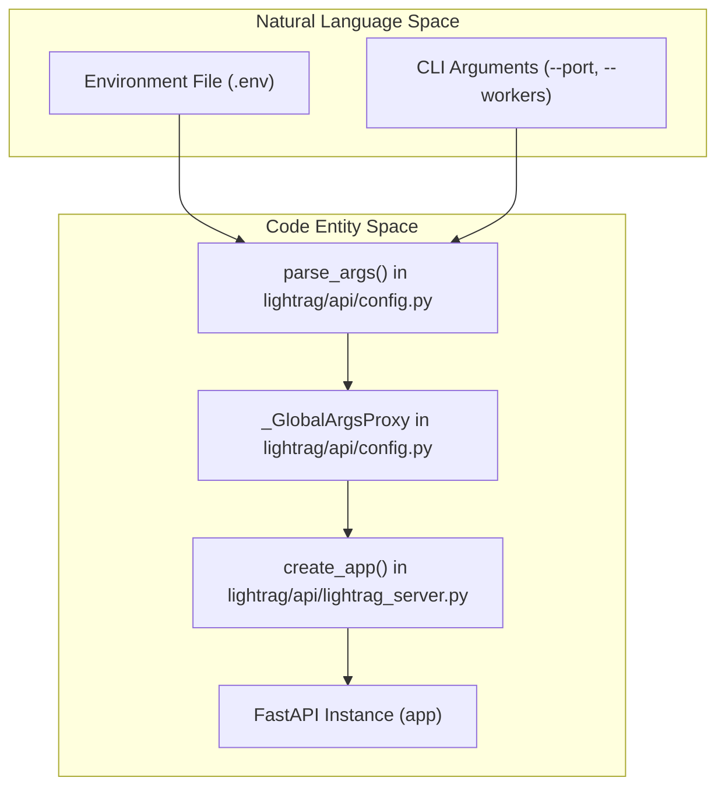
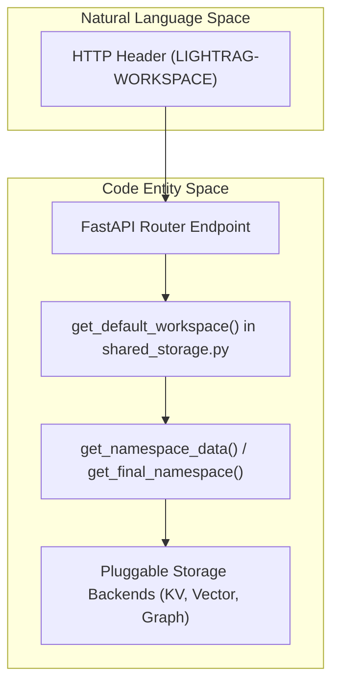

<!-- source: DeepWiki mcp.deepwiki.com · repo HKUDS/LightRAG · page 6.1 Server Configuration and Startup · fetched 2026-11-09 -->

# Server Configuration and Startup

Relevant source files

The following files were used as context for generating this wiki page:

- [docs/ui_templates_example/README.md](docs/ui_templates_example/README.md)
- [env.example](env.example)
- [lightrag/api/config.py](lightrag/api/config.py)
- [lightrag/api/gunicorn_config.py](lightrag/api/gunicorn_config.py)
- [lightrag/api/gunicorn_worker.py](lightrag/api/gunicorn_worker.py)
- [lightrag/api/lightrag_server.py](lightrag/api/lightrag_server.py)
- [lightrag/api/routers/ui_customization_routes.py](lightrag/api/routers/ui_customization_routes.py)
- [lightrag/api/run_with_gunicorn.py](lightrag/api/run_with_gunicorn.py)
- [lightrag/api/ui_customization.py](lightrag/api/ui_customization.py)
- [lightrag/api/utils_api.py](lightrag/api/utils_api.py)
- [lightrag/constants.py](lightrag/constants.py)
- [tests/api/test_gunicorn_worker_orphan_exit.py](tests/api/test_gunicorn_worker_orphan_exit.py)
- [tests/api/test_path_prefixes.py](tests/api/test_path_prefixes.py)
- [tests/api/test_ui_customization.py](tests/api/test_ui_customization.py)

The purpose of this page is to detail the technical architecture, configuration systems, workspace isolation mechanics, multi-process deployment strategies, and UI customization lifecycles of the LightRAG FastAPI server (`lightrag-server`).

---

## 1. Application Factory and Configuration (`create_app`, `_GlobalArgsProxy`, `parse_args`)

The LightRAG API server builds upon a modular application factory pattern. The central entry point is the `create_app` function defined in `lightrag/api/lightrag_server.py`. This function instantiates the `FastAPI` application, wires up middleware, registers routers, and sets up asynchronous lifespan contexts.

Configuration values flow from command-line arguments, environment variables, and `.env` files via `parse_args` and `_GlobalArgsProxy` in `lightrag/api/config.py`.

### Key Configuration Classes and Functions

- **`parse_args()`**: Parses runtime arguments using `argparse`, combining CLI flags, environment variables, and local `.env` values (loaded via `load_dotenv` in `lightrag/api/lightrag_server.py:102-102`() and `lightrag/api/config.py:61-61`()).
- **`_GlobalArgsProxy`**: A lazy-evaluation proxy that wraps parsed arguments to permit deferred property access across modules without premature instantiation [lightrag/api/config.py:338-349]().
- **`create_app(args)`**: Configures the FastAPI instance, root path prefix (`root_path`), CORS middleware (`CORSMiddleware`), body limit middleware, and static asset mounting.

### Diagram: Startup and Configuration Pipeline

Title: "Startup Configuration Flow from Natural Language Space to Code Entity Space"

Sources: `lightrag/api/lightrag_server.py:5-102](), `lightrag/api/config.py:338-349]()

---

## 2. Embedding Function Creation and Asymmetric Binding

Embedding and LLM providers are initialized and bound during server startup. To prevent embedding request starvation or rate-limit violations, LightRAG wraps embedding functions with asynchronous priority limiters.

### Embedding Optimization and Asymmetric Configuration

- **`resolve_asymmetric_embedding_opt_in`**: Resolves whether query and document-aware embedding behavior should be enabled based on provider capabilities (`openai`, `gemini`, `jina`, `voyageai`, etc.) and prefix configurations (`EMBEDDING_QUERY_PREFIX`, `EMBEDDING_DOCUMENT_PREFIX`) [lightrag/api/config.py:96-145]().
- **Concurrency Limiting**: Cross-worker concurrency limits are derived using `_build_global_concurrency_limits` in `lightrag/api/run_with_gunicorn.py:32-59`(), enforcing `EMBEDDING_FUNC_MAX_ASYNC` and role-specific LLM async caps via `priority_limit_async_func_call`.

Sources: `lightrag/api/config.py:96-145](), `lightrag/api/run_with_gunicorn.py:32-59]()

---

## 3. Workspace Isolation and Request Routing

LightRAG supports multi-tenant namespace separation via workspaces. Incoming HTTP requests specify a target workspace through the `LIGHTRAG-WORKSPACE` header.

### Namespace Resolution Flow

When a request arrives, the server resolves the workspace and combines it with storage namespaces (KV, vector, graph, and doc status) to isolate data partitions.

### Diagram: Workspace Routing and Namespace Resolution

Title: "Workspace Resolution from HTTP Request to Storage Namespaces"

Sources: `lightrag/kg/shared_storage.py:84-92]()

---

## 4. Server Lifespan, Gunicorn, and Uvicorn Deployment

LightRAG supports two primary operational modes: single-process development via Uvicorn and multi-process production via Gunicorn.

### Gunicorn Multi-Worker Deployment

- **`run_with_gunicorn.py`**: The production CLI script that validates environment settings, checks macOS Objective-C fork safety (`OBJC_DISABLE_INITIALIZE_FORK_SAFETY=YES`), and invokes Gunicorn's `BaseApplication` runner [lightrag/api/run_with_gunicorn.py:62-232]().
- **`gunicorn_config.py`**: Configures worker classes (`LightRAGUvicornWorker`), preloading (`preload_app = True`), rotating file logs, and lifecycle hooks (`on_starting`, `on_exit`, `post_fork`) [lightrag/api/gunicorn_config.py:31-163]().
- **Orphaned Worker Protection**: `LightRAGUvicornWorker` extends `UvicornWorker` to check parent process IDs (`ppid`), issuing graceful shutdown signals if the Gunicorn master process terminates unexpectedly [tests/api/test_gunicorn_worker_orphan_exit.py:1-116]().

Sources: `lightrag/api/run_with_gunicorn.py:62-232](), `lightrag/api/gunicorn_config.py:31-164](), `tests/api/test_gunicorn_worker_orphan_exit.py:1-117]()

---

## 5. UI Customization Bundle

Operators can inject custom branding, welcome pages, query empty-state descriptions, login blurbs, and user agreements via an external filesystem directory pointed to by `UI_TEMPLATES_DIR`.

### Validation and Snapshot Semantics

- **Strict Validation**: The server validates the entire bundle directory at startup by inspecting `manifest.json`. Missing required fields (such as `brand.logo` or locale-specific markdown files) trigger a `UICustomizationError` and halt server startup, preventing silent fallbacks to default branding [lightrag/api/ui_customization.py:1-110](), [docs/ui_templates_example/README.md:1-94]().
- **Immutable Snapshot**: Validated template bundles are loaded into an immutable in-memory snapshot (`UICustomizationSnapshot`), avoiding disk reads during request handling [lightrag/api/ui_customization.py:1-8]().

Sources: `lightrag/api/ui_customization.py:1-152](), `docs/ui_templates_example/README.md:1-95]()

---

