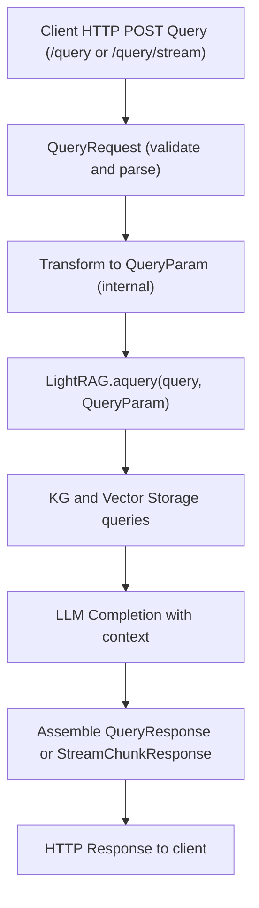
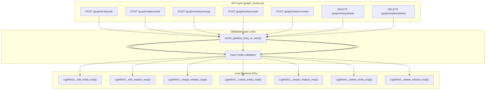
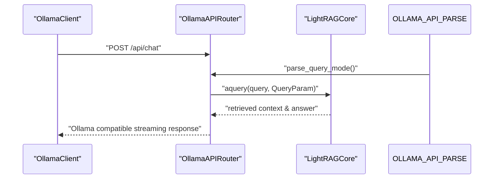
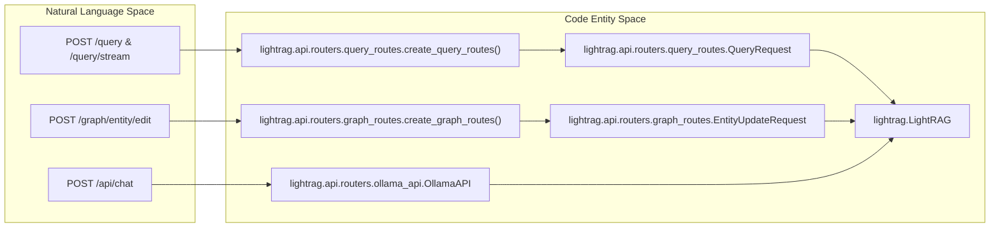

<!-- source: DeepWiki mcp.deepwiki.com · repo HKUDS/LightRAG · page 6.2 Query, Graph, and Ollama API Routes · fetched 2026-11-09 -->

# Query, Graph, and Ollama API Routes

Relevant source files

The following files were used as context for generating this wiki page:

- [docs/ProgramingWithCore.md](docs/ProgramingWithCore.md)
- [lightrag/api/input_limits.py](lightrag/api/input_limits.py)
- [lightrag/api/routers/graph_routes.py](lightrag/api/routers/graph_routes.py)
- [lightrag/api/routers/ollama_api.py](lightrag/api/routers/ollama_api.py)
- [lightrag/api/routers/query_routes.py](lightrag/api/routers/query_routes.py)
- [lightrag/query_validation.py](lightrag/query_validation.py)
- [lightrag/utils_graph.py](lightrag/utils_graph.py)
- [lightrag_webui/src/utils/queryValidation.test.ts](lightrag_webui/src/utils/queryValidation.test.ts)
- [lightrag_webui/src/utils/queryValidation.ts](lightrag_webui/src/utils/queryValidation.ts)
- [tests/api/routes/test_graph_routes_pipeline_busy.py](tests/api/routes/test_graph_routes_pipeline_busy.py)
- [tests/api/routes/test_ollama_input_limits.py](tests/api/routes/test_ollama_input_limits.py)
- [tests/api/test_ollama_query_mode.py](tests/api/test_ollama_query_mode.py)
- [tests/extraction/test_vdb_content_truncation_coverage.py](tests/extraction/test_vdb_content_truncation_coverage.py)
- [tests/kg/json_impl/test_json_commit_reconciliation.py](tests/kg/json_impl/test_json_commit_reconciliation.py)
- [tests/kg/networkx_impl/test_networkx_commit_gate.py](tests/kg/networkx_impl/test_networkx_commit_gate.py)
- [tests/kg/networkx_impl/test_networkx_index_done.py](tests/kg/networkx_impl/test_networkx_index_done.py)
- [tests/pipeline/test_admin_write_gate.py](tests/pipeline/test_admin_write_gate.py)
- [tests/pipeline/test_content_hash_normalization.py](tests/pipeline/test_content_hash_normalization.py)
- [tests/pipeline/test_document_file_path_normalization.py](tests/pipeline/test_document_file_path_normalization.py)
- [tests/pipeline/test_graph_deletion_tracking_ordering.py](tests/pipeline/test_graph_deletion_tracking_ordering.py)
- [tests/pipeline/test_graph_keyed_locks.py](tests/pipeline/test_graph_keyed_locks.py)
- [tests/pipeline/test_graph_merge_rename_tracking_order.py](tests/pipeline/test_graph_merge_rename_tracking_order.py)
- [tests/test_query_validation.py](tests/test_query_validation.py)
- [tests/utils/test_deferred_cancellation_stamp.py](tests/utils/test_deferred_cancellation_stamp.py)

This section documents the REST API routes in the LightRAG Server related to query handling, knowledge graph management, and the Ollama API emulation. It details the implementation, data flow, input constraints, route organization, and important functionalities such as token budgeting and workspace isolation. All routes are implemented dynamically in factory functions to avoid duplications and to maintain workspace isolation in multi-tenant or testing environments.

Sources:  
[lightrag/api/routers/query_routes.py:1-174]()  
[lightrag/api/routers/graph_routes.py:1-170]()  
[lightrag/api/routers/ollama_api.py:1-219]()

---

## Query Endpoints

### Overview

The query routes accept natural language queries and perform retrieval-augmented generation (RAG), interacting with the core LightRAG engine to return answers formed from knowledge graph and vector document contexts.

There are three main query endpoints:

- `POST /query` - standard, non-streaming query response with generated text and references.
- `POST /query/stream` - streaming NDJSON response suited for client-side progressive rendering.
- `POST /query/data` - detailed response that includes all internal retrieval data (entities, relations, chunks) without LLM generation, useful for debugging or evaluation.

All utilize the shared input model `QueryRequest`, which translates API parameters into internal query controls including retrieval modes, token budgets, and keyword hints.

### QueryRequest Model Highlights

The `QueryRequest` Pydantic model validates and shapes requests. Key fields include:

| Parameter | Type | Description |
|---|---|---|
| `query` | `str` | Natural language input query; non-empty, max length enforced. |
| `mode` | Enum `["local", "global", "hybrid", "naive", "mix", "bypass"]` | Defines retrieval mode: local entity, global relation, hybrid, etc. |
| `top_k` | `int` | Limits number of top entities (local mode) or relations (global mode) to retrieve. |
| `chunk_top_k` | `int` | Number of text chunks to retrieve from vector store before reranking. |
| `max_entity_tokens`, `max_relation_tokens`, `max_total_tokens` | `int` | Token budget allocations for entity context, relation context, and overall combined token budget. |
| `hl_keywords`, `ll_keywords` | `List[str]` | Optional keywords used to bias retrieval; LLM generates if left empty. |
| `conversation_history` | `Optional[List[Dict[str, Any]]]` | Chat message history passed for context (not used in retrieval). |
| `only_need_context`, `only_need_prompt` | `bool` | Flags to return only retrieval context or the prompt without generation. |
| `include_references`, `include_chunk_content` | `bool` | Controls inclusion of source references and chunk text in responses. |
| `enable_rerank` | `bool` | Whether to rerank retrieved chunks (default true). |
| `stream` | `bool` | Enables streaming responses (`/query/stream`). |

Detailed validation enforces input size limits, token budget constraints, and interaction consistency via modules like `lightrag.query_validation`.

### Query Request Flow Diagram

Title: "Query Request Flow from Client to Engine"

Sources:  
[lightrag/api/routers/query_routes.py:30-170]()  
[lightrag/query_validation.py:1-136]()

---

## Graph Management Routes

### Overview

These routes allow clients to inspect, search, and modify the knowledge graph (KG) underlying LightRAG. They cover listing entity labels, retrieving subgraphs, and editing or creating graph nodes (entities) and edges (relations).

Graph routes enforce a pipeline-busy check via `check_pipeline_busy_or_raise()` to prevent conflicts during background indexing operations. Combined authentication is required for all sensitive graph mutation endpoints.

### Graph Mutation Endpoints and Models

LightRAG exposes detailed request models for modifying KG entities and relations:

| HTTP Method | Path | Request Model | Purpose |
|---|---|---|---|
| `POST` | `/graph/entity/edit` | `EntityUpdateRequest` | Edit entity fields or optionally rename. |
| `POST` | `/graph/relation/edit` | `RelationUpdateRequest` | Edit relation attributes. |
| `POST` | `/graph/entities/merge` | `EntityMergeRequest` | Merge duplicate entities into a target one. |
| `POST` | `/graph/entity/create` | `EntityCreateRequest` | Create a new entity node with specified data. |
| `POST` | `/graph/relation/create` | `RelationCreateRequest` | Create a new relation edge between entities. |
| `DELETE` | `/graph/entity/delete` | `DeleteEntityRequest` | Delete entity by name. |
| `DELETE` | `/graph/relation/delete` | `DeleteRelationRequest` | Delete relation between two specified entities. |

All mutation requests validate the input, including non-empty entity names, permissible fields, and safe attribute values according to backend compatibility, enforcing validations via `utils_graph._sanitize_graph_fields` and other validation helpers [lightrag/utils_graph.py:58-155]().

### Graph Modification Route Flowchart

Title: "Graph Modification Execution Flow"

Sources:  
[lightrag/api/routers/graph_routes.py:76-170]()  
[lightrag/utils_graph.py:58-155]()

---

## Ollama API Emulation

### Purpose

LightRAG provides an emulation of the Ollama API to be compatible with clients expecting that ecosystem, such as Open WebUI. This lets LightRAG replace Ollama as an LLM backend transparently.

### Main Features

- Implements key Ollama endpoints:
  - `POST /api/chat`
  - `POST /api/generate`
  - `GET /api/tags`
  - `GET /api/version`
  - `GET /api/ps`
- Supports payloads with messages modeled as `OllamaMessage` and `OllamaChatRequest` or generation prompts via `OllamaGenerateRequest` [lightrag/api/routers/ollama_api.py:88-146]().
- Parses search modes from query prefixes (e.g. `/local`, `/global`, `/hybrid`, `/context`) [lightrag/api/routers/ollama_api.py:35-43]().
- Enforces input size limits and aggregates character counts before querying LLM or retrieval [lightrag/api/routers/ollama_api.py:79-86]().

### Illustration: Ollama Query Mode Parsing and Request Processing

Title: "Ollama API Emulation Flow"

Sources:  
[lightrag/api/routers/ollama_api.py:35-146]()

---

## Input Limits and Token Budgeting

To maintain service stability and predictable resource usage, input requests are subjected to rigorous constraints including:

- Maximum allowed characters per query, message, role, and request text.
- Maximum number of messages and keywords per request (`MAX_KEYWORDS_PER_LIST`, `MAX_MESSAGES_PER_REQUEST`).
- Unified token budget limits (`MAX_QUERY_TOKEN_BUDGET`) that constrain entity tokens, relation tokens, and overall context size [lightrag/api/routers/query_routes.py:76-95]().
- Validation errors return HTTP 400 with detailed messages, while payload too large errors return HTTP 413 [lightrag/api/routers/ollama_api.py:45-51]().

Sources:  
[lightrag/api/routers/query_routes.py:76-95]()  
[lightrag/api/routers/ollama_api.py:45-86]()

---

## API Path Prefixes and Workspace Isolation

- The FastAPI app respects an optional `api_prefix` parameter configured at startup, mapping all routes to a specified subpath without breaking OpenAPI specs or route logic.
- Workspace-specific isolation is enforced by workspace headers or directory scoping, ensuring queries and graph edits affect only scoped data.

Sources:  
[lightrag/api/routers/query_routes.py:10-25]()

---

# Bridge Diagrams: Natural Language Space to Code Entity Space

Title: "Natural Language to Code Entity Bridge for Query and Graph Routes"

Sources:  
[lightrag/api/routers/query_routes.py:30-40]()  
[lightrag/api/routers/graph_routes.py:76-97]()  
[lightrag/api/routers/ollama_api.py:109-125]()

---

