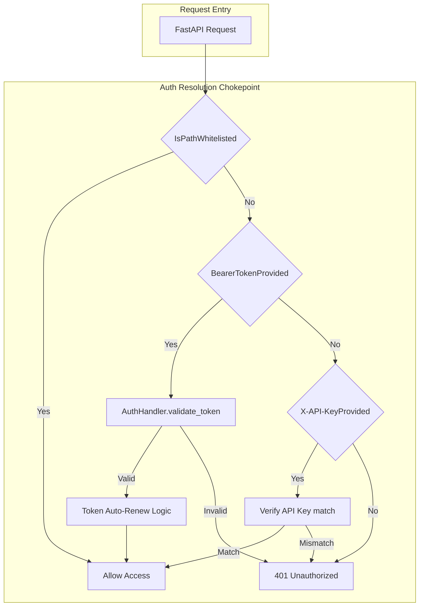
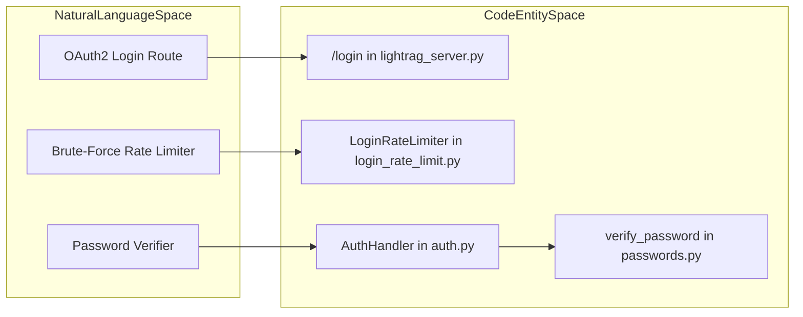
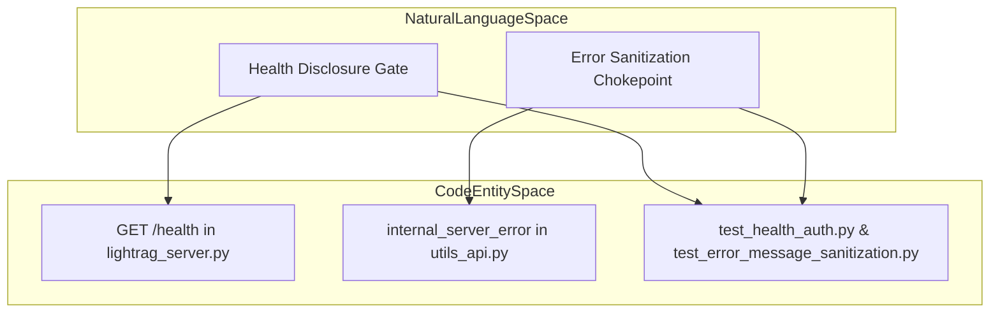

<!-- source: DeepWiki mcp.deepwiki.com · repo HKUDS/LightRAG · page 6.3 Authentication and Security · fetched 2026-11-09 -->

# Authentication and Security

Relevant source files

The following files were used as context for generating this wiki page:

- [lightrag/api/auth.py](lightrag/api/auth.py)
- [lightrag/api/login_rate_limit.py](lightrag/api/login_rate_limit.py)
- [lightrag/api/passwords.py](lightrag/api/passwords.py)
- [lightrag/tools/hash_password.py](lightrag/tools/hash_password.py)
- [tests/api/auth/test_auth.py](tests/api/auth/test_auth.py)
- [tests/api/auth/test_login_rate_limit.py](tests/api/auth/test_login_rate_limit.py)
- [tests/api/config/test_ollama_think_startup_validation.py](tests/api/config/test_ollama_think_startup_validation.py)
- [tests/api/routes/test_login_route.py](tests/api/routes/test_login_route.py)
- [tests/api/test_ai_content_notice.py](tests/api/test_ai_content_notice.py)
- [tests/api/test_api_docs_toggle.py](tests/api/test_api_docs_toggle.py)
- [tests/api/test_cors.py](tests/api/test_cors.py)
- [tests/api/test_embedding_model_required.py](tests/api/test_embedding_model_required.py)
- [tests/api/test_error_message_sanitization.py](tests/api/test_error_message_sanitization.py)
- [tests/api/test_health_auth.py](tests/api/test_health_auth.py)

This section details LightRAG's authentication and security architecture implemented in its FastAPI server. It covers the JWT-based `AuthHandler`, OAuth2 password flow, API key authentication, request path whitelisting, token auto-renew strategy, login rate limiting mechanisms, password hashing, error message sanitization, and key health auth tests verifying secure exposure of sensitive configuration data.

---

## Authentication Mechanisms

LightRAG supports multiple authentication methods ensuring flexible and secure access control. The central coordination point is the combined authentication handler that evaluates incoming headers and request paths.

### 1. JWT-Based Authentication (OAuth2 Password Flow)

- **AuthHandler**: The `AuthHandler` class encapsulates core JWT token lifecycle operations such as token creation, validation, and user password verification. It initializes from configured user credentials (via `AUTH_ACCOUNTS`) and enforces cryptographic security constraints, such as requiring an explicit secret and disallowing the `none` algorithm [lightrag/api/auth.py:50-73]().
- **TokenPayload**: Defines the JWT payload schema via Pydantic, incorporating the `sub` username claim, `exp` expiration time, user `role` (defaulting to `"user"`), and a `metadata` dictionary [lightrag/api/auth.py:43-48]().
- **Login Endpoint**: Users authenticate by POSTing to `/login` using form data containing `username` and `password`. Password verification is offloaded using `asyncio.to_thread` to prevent blocking the event loop during computationally expensive bcrypt hashing operations [tests/api/routes/test_login_route.py:164-188]().
- **Roles & Expiry**: Tokens carry role information supporting distinct token expiration policies for regular users versus guests [lightrag/api/auth.py:71-72]().

### 2. API Key Authentication (`X-API-Key` Header)

- Static API key authentication is supported via the `X-API-Key` request header, validated against the `LIGHTRAG_API_KEY` configuration argument.
- This mechanism is tailored for programmatic clients, automated workflows, and CI/CD pipelines.

### 3. Whitelist Paths

- Specific routes can bypass authentication by matching paths configured in `WHITELIST_PATHS` (such as `/health` or wildcard prefixes like `/api/*`) [tests/api/test_health_auth.py:39]().

Sources: [lightrag/api/auth.py:43-152](), [tests/api/routes/test_login_route.py:164-188]()

---

## Authentication Resolution Logic

The combined authentication mechanism determines access privileges per request based on whitelists, bearer tokens, or API keys.

Diagram: Authentication Resolution Flow

- Whitelisted paths bypass credential checks entirely.
- Bearer tokens are validated against the JWT secret, triggering optional auto-renewal headers.
- Requests lacking bearer tokens fall back to validating the `X-API-Key` header.

Sources: [lightrag/api/auth.py:50-70](), [tests/api/test_health_auth.py:1-197]()

---

## JWT Token Management and Auto-Renewal

LightRAG implements sliding-window token management to support active client sessions.

- **Expiration Windows**: Expiration timestamps are derived from `token_expire_hours` and `guest_token_expire_hours`.
- **Auto-Renewal Threshold**: Tokens nearing half of their total lifespan trigger automatic renewal when enabled.
- **Response Headers**: Renewed tokens are returned in the `X-New-Token` HTTP response header.
- **Caching & Exclusions**: Renewal checks utilize an in-memory cache to prevent excessive header generation, and high-frequency polling routes are excluded from renewal overhead [lightrag/api/auth.py:1-152]().

Sources: [lightrag/api/auth.py:1-152]()

---

## Password Hashing and Verification

- Passwords can be stored as plaintext or using explicit bcrypt hashes designated by the `{bcrypt}` prefix [lightrag/api/passwords.py:1-34]().
- **Timing Attack Mitigation**: `AuthHandler.verify_password` and `verify_password` in `passwords.py` ensure uniform execution time across all code paths (unknown users, plaintext accounts, and bcrypt accounts) by executing dummy bcrypt verifications when necessary, preventing username enumeration (CWE-208) [lightrag/api/auth.py:17-147]().
- **Constant-Time Comparison**: Plaintext comparisons use `hmac.compare_digest` to avoid short-circuit length leaks [lightrag/api/passwords.py:28-34]().

Sources: [lightrag/api/auth.py:17-147](), [lightrag/api/passwords.py:1-34]()

---

## Login Rate Limiting

Brute-force protection on `/login` is provided by an in-memory sliding-window rate limiter keyed by client IP and username [lightrag/api/login_rate_limit.py:1-37]().

- **Dual-State Tracking**: Tracks confirmed failure timestamps (`failures`) alongside in-flight request reservations (`pending`) to prevent TOCTOU race conditions [lightrag/api/login_rate_limit.py:6-16]().
- **Bounded Memory**: Limits tracked keys using an `OrderedDict` with eviction logic that protects active lockouts from denial-of-service clearing attacks [lightrag/api/login_rate_limit.py:29-36]().
- **Lifecycle**: Requests invoke `reserve_attempt` before processing, followed by `commit_failure` or `reset`, and always conclude with `release` [lightrag/api/login_rate_limit.py:18-20]().

Sources: [lightrag/api/login_rate_limit.py:1-155]()

---

## Health Endpoint and Authenticated Configuration Disclosure

- The `/health` endpoint serves unauthenticated liveness probes with an HTTP 200 response [tests/api/test_health_auth.py:1-17]().
- Sensitive runtime details (filesystem paths, backend connection strings, and full configuration dictionaries) are strictly gated and disclosed only to authenticated callers [tests/api/test_health_auth.py:1-17]().

Sources: [tests/api/test_health_auth.py:1-197]()

---

## Error Message Sanitization

- To prevent internal infrastructure details (database hosts, file paths, and credentials) from leaking to clients (CWE-209), API handlers funnel internal errors through an `internal_server_error` chokepoint [tests/api/test_error_message_sanitization.py:1-28]().
- Exception strings are stripped, replaced with generic messages, and tagged with a fresh correlation ID for server-side debugging [tests/api/test_error_message_sanitization.py:96-116]().

Sources: [tests/api/test_error_message_sanitization.py:1-211]()

---

## Code Entity Relationships

The following diagrams bridge natural language security concepts to their corresponding code components.

Diagram: Natural Language to Code Entity Space - Auth Subsystem

Diagram: Natural Language to Code Entity Space - Verification & Security Chokepoints

Sources: [lightrag/api/auth.py:50-152](), [lightrag/api/login_rate_limit.py:69-155](), [lightrag/api/passwords.py:15-34](), [tests/api/test_health_auth.py:1-197](), [tests/api/test_error_message_sanitization.py:96-116]()

---

## Summary Table of Key Security Files & Classes

| File | Key Class / Function | Responsibility |
| :--- | :--- | :--- |
| `lightrag/api/auth.py` | `AuthHandler`, `TokenPayload` | JWT generation, validation, and user authentication management |
| `lightrag/api/passwords.py` | `verify_password`, `hash_password` | Bcrypt hashing and constant-time plaintext verification |
| `lightrag/api/login_rate_limit.py` | `LoginRateLimiter` | Sliding-window brute force protection and IP/user rate throttling |
| `lightrag/api/utils_api.py` | `internal_server_error` | Sanitizing internal exceptions into correlation-tracked 500 responses |
| `tests/api/test_health_auth.py` | Test suite | Validating conditional configuration exposure on `/health` |

Sources: [lightrag/api/auth.py:43-152](), [lightrag/api/login_rate_limit.py:69-155](), [lightrag/api/passwords.py:1-34](), [tests/api/test_health_auth.py:1-197]()

---

