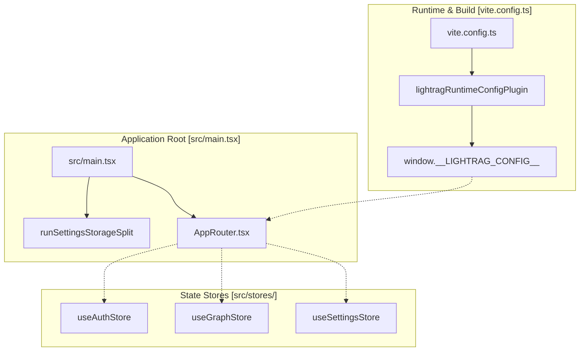
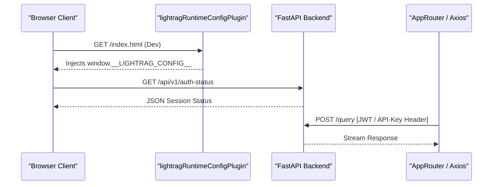

<!-- source: DeepWiki mcp.deepwiki.com · repo HKUDS/LightRAG · page 7 Web UI (lightrag_webui) · fetched 2026-11-09 -->

# Web UI (lightrag_webui)

Relevant source files

The following files were used as context for generating this wiki page:

- [lightrag_webui/.env.development](lightrag_webui/.env.development)
- [lightrag_webui/bun.lock](lightrag_webui/bun.lock)
- [lightrag_webui/env.development.smaple](lightrag_webui/env.development.smaple)
- [lightrag_webui/env.local.sample](lightrag_webui/env.local.sample)
- [lightrag_webui/eslint.config.js](lightrag_webui/eslint.config.js)
- [lightrag_webui/package.json](lightrag_webui/package.json)
- [lightrag_webui/src/components/retrieval/ChatMessage.tsx](lightrag_webui/src/components/retrieval/ChatMessage.tsx)
- [lightrag_webui/src/components/ui/Table.tsx](lightrag_webui/src/components/ui/Table.tsx)
- [lightrag_webui/src/index.css](lightrag_webui/src/index.css)
- [lightrag_webui/src/main.tsx](lightrag_webui/src/main.tsx)
- [lightrag_webui/src/vite-env.d.ts](lightrag_webui/src/vite-env.d.ts)
- [lightrag_webui/tailwind.config.js](lightrag_webui/tailwind.config.js)
- [lightrag_webui/vite.config.ts](lightrag_webui/vite.config.ts)

The `lightrag_webui` is a modern, responsive React/TypeScript frontend designed to provide a comprehensive interface for managing documents, exploring knowledge graphs, and testing retrievals in LightRAG. Architected as a Single Page Application (SPA), it decouples view rendering from state management and backend communication.

For details on specific features, see the child pages:
- [Document Manager UI](#7.1)
- [Knowledge Graph Viewer](#7.2)
- [Retrieval Testing and Settings UI](#7.3)
- [Workspace Entry, Login, and Storage Migrations](#7.4)

---

## Overview and Tech Stack

The Web UI relies on a robust frontend ecosystem configured for high performance, maintainability, and strict typing:

- **Framework & Language:** React 19 with TypeScript [lightrag_webui/package.json:58-59]() for typed component hierarchies.
- **Build Tool:** Vite [lightrag_webui/package.json:114]() handles compilation and asset bundling, incorporating custom plugins for runtime configuration injection.
- **State Management:** Zustand [lightrag_webui/package.json:81]() manages lightweight global states (authentication, graphs, settings).
- **Graph Rendering:** Sigma.js [lightrag_webui/package.json:75]() and Graphology [lightrag_webui/package.json:47]() deliver performant, WebGL-accelerated interactive graph views.
- **Styling:** Tailwind CSS v4 [lightrag_webui/package.json:110]() with Radix UI primitives [lightrag_webui/package.json:20-30]() for accessible design systems.
- **Internationalization:** i18next [lightrag_webui/package.json:53]() provides multi-language localization support.

*Sources:* [lightrag_webui/package.json:47-114](), [lightrag_webui/src/main.tsx:1-5](), [lightrag_webui/vite.config.ts:27-43]()

---

## Communication and Runtime Configuration

The frontend communicates with the FastAPI backend via Axios-based REST calls [lightrag_webui/package.json:43](). To support multi-site reverse proxies and custom path prefixes without requiring per-site builds, the application resolves its routing endpoints dynamically at runtime.

- **Runtime Configuration Injection:** In development mode, the Vite plugin `lightragRuntimeConfigPlugin` injects `window.__LIGHTRAG_CONFIG__` into `index.html` [lightrag_webui/vite.config.ts:27-43](). This mirrors the FastAPI backend's production request-time injection mechanism.
- **Migration Startup:** The application evaluates settings storage migrations (`runSettingsStorageSplit`) synchronously before any store module is parsed [lightrag_webui/src/main.tsx:1-4]().

*Sources:* [lightrag_webui/vite.config.ts:27-43](), [lightrag_webui/src/main.tsx:1-4]()

---

## Sub-Topics and Child Pages

### 7.1 Document Manager UI
Handles the document ingestion lifecycle, tracking status, batch uploads, error recovery, and polling queues.
- For details, see [Document Manager UI](#7.1).

### 7.2 Knowledge Graph Viewer
Renders interactive graph structures using Sigma.js and Graphology, providing sub-graph search, spatial layouts, and node property inspection.
- For details, see [Knowledge Graph Viewer](#7.2).

### 7.3 Retrieval Testing and Settings UI
Powers query execution across query modes with real-time streaming responses, Markdown/KaTeX/Mermaid rendering via `ChatMessage`, and user preference management.
- For details, see [Retrieval Testing and Settings UI](#7.3).

### 7.4 Workspace Entry, Login, and Storage Migrations
Manages workspace initialization, credential verification, identity checks, and `localStorage` schema migrations for split settings.
- For details, see [Workspace Entry, Login, and Storage Migrations](#7.4).

---

